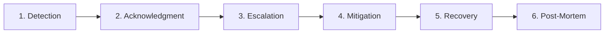

# ACREVIA — STAGE 08 INCIDENT RESPONSE POLICY & CLASSIFICATION FRAMEWORK

**Programme:** ACREVIA Stage-Wise Finalization Programme  
**Target Stage:** Stage 08 — Production Hardening, End-to-End Validation & Observability  
**Document Classification:** OPERATIONAL GOVERNANCE POLICY  
**Scope:** Production Platform & SRE Operations  
**Date:** November 2026  

---

## 1. Executive Summary & Purpose

The ACREVIA Incident Response Policy defines standardized operational protocols for identifying, classifying, mitigating, and documenting production incidents. In agricultural intelligence operations, system reliability directly impacts smallholder farmer livelihoods, crop disease prevention timing, and chemical spray safety.

This policy establishes strict Service Level Agreements (SLAs), clear command escalation paths, and a blameless post-mortem culture focused on continuous platform resilience.

---

## 2. Incident Severity Classification Matrix

| Severity Level | Definition & Criteria | Target Response SLA | Target Mitigation SLA | Primary Escalation Path |
|---|---|---|---|---|
| **`SEV1` (Critical)** | Complete platform outage; active data security breach or PII leak; database corruption; false chemical dosage advisory that could cause crop destruction or human toxicity. | **$< 15\text{ minutes}$** | **$< 2\text{ hours}$** | Incident Commander, Lead SRE, Principal Architect, Head of Agriculture |
| **`SEV2` (Major)** | Major core subsystem down (e.g. ML inference offline, expert consultation queue locked, payment/ledger failure, database read-only); multi-tenant access anomalies. | **$< 30\text{ minutes}$** | **$< 4\text{ hours}$** | Lead SRE, Domain Backend Engineer, ML Ops Engineer |
| **`SEV3` (Moderate)** | Partial feature degradation with viable workaround (e.g. slow KrishiBrain RAG queries, weather API timeout with PJTSAU fallback active, voice adapter failure degrading to keyboard). | **$< 2\text{ hours}$** | **$< 24\text{ hours}$** | On-Call Software Engineer, QA Lead |
| **`SEV4` (Minor)** | Minor non-blocking defect; cosmetic UI rendering glitch; vernacular translation typo; non-critical telemetry reporting delay. | **$< 8\text{ hours}$** | Next Sprint / Scheduled Release | Assigned Engineering Team |

---

## 3. Incident Lifecycle & Workflow

The lifecycle of any production incident follows six formal phases:

1. **Detection:** Automated monitoring alerts (Prometheus / CloudWatch), synthetic health probes, or authenticated farmer support reports.
2. **Acknowledgment:** On-call engineer acknowledges the page within the response SLA window and verifies symptom legitimacy.
3. **Escalation & Role Assignment:** For SEV1 and SEV2 incidents, an **Incident Commander (IC)** is designated to coordinate technical investigations, maintain the incident timeline, and manage stakeholder updates.
4. **Mitigation:** Priority is strictly focused on restoring service availability and data safety over determining root cause. Mitigations include rolling back bad deployments, spinning up recovery database branches, or toggling feature flags.
5. **Recovery & Verification:** Health probes verify normal latencies and zero error rates. Automated regression tests confirm that core farmer workflows (observations, diagnoses, alerts) operate cleanly.
6. **Post-Mortem & Blameless PIR:** A formal Post-Incident Review document is generated within 48 hours for all SEV1 and SEV2 events.

---

## 4. Communication & Stakeholder Transparency

- **Internal Status Updates:** The Incident Commander provides structured updates every 30 minutes for SEV1 incidents via an emergency incident bridge channel.
- **Farmer & Agronomist Advisories:** If an incident affects user-facing services for $> 15\text{ minutes}$, a localized status banner is displayed in the PWA in Telugu, Hindi, and English:
  > *"ACREVIA is currently undergoing brief emergency maintenance. Your recorded offline field scouting observations are safely preserved on your phone and will automatically synchronize once services resume."*
- **Regulatory Disclosure:** Under India's Digital Personal Data Protection (DPDP) Act, 2023, any verified unauthorized personal data access must be formally evaluated for regulatory notification within the statutory timeline.

---

## 5. Blameless Post-Incident Review (PIR) Protocol

All SEV1 and SEV2 incidents require a formal Post-Incident Review (PIR) meeting within two business days. The review is strictly blameless and focuses on structural improvements:
1. **Chronological Timeline:** Precise minute-by-minute reconstruction based on correlation IDs and log timestamps.
2. **Root Cause Analysis (5 Whys):** Identifying underlying architectural, testing, or process failures.
3. **Corrective Action Items:** Every action item must be assigned an owner, an issue tracker ticket, and a target release milestone.
4. **Preventative Automation:** Creating automated tests or chaos injection scenarios to prevent identical recurrence.

---

## 6. Policy Sign-Off

**Incident Response Policy Verdict:** **`APPROVED & RATIFIED`**  
This policy governs all operational tiers across the ACREVIA platform.

*Ratified by: Principal Software Architect, Site Reliability Lead, and Technical Release Manager — ACREVIA Programme.*
