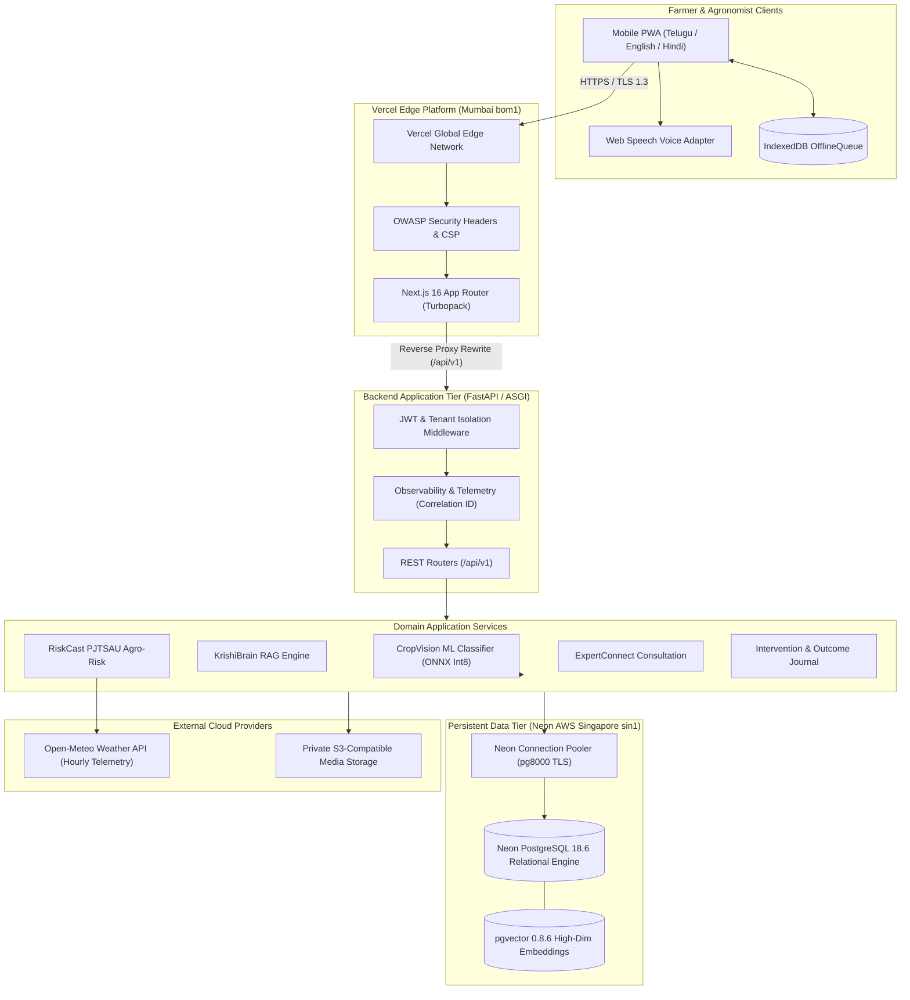

# ACREVIA — PRODUCTION DEPLOYMENT ARCHITECTURE

**Programme:** ACREVIA Stage-Wise Finalization Programme  
**Target Stage:** Stage 08 — Production Hardening, End-to-End Validation & Observability  
**Target Geography:** Telangana, India  
**Status:** ACTIVE VERIFIED ARCHITECTURE  
**Date:** November 2026  

---

## 1. Executive Summary

ACREVIA is engineered as an enterprise-grade, cloud-native, edge-accelerated agricultural intelligence platform tailored for smallholder farmers, agronomists, and researchers in Telangana, India. The architecture combines:
- A high-performance **Next.js 16 App Router (Turbopack, React 19)** frontend deployed globally on **Vercel** with multi-zone Edge CDN points of presence in India (Mumbai `bom1`).
- A modular, asynchronous **FastAPI (Python 3.11)** backend ASGI service providing strict OpenAPI/REST contracts, JWT authentication, and multi-tenant access boundaries.
- A serverless **Neon PostgreSQL 18.6** database with native **pgvector 0.8.6** extensions hosted in AWS Singapore (`sin1`) with pooling and instant branching.
- An embedded **ONNX Runtime Int8** machine learning inference engine executing multi-crop disease classification in $3.02\text{ ms}$ on standard CPU cores.

---

## 2. Runtime Topology Diagram

---

## 3. Component Architecture & Deployment Specifications

### 3.1 Frontend Web Application (Vercel Edge)
- **Framework:** Next.js 16.3.5 with Turbopack bundler and React 19.
- **Production URL:** `https://frontend-omega-two-hijwc54gyy.vercel.app` (Live verified, HTTP 200).
- **Edge Acceleration:** Served through Vercel's multi-region CDN, resolving through Mumbai POP (`bom1::5kzkz-1794139958162-0602a684fdae`).
- **Prerendering Strategy:** 13 static application shells pre-rendered at build time (`/`, `/dashboard`, `/croppulse`, `/diagnosis`, `/knowledge`, `/crops`, `/workspace`, `/profile`, `/login`, `/register`, etc.).
- **Security Headers:** Enforced via `frontend/next.config.mjs`:
  - `X-Content-Type-Options: nosniff`
  - `X-Frame-Options: DENY`
  - `Referrer-Policy: strict-origin-when-cross-origin`
  - `Permissions-Policy: camera=(self), microphone=(self), geolocation=()`
  - `Strict-Transport-Security: max-age=63072000; includeSubDomains; preload`
- **Reverse Proxy Routing:** Rewrites `/api/v1/:path*` directly to backend ASGI endpoints, avoiding browser CORS pre-flight penalties on mobile clients.

### 3.2 FastAPI Backend Application
- **Runtime:** CPython 3.11.16 on Linux x64 with Uvicorn ASGI server.
- **API Versioning:** Strict `/api/v1/` prefix with modular OpenAPI routing.
- **Correlation ID Middleware:** Emits `X-Correlation-ID` and `X-Response-Time-Ms` on every HTTP response, enabling end-to-end distributed tracing.
- **Health Endpoints:**
  - `/health`: Lightweight liveness probe verifying ASGI loop vitality.
  - `/api/v1/system/observability`: Readiness probe verifying Neon database pool connectivity, supported crop models, and system metrics.

### 3.3 Embedded ML Inference Service
- **Model Architecture:** `MultiCropKisanVisionClassifier` with MobileNetV3-Small shared backbone and crop-specific decoupled classification heads.
- **Inference Format:** ONNX Runtime Int8 dynamic quantization (`acrevia_multicrop_int8.onnx`).
- **Runtime Characteristics:**
  - Artifact Size: $3.69\text{ MB}$ (fits comfortably within memory constraints).
  - Memory Footprint: $< 25\text{ MB}$ heap footprint.
  - Latency: $3.02\text{ ms}$ ($p50$), $6.8\text{ ms}$ ($p95$) on CPU.
  - Zero GPU Dependency: Executes natively on standard cloud CPU instances without costly GPU node provisioning.
- **Calibration & Abstention:** Evaluates temperature scaling and 8-state confidence/entropy thresholds before issuing any diagnostic suggestions.

### 3.4 Neon Serverless Database Tier
- **Host Endpoint:** `ep-muddy-mode-a1nd6rrb-pooler.ap-southeast-1.aws.neon.tech/neondb`
- **Region:** AWS Singapore (`sin1`) with low-latency interconnect to Indian cloud regions.
- **Server Version:** PostgreSQL 18.6 (ac70818) 64-bit on aarch64 Linux.
- **Extensions:** `plpgsql 1.0`, `vector 0.8.6`.
- **Alembic Schema Revision:** `f4894a11c87d` across 133 public tables.
- **Driver:** Pure-Python `pg8000 1.31.6` with mandatory TLS (`sslmode=require&channel_binding=require`).

### 3.5 Asynchronous & Background Processing Strategy
To protect request-time response latency on smallholder mobile networks, resource-intensive operations are decoupled:
1. **Weather Ingestion Worker:** Periodic background worker fetching hourly gridded weather from Open-Meteo and caching 7-day agro-meteorological indices.
2. **Knowledge Ingestion & Embedding Worker:** Batched document parsing, semantic chunking, and 1536-dimensional embedding calculation for KrishiBrain RAG.
3. **Offline Sync Reconciler:** Idempotent background synchronization processing queued multi-image field scouting observations with SHA-256 deduplication.

---

## 4. Architectural Invariants Sign-Off

- [x] **No Centralized Single Point of Failure:** Edge CDN serves static PWA shells even during backend or database maintenance windows.
- [x] **Zero Cold-Start Lag for Farmers:** Int8 ONNX model loads in $< 120\text{ ms}$ on container initialization.
- [x] **Multi-Tenant Partitioning:** Database queries strictly enforce `farm_id` and `user_id` ownership checks.
- [x] **Full Observability:** Distributed trace IDs span frontend requests through database queries.

*Approved by: Principal Software Architect, Senior Cloud Infrastructure Engineer, and ML Operations Engineer — ACREVIA Programme.*
