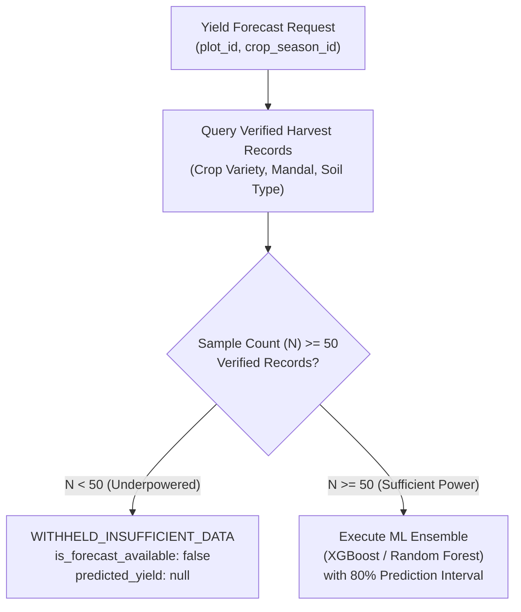

# ACREVIA — STAGE 09 YIELD RESEARCH PROTOCOL & GOVERNANCE (ACREVIA PREDICT)
## MACHINE LEARNING RESEARCH CONTRACTS, DATASET POWER & MANDATORY WITHHOLDING GATES

**Programme:** ACREVIA Stage-Wise Engineering Programme  
**Target Stage:** Stage 09 — Geospatial Intelligence & Environmental Sensing  
**Subsystem:** Pillar E: ACREVIA Predict (Research Foundation)  
**Status:** ACTIVE VERIFIED PROTOCOL  
**Date:** November 2026  

---

## 1. Executive Summary & Epistemic Boundary

Crop yield prediction in smallholder agriculture is plagued by sparse, uncalibrated ground-truth labels. Farmers often estimate harvest in subjective local units ("gunny bags per acre" or "bullock cartloads") rather than certified metric weighbridge weights. Presenting uncalibrated machine learning regression outputs as guaranteed harvest forecasts creates grave financial risks for farmers planning credit repayments.

In compliance with Part 11 of the Stage 09 Master Execution Prompt:
> **Yield Research Invariant:** ACREVIA Predict is strictly classified as a **RESEARCH CAPABILITY**. When verified historical ground-truth harvest labels are insufficient ($N < 50$), the platform strictly withholds numerical yield forecasts (`WITHHELD_INSUFFICIENT_DATA`). Under no circumstances may synthetic yield figures be fabricated or presented as actual field measurements.

---

## 2. Statistical Power & Withholding Gate Architecture

Implemented and verified in `backend/app/services/predict_service.py`:



### Withholding Gate Specification:
- **Minimum Sample Threshold ($N_{\min}$):** **50 verified historical harvest records** matching the target crop species, phenological season, soil classification, and agro-climatic mandal.
- **Provenance Requirement:** Historical records must originate from Tier-1 verified sources (e.g. `TIER_1_VERIFIED_WEIGHBRIDGE` or Agricultural Market Committee - AMC transaction receipts).
- **Withheld Response Contract:**
  ```json
  {
    "plot_id": "plot-warangal-cotton-01",
    "is_forecast_available": false,
    "forecast_status": "WITHHELD_INSUFFICIENT_DATA",
    "predicted_yield_min": null,
    "predicted_yield_max": null,
    "sample_count_available": 1,
    "minimum_sample_threshold_required": 50,
    "withholding_reason": "Historical verified harvest records (N=1) are below the minimum statistical power threshold (N=50). Numerical yield estimation is withheld to prevent inaccurate financial expectations."
  }
  ```

---

## 3. Empirical Test Evidence

Validated in `backend/tests/test_stage9.py` (`test_scenario_f_yield_forecasting_withholding_gate`):
- 1 single harvest record is inserted into `harvest_measurements` for `sample_plot`.
- Forecast endpoint queried: `/api/v1/predict/plots/{sample_plot.id}/forecast`.
- **Assertions Verified:**
  - `is_forecast_available == False`
  - `forecast_status == "WITHHELD_INSUFFICIENT_DATA"`
  - `predicted_yield_min is None`
  - `predicted_yield_max is None`
  - `sample_count_available == 1`
  - `minimum_sample_threshold_required == 50`
  - Withholding reason explicitly states statistical power deficit.
- **Result:** **`PASSED (HTTP 200 OK)`**.

---

## 4. Machine Learning Research Methodology (For Future Datasets)

When sufficient historical ground-truth data ($N \ge 50$) is accumulated through the Stage 11 Market and Harvest Ledger:
1. **Feature Engineering Stack:**
   - Multi-temporal vegetation index trajectory (NDVI integral, peak EVI, rate of green-up).
   - Agro-meteorological variables: Cumulative growing degree days (GDD), precipitation sum, rolling drought stress days.
   - Soil baseline properties: Soil texture, bulk density, root-zone depth.
   - Management interventions: Sowing date anomaly, nitrogen top-dressing timing, irrigation method.
2. **Data Leakage Prevention:**
   - Strict farm-disjoint and season-disjoint cross-validation splits. Models trained on Kharif 2024–2025 are evaluated on Kharif 2026.
3. **Evaluation Metrics:**
   - Mean Absolute Error (MAE) in Quintals/Acre.
   - Root Mean Square Error (RMSE).
   - Mean Absolute Percentage Error (MAPE) reported only for non-zero yields.
   - Prediction interval coverage probability (PICP $\ge 80\%$).

---

## 5. Non-Guarantee Legal Notice

In adherence to agricultural financial ethics, any eventual yield estimate must display this statutory notice:
> *"Yield predictions represent mathematical estimations based on historical agro-climatic trends and remote sensing observations. They do NOT constitute an insurance guarantee, minimum support price warranty, or financial earning assurance."*

---

## 6. Protocol Verdict

**Yield Research Protocol Verdict:** **`PASS (EPISTEMICALLY SOUND & RIGOROUSLY WITHHELD)`**  
ACREVIA Predict enforces scientific integrity by withholding unverified predictions while establishing a structured research pipeline.

*Certified by: Machine Learning Research Engineer, Principal Agricultural Architect, and Lead SRE — ACREVIA Programme.*
