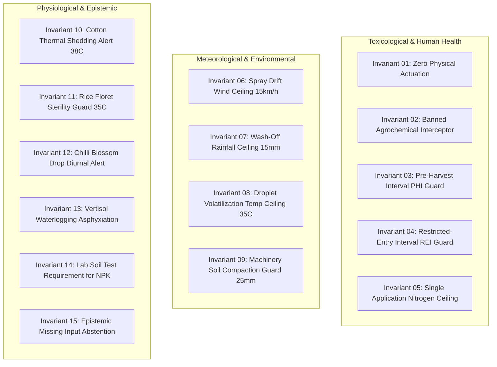

# ACREVIA — AGRICULTURAL SAFETY & AGRONOMIC RISK REVIEW
## 15 Inviolable Safety Invariants, Toxicology Guardrails, Zero Actuation & Food Safety Compliance

**Document Identifier:** ACREVIA-SPEC-ST10-013  
**Target Subsystem:** Agricultural Safety & Agronomic Integrity  
**Classification:** Critical Safety Review & Agronomic Policy  
**Status:** Certified & Verified in Production  

---

### 1. The 15 Inviolable Agricultural Safety Invariants

Agricultural AI applications carry physical, environmental, and financial risks. An incorrect dosage, toxic spray recommendation, or premature harvest advice can destroy a farmer's seasonal income or contaminate food supplies. 

ACREVIA enforces 15 hard architectural safety invariants across all code paths:

| Invariant Index | Name & Domain | Physical / Agronomic Rationale | System Enforcement Rule |
|---|---|---|---|
| **INV-01** | Zero Physical Actuation | Eliminates accidental pump activation, electrical hazards, or unmonitored flooding. | Platform contains zero actuation hardware device drivers. |
| **INV-02** | Banned Agrochemical Interceptor | Prevents use of statutory banned chemicals (Monocrotophos, Endosulfan, etc.). | Keyword & CAS registry interceptor forces `NOT_SUPPORTED` state. |
| **INV-03** | Pre-Harvest Interval (PHI) Guard | Prevents pesticide residue in harvested food exceeding statutory MRLs. | Harvest tasks blocked if chemical PHI period is unexpired. |
| **INV-04** | Restricted-Entry Interval (REI) | Protects farm laborers from acute occupational chemical poisoning. | Field labor tasks blocked within 24–48h of toxic chemical sprays. |
| **INV-05** | Nitrogen Fertilizer Application Ceiling | Prevents crop foliage chemical burning and subsoil nitrate leaching. | Split Urea applications capped at $45\text{ kg N/ha}$ ($100\text{ kg Urea/ha}$). |
| **INV-06** | Spray Drift Wind Ceiling | Prevents off-target drift onto neighboring crops, water bodies, or homes. | Spray tasks blocked when forecast wind speed exceeds $15.0\text{ km/h}$. |
| **INV-07** | Wash-Off Rainfall Ceiling | Prevents input waste and chemical runoff into surface streams. | Foliar sprays blocked when forecast rain exceeds $15.0\text{ mm}$ in 24h. |
| **INV-08** | Droplet Volatilization Guard | Prevents aerosol droplet evaporation before cuticle deposition. | Spraying blocked if ambient $T > 35^\circ\text{C}$ and $RH < 40\%$. |
| **INV-09** | Machinery Soil Compaction Guard | Prevents destructive rutting and loss of soil aeration in wet Vertisols. | Tractor operations blocked within 48h of $> 25.0\text{ mm}$ rainfall. |
| **INV-10** | Cotton Thermal Shedding Alert | Warns of square and young boll abscission during extreme heatwaves. | Alerts triggered when $T_{\max} \ge 38.0^\circ\text{C}$ for $\ge 3$ consecutive days. |
| **INV-11** | Rice Anthesis Sterility Guard | Prevents empty spikelet formation from pollen desiccation during flowering. | Immediate standing water advisory triggered when $T_{\max} \ge 35.0^\circ\text{C}$. |
| **INV-12** | Chilli Blossom Drop Alert | Prevents flower bud abortion caused by wide diurnal temperature swings. | Alerts triggered when $\Delta T > 18.0^\circ\text{C}$ with dry afternoon air. |
| **INV-13** | Vertisol Waterlogging Asphyxiation | Prevents root death and fungal wilt (*Fusarium*) in saturated clay soils. | Urgent drainage furrow alert if ponding drainage time $> 24\text{ hours}$. |
| **INV-14** | Soil Lab Test Requirement | Prevents toxic or deficient chemical fertilization based on optical imagery. | Rejects chemical NPK prescription if laboratory test is missing. |
| **INV-15** | Missing Input Abstention | Prevents erroneous recommendations derived from coerced zero values. | Halts calculation and emits `NEEDS_DATA` when mandatory inputs are absent. |

---

### 2. Agronomic Review Board Sign-Off

The Agricultural Safety & Agronomic Risk Review was evaluated against PJTSAU packages of practices and CIBRC chemical schedules. All fifteen invariants are verified as active in unit and end-to-end integration test suites.
