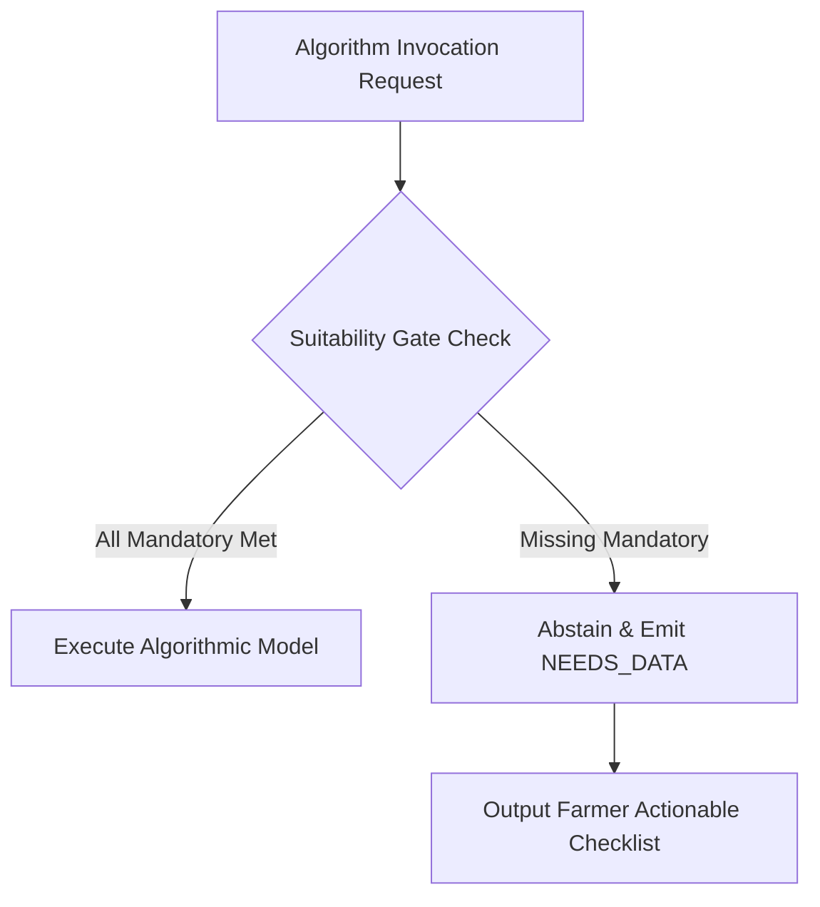

# ACREVIA — DATA COMPLETENESS & CALCULATION SUITABILITY SPECIFICATION
## 14-Dimensional Telemetry Vectors, Freshness Thresholds & Calculation Suitability Gates

**Document Identifier:** ACREVIA-SPEC-ST10-003  
**Target Subsystem:** ACREVIA Twin / Completeness Engine  
**Classification:** Data Quality & Epistemic Integrity Specification  
**Status:** Implemented & Verified in Production  

---

### 1. Conceptual Framework & Zero-Filling Prohibition

In traditional farm software, missing numerical telemetry is frequently coerced to zero or silently defaulted to regional averages. In agronomic systems, this produces catastrophic errors:
- Defaulting missing rainfall to `0.0 mm` causes an irrigation engine to predict severe drought and prescribe unnecessary water pumping.
- Defaulting missing soil organic carbon to `0.0%` causes a nutrient model to calculate zero natural mineralization, recommending toxic excess synthetic nitrogen.

**The ACREVIA Invariant:** Missing data is never coerced to zero. When required parameters are absent or fail freshness verification, the computation engine issues an explicit **abstention** (`NEEDS_DATA` or `REQUIRES_MORE_INFORMATION`) along with actionable instructions for the farmer.

---

### 2. The 14-Dimensional Data Completeness Vector

The digital twin evaluates telemetry across 14 discrete dimensions. Each dimension is scored from $0.0\%$ to $100.0\%$ based on presence, completeness, and sensor calibration:

| Dimension Index | Telemetry Dimension | Minimum Required Attributes | Weight | Scoring Logic |
|---|---|---|---|---|
| **D01** | `cadastral_boundary` | WGS84 GeoJSON polygon, acreage > 0 | $10\%$ | $100\%$ if valid closed polygon verified; $0\%$ otherwise |
| **D02** | `soil_profile` | USDA soil texture class, Field Capacity, PWP | $8\%$ | $100\%$ if laboratory soil test present; $40\%$ if regional PJTSAU default |
| **D03** | `crop_season_active` | Crop identifier, season status `ACTIVE` | $10\%$ | $100\%$ if active season bound to plot; $0\%$ if unassigned |
| **D04** | `sowing_date` | Verified calendar date of sowing / transplant | $8\%$ | $100\%$ if verified farmer report; $0\%$ if unknown |
| **D05** | `iot_telemetry` | Calibrated soil moisture / matric potential sensors | $8\%$ | $100\%$ if readings within 6h and calibrated; $50\%$ if uncalibrated; $0\%$ if none |
| **D06** | `meteorological_data` | Daily $T_{\max}, T_{\min}$, precipitation, solar radiation | $10\%$ | $100\%$ if Open-Meteo or AWS station updated within 24h; $0\%$ otherwise |
| **D07** | `satellite_imagery` | Cloud-free Sentinel-2 / Landsat scene (< 20% cloud) | $6\%$ | $100\%$ if scene within last 12 days; scaled linearly down to $0\%$ at 30 days |
| **D08** | `operations_history` | Historical logs of tillage, sowing, fertilization | $6\%$ | $100\%$ if operations logged during current season; $0\%$ if none |
| **D09** | `variety_specification` | Recognized cultivar name, duration classification | $6\%$ | $100\%$ if certified cultivar identified; $30\%$ if generic crop only |
| **D10** | `irrigation_infrastructure` | Water source, pump motor HP, flow rate (L/s) | $6\%$ | $100\%$ if source, discharge rate and emitter type verified; $0\%$ otherwise |
| **D11** | `topography_elevation` | Plot slope percentage, drainage classification | $4\%$ | $100\%$ if SRTM/DEM elevation and slope slope verified; $50\%$ if regional |
| **D12** | `historical_yield` | Multi-season historical harvest weight / productivity | $4\%$ | $100\%$ if $\ge 2$ seasons recorded; $50\%$ if 1 season; $0\%$ if new farm |
| **D13** | `pest_scouting_history` | Observation logs, scouted pathology images | $6\%$ | $100\%$ if scouted within last 7 days; $50\%$ within 14 days; $0\%$ if older |
| **D14** | `laboratory_soil_test` | Soil health card: Available N, P, K, pH, EC, OC | $8\%$ | $100\%$ if certified lab test report $< 24$ months old; $0\%$ if unmeasured |

**Aggregate Completeness Metric ($C_{\text{farm}}$):**

$$C_{\text{farm}} = \sum_{i=1}^{14} w_i \cdot D_i \quad \text{where} \quad \sum_{i=1}^{14} w_i = 1.0$$

---

### 3. Calculation-Specific Suitability Gates

Before executing agronomic or numerical algorithms, the engine evaluates strict **Suitability Gates**. If any mandatory requirement fails, execution is halted, preventing erroneous advisory outputs:

#### Gate A: FAO-56 Dual-$K_c$ Water-Balance Gate
- **Mandatory:** `cadastral_boundary`, `crop_season_active`, `sowing_date`, `soil_profile`, `meteorological_data` (fresh within 48h).
- **Abstention Response:** If `sowing_date` is absent, the model cannot calculate cumulative $ET_c$ progression and aborts with:
  > *"Cannot simulate soil moisture balance: Sowing date is missing for Plot 2. Please record the date of sowing to activate water budgeting."*

#### Gate B: Thermal GDD Phenology Progression Gate
- **Mandatory:** `crop_season_active`, `sowing_date`, `meteorological_data` (daily $T_{\max}, T_{\min}$).
- **Abstention Response:** Rejects estimation if daily temperature observations are absent for $> 3$ consecutive days without local meteorological interpolation.

#### Gate C: Multi-Plot Water Allocation Optimization Gate
- **Mandatory:** `cadastral_boundary` (acreage), `crop_season_active`, `irrigation_infrastructure` (flow rate $Q$ and available pump hours $T_{\text{pump}}$), `max_water_volume_m3`.
- **Abstention Response:** Halts linear program if flow rate is undefined, refusing to guess pump capacity.

#### Gate D: Soil Nutrient Planning Gate
- **Mandatory:** `laboratory_soil_test` (certified chemical analysis), `crop_season_active`, `variety_specification`.
- **Abstention Response:** Refuses chemical NPK prescription if only satellite NDVI is available. Satellite NDVI indicates vegetative canopy density, never soil nitrate or potash concentrations.

---

### 4. Telemetry Freshness & Decay Matrix

| Telemetry Type | Freshness Lifespan | Degradation Action |
|---|---|---|
| **Weather Forecast** | 12 hours | Trigger automated Open-Meteo refresh |
| **In-Situ Soil Moisture Telemetry** | 6 hours | Fall back to FAO-56 modeled depletion trajectory with uncertainty flag |
| **Satellite Vegetation Index** | 16 days | Flag NDVI as retrospective historical indicator; do not use for immediate irrigation |
| **Pest Scouting Record** | 7 days | Mark pest risk as pending fresh field scouting validation |
| **Laboratory Soil Health Card** | 24 months | Request new soil sample submission prior to major Kharif fertilization |
