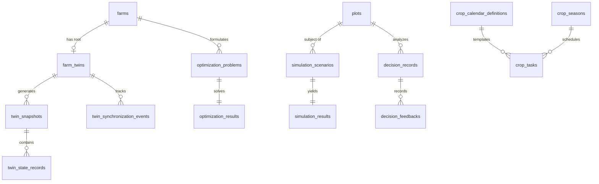

# ACREVIA — DATA MODEL & REST API CONTRACT SPECIFICATION
## Relational Schemas, Foreign Keys, Indexing Strategies & OpenAPI Contracts

**Document Identifier:** ACREVIA-SPEC-ST10-011  
**Target Subsystem:** All Stage 10 Subsystems (Twin, Simulate, Optimize, Plan, Decision)  
**Classification:** Database & API Contract Specification  
**Status:** Implemented & Verified in Production  

---

### 1. Relational Database Entity-Relationship Architecture

The Stage 10 data model is deployed on **Neon Serverless PostgreSQL 18.6** across 12 relational tables adhering to Boyce-Codd Normal Form (BCNF) with targeted JSONB payloads for non-scalar telemetry vectors:

---

### 2. Relational Schema Definitions & Indexing Specifications

#### A. Digital Twin Subsystem Tables
1. **`farm_twins`**:
   - `id` (VARCHAR(36), PK), `farm_id` (VARCHAR(36), FK $\to$ `farms.id`, UNIQUE, INDEX), `twin_version` (INT, default 1), `state_status` (VARCHAR(50)), `last_synchronized_at` (TIMESTAMPTZ), `completeness_score` (FLOAT).
2. **`twin_snapshots`**:
   - `id` (VARCHAR(36), PK), `twin_id` (VARCHAR(36), FK $\to$ `farm_twins.id`), `farm_id` (VARCHAR(36), FK $\to$ `farms.id`), `plot_id` (VARCHAR(36), FK $\to$ `plots.id`, nullable), `crop_season_id` (VARCHAR(36), FK $\to$ `crop_seasons.id`, nullable).
   - `snapshot_version` (INT), `state_payload_json` (JSONB), `source_manifest_json` (JSONB), `data_completeness_pct` (FLOAT), `payload_hash` (VARCHAR(64)), `generated_at` (TIMESTAMPTZ), `created_by` (VARCHAR(36), FK $\to$ `users.id`).
   - *Compound Index:* `ix_twin_snapshots_farm_ver` (`farm_id`, `snapshot_version`).
3. **`twin_state_records`**:
   - `id` (VARCHAR(36), PK), `snapshot_id` (VARCHAR(36), FK $\to$ `twin_snapshots.id`, CASCADE), `entity_type` (VARCHAR(50)), `entity_id` (VARCHAR(36)), `property_name` (VARCHAR(100)), `property_value_json` (JSONB), `unit` (VARCHAR(30)), `provenance_type` (VARCHAR(50)), `source_reference` (VARCHAR(255)), `observed_at` (TIMESTAMPTZ), `quality_status` (VARCHAR(30)).
   - *Compound Index:* `ix_twin_state_prop_lookup` (`snapshot_id`, `property_name`).
4. **`twin_synchronization_events`**:
   - `id` (VARCHAR(36), PK), `twin_id` (VARCHAR(36), FK $\to$ `farm_twins.id`), `event_type` (VARCHAR(100)), `event_hash` (VARCHAR(64), UNIQUE), `payload_json` (JSONB), `processed_at` (TIMESTAMPTZ).

#### B. Simulation & Optimization Tables
5. **`simulation_scenarios`**:
   - `id` (VARCHAR(36), PK), `plot_id` (VARCHAR(36), FK $\to$ `plots.id`), `crop_season_id` (VARCHAR(36), nullable), `creator_id` (VARCHAR(36), FK $\to$ `users.id`), `scenario_type` (VARCHAR(50)), `scenario_name` (VARCHAR(150)), `baseline_snapshot_id` (VARCHAR(36), nullable), `input_parameters_json` (JSONB), `farmer_assumptions_json` (JSONB), `constraints_json` (JSONB), `status` (VARCHAR(30)).
6. **`simulation_results`**:
   - `id` (VARCHAR(36), PK), `scenario_id` (VARCHAR(36), FK $\to$ `simulation_scenarios.id`, UNIQUE), `model_name` (VARCHAR(100)), `model_version` (VARCHAR(50)), `outputs_json` (JSONB), `uncertainty_metadata_json` (JSONB), `evidence_sources_json` (JSONB), `execution_duration_ms` (FLOAT), `completed_at` (TIMESTAMPTZ).
7. **`optimization_problems`**:
   - `id` (VARCHAR(36), PK), `farm_id` (VARCHAR(36), FK $\to$ `farms.id`), `plot_id` (VARCHAR(36), nullable), `problem_type` (VARCHAR(50)), `objective_type` (VARCHAR(50)), `decision_variables_json` (JSONB), `hard_constraints_json` (JSONB), `soft_constraints_json` (JSONB), `status` (VARCHAR(30)).
8. **`optimization_results`**:
   - `id` (VARCHAR(36), PK), `problem_id` (VARCHAR(36), FK $\to$ `optimization_problems.id`, UNIQUE), `feasibility_status` (VARCHAR(30)), `selected_solution_json` (JSONB), `alternative_solutions_json` (JSONB), `conflicting_constraints_json` (JSONB), `trade_off_analysis_json` (JSONB), `solver_name` (VARCHAR(100)), `solved_at` (TIMESTAMPTZ).

#### C. Operations & Decision Tables
9. **`crop_calendar_definitions`**:
   - `id` (VARCHAR(36), PK), `crop_id` (VARCHAR(50)), `variety_id` (VARCHAR(100)), `agro_climatic_zone` (VARCHAR(100)), `growth_stage` (VARCHAR(100)), `typical_duration_days` (INT), `recommended_tasks_json` (JSONB), `source_citation` (TEXT), `version` (VARCHAR(20)).
10. **`crop_tasks`**:
    - `id` (VARCHAR(36), PK), `crop_season_id` (VARCHAR(36), FK $\to$ `crop_seasons.id`), `plot_id` (VARCHAR(36), FK $\to$ `plots.id`), `calendar_def_id` (VARCHAR(36), nullable), `task_name` (VARCHAR(150)), `task_category` (VARCHAR(50)), `due_date` (DATE), `completed_date` (DATE, nullable), `status` (VARCHAR(30)), `weather_conflict_flag` (BOOLEAN), `conflict_reason` (VARCHAR(255)), `execution_details_json` (JSONB), `notes` (TEXT).
    - *Compound Index:* `ix_crop_tasks_season_due` (`crop_season_id`, `due_date`).
11. **`decision_records`**:
    - `id` (VARCHAR(36), PK), `plot_id` (VARCHAR(36), FK $\to$ `plots.id`), `farmer_id` (VARCHAR(36), FK $\to$ `users.id`), `query_text` (TEXT), `decision_category` (VARCHAR(50)), `recommendation_state` (VARCHAR(50)), `evidence_sources_json` (JSONB), `grounded_explanation_en` (TEXT), `grounded_explanation_te` (TEXT), `grounded_explanation_hi` (TEXT), `uncertainty_disclosures_json` (JSONB), `expert_escalation_case_id` (VARCHAR(36), nullable), `evaluated_at` (TIMESTAMPTZ).
    - *Compound Index:* `ix_decision_records_plot_eval` (`plot_id`, `evaluated_at`).
12. **`decision_feedbacks`**:
    - `id` (VARCHAR(36), PK), `decision_id` (VARCHAR(36), FK $\to$ `decision_records.id`), `farmer_action_taken` (VARCHAR(50)), `farmer_rating` (INT, 1–5), `feedback_notes` (TEXT), `observed_outcome` (TEXT), `recorded_at` (TIMESTAMPTZ).

---

### 3. REST API Endpoint Catalog

| HTTP Method | Path | Summary / Responsibility | Auth Scope | Success Code |
|---|---|---|---|---|
| `GET` | `/api/v1/twin/farms/{farm_id}` | Retrieve current synchronized digital twin root and status | Farmer / Agronomist | `200 OK` |
| `GET` | `/api/v1/twin/farms/{farm_id}/completeness` | Retrieve 14-dimensional completeness vector and score | Farmer / Agronomist | `200 OK` |
| `POST` | `/api/v1/twin/farms/{farm_id}/reconcile` | Force reconciliation and generate new state snapshot | Farmer / Agronomist | `200 OK` |
| `GET` | `/api/v1/twin/farms/{farm_id}/snapshots` | List chronological immutable snapshots with SHA-256 hashes | Farmer / Agronomist | `200 OK` |
| `GET` | `/api/v1/twin/snapshots/{snapshot_id}` | Retrieve full snapshot payload and 8-tier provenance state records | Farmer / Agronomist | `200 OK` |
| `POST` | `/api/v1/simulations/` | Create and execute counterfactual simulation scenario | Farmer / Agronomist | `201 Created` |
| `GET` | `/api/v1/simulations/{scenario_id}` | Retrieve simulation status, outputs, and uncertainty metadata | Farmer / Agronomist | `200 OK` |
| `POST` | `/api/v1/simulations/compare` | Compare multiple simulation scenarios side-by-side | Farmer / Agronomist | `200 OK` |
| `POST` | `/api/v1/optimization/problems` | Submit constrained resource optimization problem | Farmer / Agronomist | `201 Created` |
| `GET` | `/api/v1/optimization/problems/{problem_id}` | Retrieve optimization status, solver solution, or conflicts | Farmer / Agronomist | `200 OK` |
| `GET` | `/api/v1/planning/calendars` | List PJTSAU crop calendar definitions by crop and zone | Public / Farmer | `200 OK` |
| `POST` | `/api/v1/planning/tasks` | Schedule planned agricultural operation with weather conflict check | Farmer / Agronomist | `201 Created` |
| `POST` | `/api/v1/planning/tasks/{task_id}/complete` | Complete operation, record labor/materials, write audit journal | Farmer / Agronomist | `200 OK` |
| `POST` | `/api/v1/decisions/analyze` | Submit agronomic query for explainable decision intelligence | Farmer / Agronomist | `200 OK` |
| `POST` | `/api/v1/decisions/{decision_id}/feedback` | Submit post-decision action feedback and outcome rating | Farmer / Agronomist | `201 Created` |
