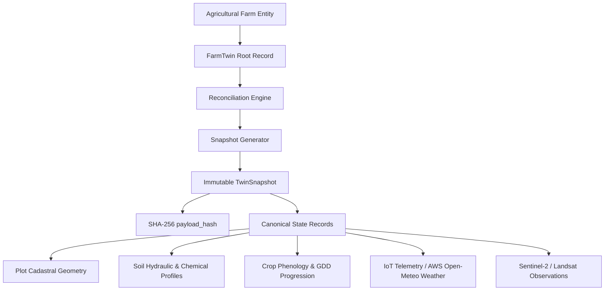
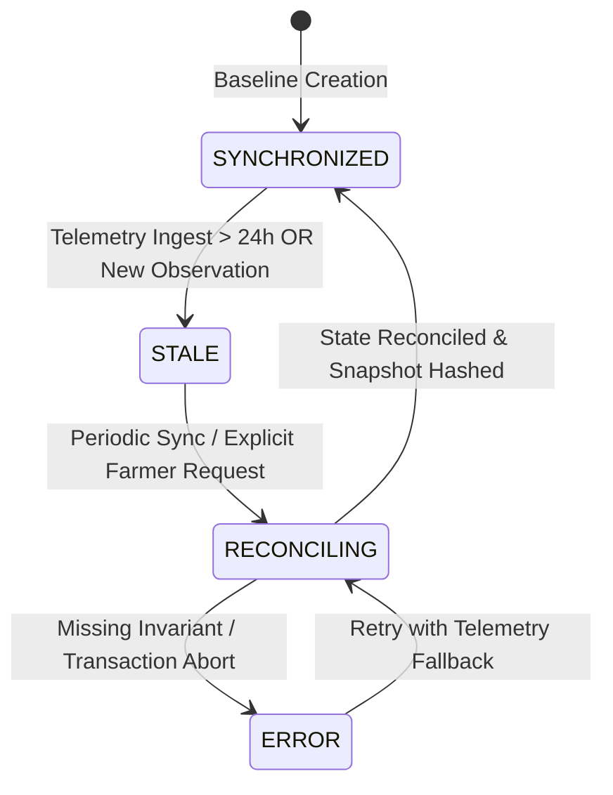

# ACREVIA — DIGITAL TWIN ARCHITECTURE SPECIFICATION (PILLAR A: ACREVIA TWIN)
## State Representation, Content-Hashed Snapshots, Provenance Hierarchy & Immutability

**Document Identifier:** ACREVIA-SPEC-ST10-002  
**Target Subsystem:** ACREVIA Twin (Digital Twin Engine)  
**Classification:** Core Architectural Specification  
**Status:** Implemented & Verified in Production  

---

### 1. Conceptual Framework & System Boundary

The **ACREVIA Digital Twin** (`FarmTwin`) is a stateful, reproducible, computational representation of a smallholder farm entity in Telangana. Rather than maintaining an opaque black-box simulation, ACREVIA Twin structures farm state as a hierarchical, multi-tiered graph connecting:

$$\text{Farm} \longrightarrow \text{Plots} \longrightarrow \text{Crop Seasons} \longrightarrow \{\text{Soil}, \text{Telemetry}, \text{Weather}, \text{Satellite}, \text{Operations}\}$$

The digital twin decouples **real-time observation ingestion** from **agronomic decision intelligence**, providing mathematical isolation and auditability.

---

### 2. Digital Twin State Lifecycle Machine

The digital twin transitions through four strictly governed operational states:

1. **`SYNCHRONIZED`**: All active plots, crop seasons, weather forecasts, and sensor telemetry have been reconciled into a valid, immutable `TwinSnapshot`. Completeness score and freshness are up to date.
2. **`STALE`**: Triggered automatically when telemetry exceeds the 24-hour freshness threshold, or when new field observations, satellite scenes, or operations are recorded.
3. **`RECONCILING`**: Background task or transactional lock during which the multi-source evidence fusion pipeline aggregates state properties and constructs the state payload.
4. **`ERROR`**: Exception state triggered upon structural schema mismatch, foreign key corruption, or invalid geometry. Does not block read operations on prior valid snapshots.

---

### 3. Strict 8-Tier Provenance Hierarchy

Every discrete property within a digital twin snapshot is tagged with an immutable provenance classification from an 8-tier hierarchy. This guarantees epistemic clarity and prevents synthetic approximations from masquerading as physical measurements:

| Provenance Tier | Enum Value | Ground-Truth Definition & Acceptance Rules | Example Properties |
|---|---|---|---|
| **Tier 1: Physical Ground Truth** | `MEASURED` | Direct instrumented observation from calibrated field sensors or certified laboratory test reports. | Soil lab organic carbon, calibrated tensiometer soil water tension (kPa) |
| **Tier 2: Farmer Ground Truth** | `FARMER_REPORTED` | Direct primary assertion submitted by verified farm operator or landowner. | Sowing date, cultivar name, irrigation event application, seed lot number |
| **Tier 3: Expert Ground Truth** | `EXPERT_REVIEWED` | Agronomic assertion validated or adjusted by licensed KVK / PJTSAU extension specialist. | Pest identification confirmation, nutrient deficiency diagnosis |
| **Tier 4: Remote Observation** | `PROVIDER_OBSERVATION` | External observational data received from qualified geospatial or meteorological providers. | Open-Meteo temperature/rainfall, Sentinel-2 BOA surface reflectance |
| **Tier 5: Model Estimation** | `AI_ESTIMATED` | Statistical, machine-learning, or computer-vision inference derived from primary data. | MobileNetV3 crop disease classification, satellite NDVI/NDMI indicators |
| **Tier 6: Mechanistic Simulation** | `SIMULATED` | Deterministic outputs generated by validated physical or agronomic process models. | FAO-56 dual-$K_c$ root zone depletion ($D_r$), thermal GDD accumulation |
| **Tier 7: Algorithmic Inference** | `INFERRED` | Contextual property derived through rule-based or multi-source heuristic deduction. | Probable irrigation method inferred from plot geometry and pump capacity |
| **Tier 8: Unverified Default** | `UNKNOWN` | Value where source is undocumented or origin telemetry could not be verified. | Default bulk density used when soil survey data is unavailable |

---

### 4. Content-Addressable Cryptographic Hashing (`payload_hash`)

To guarantee absolute immutability and detect tampering across distributed environments:

1. The digital twin state payload is serialized to a canonical JSON string with strictly sorted keys, standardized decimal representations, and UTC ISO-8601 timestamps.
2. A cryptographic SHA-256 digest is computed over this serialized canonical byte array:

$$\text{payload\_hash} = \text{SHA-256}\left(\text{json.dumps}(\text{state\_payload}, \text{sort\_keys}=\text{True})\right)$$

3. The generated `payload_hash` is recorded in `twin_snapshots.payload_hash` as a 64-character hexadecimal string.
4. Any manual database update to a snapshot payload immediately invalidates its hash, triggering security integrity alerts during automated audit sweeps.

---

### 5. Multi-Tenant Isolation & Zero Actuation Guarantee

- **Tenant Isolation:** Every `farm_twins` and `twin_snapshots` record is explicitly foreign-keyed to `farms.id`. FastAPI dependencies verify that the authenticated JWT subject holds ownership or active tenancy over the farm before returning twin representations. Cross-tenant access yields an immediate `HTTP 403 Forbidden`.
- **Zero Actuation Invariant:** The digital twin is an observational and analytical system. The schema contains no hardware actuation addresses, relay commands, or autonomous control mechanisms. Recommendations generated from the twin require affirmative, explicit human intervention.
