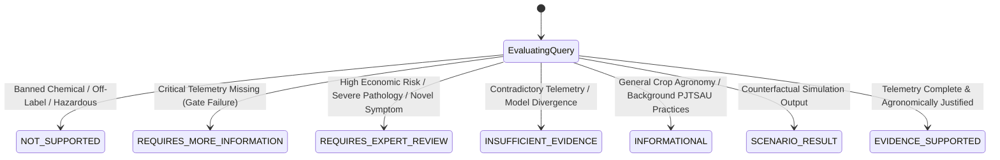

# ACREVIA — EXPLAINABLE DECISION ENGINE SPECIFICATION (PILLAR E: ACREVIA DECISION)
## Canonical Recommendation States, 11-Question Explainability Standard, Banned Chemical Interceptors & Trilingual Grounding

**Document Identifier:** ACREVIA-SPEC-ST10-010  
**Target Subsystem:** ACREVIA Decision / Explainability Engine  
**Classification:** Core Decision Intelligence Specification  
**Status:** Implemented & Verified in Production  

---

### 1. Conceptual Framework & Non-Prescriptive Principle

Smallholder farmers operate under severe financial and livelihood constraints. Advisory software that delivers opaque, authoritarian instructions (*"Apply 50kg DAP tomorrow"*) fosters skepticism or catastrophic compliance without situational awareness.

**ACREVIA Decision** operates under an explainable, evidence-grounded paradigm:
- Every recommendation must explain **why** it is proposed, **what evidence** was used, **what uncertainties** exist, and **what alternatives** were evaluated.
- The platform adheres to the **Human-in-the-Loop Principle**: The software recommends; the human farmer or extension officer decides and acts.

---

### 2. The 7 Canonical Recommendation States

Every decision query evaluated by `DecisionService.analyze_query()` resolves into exactly one of seven canonical recommendation states:

| Canonical State | Definitive Trigger Conditions | System Behavior & Actionable Guidance |
|---|---|---|
| **`INFORMATIONAL`** | General knowledge inquiry regarding crop management, varietal traits, or PJTSAU standard practices without immediate field urgency. | Provides educational context, citations, and standard agronomic practices across Telugu, Hindi, and English. |
| **`EVIDENCE_SUPPORTED`** | All required telemetry is present, fresh, and within valid ranges; simulation and phenological models confirm agronomic benefit. | Returns full operational recommendation with multi-source evidence citations and 11-point explainability dossier. |
| **`SCENARIO_RESULT`** | Response represents the output of a user-defined counterfactual simulation rather than an immediate real-time advisory. | Highlights assumptions, simulation parameters, and warns that outcomes reflect model projections, not field guarantees. |
| **`REQUIRES_MORE_INFORMATION`** | Missing critical telemetry (e.g., unknown sowing date, missing soil test, stale weather forecast > 48h). | Abstains from guessing; provides farmer with a structured checklist of missing items needed to activate advisory. |
| **`REQUIRES_EXPERT_REVIEW`** | Complex disease symptoms, ambiguous computer vision diagnoses (confidence $< 60\%$), or high-cost chemical interventions. | Automatically creates an `ExpertReviewCase` routing the dossier to an accredited KVK agronomist. |
| **`INSUFFICIENT_EVIDENCE`** | Sensor readings conflict with satellite indicators or historical patterns without clear resolution. | Explains the contradictory evidence; advises physical field inspection before investing capital. |
| **`NOT_SUPPORTED`** | Query requests banned agrochemicals (e.g., Monocrotophos), hazardous off-label chemical mixtures, or unsafe procedures. | Blocks recommendation; issues immediate safety warning citing CIBRC statutory bans and non-chemical IPM alternatives. |

---

### 3. The 11-Question Agricultural Explainability Standard

To ensure full transparency for farmers and agricultural extension officers, every `EVIDENCE_SUPPORTED` or `SCENARIO_RESULT` decision dossier addresses eleven fundamental questions:

1. **What is the recommended action?** (Specific intervention, e.g., second split Urea top dressing + Potassium).
2. **Why is this action recommended now?** (Crop is at 55 DAS peak flowering; nitrogen uptake curve is maximal).
3. **What physical or telemetry evidence supports this?** (Soil Health Card indicates Available N is low at $210\text{ kg/ha}$; root zone moisture is optimal at $82\% RAW$).
4. **What agronomic models were used?** (PJTSAU Crop Calendar v1.0 + FAO-56 Dual-$K_c$ Water Balance v1.4).
5. **What assumptions were made?** (Weather forecast holds true with $< 5\text{ mm}$ precipitation in next 48h).
6. **What are the uncertainty boundaries?** (Soil moisture depletion confidence $\pm 8\text{ mm}$; weather forecast confidence $85\%$).
7. **What counterfactual alternatives were evaluated?** (Simulated delayed application by 7 days: showed $12\%$ vegetative stress increase).
8. **What are the risks of taking this action?** (Potential leaf scorch if applied during heat of day; must apply late afternoon into moist soil).
9. **What are the risks of taking NO action?** (Nitrogen deficiency during boll development causing square shedding and up to $18\%$ yield reduction).
10. **What are the regulatory and food safety compliance constraints?** (Pre-Harvest Interval is $45\text{ days}$; crop is $90\text{ days}$ prior to first picking, fully compliant).
11. **Who is the accountable human decision-maker?** (The farm operator or licensed KVK extension officer).

---

### 4. Prohibited Agrochemical Interceptor & Regulatory Safeguards

ACREVIA maintains an active statutory database of banned and restricted pesticides in India aligned with Central Insecticide Board and Registration Committee (CIBRC) gazette notifications. 

When a query requests or references a banned chemical (e.g., Monocrotophos, Endosulfan, Carbofuran, Phorate, Methyl Parathion):
1. Immediately forces `recommendation_state = "NOT_SUPPORTED"`.
2. Generates an explicit regulatory disclaimer in the farmer's preferred language.
3. Provides approved non-chemical Integrated Pest Management (IPM) alternatives (e.g., neem oil formulations, pheromone traps, yellow sticky cards).

---

### 5. Closed-Loop Farmer Feedback Architecture

Decision intelligence without outcome feedback remains an open-loop model. The `/api/v1/decisions/{id}/feedback` endpoint captures farmer actions and real-world outcomes:
- **`farmer_action_taken`**: `ADOPTED`, `PARTIALLY_ADOPTED`, `REJECTED`, `INAPPLICABLE`.
- **`farmer_rating`**: 1 to 5 scale.
- **`feedback_notes`** and **`observed_outcome`**: Narrative observations recorded for model calibration.
