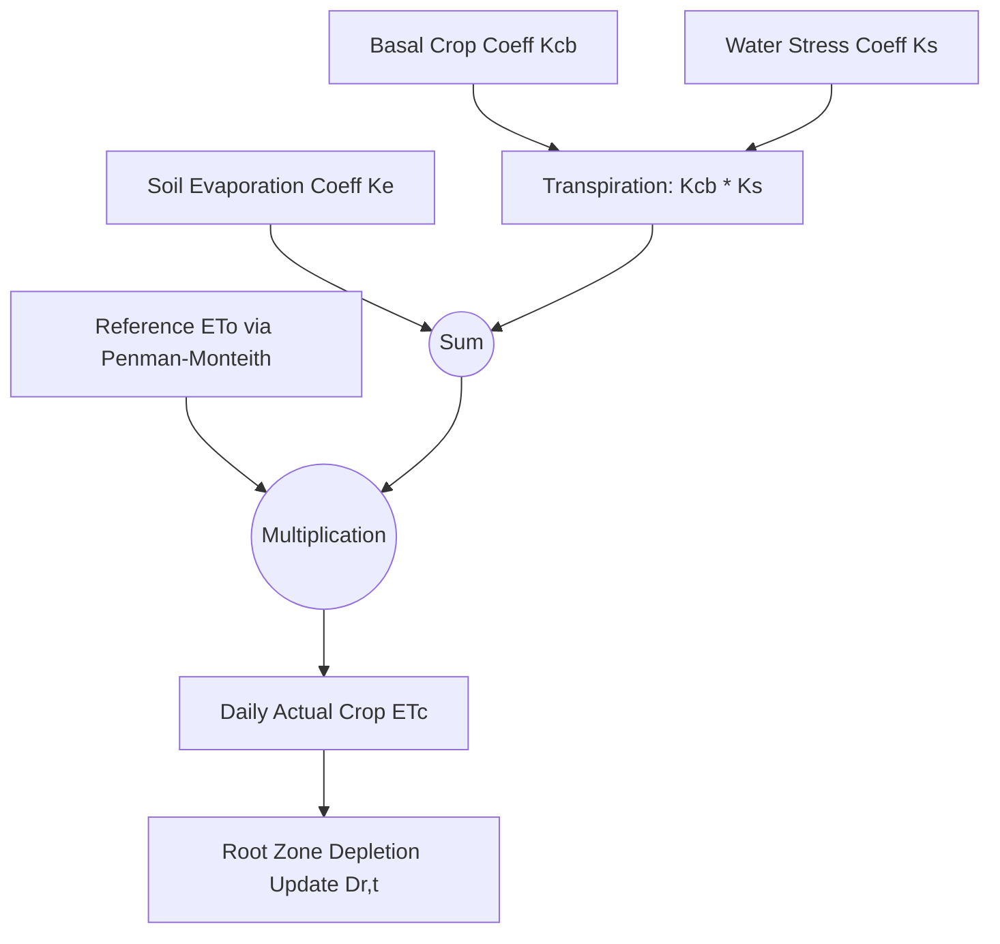

# ACREVIA — FAO-56 DUAL-KC WATER BALANCE SPECIFICATION
## Daily Evapotranspiration, Dual Crop Coefficients, Root-Zone Depletion & Soil Hydraulics

**Document Identifier:** ACREVIA-SPEC-ST10-005  
**Target Subsystem:** ACREVIA Simulate / Water Balance Engine  
**Classification:** Physical Agricultural Process Model Specification  
**Status:** Implemented & Verified in Production  

---

### 1. Theoretical Foundation & Dual Crop Coefficient Architecture

The standard FAO-56 dual crop coefficient approach explicitly separates crop transpiration from soil evaporation:

$$ET_c = (K_{cb} \cdot K_s + K_e) \cdot ET_o$$

Where:
- $ET_c$: Daily actual crop evapotranspiration ($\text{mm/day}$).
- $K_{cb}$: Basal crop coefficient (transpiration component from green canopy).
- $K_s$: Soil water stress reduction coefficient ($0.0 \le K_s \le 1.0$).
- $K_e$: Soil water evaporation coefficient from the exposed topsoil layer ($0.0 \le K_e \le K_{c,\max} - K_{cb}$).
- $ET_o$: Daily grass-reference evapotranspiration ($\text{mm/day}$), computed via the FAO Penman-Monteith equation (or Hargreaves-Samani with uncertainty flag when net solar radiation or wind telemetry is missing).

---

### 2. Soil Hydraulic Properties & Available Water Metrics

Soil water storage capacity is dictated by root zone depth and hydraulic characteristics:

$$\begin{aligned}
TAW &= 1000 \cdot (\theta_{FC} - \theta_{WP}) \cdot Z_r \quad (\text{mm}) \\
RAW &= p \cdot TAW \quad (\text{mm})
\end{aligned}$$

Where:
- $TAW$: Total Available Water in the root zone ($\text{mm}$).
- $RAW$: Readily Available Water before onset of vegetative stress ($\text{mm}$).
- $\theta_{FC}$: Volumetric soil water content at Field Capacity ($\text{m}^3/\text{m}^3$, $-33\text{ kPa}$).
- $\theta_{WP}$: Volumetric soil water content at Permanent Wilting Point ($\text{m}^3/\text{m}^3$, $-1500\text{ kPa}$).
- $Z_r$: Effective rooting depth ($\text{m}$).
- $p$: Soil water depletion fraction before onset of moisture stress.

#### Calibrated Telangana Soil Hydraulic Database

| Soil Classification | Dominant District Regions | Field Capacity ($\theta_{FC}$) | Wilting Point ($\theta_{WP}$) | Infiltration Rate ($I_{\text{rate}}$) | Root Depth ($Z_r$) |
|---|---|---|---|---|---|
| **Deep Black Cotton (Vertisols)** | Adilabad, Khammam, Nalgonda | $0.38$ | $0.19$ | $5.0\text{ mm/hr}$ (Low) | $0.80\text{ m}$ |
| **Red Sandy Loam (Chalkas)** | Warangal, Karimnagar, Suryapet | $0.22$ | $0.10$ | $25.0\text{ mm/hr}$ (High) | $0.60\text{ m}$ |
| **Alluvial Loams** | Godavari / Krishna basins | $0.30$ | $0.14$ | $15.0\text{ mm/hr}$ (Moderate) | $0.70\text{ m}$ |

#### Crop-Specific Depletion Fractions ($p$) & Coefficients ($K_c$)

| Crop | $K_{cb,\text{ini}}$ | $K_{cb,\text{mid}}$ | $K_{cb,\text{end}}$ | Depletion Fraction ($p$) | Base Temp ($T_{\text{base}}$) |
|---|---|---|---|---|---|
| **Cotton** | $0.35$ | $1.15$ | $0.50$ | $0.55$ | $12.0^\circ\text{C}$ |
| **Rice (Non-flooded SRI / AWD)** | $1.05$ | $1.20$ | $0.90$ | $0.20$ | $10.0^\circ\text{C}$ |
| **Chilli** | $0.60$ | $1.05$ | $0.80$ | $0.50$ | $15.0^\circ\text{C}$ |

---

### 3. Daily Water Balance & Depletion Equation

Root-zone depletion is computed on a daily step $t$:

$$D_{r,t} = D_{r,t-1} - (P_t - RO_t) - I_t - CR_t + ET_{c,t} + DP_t$$

Where:
- $D_{r,t}$: Root-zone depletion at end of day $t$ ($\text{mm}$).
- $P_t$: Gross precipitation ($\text{mm}$).
- $RO_t$: Surface runoff ($\text{mm}$), triggered when $(P_t + I_t)$ exceeds soil infiltration capacity $I_{\text{rate}}$.
- $I_t$: Net irrigation applied ($\text{mm}$).
- $CR_t$: Capillary rise from shallow groundwater table ($\text{mm}$, set to $0$ unless shallow water table is verified).
- $ET_{c,t}$: Daily actual evapotranspiration ($\text{mm}$).
- $DP_t$: Deep percolation loss beyond root zone ($\text{mm}$), occurring whenever $D_{r,t} < 0$:

$$DP_t = \max\left(0, -D_{r,t}^*\right) \quad \text{and} \quad D_{r,t} = \max\left(0, D_{r,t}^*\right)$$

---

### 4. Water Stress Reduction Coefficient ($K_s$)

When soil moisture drops below Readily Available Water ($D_r > RAW$), the plant experiences stomatal closure and transpiration reduction:

$$K_s = \begin{cases} 
1.0 & \text{if } D_r \le RAW \\ 
\dfrac{TAW - D_r}{TAW - RAW} & \text{if } RAW < D_r < TAW \\ 
0.0 & \text{if } D_r \ge TAW 
\end{cases}$$

The dimensionless **Water Stress Index ($WSI$)** is tracked daily:

$$WSI = 1.0 - K_s$$

- $WSI = 0.0$: Optimum moisture conditions; zero vegetative water stress.
- $0.0 < WSI < 0.4$: Mild stress; growth slows, stomata partially closed.
- $0.4 \le WSI < 0.8$: Moderate to severe stress; leaf wilting, square/flower drop.
- $WSI \ge 0.8$: Critical physiological wilt; permanent yield penalty.

---

### 5. Waterlogging & Drainage Evaluation

In heavy Black Cotton Soils (Vertisols) prevalent across northern and eastern Telangana, high rainfall events exceed infiltration capacity ($5\text{ mm/hr}$), leading to waterlogging and root asphyxiation:

- **Surface Ponding Depth ($P_{\text{depth}}$):**
  $$P_{\text{depth}} = \max\left(0, P_{\text{intense}} - (I_{\text{rate}} \cdot \Delta t)\right)$$
- **Drainage Clearance Window:**
  $$T_{\text{drain}} = \frac{P_{\text{depth}}}{I_{\text{rate}}} \quad (\text{hours})$$

If $T_{\text{drain}} > 24\text{ hours}$ for Cotton or Chilli, the simulation engine flags **High Waterlogging Asphyxiation Risk**, recommending surface furrow drain clearing.
