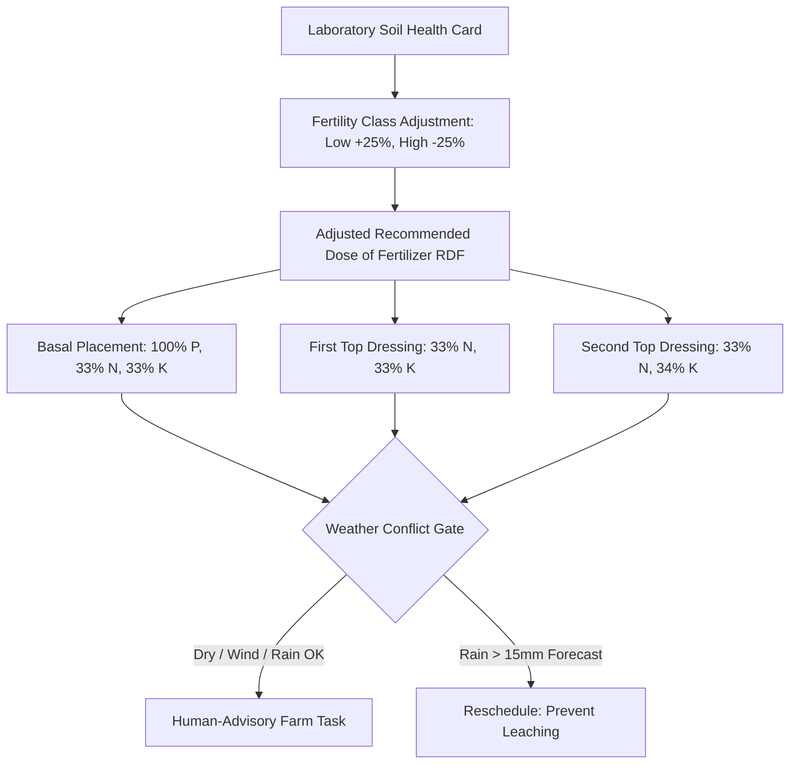

# ACREVIA — NUTRIENT PLANNING & FERTIGATION OPTIMIZATION SPECIFICATION
## Soil Health Card Grounding, PJTSAU Split Applications, Safety Ceilings & Epistemic Boundaries

**Document Identifier:** ACREVIA-SPEC-ST10-008  
**Target Subsystem:** ACREVIA Plan / Nutrient Advisory Engine  
**Classification:** Agronomic Soil Fertility Specification  
**Status:** Implemented & Verified in Production  

---

### 1. Epistemic Foundation & Laboratory Grounding Invariant

A persistent hazard in digital agriculture is estimating soil chemical nutrients (such as available nitrogen, phosphorus, or potassium) from multi-spectral satellite imagery or uncalibrated in-situ moisture sensors. 

**The ACREVIA Invariant:** Chemical nutrient planning and fertilizer prescriptions are strictly predicated on **certified laboratory soil test reports** (e.g., Soil Health Cards issued by State Agricultural Labs, KVKs, or certified private testing labs).
- **Satellite Multi-Spectral Imagery:** Sentinel-2 NDVI or NDRE reflects vegetative canopy chlorophyll density, never subsurface soil nitrate ($\text{NO}_3^-$) or exchangeable potassium ($\text{K}^+$).
- **Capacitance Soil Sensors:** Measures dielectric permittivity and bulk electrical conductivity, which cannot differentiate between beneficial potassium ions and harmful sodium salinity without calibration.

---

### 2. Soil Health Card Telemetry Ingest Schema

Nutrient formulations require the following chemical parameters measured within the past 24 months:

| Soil Parameter | Unit | Low Range | Medium Range | High Range | Analytical Method Grounding |
|---|---|---|---|---|---|
| **Available Nitrogen ($N$)** | $\text{kg/ha}$ | $< 280$ | $280 - 560$ | $> 560$ | Alkaline Permanganate Method (Subbiah & Asija) |
| **Available Phosphorus ($P_2O_5$)**| $\text{kg/ha}$ | $< 24$ | $24 - 56$ | $> 56$ | Olsen's Method for neutral/alkaline; Bray's for acidic |
| **Available Potassium ($K_2O$)** | $\text{kg/ha}$ | $< 140$ | $140 - 330$ | $> 330$ | Neutral Normal Ammonium Acetate Method |
| **Soil Reaction ($pH$)** | Dimensionless | $< 6.5$ (Acidic)| $6.5 - 8.2$ (Optimal)| $> 8.2$ (Alkaline)| $1:2.5$ Soil-Water Suspension Potentiometry |
| **Electrical Conductivity ($EC$)**| $\text{dS/m}$ | $< 1.0$ (Normal)| $1.0 - 2.0$ (Critical)| $> 2.0$ (Saline) | $1:2.5$ Soil-Water Suspension Conductometry |
| **Organic Carbon ($OC$)** | $\%$ | $< 0.50$ | $0.50 - 0.75$ | $> 0.75$ | Walkley-Black Chromic Acid Wet Oxidation |

---

### 3. Crop-Specific Nutrient Demand & Split Timing (PJTSAU Guidelines)

Fertilizer prescriptions are phased across crop growth stages to maximize Nutrient Use Efficiency (NUE) and prevent environmental runoff:

#### A. Cotton (*Gossypium hirsutum* — Hybrid / Bt)
- **Standard PJTSAU RDF:** $150 : 60 : 60\text{ kg N:P}_2\text{O}_5:\text{K}_2\text{O / ha}$ (approx $60 : 24 : 24\text{ kg / acre}$).
- **Split Protocol:**
  - *Basal (Sowing):* Entire Phosphorus ($60\text{ kg P}_2\text{O}_5$), $20\%$ Nitrogen, $20\%$ Potassium.
  - *First Top Dressing (25–30 DAS, Squaring):* $40\%$ Nitrogen, $40\%$ Potassium.
  - *Second Top Dressing (55–60 DAS, Flowering):* $40\%$ Nitrogen, $40\%$ Potassium.
  - *Foliar Correction:* $1\%\text{ MgSO}_4 + 1\%\text{ 19-19-19}$ if leaf reddening occurs during peak boll load.

#### B. Rice (*Oryza sativa* — Irrigated Transplanted)
- **Standard PJTSAU RDF:** $120 : 60 : 40\text{ kg N:P}_2\text{O}_5:\text{K}_2\text{O / ha}$ (approx $48 : 24 : 16\text{ kg / acre}$).
- **Split Protocol:**
  - *Basal:* $100\%$ Phosphorus, $33\%$ Nitrogen, $50\%$ Potassium.
  - *Active Tillering (20–25 DAT):* $33\%$ Nitrogen.
  - *Panicle Initiation (45–50 DAT):* $34\%$ Nitrogen, $50\%$ Potassium.
  - *Zinc Safeguard:* $50\text{ kg/ha ZnSO}_4$ basal once every 3 seasons; never mix directly with DAP or SSP in the same spray tank.

#### C. Chilli (*Capsicum annuum*)
- **Standard PJTSAU RDF:** $150 : 60 : 120\text{ kg N:P}_2\text{O}_5:\text{K}_2\text{O / ha}$ (approx $60 : 24 : 48\text{ kg / acre}$).
- **Split Protocol:**
  - *Basal:* $25\text{ t/ha FYM} + 100\%\text{ P}_2\text{O}_5 + 20\%\text{ N} + 20\%\text{ K}_2\text{O}$.
  - *Top Dressings:* Nitrogen and Potassium split equally across 4 intervals (30, 60, 90, 120 DAT) following each flush picking.

---

### 4. Safety Ceilings & Toxic Boundary Enforcement

To safeguard soil health and prevent water contamination, the nutrient engine enforces inviolable agronomic guardrails:
1. **Single Application Nitrogen Cap:** No single split application of Urea shall exceed $45\text{ kg N/ha}$ ($100\text{ kg Urea/ha}$) to prevent vegetative scorching and groundwater nitrate leaching.
2. **Rainfall Wash-Off Abort:** If forecast precipitation exceeds $15.0\text{ mm}$ in the succeeding 48 hours, top dressing recommendations are flagged with an urgent weather conflict holding advisory.
3. **Salinity Warning:** If soil $EC > 2.0\text{ dS/m}$, chemical fertilizer doses are downgraded and gypsum/green-manuring soil reclamation protocols are surfaced.
