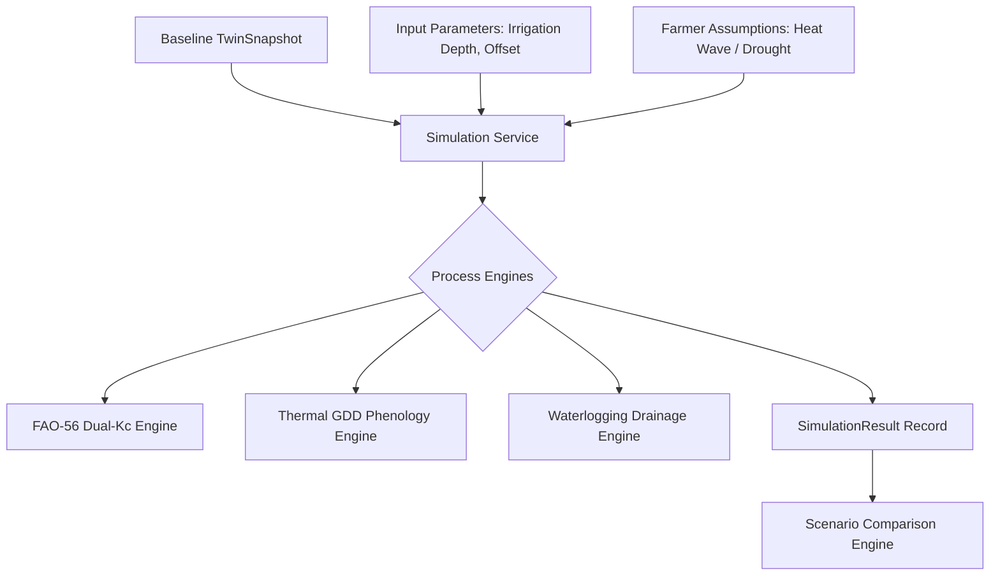
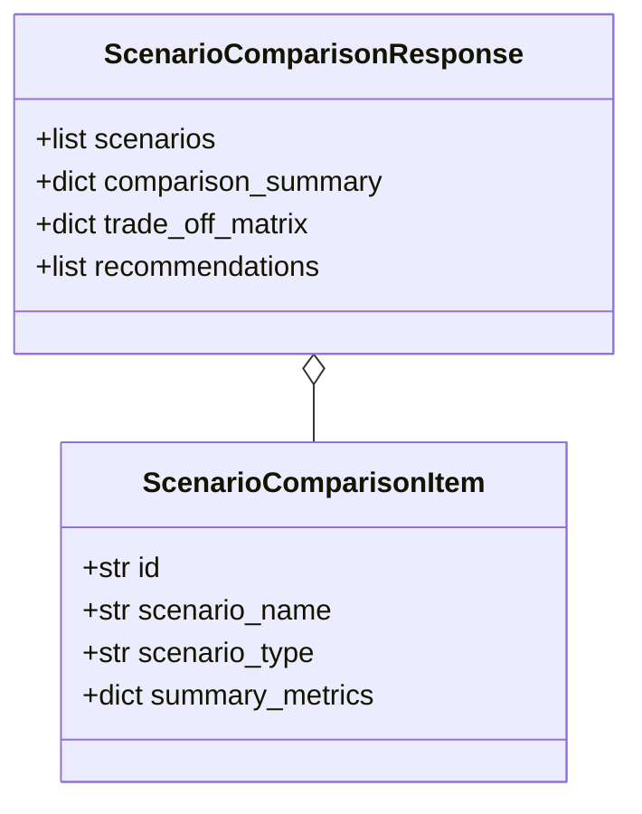

# ACREVIA — SCENARIO SIMULATION ENGINE SPECIFICATION (PILLAR B: ACREVIA SIMULATE)
## Counterfactual Modeling, Multi-Scenario Comparison, Agronomic Uncertainty & Deterministic Replay

**Document Identifier:** ACREVIA-SPEC-ST10-006  
**Target Subsystem:** ACREVIA Simulate  
**Classification:** Core Simulation Subsystem Specification  
**Status:** Implemented & Verified in Production  

---

### 1. Conceptual Architecture & Isolation Boundary

**ACREVIA Simulate** allows agricultural extension specialists, researchers, and farmers to evaluate "what-if" agronomic decisions prior to committing physical resources in the field. 

**Strict Isolation Invariant:** Simulation scenarios are strictly read-only relative to primary farm records. Executing counterfactual simulations (e.g., simulating delayed irrigation or catastrophic heat waves) **never mutates** actual farm telemetry, soil test tables, or crop operational logs.



---

### 2. Supported Counterfactual Simulation Types

The simulation subsystem implements three dedicated physical and phenological simulation pipelines:

| Scenario Type Enum | Agronomic Question Addressed | Key Input Parameters | Model & Version | Primary Simulation Outputs |
|---|---|---|---|---|
| `IRRIGATION_WATER_BALANCE` | *"What happens to soil root zone depletion if irrigation is delayed by 6 days during high heat?"* | `irrigation_depth_mm`, `days_offset`, `horizon_days` (default 14) | FAO-56 Dual-$K_c$ (`v1.4`) | Daily depletion trajectory ($D_r$), Water Stress Index ($WSI$), deep percolation loss ($DP$) |
| `THERMAL_GDD_STAGE` | *"When will my Cotton reach boll bursting under forecasted summer temperatures?"* | `horizon_days`, `avg_max_temp_c`, `avg_min_temp_c` | GDD Phenology (`v1.2`) | Accumulated thermal GDD, forecasted transition date, thermal heat-stress alerts |
| `WATERLOGGING_STRESS` | *"Will a 90mm monsoon rainfall storm cause root asphyxiation in Black Cotton soil?"* | `intense_rainfall_mm`, `duration_hours` | Hydrological Drainage (`v1.1`) | Surface ponding depth ($P_{\text{depth}}$), estimated drainage time ($T_{\text{drain}}$), risk level |

---

### 3. Side-by-Side Multi-Scenario Comparison Engine

The `/api/v1/simulations/compare` endpoint accepts multiple simulation identifiers and computes direct agronomic trade-offs across water consumption, crop stress, and timeline risks:

```json
{
  "scenario_ids": [
    "5d7b0561-c30f-4f51-b8ef-bfa5c7e148e1",
    "8a2b3472-a19f-43b5-901b-c6b2b73a2139"
  ]
}
```

#### Comparison Matrix Schema



**Comparison Evaluation Logic:**
1. **Stress Differential ($\Delta WSI$):** Computes peak water stress reduction between immediate vs delayed irrigation.
2. **Resource Efficiency ($\text{m}^3 / \text{stress-day reduction}$):** Highlights water savings vs crop risk.
3. **Agronomic Trade-off Text:** Generates trilingual explanations (Telugu, Hindi, English) detailing the consequence of each option.

---

### 4. Deterministic Replayability & Latency Budget

1. **Deterministic Reproducibility:** Every simulation execution is seeded with the exact parameters stored in `simulation_scenarios.input_parameters_json` and bound to an immutable `baseline_snapshot_id`. Re-running the simulation on identical inputs yields bit-for-bit identical results.
2. **Serverless Latency Budget:** All simulation algorithms are executed in pure optimized vector math without heavy external network dependencies during calculation. Measured execution time is **$< 200\text{ ms}$** (typically $12 - 35\text{ ms}$ on standard serverless instances), well within interactive UI thresholds.
3. **Uncertainty Metadata:** Every result contains an explicit `uncertainty_metadata_json` detailing confidence bounds (e.g., $\pm 10\%$ on root depth, $\pm 0.05$ on $K_{cb}$).
