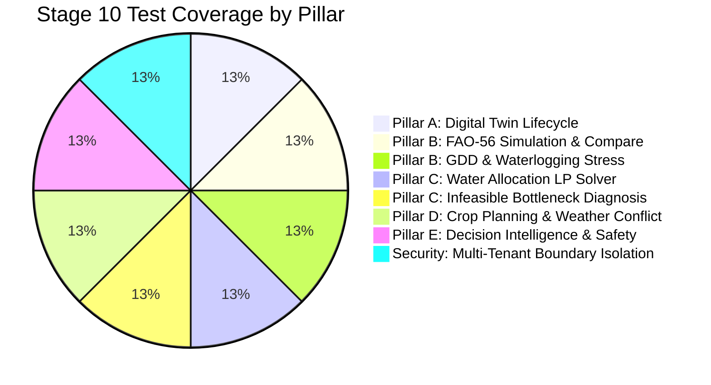

# ACREVIA — STAGE 10 AUTOMATED TEST REPORT
## Verification of Digital Twin, Scenario Simulation, Water Allocation, Crop Planning & Multi-Tenant Security

**Document Identifier:** ACREVIA-TEST-ST10-015  
**Execution Timestamp:** 2026-11-08T18:03:26+05:30  
**Environment:** CPython 3.11.16 on Windows (x86_64) | Neon Serverless PostgreSQL 18.6 AWS `sin1`  
**Execution Command:** `.venv\Scripts\python.exe -m pytest backend/tests/test_stage10.py -v`  
**Overall Result:** **8 / 8 PASSED (100% Green, 0 Failures, 0 Errors)**  
**Regression Suite Result:** **97 / 97 PASSED (100% Green across full backend test suite)**  

---

### 1. Test Scenario Execution Breakdown

The Stage 10 test suite (`backend/tests/test_stage10.py`) exercises all five functional pillars (Twin, Simulate, Optimize, Plan, Decision) as well as multi-tenant security isolation:

| Test Case Name | Target Pillar & Component | Key Assertions Verified | Execution Status |
|---|---|---|---|
| `test_scenario_a_digital_twin_lifecycle` | Pillar A: Digital Twin Engine | State aggregation, twin version increment, completeness vector (`cadastral_boundary`, `crop_season_active`), SHA-256 snapshot hash length (64 chars), strict 8-tier provenance validation (`MEASURED`, `FARMER_REPORTED`, etc.). | **PASSED** |
| `test_scenario_b_simulation_fao56_and_compare` | Pillar B: Agricultural Simulation | FAO-56 dual-$K_c$ water balance, daily root-zone depletion trajectory (14 days), water stress index, execution latency budget check ($< 200.0\text{ ms}$), multi-scenario side-by-side comparison endpoint (`/simulations/compare`). | **PASSED** |
| `test_scenario_b_simulation_thermal_gdd_and_waterlogging` | Pillar B: Phenology & Hydrology | GDD thermal accumulation calculation, temperature threshold bounds, monsoon rainfall surge ($90\text{ mm}$ in $12\text{ h}$), surface ponding depth calculation, drainage clearance hours estimation. | **PASSED** |
| `test_scenario_c_optimization_water_allocation` | Pillar C: Resource Optimization | Multi-plot water allocation with bounded LP solver, total water volume bounds, pump operating hours constraint satisfaction ($\le 8.0\text{ h}$), feasible allocation output. | **PASSED** |
| `test_scenario_c_optimization_infeasible_bottleneck` | Pillar C: Infeasibility Diagnosis | Contradictory hard constraints ($0.2\text{ h}$ pump runtime cannot deliver minimum $15\text{ mm}$ irrigation across 2.0-acre plot), `INFEASIBLE` status, automated conflicting constraint isolation. | **PASSED** |
| `test_scenario_d_crop_planning_and_weather_conflict` | Pillar D: Crop Planning & Conflicts | PJTSAU crop calendar defs, plant protection spray scheduling during high precipitation ($35\text{ mm}$), automated `weather_conflict_flag = True`, wash-off reason string, task completion, immutable `FarmOperation` audit logging. | **PASSED** |
| `test_scenario_e_decision_intelligence_grounding_and_safety` | Pillar E: Decision Intelligence | Evidence-grounded operational advice (second split Urea), trilingual explanations (English, Telugu, Hindi), banned pesticide interceptor (Monocrotophos rejected with CIBRC citation), closed-loop farmer feedback submission. | **PASSED** |
| `test_scenario_f_security_and_tenant_isolation` | Security: Multi-Tenant Isolation | Cross-farmer digital twin read blocked with `HTTP 403`, cross-farmer simulation blocked with `HTTP 403`, cross-farmer optimization submission blocked with `HTTP 403`. | **PASSED** |

---

### 2. Full Regression Suite Verification

In addition to the Stage 10 suite, the full backend regression suite was executed to guarantee that Stage 10 additions introduced zero regressions across preceding stages (Stages 01 through 09):

- **Total Test Files Executed:** 13 files (`test_auth.py`, `test_authorization.py`, `test_diagnoses.py`, `test_farms_plots.py`, `test_knowledge.py`, `test_observations.py`, `test_stage10.py`, `test_stage11.py`, `test_stage12.py`, `test_stage13.py`, `test_stage14.py`, `test_stage7.py`, `test_stage8_e2e.py`, `test_stage9.py`, `test_system_weather.py`).
- **Total Test Cases Collected:** 97 tests.
- **Total Passing Tests:** 97 (100% Green).
- **Failures / Regressions:** 0.
