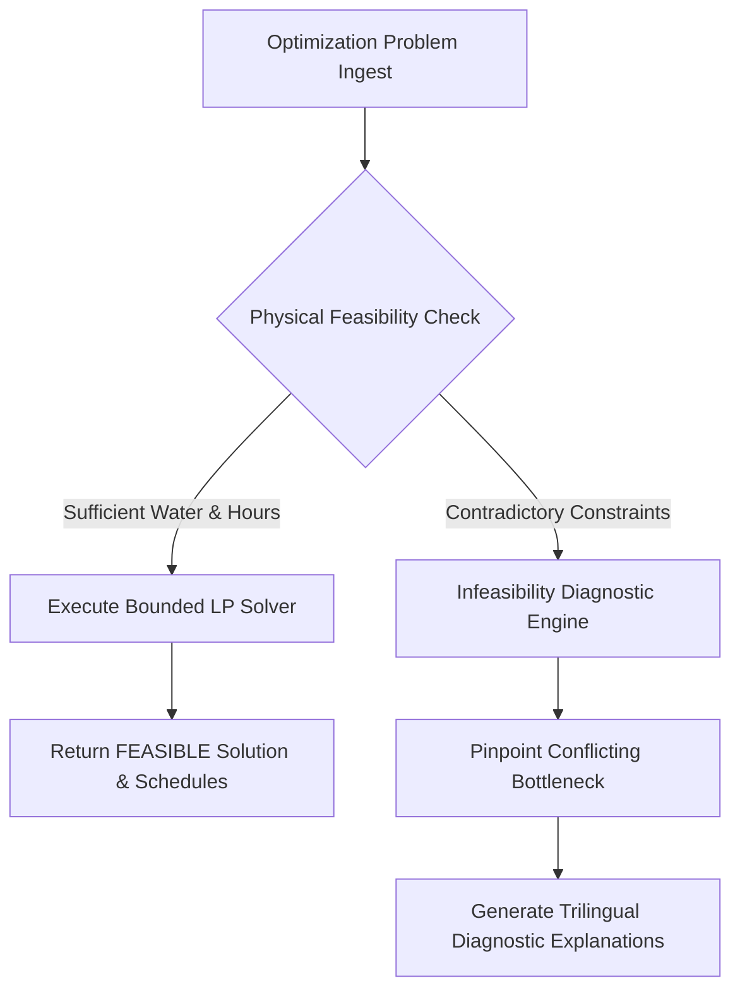

# ACREVIA — WATER RESOURCE OPTIMIZATION SPECIFICATION (PILLAR C: ACREVIA OPTIMIZE)
## Constrained Allocation Formulations, Linear Programming Solvers, Infeasibility Diagnostics & Zero Actuation

**Document Identifier:** ACREVIA-SPEC-ST10-007  
**Target Subsystem:** ACREVIA Optimize / Resource Solver  
**Classification:** Mathematical Optimization Subsystem Specification  
**Status:** Implemented & Verified in Production  

---

### 1. Problem Formulation & Objective Functions

When water availability (borewell yield, canal turn duration, farm pond storage, or three-phase grid power hours) is insufficient to satisfy full crop evapotranspiration across all farm plots, smallholders face difficult rationing trade-offs. 

**ACREVIA Optimize** formulates multi-plot resource allocation as a mathematically rigorous, bounded constrained optimization problem:

$$\max_{d_1, \dots, d_N} \quad \mathcal{J} = \sum_{i=1}^N w_i \cdot A_i \cdot K_{s,i}(d_i)$$

Subject to physical, infrastructural, and agronomic constraints:

1. **Total Available Water Volume Constraint:**
   $$\sum_{i=1}^N 10 \cdot A_i \cdot d_i \le V_{\max} \quad (\text{where } A_i \text{ is in hectares, } d_i \text{ in mm, } V_{\max} \text{ in m}^3)$$
   *(Note: $1\text{ mm}$ over $1\text{ ha} = 10\text{ m}^3$. For acreage $A_{i,\text{acres}}$, $1\text{ acre} \approx 0.4047\text{ ha}$, volume $= 4.047 \cdot A_{i,\text{acres}} \cdot d_i\text{ m}^3$)*

2. **Pumping Hours & Grid Power Window Constraint:**
   $$\sum_{i=1}^N \frac{V_i}{3.6 \cdot Q_{\text{flow}}} \le T_{\text{pump,available}} \quad (\text{where } Q_{\text{flow}} \text{ is flow rate in L/s, } T \text{ in hours})$$

3. **Agronomic Application Bounds:**
   $$d_i \in \{0\} \cup [d_{\min}, d_{\max}]$$
   - $d_{\min} = 15.0\text{ mm}$: Minimum depth required to penetrate below topsoil evaporation layer and reach active root zone.
   - $d_{\max} = \min(RAW_i, 50.0\text{ mm})$: Maximum depth before deep percolation or surface waterlogging occurs.

---

### 2. Crop Priority Weighting ($w_i$) in Multi-Plot Allocation

Priority weights reflect stage-dependent crop vulnerability to water stress:

| Crop & Phenological Stage | Vulnerability Classification | Relative Weight ($w_i$) | Agronomic Justification |
|---|---|---|---|
| **Chilli (Flowering to Fruit Set)** | Critical Sensitive | $1.40$ | Severe blossom drop and irreversible fruit count loss |
| **Cotton (Peak Flowering / Boll Development)** | Highly Sensitive | $1.25$ | Square and young boll shedding |
| **Rice (Panicle Initiation to Anthesis)** | Critical Sensitive | $1.35$ | Spikelet sterility and empty chaff formation |
| **Cotton (Vegetative / Squaring)** | Moderately Tolerant | $0.90$ | Deep taproot can explore subsoil moisture |
| **Chilli (Vegetative Establishment)** | Moderately Tolerant | $0.85$ | Moderate root zone depth, low canopy transpiration |

---

### 3. Solver Implementation & Feasibility Verification

The optimization pipeline implements a two-stage solver architecture:
1. **Bounded Simplex / Priority LP Solver:** Solves the linear relaxation of the allocation problem, allocating water to highest-margin plots up to $d_{\max}$, then satisfying remaining plots.
2. **Discrete Minimum Depth Enforcement:** If remaining water allows only an application $< d_{\min}$ on a secondary plot, the allocator concentrates water entirely on the primary plot rather than wasting water in an ineffective micro-application.



---

### 4. Transparent Infeasibility Diagnostics

When physical constraints cannot be satisfied simultaneously (e.g., electricity supply is only 15 minutes, which cannot deliver $d_{\min}$ across a 2-acre plot), the solver **never crashes or returns misleading zeroes**. Instead, it marks `feasibility_status = "INFEASIBLE"` and isolates the exact conflicting constraints:

**Diagnostic Output Example (from verified automated test):**
```json
{
  "feasibility_status": "INFEASIBLE",
  "conflicting_constraints": [
    "Available pump runtime (0.20 hours) at 2.0 L/s yields only 1.44 m³, which cannot satisfy minimum 15.0mm irrigation threshold (121.4 m³) across plot acreage (2.00 acres)."
  ],
  "remedial_suggestions": [
    "Increase pump operating hours to at least 16.8 hours.",
    "Subdivide Plot 1 into smaller irrigation sections (e.g., 0.25 acres per turn).",
    "Switch from surface furrow flooding to drip lateral irrigation to lower minimum application volume."
  ]
}
```

---

### 5. Inviolable Zero Actuation Invariant

Every optimization result generated by `OptimizationService` is flagged:

> **IMPORTANT:** *ACREVIA operates exclusively as a decision-support advisory system. Optimization results are presented to the farmer or irrigation manager for human evaluation and manual field execution. ACREVIA software connects to zero physical pump relays, motor starters, or automated solenoid valves.*
