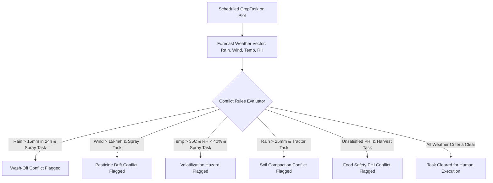

# ACREVIA — WEATHER-WINDOW & INTERVENTION CONFLICT ENGINE SPECIFICATION
## Dynamic Conflict Detection, Spray Wash-Off Rules, PHI/REI Interval Enforcement & Operational Audit Trails

**Document Identifier:** ACREVIA-SPEC-ST10-009  
**Target Subsystem:** ACREVIA Plan / Operations Engine  
**Classification:** Operational Safety & Agrometeorological Conflict Specification  
**Status:** Implemented & Verified in Production  

---

### 1. Conceptual Framework & Operational Context

Agricultural operations in Telangana are acutely sensitive to immediate meteorological conditions. Applying contact or systemic plant protection chemicals immediately prior to heavy rainfall wastes expensive inputs, causes pesticide runoff into community water bodies, and leaves crops vulnerable. Similarly, spraying during high winds leads to droplet drift onto non-target crops and neighboring residential parcels.

**ACREVIA Plan** continuously evaluates scheduled agricultural tasks against real-time and 72-hour forecast weather vectors to automatically flag operational conflicts and recommend safe rescheduling.

---

### 2. Meteorological Conflict Rules Matrix

The conflict engine evaluates four standard environmental stress regimes:

| Conflict Regime | Primary Threshold Condition | Affected Task Categories | Operational Risk Avoided | Automated Advisory Output |
|---|---|---|---|---|
| **Rainfall Wash-Off Hazard** | $P_{\text{forecast}} \ge 15.0\text{ mm}$ within $24\text{ hours}$ | `PLANT_PROTECTION`, `FERTILIZATION` | Chemical active ingredient washed into soil; zero foliar absorption; groundwater leaching | *"Heavy rainfall (35.0mm) forecasted on due date. High risk of foliar wash-off and chemical waste. Postpone foliar spray until 24h after rainfall ceases."* |
| **Pesticide Spray Drift Hazard** | Wind Speed $> 15.0\text{ km/h}$ or Gusts $> 25.0\text{ km/h}$ | `PLANT_PROTECTION` | Off-target drift onto adjacent plots, water bodies, or livestock; applicator exposure | *"High wind speed (18 km/h) forecasted. Risk of spray drift onto non-target areas. Reschedule spraying to early morning (06:00–09:00) when wind is calm."* |
| **Droplet Volatilization Hazard** | $T_{\max} > 35.0^\circ\text{C}$ and $RH < 40\%$ | `PLANT_PROTECTION` | Fine aerosol droplets evaporate before reaching plant cuticle; leaf scorching | *"High ambient temperature and low humidity will cause rapid droplet evaporation. Spray only in late afternoon after 16:30."* |
| **Soil Compaction / Sinking Hazard** | Recent rain $> 25.0\text{ mm}$ in preceding $24\text{ hours}$ | `LAND_PREPARATION`, `HARVEST` (Machinery) | Tractor tires sinking, deep rutting, severe destruction of Black Cotton soil macropores | *"Soil profile saturated. Heavy machinery operation will cause severe subsoil compaction. Delay tractor operations by 48 hours."* |

---

### 3. Food Safety & Worker Health Interval Enforcement (PHI & REI)

In addition to weather conditions, the conflict engine strictly audits chemical withholding intervals:

1. **Pre-Harvest Interval (PHI) Violation Gate:**
   - If a harvest task is scheduled on a plot where an insecticide or fungicide application occurred within that chemical's statutory PHI (e.g., $15\text{ days}$ for Profenofos, $7\text{ days}$ for Emamectin Benzoate), the task is blocked with a critical safety alert:
   > *"CANNOT HARVEST: Plot 1 was treated with Profenofos 6 days ago. Statutory Pre-Harvest Interval (PHI) is 15 days. Minimum 9 days remaining before produce meets Maximum Residue Limits (MRLs)."*

2. **Restricted-Entry Interval (REI) Warning:**
   - Field operations requiring human presence (weeding, thinning, manual irrigation) scheduled within $24 - 48\text{ hours}$ of toxic agrochemical application are flagged with mandatory Personal Protective Equipment (PPE) requirements or rescheduled.

---

### 4. Crop Task Lifecycle & Immutable FarmOperation Audit Logging

When a farmer completes a task via `/api/v1/planning/tasks/{id}/complete`, the system executes an atomic transaction:
1. Marks `CropTask.status = "COMPLETED"` and records `completed_date`, `labor_hours`, `materials_used`, and observations.
2. Creates an immutable `FarmOperation` audit record in the farm journal:
   - Stores exact material quantities, laborer hours, and equipment utilized.
   - Updates the digital twin synchronization event log with an operational hash.
   - Feeds historical operational telemetry into the completeness engine ($D08$).
