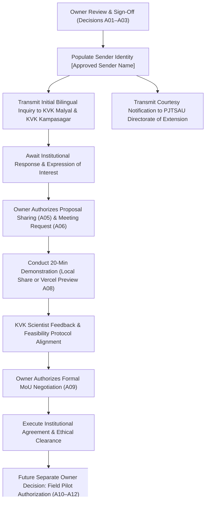

# ACREVIA — PHASE 02 FINAL OWNER DECISION SUMMARY
## EXECUTIVE ACTION BRIEF, REPOSITORY BASELINE & UNBUNDLED AUTHORIZATION ROADMAP

**Programme:** ACREVIA — Agricultural Intelligence Platform  
**Target Geography:** Telangana, India  
**Target Institutions:**
1. Krishi Vigyan Kendra (KVK), Malyal — Mahabubabad District
2. Krishi Vigyan Kendra (KVK), Kampasagar — Nalgonda District
3. Professor Jayashankar Telangana State Agricultural University (PJTSAU) — Office of the Director of Extension
4. ICAR — Agricultural Technology Application Research Institute (ATARI), Zone X, Hyderabad  
**Reported Repository Baseline:** `14dc601`  
**Document Code:** `PHASE_02_FINAL_OWNER_DECISION_SUMMARY.md`  
**Date of Audit Review:** November 9, 2026  
**Operational Status:** **`READY_FOR_OWNER_DECISION`**  
**Outreach Authorization Status:** **`GO_FOR_OUTREACH_PENDING_OWNER_APPROVAL`**  
**Field Pilot Status:** **`FIELD_PILOT_STATUS = NOT_AUTHORIZED`**  
**External Communication Status:** **`INSTITUTIONAL_EMAILS_SENT = FALSE`**  

---

## 1. Executive Mission & Operating Principle

This document serves as the executive summary brief for the project owner. It synthesizes the technical, institutional, legal, and operational posture of ACREVIA and establishes an unbundled decision framework across 12 distinct action gates (A01–A12).

### Foundational Operating Principle:
> **Prepare everything. Verify everything. Approve nothing on behalf of the owner. Send nothing without explicit authorization.**

No external communication has been transmitted. No farmers have been recruited. No staging cloud deployments have been triggered. All preparatory documents are filed in the repository and held in a `PENDING` state awaiting formal owner sign-off.

---

## 2. Verified Repository Baseline

```
+========================================================================================================================+
| ACREVIA REPOSITORY AUDIT BASELINE (COMMIT 14dc601)                                                                     |
+----+-------------------------------+-------------------+---------------------------------------------------------------+
| #  | Verification Dimension        | Verified Status   | Verifiable Evidence Baseline                                  |
+----+-------------------------------+-------------------+---------------------------------------------------------------+
| 01 | Git Working Tree Lineage      | COMPLETE_VERIFIED | HEAD at 14dc601 (branch main); clean working tree; 0 diff     |
| 02 | Automated Backend Test Suite  | COMPLETE_VERIFIED | 145/145 passing (includes 9 staging acceptance tests) in 356s |
| 03 | Machine Learning Test Suite   | COMPLETE_VERIFIED | 55/55 passing (CropVision & KrishiBrain models) in 21.05s     |
| 04 | Vision API Endpoint Tests     | COMPLETE_VERIFIED | 9/9 passing (ONNX runtime inference & Grad-CAM) in 18.12s     |
| 05 | Frontend Test Suite (Vitest)  | COMPLETE_VERIFIED | 43/43 passing (offline queue, PWA caching, i18n parity) in 1s |
| 06 | TypeScript Static Compilation | COMPLETE_VERIFIED | cd frontend; npx tsc --noEmit executed with 0 errors          |
| 07 | Staging Cloud Architecture    | COMPLETE_VERIFIED | frontend/vercel.json (sin1 region), .env.staging.example      |
| 08 | Application Tenant Isolation  | COMPLETE_VERIFIED | verify_farm_access() returns HTTP 403 on cross-tenant read    |
| 09 | Satellite Pipeline Fallback   | COMPLETE_VERIFIED | Element 84 Earth Search STAC -> MS Planetary Computer fallback|
| 10 | Redis Distributed Limiting    | COMPLETE_WITH_LMT | Staging namespace acrevia_staging:* isolated; fail-open mode  |
| 11 | Free-Tier Financial Controls  | COMPLETE_WITH_LMT | Code enforces hard HTTP 429 on quota exhaustion; no paid tier |
+----+-------------------------------+-------------------+---------------------------------------------------------------+
|    | TOTAL PHYSICAL TEST HARNESS   | COMPLETE_VERIFIED | 252/252 PHYSICAL TESTS PASSING (100% SUCCESS RATE)            |
+----+-------------------------------+-------------------+---------------------------------------------------------------+
```

---

## 3. What is Ready vs What Requires Owner Decision

### 3.1 What is Fully Prepared & Audited:
1. **Institutional Grounding:** Four institutional entities verified against official university (`pjtau.edu.in`) and ICAR (`atarihyd.res.in`) records.
2. **Discrepancy Resolutions:** Leadership names, spellings, and titles reconciled; generic institutional addressing established for PJTSAU Directorate.
3. **Bilingual Correspondence:** Complete, culturally grounded English and formal Telugu email drafts prepared for all four institutions in `KVK_OUTREACH_EMAIL_DRAFTS.md`.
4. **Research Governance:** Legally qualified non-binding term sheet (`ACREVIA_INSTITUTIONAL_COLLABORATION_TERM_SHEET.md`) and 30-day supervised feasibility evaluation protocol (`30_DAY_SUPERVISED_FEASIBILITY_EVALUATION_PROTOCOL.md`) established.
5. **DPDP Data Protection:** Full data lifecycle, processor boundaries, data minimization (zero Aadhaar/land titles), and qualified 48-hour deletion pathway documented.
6. **Technical Demonstration Blueprint:** 12-point synthetic-data demonstration procedure prepared in `PHASE_02_LIVE_DEMONSTRATION_READINESS.md`.

### 3.2 What Requires Explicit Owner Decision:
1. **Selection of Outreach Inquiries:** Which institutions to contact (Decisions A01, A02, A03, A04).
2. **Sender Identity Insertion:** Owner must supply verified sender details (`[Approved Sender Name]`, `[Verified Sender Email]`) prior to dispatch.
3. **Proposal & Meeting Approvals:** Authorizing proposal document distribution (A05) and exploratory meeting requests (A06).
4. **Staging Cloud Trigger:** Authorizing live Vercel Preview cloud deployment (A08) versus conducting local screen-share demonstration.
5. **MoU Initiation:** Authorizing negotiation of non-binding formal agreements upon institutional interest (A09).

---

## 4. Exact Institutional Recipients & Verification Status

```
+==================================================================================================================================================+
| AUTHORITATIVE RECIPIENT DIRECTORY                                                                                                                |
+--------------------------+------------------------------------+------------------------------------+-----------------------+---------------------+
| Dimension                | KVK Malyal                         | KVK Kampasagar                     | PJTSAU Directorate    | ICAR-ATARI Zone X   |
+--------------------------+------------------------------------+------------------------------------+-----------------------+---------------------+
| Recommended Addressee    | The Programme Coordinator          | The Programme Coordinator          | The Office of the     | Dr. Shaik N. Meera  |
|                          | (Dr. Banoth Dileep Kumar, Sr. Sci.)| (Dr. Chandrashekar, Sr. Scientist) | Director of Extension | Director            |
| Academic Specialization  | Entomology / Plant Protection      | Agronomy / Crop Production         | Extension Leadership  | Extension Systems   |
| Primary Official Inbox   | kvkwgl@pjtau.edu.in                | kvkkampasagar@pjtau.edu.in         | de@pjtau.edu.in       | director.atari-hyd  |
|                          |                                    |                                    |                       | @icar.org.in        |
| Secondary Alternate      | kvk.wgl@gmail.com                  | kvkkampasagar2011@gmail.com        | None published        | atarihyderabad      |
|                          |                                    |                                    |                       | @yahoo.com          |
| Official Phone Channel   | 8333818262 / 08719-240182          | 8333818260                         | 040-24015011 to 15    | 040-24006500        |
| Source Verification URL  | pjtau.edu.in / telangana.gov.in    | pjtau.edu.in / telangana.gov.in    | pjtau.edu.in          | atarihyd.res.in     |
| Last Verification Date   | November 9, 2026                   | November 9, 2026                   | November 9, 2026      | November 9, 2026    |
| Source Verification Code | CURRENT_OFFICIAL                   | CURRENT_OFFICIAL                   | CURRENT_OFFICIAL_GEN. | CURRENT_OFFICIAL    |
| Outreach Strategy Role   | Primary Target (Cotton/Chilli)     | Primary Target (Rice/Cotton/AWD)   | Administrative Courtesy| Optional Zonal Note |
+--------------------------+------------------------------------+------------------------------------+-----------------------+---------------------+
```

---

## 5. Recommended Outreach & Execution Sequence



---

## 6. The 12 Unbundled Owner Decisions (A01–A12)

Every action is isolated into an independent decision gate in `PHASE_02_INSTITUTIONAL_OUTREACH_AUTHORIZATION_REGISTER.md`:

| Gate ID | Decision Scope | Default Status | Recommended Strategy |
|---|---|---|---|
| **A01** | KVK Malyal Introductory Outreach Inquiry | `PENDING` | **APPROVE** (Primary cotton/chilli center) |
| **A02** | KVK Kampasagar Introductory Outreach Inquiry | `PENDING` | **APPROVE** (Primary rice/cotton/AWD center) |
| **A03** | PJTSAU Extension Leadership Courtesy Notice | `PENDING` | **APPROVE** (Required protocol courtesy) |
| **A04** | ICAR-ATARI Zone X Optional Courtesy Notice | `PENDING` | **HOLD** (Option A: Engage state KVKs first) |
| **A05** | Sharing Detailed Institutional Proposals | `PENDING` | **APPROVE** (Upon institutional response) |
| **A06** | Requesting Exploratory Discussion / Briefing | `PENDING` | **APPROVE** (Virtual or station visit) |
| **A07** | Live Technical Demonstration of CropVision/RAG | `PENDING` | **APPROVE** (Controlled synthetic data only) |
| **A08** | Vercel Preview Staging Cloud Deployment | `PENDING` | **OWNER CHOICE** (Cloud URL vs local share) |
| **A09** | Formal Non-Binding MoU Negotiation | `PENDING` | **HOLD** (Pending successful demonstration) |
| **A10** | Farmer Recruitment & Community Surveying | `NOT_AUTHORIZED` | **STRICTLY GATED** (Requires executed MoU) |
| **A11** | Farmer Personal Data & Coordinate Collection | `NOT_AUTHORIZED` | **STRICTLY GATED** (Requires farmer consent) |
| **A12** | Field Pilot Trials & Farm Interventions | `NOT_AUTHORIZED` | **STRICTLY GATED** (Requires ethics clearance) |

---

## 7. Strict Operational Boundaries & Absolute Prohibitions

1. **Zero External Communication:** No emails, calls, WhatsApp messages, or web inquiries may be sent until the owner executes Decisions A01–A03.
2. **Zero Farmer Activities:** `FARMER_RECRUITMENT_STARTED = FALSE` and `FARMER_DATA_COLLECTION_STARTED = FALSE`. No farmers may be contacted, surveyed, or enrolled.
3. **Zero Production Mutation:** No database migrations, secret rotations, or infrastructure alterations.
4. **Zero Paid Tier Activation:** Platform remains 100% within verified free-tier limits.
5. **Field Pilot Gating:** **`FIELD_PILOT_STATUS = NOT_AUTHORIZED`**.

---

## 8. Exact Next Action for the Owner

The project owner is requested to:
1. Open [PHASE_02_INSTITUTIONAL_OUTREACH_AUTHORIZATION_REGISTER.md](file:///c:/Users/gokul/OneDrive/Documents/projects/docs/pilot/PHASE_02_INSTITUTIONAL_OUTREACH_AUTHORIZATION_REGISTER.md).
2. Review the unbundled decision gates A01 through A09.
3. Mark approval decisions and provide initials/signature where authorized.
4. Supply verified sender name and email address in the designated fields.
