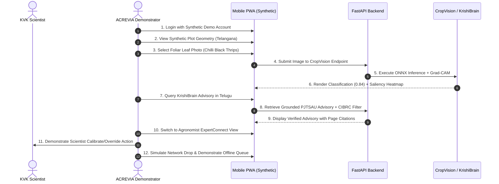

# ACREVIA — PHASE 02 LIVE DEMONSTRATION READINESS
## STAGING CLOUD ARCHITECTURE, CONTROLLED DEMONSTRATION BLUEPRINT & DEPLOYMENT GATING REGISTER

**Programme:** ACREVIA — Agricultural Intelligence Platform  
**Document Code:** `PHASE_02_LIVE_DEMONSTRATION_READINESS.md`  
**Target Geography:** Telangana, India  
**Audited Baseline Commit:** `14dc601`  
**Audit Reference Date:** November 9, 2026  
**Staging Cloud Deployment Status:** **`HOLD — PENDING OWNER AUTHORIZATION (GATE A08)`**  
**Live Staging Deployment Triggered:** **`LIVE_STAGING_DEPLOYMENT_TRIGGERED = FALSE`**  
**Demonstration Mode:** **`CONTROLLED_SYNTHETIC_DATA_ONLY`**  

---

> [!CAUTION]
> **GOVERNANCE & COST DIRECTIVE — NO DEPLOYMENT TRIGGERED:**  
> The staging configuration has been verified in the repository.  
> **NO LIVE VERCEL PREVIEW DEPLOYMENT HAS BEEN EXECUTED.**  
> A live cloud deployment requires explicit owner authorization under Decision A08.  
> For technical briefings prior to cloud deployment, a **local screen-share demonstration** using verified synthetic test fixtures is the recommended default.

---

## 1. Truthful Staging Deployment Status Register

To prevent any confusion between configuration readiness and actual live infrastructure existence, the status of each staging component is explicitly documented:

```
+========================================================================================================================+
| ACREVIA STAGING INFRASTRUCTURE TRUTHFUL STATUS REGISTER                                                                |
+----+-----------------------------------+-----------------------+-------------------------------------------------------+
| #  | Infrastructure Component          | Status Code           | Physical Audit Finding Baseline                       |
+----+-----------------------------------+-----------------------+-------------------------------------------------------+
| 01 | Vercel Deployment Blueprint       | CONFIGURATION_VERIFIED| frontend/vercel.json verified; sin1 (Singapore) region|
| 02 | Security Response Headers         | CONFIGURATION_VERIFIED| nosniff, DENY, strict-origin, camera=(self) configured|
| 03 | Staging Environment Blueprint     | CONFIGURATION_VERIFIED| .env.staging.example verified with zero-cost limits   |
| 04 | Neon Staging Database Branch      | BRANCH_PREPARED       | Staging branch configuration defined in blueprint     |
| 05 | Upstash Redis Staging Namespace   | NAMESPACE_ISOLATED    | Prefix 'acrevia_staging:*' isolated from production   |
| 06 | Live Staging Cloud Deployment     | DEPLOYMENT_NOT_TRIGGER| No Vercel Preview URL generated; holds for A08 sign-off|
| 07 | Staging Acceptance Test Suite     | PASSED_LOCAL_FIXTURES | 9/9 staging acceptance tests passed in backend harness|
| 08 | Live Cloud Health Check           | LOCAL_MOCK_ONLY       | Local mock endpoints pass; cloud URL unverified       |
+----+-----------------------------------+-----------------------+-------------------------------------------------------+
|    | OVERALL DEMONSTRATION READINESS   | READY_CONDITIONAL     | Ready for Local Screen-Share; Cloud URL holds for A08 |
+----+-----------------------------------+-----------------------+-------------------------------------------------------+
```

---

## 2. Staging Configuration & Isolation Architecture

### 2.1 Frontend Configuration (`frontend/vercel.json`):
- **Region:** `sin1` (Singapore) — Minimizes network latency to Telangana (~45–60 ms RTT).
- **Security Headers:**
  - `X-Content-Type-Options: nosniff` (Prevents MIME-sniffing exploits).
  - `X-Frame-Options: DENY` (Mitigates clickjacking in mobile and web webviews).
  - `Referrer-Policy: strict-origin-when-cross-origin`.
  - `Permissions-Policy: camera=(self), microphone=(self), geolocation=()`.
- **Framework:** Next.js 16 App Router with offline service worker.

### 2.2 Backend & Data Isolation Configuration:
- **Neon PostgreSQL:** Operates on an isolated staging branch (`acrevia_staging`) created via Neon's zero-cost ephemeral branching. Completely isolated from production data.
- **Upstash Redis:** All cache keys and distributed rate-limiting buckets strictly enforce the `acrevia_staging:*` namespace. Rate limiter operates in fail-open mode during connection dropouts to prevent false denials.
- **GroqCloud AI Inference:** Operates using ephemeral inference (`qwen/qwen3.8-27b`) under strict zero-retention mode. No prompt data is stored or used for model training.
- **Element 84 Earth Search:** Anonymous STAC API queries using parcel bounding boxes. Zero user tokens or credentials transmitted.
- **Open-Meteo:** Anonymous microclimate queries with 15-minute in-memory caching.

---

## 3. Controlled 12-Point Technical Demonstration Procedure

When conducting a technical briefing for university scientists (e.g. 20-minute virtual briefing), the demonstrator must follow this standardized sequence using **strictly synthetic test fixtures**:



### Detailed Demonstration Checklist:
1. **Synthetic Demo Account:** Use pre-seeded credential `demo_scientist@acrevia.internal` or test OTP `000000`. No real farmer credentials.
2. **Synthetic Farm and Plot Geometry:** Load synthetic parcel polygons located in Mahabubabad (Cotton/Chilli) and Nalgonda (Rice).
3. **Non-Sensitive Test Imagery:** Use standard agricultural benchmark photos from `backend/tests/fixtures/` representing:
   - Cotton: Healthy vs Pink Bollworm damaged square.
   - Chilli: Healthy vs Chilli Black Thrips foliar curling.
   - Rice: Healthy vs Leaf Blast (*Magnaporthe oryzae*) spindle lesion.
4. **CropVision Inference & Explainability:**
   - Demonstrate real-time inference latency ($<150\text{ ms}$ on local ONNX Runtime).
   - Display Grad-CAM visual attention heatmap highlighting the exact necrotic lesion.
   - Demonstrate model abstention when an out-of-domain image (e.g., random object) is submitted.
5. **Multilingual KrishiBrain Interaction:**
   - Submit agronomic inquiry in Telugu: `"మిర్చి పంటలో నల్ల తామర పురుగుల నివారణకు సిఫార్సు చేయబడిన పద్ధతులు ఏమిటి?"`
   - Show synthesized guidance citing PJTSAU *Vyavasaya Panchangam* chapter and page references.
   - Demonstrate CIBRC safety guardrail abstaining from off-label chemical formulations.
6. **ExpertConnect Agronomist Portal:**
   - Log into the agronomist interface.
   - Review pending AI diagnostic reports.
   - Demonstrate the scientist's authority to validate, adjust confidence, or reject the AI recommendation before farmer viewing.
7. **Weather & RiskCast:**
   - Display 7-day microclimate forecast from Open-Meteo for the synthetic parcel coordinate.
   - Show temperature, humidity, and disease risk index computation.
8. **Satellite Vegetation Tracing:**
   - Display Sentinel-2 NDVI calculation using Warangal/Nalgonda open COG tile fixtures.
   - Explain Earth Search STAC query and automatic Planetary Computer fallback.
9. **Offline Observation Queue:**
   - Disconnect network in browser developer tools (Offline mode).
   - Capture a simulated field observation and show it queued in IndexedDB.
   - Re-enable network and show automatic background synchronization.
10. **Error & Outage Resilience:**
    - Demonstrate graceful degradation when Redis cache is unavailable (in-memory rate limiting).
11. **Tenant Isolation Verification:**
    - Attempt to access a different synthetic tenant's farm ID and observe strict HTTP 403 response.
12. **Mobile Compatibility:**
    - Demonstrate fully responsive PWA layout on standard Android viewport (360×800 px).

---

## 4. Absolute Data Safety & Privacy Rules for Demonstrations

1. **NO REAL FARMER DATA:** Real farmer phone numbers, names, GPS coordinates, land records, or facial images must NEVER be loaded into demonstration environments.
2. **SYNTHETIC DATA ONLY:** All demonstration accounts, parcels, and crop images must originate from repository test fixtures.
3. **NO LIVE PESTICIDE PRESCRIPTIONS:** The demonstrator must emphasize that all advisories shown are demonstration samples anchored in published university guidelines, requiring human agronomist approval before field application.

---

## 5. Live Cloud Deployment Authorization & Rollback Procedure (Gate A08)

If the project owner decides to deploy a live Vercel Preview staging URL for the demonstration (Decision A08):

### Pre-Deployment Checklist:
- [ ] Decision A08 signed by project owner.
- [ ] Vercel Preview environment variables populated from `.env.staging.example`.
- [ ] Neon PostgreSQL staging branch active.
- [ ] Upstash Redis staging namespace verified.
- [ ] Staging domain restricted via HTTP basic authentication or Vercel password protection to prevent public search indexing.

### Deployment Execution (Owner or Authorized DevOps Only):
```bash
# Execute within frontend directory
cd frontend
vercel deploy --prebuilt --preview
```

### Rollback Procedure:
```bash
# If any anomaly occurs, immediately deactivate the deployment
vercel rollback [DEPLOYMENT_URL]
# Or remove the preview deployment via Vercel CLI
vercel remove [DEPLOYMENT_NAME] --yes
```

### Post-Deployment Verification:
1. Verify `sin1` edge execution region.
2. Verify security response headers (`X-Frame-Options: DENY`, `X-Content-Type-Options: nosniff`).
3. Confirm HTTP 403 on cross-tenant access.
4. Confirm zero traffic to production databases.

---

## 6. Demonstration Readiness Sign-Off

```
+========================================================================================================================+
| TECHNICAL DEMONSTRATION READINESS SUMMARY                                                                              |
+-----------------------------------+-----------------------------------+------------------------------------------------+
| Demonstration Dimension           | Readiness Status                  | Permitted Demonstration Method                 |
+-----------------------------------+-----------------------------------+------------------------------------------------+
| Local Screen-Share Demonstration  | FULLY READY                       | Permitted immediately upon A06 approval        |
| Live Cloud Vercel Preview Deploy  | STANDBY (Gated)                   | Permitted ONLY upon explicit A08 owner sign-off|
+-----------------------------------+-----------------------------------+------------------------------------------------+
```
