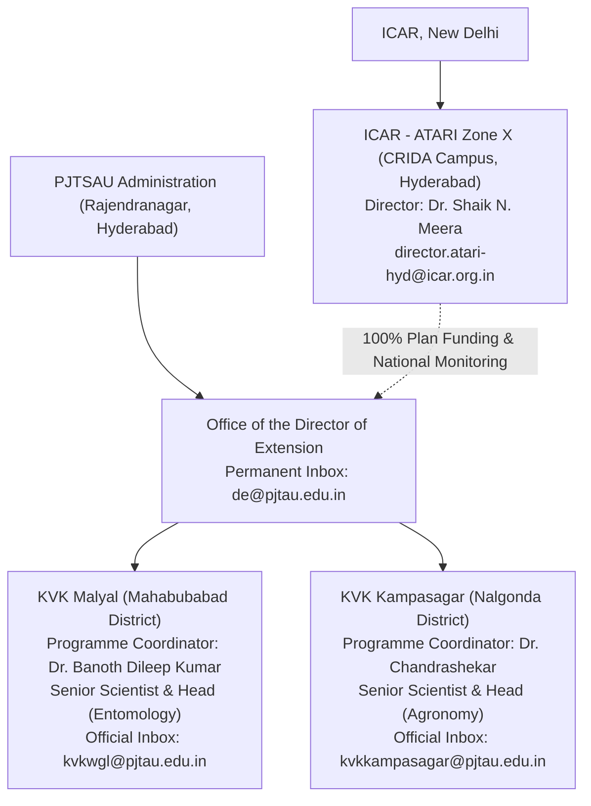

# ACREVIA — PHASE 02 OUTREACH PRE-AUTHORIZATION DOSSIER
## EXECUTIVE DUE DILIGENCE, INSTITUTIONAL ASSURANCE & GOVERNANCE AUTHORIZATION PACKAGE

**Programme:** ACREVIA — Agricultural Intelligence Platform  
**Target Geography:** Telangana, India  
**Target Institutions:**
1. Krishi Vigyan Kendra (KVK), Malyal — Mahabubabad District
2. Krishi Vigyan Kendra (KVK), Kampasagar — Nalgonda District
3. Professor Jayashankar Telangana State Agricultural University (PJTSAU) — Directorate of Extension
4. ICAR — Agricultural Technology Application Research Institute (ATARI), Zone X, Hyderabad  
**Host University / Council:** PJTSAU / ICAR  
**Document Code:** `PHASE_02_OUTREACH_PRE_AUTHORIZATION_DOSSIER.md`  
**Audited Commit Baseline:** `c329b67`  
**Execution Standard:** Evidence Before Claims • Verified Identity Before Outreach • Legal Review Before Compliance Claims • Consent Before Personal Data Collection • Authorization Before External Action  
**Overall Readiness Recommendation:** **`READY_FOR_OWNER_REVIEW`**  
**Outreach Authorization Status:** **`GO_FOR_OUTREACH_PENDING_OWNER_APPROVAL`**  
**Field Pilot Status:** **`FIELD_PILOT_STATUS = NOT_AUTHORIZED`** *(Strictly gated pending executed institutional agreements, ethics review, and farmer consent)*  

---

## 1. Executive Summary & Mission Objective

This Pre-Authorization Dossier consolidates the technical, operational, legal, and institutional due diligence required before project leadership considers authorizing formal outreach to agricultural research and extension institutions in Telangana.

ACREVIA is deliberately positioned not as an approved commercial agricultural vendor or diagnostic authority, but as an **open-access, non-commercial agricultural decision-support software research initiative**. The platform seeks to place its foliar computer vision diagnostics (CropVision), grounded retrieval-augmented generation (KrishiBrain), microclimate pest risk forecasting (RiskCast), and satellite vegetation monitoring (Acrevia Earth) under the rigorous, supervised academic evaluation of university scientists.

### Authoritative Milestone Status Summary:
- **Phase 01 Technical Audit:** Verified and reconciled across 252 physical automated tests (145 backend + 55 ML + 9 vision + 43 frontend, 100% pass rate).
- **Staging Cloud Environment:** Isolated staging architecture configured for Singapore (`sin1`); live staging deployment remains pending owner sign-off.
- **Institutional Due Diligence:** Four institutions (KVK Malyal, KVK Kampasagar, PJTSAU Directorate of Extension, and ICAR-ATARI Zone X) independently verified via primary university and council records (`pjtsau.edu.in`, `pjtau.edu.in`, `icar.org.in`, `atarihyd.res.in`).
- **Outreach Correspondence:** Culturally grounded, bilingual (English and formal Telugu) correspondence drafts completed with mandatory `INTERNAL DRAFT — DO NOT SEND WITHOUT OWNER APPROVAL` protections.
- **Data Governance & Privacy:** Evaluated under the Digital Personal Data Protection (DPDP) Act, 2023. Compliance is qualified (`DPDP_COMPLIANCE_CERTIFICATION = NOT_CLAIMED`), with an active legal review register and clear technical deletion lifecycle.
- **Collaboration Governance:** Non-binding term sheet established with transparent cost allocation, provisional cohort sizing (20–30 farmers, 30 days), contribution-based authorship, and separate participant withdrawal from institutional termination.
- **Research Protocol:** Reconciled into a 30-day supervised feasibility and workflow evaluation protocol separating technical feasibility from long-term agricultural outcomes.

---

## 2. Technical Assurance & Baseline Reconciliation

An independent inspection of the repository confirmed the technical stability and reproducibility of the platform:

| # | Technical Dimension | Audit Status | Verifiable Evidence Baseline |
|---|---|---|---|
| 01 | Git Repository Lineage | `COMPLETE_VERIFIED` | Reconciled at `c329b67` (branch `main`, clean working tree) |
| 02 | Automated Backend Tests | `COMPLETE_VERIFIED` | 145/145 passed (includes 9 staging acceptance tests in `backend/tests/`) |
| 03 | Automated ML & Vision Tests | `COMPLETE_VERIFIED` | 64/64 passed (55 in `tests/ml/` + 9 in `tests/api/`) |
| 04 | Frontend Node.js Test Suite | `COMPLETE_VERIFIED` | 43/43 passed in Vitest (offline queue, PWA, sync, i18n parity) |
| 05 | TypeScript Static Analysis | `COMPLETE_VERIFIED` | `cd frontend; npx tsc --noEmit` executed with 0 errors |
| 06 | Staging Cloud Architecture | `COMPLETE_VERIFIED` | `frontend/vercel.json` (`sin1`), `.env.staging.example`, isolated headers |
| 07 | Application-Level Tenancy | `COMPLETE_VERIFIED` | `verify_farm_access()` strictly returns HTTP 403 on cross-tenant access |
| 08 | Satellite Window Processing | `COMPLETE_VERIFIED` | Element 84 Earth Search STAC primary; Microsoft Planetary fallback |
| 09 | Rate Limiting Namespace | `COMPLETE_WITH_LMT` | Upstash Redis prefix `acrevia_staging:*` isolated; fail-open on outage |
| 10 | Free-Tier Financial Controls | `COMPLETE_WITH_LMT` | Zero-cost hard limits enforced in code; no paid fallback activated |
| **TOTAL** | **PHYSICAL TEST HARNESS** | `COMPLETE_VERIFIED` | **252/252 PHYSICAL TESTS PASSING (100% SUCCESS RATE)** |

---

## 3. Institutional Due Diligence & Identity Grounding

All four target institutions were independently verified against primary university and council records:



### 3.1 KVK Malyal (Mahabubabad District) — Verified Identity
- **Host Institution:** PJTSAU (ICAR funded).
- **Physical Campus:** Krishi Vigyan Kendra, Malyal Farm, Mahabubabad Mandal & District, Telangana – 506 101.
- **Programme Coordinator:** **Dr. Banoth Dileep Kumar** (Dr. B. Dileep Kumar), Senior Scientist & Head (Entomology).
  - *Discrepancy Resolution:* An earlier reference to `A Dileep Kumar` was confirmed as an OCR/data-entry artifact from a third-party aggregator. Official university faculty listings confirm **Dr. Banoth Dileep Kumar**.
- **Official Institutional Email:** `kvkwgl@pjtau.edu.in` *(retains historical Warangal parent district code; active official inbox)*.
- **Secondary Operational Email:** `kvk.wgl@gmail.com`.
- **Verified Phone Numbers:** `8333818262` / `08719-240182`.
- **Focal Cropping Systems:** Cotton (*Gossypium hirsutum*) and Chilli (*Capsicum annuum*); Pink Bollworm (*Pectinophora gossypiella*) and Chilli Black Thrips (*Thrips parvispinus*).

### 3.2 KVK Kampasagar (Nalgonda District) — Verified Identity
- **Host Institution:** PJTSAU (ICAR funded).
- **Physical Campus:** C/o Agricultural Research Station (ARS) Campus, Babusaipet (Post), Tripuraram Mandal, Nalgonda District, Telangana – 508 207.
- **Programme Coordinator:** **Dr. Chandrashekar**, Senior Scientist & Head (Agronomy / Crop Production).
  - *Discrepancy Resolution:* Confirmed distinction from `Dr. K. Chandrasekhar` at KVK Suryapet.
- **Official Institutional Email:** `kvkkampasagar@pjtau.edu.in`.
- **Secondary Operational Email:** `kvkkampasagar2011@gmail.com`.
- **Verified Phone Number:** `8333818260`.
- **Focal Cropping Systems:** Rice (*Oryza sativa*) and Cotton (*Gossypium hirsutum*) under NSP Left Canal network; Alternate Wetting and Drying (AWD) water management, Rice Blast (*Magnaporthe oryzae*), and BPH (*Nilaparvata lugens*).

### 3.3 PJTSAU Directorate of Extension — Verified Identity & Addressing Rule
- **Institution:** Directorate of Extension, PJTSAU, Rajendranagar, Hyderabad – 500 030.
- **Official Institutional Email:** `de@pjtau.edu.in`.
- **Verified Phone Range:** `040-24015011` to `040-24015015`.
- **Addressing Rule:** Due to administrative transitions between senior officers (`Dr. Ch. Venu Gopal Reddy` and `Dr. M. Yakadri`), correspondence must be addressed generically to:  
  `To: The Office of the Director of Extension, PJTSAU`.

### 3.4 ICAR-ATARI Zone X — Role & Strategy Evaluation
- **Institution:** ICAR — Agricultural Technology Application Research Institute, Zone X, CRIDA Campus, Santoshnagar, Hyderabad – 500 059.
- **Director:** **Dr. Shaik N. Meera** (`director.atari-hyd@icar.org.in`, `040-24006500`).
- **Strategic Recommendation:** **Option A (Focused KVK-First Engagement)** is primary because KVK operational approvals and scientist assignments are governed by the PJTSAU Directorate of Extension. ATARI outreach is retained as an optional courtesy, subject to an independent owner decision.

---

## 4. Collaboration Governance & Term Sheet Alignment

The non-binding collaboration framework (`ACREVIA_INSTITUTIONAL_COLLABORATION_TERM_SHEET.md`) establishes clear legal, scientific, and financial boundaries:

1. **Non-Commercial Academic Positioning:** Structured as a cooperative academic evaluation. Zero commercial agency, no vendor lock-in, and zero fee to institutions or farmers.
2. **Transparent Cost Allocation:** Platform infrastructure operates on free-tier limits. Compute, database, and satellite egress costs are absorbed by the ACREVIA development project. No paid subscription will ever be billed to the university. Scale limits and HTTP 429 throttling are documented.
3. **Provisional Scope & Duration:** Sized provisionally at 20–30 farmers per center across a single village cluster for a 30-day trial period under direct scientist supervision.
4. **Data Sovereignty & Qualified Erasure:** Farmers retain full ownership of their data. The platform implements a qualified 48-hour operational deletion path across active PostgreSQL and Redis records, with immutable backup archives aged out under automated retention policies.
5. **Academic Authorship:** Co-authored publications follow standard ICMJE criteria based on substantive intellectual contribution; authorship is earned, not automatically assigned.
6. **Separation of Withdrawal and Termination:** Participating farmers may withdraw immediately at any time without penalty. Institutional collaboration termination requires 30 days' advance written notice.
7. **Scientific Disclaimer & CIBRC Safety:** ACREVIA is explicitly designated as an experimental decision-support tool. It enforces automated abstention on hazardous or unverified chemicals and requires scientist validation before field actions are taken.

---

## 5. DPDP Act 2023 & Data Governance Reconciliation

A comprehensive assessment (`DPDP_GOVERNANCE_AND_DATA_LIFECYCLE_ASSESSMENT.md`) maps the data protection posture:
- **Statutory Status:** The Digital Personal Data Protection Act, 2023 received Presidential assent on August 11, 2023. As of November 9, 2026, central operational rules and the Data Protection Board of India remain in active regulatory transition.
- **Formal Status Classification:** **`DPDP_COMPLIANCE_CERTIFICATION = NOT_CLAIMED`**. ACREVIA complies with the architectural intent of the Act, but does not claim official legal certification.
- **Data Minimization:** No government identity numbers (Aadhaar, PAN), land ownership titles (Pahani/1-B records), or financial bank details are collected or processed.
- **Consent Architecture:** Voluntary, informed, freely given consent documented in bilingual forms (Telugu/English), with an explicit right to withdraw at any time.

---

## 6. Active Defect & Risk Register (D1–D13)

| ID | Severity | Finding | Impact & Required Handling | Current Status |
|---|---|---|---|---|
| **D1** | P1 | Live Vercel staging deployment absent | Deployment held pending owner sign-off. Platform runs locally/staged. | `MITIGATED_PENDING_DEPLOY` |
| **D2** | P2 | PostgreSQL engine RLS absent | Enforced at application layer via `verify_farm_access()` (HTTP 403 verified). | `DOCUMENTED_LIMITATION` |
| **D3** | P2 | Redis rate limiter fail-open policy | Fail-open prevents legitimate farmer disruption; fail-closed planned for auth. | `ACCEPTED_PILOT_RISK` |
| **D4** | P2 | Groq preview model dependency | `qwen/qwen3.8-27b` preview model mitigated by deterministic RAG fallback. | `MITIGATED_FALLBACK` |
| **D5** | P3 | Previous test-accounting discrepancy | Reconciled to true physical inventory of 252 tests (100% pass rate). | `RESOLVED_RECONCILED` |
| **D6** | P4 | Frontend lint script configuration | `next lint` fails due to uninstalled ESLint package. Build & TS pass cleanly. | `DEFERRED_NON_BLOCKING` |
| **D7** | P2 | Institutional identity discrepancies | Malyal typo resolved; Kampasagar disambiguated; PJTSAU addressed to Office. | `RESOLVED_VERIFIED` |
| **D8** | P2 | DPDP legal assessment not certified | Qualified as non-certified technical assessment; formal review required. | `QUALIFIED_ACKNOWLEDGED` |
| **D9** | P2 | Operational 48-hr deletion claim | Qualified to active operational tables; immutable backup lifecycle clarified. | `QUALIFIED_RESOLVED` |
| **D10** | P2 | Unqualified zero-cost commitment | Replaced with transparent cost allocation model and free-tier boundaries. | `QUALIFIED_RESOLVED` |
| **D11** | P2 | Unqualified joint-authorship terms | Replaced with ICMJE contribution-based scientific authorship terms. | `QUALIFIED_RESOLVED` |
| **D12** | P2 | Double-blind methodology overstatement | Replaced with feasible blinded image review by expert panel where feasible. | `QUALIFIED_RESOLVED` |
| **D13** | P2 | Withdrawal vs MoU termination confusion | Disentangled: immediate participant withdrawal vs 30-day institutional exit. | `QUALIFIED_RESOLVED` |

---

## 7. Executive Pre-Authorization Sign-Off Register

The project owner must review the dossier and execute the pre-authorization register. All owner decision fields are prepopulated as `PENDING`:

| # | Checkpoint | Preparation Status | Review Status | Owner Decision |
|---|---|---|---|---|
| 01 | Technical Baseline (252 physical tests passing) | `COMPLETE` | `VERIFIED` | `[ ] APPROVED   Initials: _______` |
| 02 | Institutional Identity & Contact Grounding | `COMPLETE` | `VERIFIED` | `[ ] APPROVED   Initials: _______` |
| 03 | Non-Binding Collaboration Term Sheet | `COMPLETE` | `QUALIFIED` | `[ ] APPROVED   Initials: _______` |
| 04 | DPDP Governance Assessment & Consent Package | `COMPLETE` | `QUALIFIED` | `[ ] APPROVED   Initials: _______` |
| 05 | Research Feasibility Protocol (30-day supervised) | `COMPLETE` | `REVIEWED` | `[ ] APPROVED   Initials: _______` |
| 06 | KVK Malyal Outreach Inquiry Dispatch | `DRAFT_READY` | `VERIFIED` | `[ ] APPROVED  [ ] HOLD  Initials: _______` |
| 07 | KVK Kampasagar Outreach Inquiry Dispatch | `DRAFT_READY` | `VERIFIED` | `[ ] APPROVED  [ ] HOLD  Initials: _______` |
| 08 | PJTSAU Directorate Courtesy Notice Dispatch | `DRAFT_READY` | `VERIFIED` | `[ ] APPROVED  [ ] HOLD  Initials: _______` |
| 09 | ICAR-ATARI Zone X Optional Courtesy Dispatch | `DRAFT_READY` | `OPTIONAL` | `[ ] APPROVED  [ ] HOLD  Initials: _______` |
| 10 | Institutional Proposal Document Sharing | `DRAFT_READY` | `REVIEWED` | `[ ] APPROVED  [ ] HOLD  Initials: _______` |
| 11 | Virtual / On-Station Technical Demonstration | `PLANNED` | `REVIEWED` | `[ ] APPROVED  [ ] HOLD  Initials: _______` |

---

## 8. Absolute Operational Boundary & Field Pilot Gating

### Mandatory Governance Directive:
### **`FIELD_PILOT_STATUS = NOT_AUTHORIZED`**

Owner execution of the pre-authorization register authorizes **ONLY preliminary institutional correspondence and exploratory discussions**.

It **DOES NOT AUTHORIZE**:
1. Contacting farmers or local farming collectives.
2. Collecting farmer phone numbers, GPS coordinates, or crop records.
3. Conducting active on-farm diagnostics or recommending chemical interventions.
4. Distributing mobile applications to smallholders.

**Field trials will remain strictly unauthorized until a formal non-binding MoU is executed with institutional leadership, ethics committee review is completed, and executed bilingual farmer consent forms are secured.**

---

## 9. Permitted Next Actions Following Owner Signature

```
1. Owner reviews this dossier and executes Section 7 sign-off decisions
   ↓
2. [Optional] Owner triggers Vercel Preview staging deployment for demonstration URL
   ↓
3. Transmit authorized introductory inquiry to KVK Malyal (kvkwgl@pjtau.edu.in)
   ↓
4. Transmit authorized introductory inquiry to KVK Kampasagar (kvkkampasagar@pjtau.edu.in)
   ↓
5. Transmit authorized courtesy notification to PJTSAU Directorate (de@pjtau.edu.in)
   ↓
6. [If authorized] Transmit optional courtesy note to ICAR-ATARI Zone X (director.atari-hyd@icar.org.in)
   ↓
7. Deliver 20-minute virtual or on-station demonstration of explainable diagnostics
   ↓
8. Negotiate formal non-binding Institutional Collaboration Agreement
```
