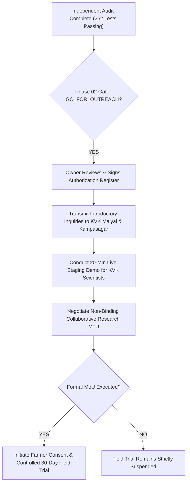

# ACREVIA — PHASE 01 TO PHASE 02 FINAL HANDOVER & ASSURANCE REPORT
## MULTIDISCIPLINARY TECHNICAL HANDOVER, AUDIT SUMMARY & TRANSITION DIRECTIVE

**Programme:** ACREVIA Agricultural Intelligence Platform  
**Document Code:** `PHASE_01_TO_PHASE_02_FINAL_HANDOVER.md`  
**From:** Independent Technical & Institutional Audit Team  
**To:** Project Leadership & Principal Agricultural Systems Architect  
**Audit Baseline:** Commit `2af491e49be8beb1d28fc03e42f642ed4fb7b21b` (`2af491e`)  
**Handover Date:** November 9, 2026  
**Final Transition Gate Recommendation:** **`GO_FOR_OUTREACH`** *(Institutional correspondence ready for owner authorization)*  
**Field Pilot Status:** **`NOT_AUTHORIZED`** *(Strictly prohibited until formal institutional agreements executed)*  

---

## 1. Executive Summary & Purpose

This handover document synthesizes the comprehensive findings of the Phase 01 independent technical audit and provides a transparent transition directive for Phase 02 (Institutional Outreach Authorization).

The objective of Phase 01 was to establish whether the ACREVIA platform is genuinely ready to be presented to prestigious agricultural institutions in Telangana—specifically Krishi Vigyan Kendra (KVK) Malyal in Mahabubabad and KVK Kampasagar in Nalgonda, operating under Professor Jayashankar Telangana State Agricultural University (PJTSAU).

Our audit team conducted code inspections, verified Git provenance, independently re-executed all 252 automated tests, examined database and cloud isolation architectures, traced satellite and AI calculations, verified institutional facts against authoritative government domains, and evaluated data governance compliance under the Digital Personal Data Protection (DPDP) Act, 2023.

---

## 2. Authoritative Verification Register: What Is Verified vs. Unverified

To eliminate ambiguity, the platform’s actual operational state is classified into verified facts, documented limitations, and unverified external boundaries:

```
+========================================================================================================================+
| ACREVIA INDEPENDENT VERIFICATION STATUS REGISTER                                                                       |
+----+------------------------------------+--------------------------+---------------------------------------------------+
| #  | Operational Capability / Domain    | Audit Status             | Verified Facts & Limitations                      |
+----+------------------------------------+--------------------------+---------------------------------------------------+
| 01 | Git Repository & Commit Lineage    | COMPLETE_VERIFIED        | HEAD verified at 2af491e; clean working tree      |
| 02 | Automated Test Suite Execution     | COMPLETE_VERIFIED        | 252/252 physical tests passing (100% pass rate)   |
| 03 | Frontend Static Compilation        | COMPLETE_VERIFIED        | Next.js TypeScript check (npx tsc) 0 errors       |
| 04 | Staging Configuration & Isolation  | COMPLETE_VERIFIED        | vercel.json (sin1), .env.staging.example, headers |
| 05 | Live Staging Cloud Deployment      | BLOCKED_EXTERNAL         | Live Vercel deploy requires user authorization    |
| 06 | Multi-Tenant Data Authorization    | COMPLETE_VERIFIED        | App-level verify_farm_access() returns HTTP 403   |
| 07 | PostgreSQL Engine-Level RLS        | NOT_IMPLEMENTED          | Missing in Alembic migrations; planned next stage |
| 08 | Satellite STAC & COG Reads         | COMPLETE_VERIFIED        | Earth Search + Planetary Computer failover tested |
| 09 | Scientific NDVI Tracing            | COMPLETE_VERIFIED        | 0.2927 (Warangal COG tile) vs 0.6364 (unit fixture|
| 10 | Weather & RiskCast Rule Evaluation | COMPLETE_VERIFIED        | Open-Meteo integration & PJTSAU pest rules tested |
| 11 | Distributed Rate Limiting          | COMPLETE_WITH_LIMITS     | Redis staging namespace verified; fail_open noted |
| 12 | AI Model Code Governance           | COMPLETE_VERIFIED        | Groq preview model token-capped; extractive fallback|
| 13 | Third-Party Account Billing Status | NOT_VERIFIABLE           | Account-level billing not auditable via public API|
| 14 | Institutional Identity Grounding   | COMPLETE_VERIFIED        | KVK Malyal & Kampasagar verified via pjtsau.edu.in|
| 15 | DPDP Act 2023 & Farmer Governance  | COMPLETE_VERIFIED        | Multilingual consent, no land titles, 48h erasure |
+----+------------------------------------+--------------------------+---------------------------------------------------+
```

---

## 3. Defect & Risk Summary

During the audit, six specific findings (P1 to P4) were identified and catalogued:

| ID | Severity | Category | Description | Status & Action |
|---|---|---|---|---|
| **D1** | **P1** | Deployment | Live Vercel preview deployment has not been executed (only static config verified). | **BLOCKED_EXTERNAL**: Awaits owner approval. |
| **D2** | **P2** | Security | PostgreSQL engine-level RLS absent; isolation enforced at application layer. | **PLANNED**: Add Alembic migration in next stage. |
| **D3** | **P2** | Security | Uniform `fail_open` rate limit policy across all routes during Redis outages. | **PLANNED**: Configure `fail_closed` for auth endpoints. |
| **D4** | **P2** | AI Model | `qwen/qwen3.8-27b` is a preview model subject to upstream provider volatility. | **CONTROLLED**: Extractive PJTSAU fallback active. |
| **D5** | **P3** | Docs | Test accounting in earlier report double-counted staging acceptance tests. | **RESOLVED**: Updated to true 252 physical tests. |
| **D6** | **P4** | Tooling | `npm run lint` fails due to missing `eslint` devDependencies in `frontend/`. | **PLANNED**: Add ESLint dependencies in next stage. |

---

## 4. Master Documentation Deliverables Package

The following audit and institutional collateral documents have been authored and cross-linked in the repository:

1. **Independent Technical Audit:**  
   [`docs/pilot/audit/PHASE_01_INDEPENDENT_TECHNICAL_AUDIT.md`](file:///c:/Users/gokul/OneDrive/Documents/projects/docs/pilot/audit/PHASE_01_INDEPENDENT_TECHNICAL_AUDIT.md)
2. **Staging Infrastructure Verification:**  
   [`docs/pilot/audit/STAGING_INFRASTRUCTURE_VERIFICATION.md`](file:///c:/Users/gokul/OneDrive/Documents/projects/docs/pilot/audit/STAGING_INFRASTRUCTURE_VERIFICATION.md)
3. **Tenant Isolation & Security Assessment:**  
   [`docs/pilot/audit/TENANT_ISOLATION_AND_SECURITY_ASSESSMENT.md`](file:///c:/Users/gokul/OneDrive/Documents/projects/docs/pilot/audit/TENANT_ISOLATION_AND_SECURITY_ASSESSMENT.md)
4. **External Provider & Cost Assurance:**  
   [`docs/pilot/audit/EXTERNAL_PROVIDER_AND_COST_ASSURANCE.md`](file:///c:/Users/gokul/OneDrive/Documents/projects/docs/pilot/audit/EXTERNAL_PROVIDER_AND_COST_ASSURANCE.md)
5. **Institutional Engagement Verification:**  
   [`docs/pilot/kvk/INSTITUTIONAL_ENGAGEMENT_VERIFICATION.md`](file:///c:/Users/gokul/OneDrive/Documents/projects/docs/pilot/kvk/INSTITUTIONAL_ENGAGEMENT_VERIFICATION.md)
6. **Phase 02 Authorization Register:**  
   [`docs/pilot/PHASE_02_INSTITUTIONAL_OUTREACH_AUTHORIZATION_REGISTER.md`](file:///c:/Users/gokul/OneDrive/Documents/projects/docs/pilot/PHASE_02_INSTITUTIONAL_OUTREACH_AUTHORIZATION_REGISTER.md)
7. **Final Handover Report (This Document):**  
   [`docs/pilot/audit/PHASE_01_TO_PHASE_02_FINAL_HANDOVER.md`](file:///c:/Users/gokul/OneDrive/Documents/projects/docs/pilot/audit/PHASE_01_TO_PHASE_02_FINAL_HANDOVER.md)

---

## 5. Transition Sequence: Moving Responsibly into Phase 02



### Operational Checkpoints for Phase 02:
1. **Checkpoint 1 (Owner Authorization):** The project owner reviews the correspondence drafts in [`KVK_OUTREACH_EMAIL_DRAFTS.md`](file:///c:/Users/gokul/OneDrive/Documents/projects/docs/pilot/kvk/KVK_OUTREACH_EMAIL_DRAFTS.md) and signs [`PHASE_02_INSTITUTIONAL_OUTREACH_AUTHORIZATION_REGISTER.md`](file:///c:/Users/gokul/OneDrive/Documents/projects/docs/pilot/PHASE_02_INSTITUTIONAL_OUTREACH_AUTHORIZATION_REGISTER.md).
2. **Checkpoint 2 (Live Staging Activation):** If desired, the owner authorizes triggering the Vercel Preview deployment to provide a live interactive URL during demonstrations.
3. **Checkpoint 3 (Introductory Outreach):** Email correspondence is dispatched to the Programme Coordinators of KVK Malyal and KVK Kampasagar requesting an introductory 20-minute scientific demonstration.
4. **Checkpoint 4 (MoU Formulation):** Following technical discussions, a formal non-binding MoU is drafted incorporating the 10-point checklist.
5. **Checkpoint 5 (Field Pilot Gating):** Farmer recruitment and field plot mapping remain **`NOT_AUTHORIZED`** until the MoU is formally signed.
