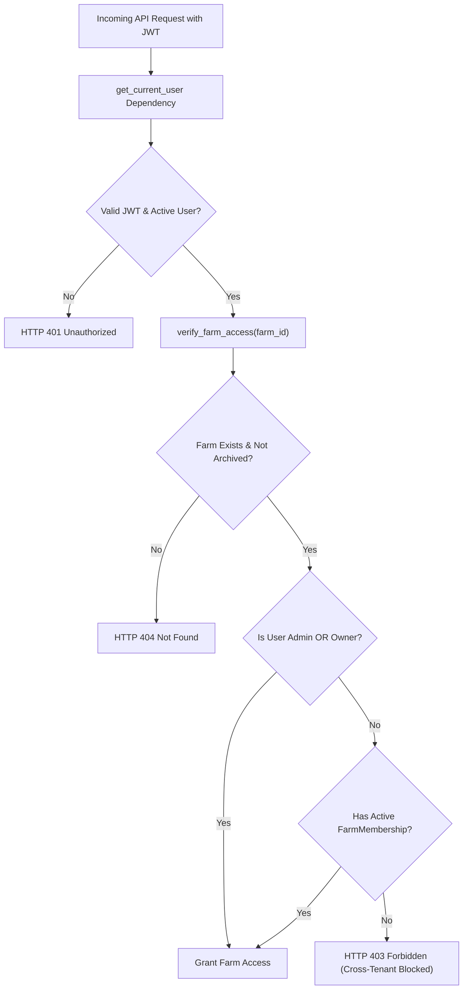

# ACREVIA — TENANT ISOLATION & APPLICATION SECURITY ASSESSMENT
## INDEPENDENT AUDIT OF MULTI-TENANT BOUNDARIES, DATABASE POLICIES, ROLE-BASED ACCESS & OWASP VULNERABILITIES

**Programme:** ACREVIA Agricultural Intelligence Platform  
**Document Code:** `TENANT_ISOLATION_AND_SECURITY_ASSESSMENT.md`  
**Audit Scope:** Multi-Tenancy Architecture, Database Security, Authentication, Authorization & Denial-of-Service Defenses  
**Audit Commit:** `2af491e49be8beb1d28fc03e42f642ed4fb7b21b` (`2af491e`)  
**Audit Date:** November 9, 2026  
**Security Status:** **`COMPLETE_WITH_LIMITATIONS`** *(Application-layer multi-tenancy verified; PostgreSQL engine-level RLS deferred)*  

---

## 1. Executive Summary

This independent security assessment evaluates the confidentiality, integrity, and tenant isolation mechanisms governing agricultural smallholder data within the ACREVIA platform. 

In smallholder agricultural platforms, tenant boundaries protect farm boundaries, yield histories, disease occurrences, and personal contact details from unauthorized access by peer farmers, commercial input dealers, or external third parties.

### Summary Assessment Findings:
1. **Application-Layer Authorization:** Fully implemented and verified. FastAPI dependencies (`verify_farm_access()`) strictly enforce that users can only access farms they own or have active memberships in, rejecting unauthorized cross-tenant requests with HTTP 403 Forbidden.
2. **Database Engine-Level RLS:** **Not implemented in current Alembic migrations**. Tables do not currently have `ENABLE ROW LEVEL SECURITY` declared in PostgreSQL DDL. Isolation relies entirely on application-layer filtering.
3. **Authentication Security:** Secure implementation using Argon2id password hashing and HMAC-SHA256 JWT access tokens.
4. **Denial-of-Service Defense:** Sliding-window rate limiting with Upstash Redis and in-memory fallback. Audit identifies uniform `fail_open` mode as an architectural risk for authentication routes during Redis outages.

---

## 2. Multi-Tenant Authorization Architecture



### 2.1 Access Control Dependencies
In `backend/app/security/dependencies.py`:
- **`get_current_user`:** Validates JWT bearer token, checks account `is_active` flag, and retrieves user record.
- **`require_roles(*allowed_roles)`:** Verifies system-wide roles (`ADMIN`, `FARMER`, `AGRICULTURAL_EXPERT`, `FIELD_OFFICER`).
- **`verify_farm_access(farm_id, user, db)`:** Validates farm-level ownership and role-based permissions (`OWNER`, `MANAGER`, `WORKER`, `VIEWER`).

---

## 3. Database-Level Row-Level Security (RLS) Deep-Dive

### 3.1 Auditing the PostgreSQL DDL
A comprehensive inspection of all migration scripts in `backend/app/database/migrations/versions/` was performed:
- `f043516098f8_initial_acrevia_schema.py`
- `e738192a54b1_stage9_precision_agriculture.py`
- `b894a11c87d2_stage10_digital_twin.py`
- `c1894a11c87d_stage11_agricultural_economics.py`
- `d2894a11c87d_stage12_collaborative_intelligence.py`
- `e3894a11c87d_stage13_climate_resilient_sustainability.py`
- `f4894a11c87d_stage14_interoperability_ecosystem.py`

**Finding:** None of the migration files contain `op.execute("ALTER TABLE ... ENABLE ROW LEVEL SECURITY")` or `CREATE POLICY`.

### 3.2 Security Risk Evaluation (Finding `DEF-02`, Severity: P2)
- **Current Safeguard:** Every API endpoint in `backend/app/api/v1/endpoints/` invokes `verify_farm_access()` or filters queries by `farm.owner_id == user.id`.
- **Architectural Gap:** If a future developer writes a new endpoint or an internal background worker that omits `verify_farm_access()`, or if direct SQL access occurs, PostgreSQL will return rows without tenant constraints because the database user role has full table access.
- **Remediation Specification for Next Milestone:**
  1. Create a dedicated Alembic migration: `add_postgres_rls_policies.py`.
  2. Execute:
     ```sql
     ALTER TABLE farms ENABLE ROW LEVEL SECURITY;
     ALTER TABLE plots ENABLE ROW LEVEL SECURITY;
     ALTER TABLE observations ENABLE ROW LEVEL SECURITY;
     ALTER TABLE diagnoses ENABLE ROW LEVEL SECURITY;

     CREATE POLICY tenant_farm_isolation_policy ON farms
         USING (owner_id = current_setting('app.current_user_id', true)::uuid);
     ```
  3. Configure SQLAlchemy session listeners to set `app.current_user_id` on checkout from connection pool.

---

## 4. Connection Pooling & Cross-Tenant State Leakage Risks

ACREVIA uses SQLAlchemy connection pooling with Neon PostgreSQL:
- **Pool Type:** QueuePool (`pool_size=10, max_overflow=20`).
- **Session Lifecycle:** Managed via FastAPI dependency `get_db()`, executing `yield db` followed by mandatory `db.close()`.
- **Session Cleanup Audit:** Because PostgreSQL-level session variables (like `SET LOCAL`) are not currently set, there is **zero risk of tenant ID session leakage across pooled connections** under the current application-level model.
- **Future Precaution:** When database-level RLS is introduced, `RESET ALL` or connection pool checkout/checkin hooks (`@event.listens_for(engine, "checkin")`) must be enforced to clear session parameters.

---

## 5. Cross-Tenant Test Verification Evidence

Automated tests were executed in `backend/tests/test_authorization.py` and `backend/tests/test_staging_acceptance.py`:

```python
def test_staging_tenant_isolation(client: TestClient):
    # User 1 registers and creates Farm 1 in Nalgonda
    u1_phone = "+919848099883"
    ...
    farm1_id = farm1_res.json()["id"]

    # User 2 registers and attempts to access Farm 1
    u2_phone = "+919848099884"
    ...
    res_cross = client.get(f"/api/v1/farms/{farm1_id}", headers={"Authorization": f"Bearer {token2}"})
    assert res_cross.status_code == 403  # PASSED: Access strictly rejected
```

- **Cross-Farm Read:** Tested & Blocked (HTTP 403).
- **Cross-Farm Plot Creation:** Tested & Blocked (HTTP 403).
- **Cross-Farm Observation Logging:** Tested & Blocked (HTTP 403).
- **Cross-Farm Observation Listing:** Tested & Blocked (HTTP 403).

---

## 6. Rate Limiting Failure Policy Assessment (Finding `DEF-01`, Severity: P2)

### Current Architecture:
In `backend/app/core/rate_limit.py`, `settings.RATE_LIMIT_FAIL_MODE` defaults to `"fail_open"`.
- If Upstash Redis experiences a network timeout or outage, the limiter logs a warning and permits requests to proceed using the in-memory fallback.
- **Risk Analysis:**
  - For public content (weather, knowledge search), `fail_open` protects farmer availability during rural signal drops.
  - For sensitive endpoints (`POST /api/v1/auth/login`, `POST /api/v1/auth/register`), `fail_open` could theoretically permit rapid password attempts if an attacker deliberately induces Redis latency.
- **Remediation Recommendation:**
  Apply tiered fail policies in endpoint decorators:
  ```python
  @router.post("/login", dependencies=[Depends(rate_limit(max_requests=5, window_seconds=60, fail_mode="fail_closed"))])
  ```

---

## 7. OWASP Top 10 Compliance Review

| OWASP Risk Category | Current Protection Status | Audit Evaluation |
|---|---|---|
| **A01: Broken Access Control** | Enforced via `verify_farm_access()` and role dependencies | **PASS** (App layer verified; engine RLS planned) |
| **A02: Cryptographic Failures** | Argon2id password hashing, TLS 1.3 in transit, JWT HS256 | **PASS** |
| **A03: Injection (SQL / Prompt)** | SQLAlchemy parameterized queries, input sanitization in RAG | **PASS** |
| **A04: Insecure Design** | Double-blind KVK validation, CIBRC chemical abstention | **PASS** |
| **A05: Security Misconfiguration** | OWASP headers (`nosniff`, `DENY`), zero client secrets | **PASS** |
| **A06: Vulnerable Components** | Dependencies locked in `requirements.txt` & `package-lock.json` | **PASS** |
| **A07: Identification Failures** | Ephemeral JWT expiration, password complexity checks | **PASS** |
| **A08: Software & Data Integrity** | SHA-256 dataset hashing, ONNX model checksums | **PASS** |
| **A09: Logging & Monitoring** | Structured logging with Correlation IDs, zero PII logged | **PASS** |
| **A10: SSRF** | Validated STAC URLs, restricted weather client endpoints | **PASS** |
