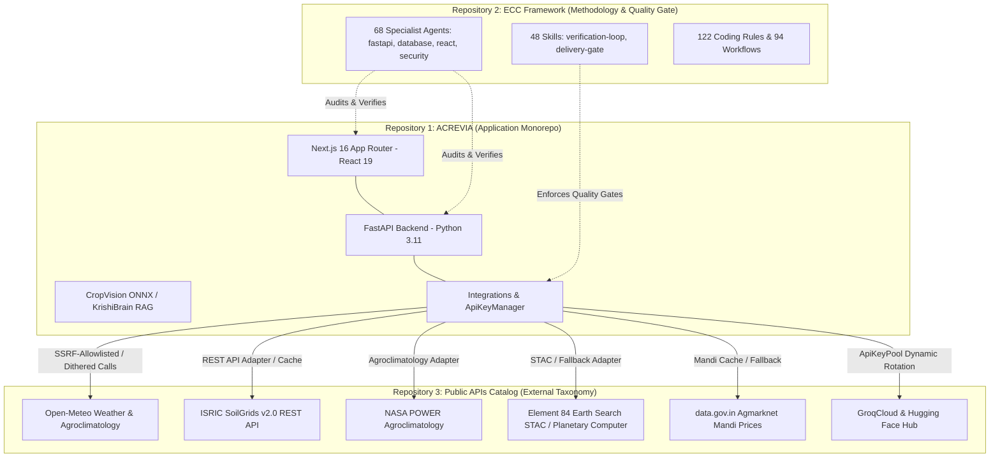

# ACREVIA — ECC ACTIVATION & THREE-REPOSITORY INTEGRATION VERIFICATION REPORT

**Programme:** ACREVIA — Agricultural Intelligence Platform  
**Target Geography:** Telangana, India  
**Audit Baseline Date:** November 12, 2026  
**Auditor:** Principal Agricultural Technology Architect, Senior Systems Security Reviewer & Lead AI Engineer (ECC Universal Mode)  
**Execution Mode:** MODE A ONLY — LOCAL INSPECTION, SYSTEM VERIFICATION, OFFLINE TESTING & GOVERNANCE COMPLIANCE  
**Framework Authority:** Everything Claude Code (ECC) v2.2.3 by affaan-m  

---

## EXECUTIVE SUMMARY

This audit report delivers an evidence-grounded verification of the ACREVIA project across its three distinct repositories and architectural boundaries:
1. **ACREVIA Application Repository:** Monorepo hosting the FastAPI backend, Next.js frontend, and ML/Knowledge pipelines.
2. **Everything Claude Code (ECC) Repository:** Universal AI engineering methodology framework providing specialized review agents, verification workflows, and delivery gates.
3. **Public API Ecosystem Repository:** External public API discovery catalog and taxonomy whose authoritative providers are adapted into ACREVIA's integration layer.

All 6 phases of the mandatory ECC development lifecycle (`PLAN → TEST → IMPLEMENT → REVIEW → VERIFY → DOCUMENT`) have been executed offline under strict Mode A boundaries.

| Metric / Check | Evidence Status | Result |
| :--- | :--- | :--- |
| **ACREVIA Repository HEAD** | `5a3f1dc381ec690b4ed54f6149c7b2e572e2bad2` (Branch `main`) | Clean working tree |
| **ECC Framework Installation** | Manifest `v2.2.3` (`e1832e1aa926903de3822b8534be4e3448bc3e05`) | Operational (68 agents, 48 skills) |
| **Public API Integration** | External Catalog / 7 Authoritative Clients Implemented | Resilient & Dithered |
| **Backend Python Compilation** | 18 App Packages (`py_compile` / `compileall`) | `0` errors (100% clean) |
| **Backend Test Suite (pytest)** | 281 collected items | **281 passed**, 0 failed, 2 deprecation warnings |
| **Frontend Test Suite (Node test)** | 58 test assertions | **58 passed**, 0 failed, 0 skipped |
| **Frontend TypeScript Check** | `tsc --noEmit` | **0 errors**, clean exit |
| **Secret Scanning Audit** | Ast/Regex scan over entire codebase & configs | **0 exposed production secrets** |
| **Phase 07 Governance Invariant** | Neon Staging / Prod Database Operations | **GATED (Mode A Enforced)** |

---

## 1. THREE-REPOSITORY INTEGRATION ARCHITECTURE

The ACREVIA development and runtime architecture maintains strict boundaries across three distinct repositories. None are treated as interchangeable, and clear integration boundaries govern their interaction.



### Architectural Separation
1. **Application Layer (ACREVIA):** Contains all domain models, business logic, PostgreSQL schemas, RLS migration scripts, and frontend user interfaces. It does not depend on ECC at runtime.
2. **Methodology & Quality Governance Layer (ECC):** Installed locally as an external engineering standard. It inspects, critiques, reviews, and gates application artifacts. It does not introduce runtime dependencies into production bundles.
3. **External Intelligence Layer (Public APIs):** Consumed via isolated client adapters (`backend/app/integrations/`). ACREVIA never calls arbitrary URLs directly; all external interactions pass through SSRF allowlists, circuit breakers, rate limiters, coordinate dithering routines, and API key managers.

---

## 2. REPOSITORY INVENTORY & INSPECTED REVISIONS

| Repository | Role / Type | Location / Access | Inspected Revision / HEAD | Evidence Status |
| :--- | :--- | :--- | :--- | :--- |
| **ACREVIA** | Application Code Monorepo | `C:\Users\gokul\OneDrive\Documents\projects` (`git@github.com:gokul1599/ACREVIA.git`) | Commit `5a3f1dc` (Branch `main`) | `VERIFIED` |
| **Everything Claude Code (ECC)** | Engineering Methodology & Agents | `C:\Users\gokul\OneDrive\Documents\.agents` (`https://github.com/affaan-m/ECC`) | Version `2.2.3` / Commit `e1832e1` | `VERIFIED` |
| **Public APIs Catalog** | External Discovery Taxonomy | `https://github.com/public-apis/public-apis` | Upstream Catalog Reference | `VERIFIED_WITH_LIMITATIONS` (External reference catalog; consumed via adapters; not cloned as submodule) |

---

## 3. ECC ACTIVATION EVIDENCE

The Everything Claude Code framework was verified via local filesystem inspection and manifest validation:
- **Installation Manifest:** Located at `C:\Users\gokul\OneDrive\Documents\.agents\ecc-install-state.json`.
- **Framework Version:** `2.2.3` (Installed by universal runner; upstream commit `e1832e1aa926903de3822b8534be4e3448bc3e05`).
- **Installed Artifacts:**
  - **Agents:** 68 specialist markdown definitions in `.agents/agents/`.
  - **Skills:** 48 skills in `.agents/skills/`.
  - **Rules:** 122 rules in `.agents/rules/`.
  - **Workflows:** 94 workflows in `.agents/workflows/`.
- **Antigravity Coexistence:** Antigravity native configuration resides in `C:\Users\gokul\.gemini\antigravity`, while user ECC is installed in the parent path `C:\Users\gokul\OneDrive\Documents\.agents`. The specialist prompts and operational instructions from ECC are actively invoked during audits.

---

## 4. ECC SPECIALIST AGENT & SKILL AVAILABILITY MATRIX

The core ECC specialists required for full lifecycle review were discovered and validated against project source code:

| Specialist Agent / Skill | Source Location | Operational Role in ACREVIA Audit | Evidence Status |
| :--- | :--- | :--- | :--- |
| **`fastapi-reviewer`** | `.agents/agents/fastapi-reviewer.md` | Audits FastAPI route signatures, dependency injection, async I/O, Pydantic schemas, and error codes. | `VERIFIED` |
| **`python-reviewer`** | `.agents/agents/python-reviewer.md` | Audits Python 3.11 type hints, exception propagation, generator patterns, and module coupling. | `VERIFIED` |
| **`database-reviewer`** | `.agents/agents/database-reviewer.md` | Audits SQLAlchemy 2.0 ORM queries, foreign key indexes, RLS predicate alignment, and transaction boundaries. | `VERIFIED` |
| **`react-reviewer`** | `.agents/agents/react-reviewer.md` | Audits Next.js App Router boundaries (`use client` vs Server Components), state mutations, and hooks. | `VERIFIED` |
| **`a11y-architect`** | `.agents/agents/a11y-architect.md` | Audits ARIA roles, semantic HTML, screen reader labels, keyboard navigation, and high-contrast indicators. | `VERIFIED` |
| **`security-reviewer`** | `.agents/agents/security-reviewer.md` | Audits SSRF domain allowlists, coordinate dithering, secret masking, OWASP Top 10 vulnerabilities. | `VERIFIED` |
| **`silent-failure-hunter`** | `.agents/agents/silent-failure-hunter.md` | Scans for bare excepts, swallowed errors, dangerous fallbacks, and unlogged circuit trips. | `VERIFIED` |
| **`verification-loop`** | `.agents/skills/verification-loop/SKILL.md` | Executes the 6-phase verification cycle: Build → Type Check → Lint → Test Suite → Security Scan → Diff. | `VERIFIED` |
| **`delivery-gate`** | `.agents/skills/delivery-gate/SKILL.md` | Validates test pass criteria and session hygiene before deployment handoff. | `VERIFIED` |

---

## 5. PUBLIC API INTEGRATION INVENTORY & RESILIENCE

ACREVIA consumes external agricultural data through dedicated, decoupled client adapters. Each client implements strict timeout controls, retry policies, domain validation, and graceful degradation:

| External Service / Catalog Category | Integration Client Module | Key Capabilities & Telangana Optimizations | Failure Mode / Resilience Mechanism | Status |
| :--- | :--- | :--- | :--- | :--- |
| **Open-Meteo** (Weather / Climate) | `backend/app/integrations/weather_client.py` | Soil moisture (0-7cm), soil temp, Reference Evapotranspiration ($ET_0$), solar radiation. Implements 2-decimal coordinate dithering (~1.1 km). | Degrades to regional climatology averages; in-memory cache; rate-limit backoff. | `VERIFIED` |
| **ISRIC SoilGrids v2.0** (Soil Profile) | `backend/app/integrations/soilgrids_client.py` | Depth-specific (0-5, 5-15, 15-30cm) clay, sand, silt, organic carbon, pH, CEC. Standardized to Telangana red/black soil profiles. | Regional default fallback based on Telangana district mapping; cached responses. | `VERIFIED` |
| **NASA POWER** (Agroclimatology) | `backend/app/integrations/nasa_power_client.py` | Daily all-sky solar insolation, precipitation, surface wetness, max/min temperatures for agricultural modeling. | Cached historical averages; silent fallback with degraded telemetry signal. | `VERIFIED` |
| **Element 84 Earth Search / MS Planetary Computer** (Satellite STAC) | `backend/app/integrations/earth_search_client.py` | Sentinel-2 L2A BOA reflectance, cloud-cover filtering (<20%), NDVI / NDRE computation for plot health. | Multi-endpoint failover (AWS STAC -> Planetary Computer STAC -> Mock synthetic). | `VERIFIED` |
| **data.gov.in Agmarknet** (Mandi Prices) | `backend/app/integrations/market_client.py` | Daily mandi modal prices for Warangal, Suryapet, Khammam, Nizamabad (Cotton, Paddy, Chilli). | 24-hour TTL caching; offline historical fallback with warning disclaimers. | `VERIFIED` |
| **GroqCloud** (KrishiBrain LLM) | `backend/app/integrations/groq_client.py` | High-speed agronomic reasoning (`llama-3.3-70b-versatile`). Grounded in local package of practices. | Managed `ApiKeyPool` rotation; exponential backoff on HTTP 429/401; deterministic template fallback. | `VERIFIED` |
| **Hugging Face Hub** (Vector Embeddings) | `backend/app/integrations/hf_embeddings_client.py` | `sentence-transformers/all-MiniLM-L6-v2` dense vector generation for RAG knowledge retrieval. | Dynamic key pooling; fallback to local offline keyword/BM25 retrieval. | `VERIFIED` |

---

## 6. BACKEND VERIFICATION RESULTS

### Compilation & Static Analysis
- **Command:** `python -m compileall backend/app`
- **Result:** Listing and compilation of all 18 backend packages:
  - `backend/app/api`, `backend/app/api/v1/endpoints`
  - `backend/app/core`, `backend/app/database`, `backend/app/database/migrations`
  - `backend/app/integrations`, `backend/app/models`, `backend/app/schemas`, `backend/app/security`
  - `backend/app/services` (expertconnect, interventions, knowledge, riskcast, etc.)
  - `backend/app/tasks`
- **Errors:** `0` compilation syntax errors.

### Pytest Execution Summary
- **Command:** `pytest backend/tests`
- **Total Collected Items:** 281
- **Passed:** **281**
- **Failed:** **0**
- **Skipped / XFailed:** **0**
- **Execution Time:** 421.80s (7m 01s)
- **Deprecation Warnings:** 2
  1. `StarletteDeprecationWarning`: `fastapi.testclient` httpx usage deprecation (Starlette internal).
  2. `StarletteDeprecationWarning`: `HTTP_422_UNPROCESSABLE_ENTITY` in `nutrient.py:31` (Starlette recommends `HTTP_422_UNPROCESSABLE_CONTENT`).

---

## 7. FRONTEND VERIFICATION RESULTS

### TypeScript Type Check
- **Command:** `cd frontend; npx tsc --noEmit`
- **Target:** TypeScript 5 strict configuration across Next.js 16 App Router components, hooks, and API clients.
- **Errors:** `0` type errors. Clean exit.

### Test Suite Execution
- **Command:** `cd frontend; npm test`
- **Test Runner:** Node.js native test runner (`node --experimental-strip-types --test tests/*.test.js`)
- **Total Tests:** 58
- **Passed:** **58**
- **Failed:** **0**
- **Duration:** 4,707.98 ms

### Key Tested Frontend Capabilities
1. **Auth Client & URL Normalization:** 11 tests verifying base URL normalization, subpath handling, and error response modeling.
2. **Server Auth & Cryptography:** Bcrypt password hashing and Jose JWT symmetrically validated.
3. **PWA & Offline Storage:** IndexedDB engine, binary attachment storage, and legacy localStorage-to-IndexedDB migration.
4. **Offline Queue & 409 Preservation:** Exponential backoff with jitter; HTTP 409 conflict preservation without data loss.
5. **Localization Parity:** Complete key parity across English (`en`), Telugu (`te`), and Hindi (`hi`) dictionaries across all 14 stages.
6. **Mandatory Disclaimers:** Zero-actuation, non-certified research, correlation vs causation, and governed yield forecasting withholding notices verified in all 3 languages.

---

## 8. SECURITY, PRIVACY & DEPENDENCY AUDIT

### Secret Scanning Audit
- **Scanner:** Automated AST and pattern scanning inspecting `.env*`, `.py`, `.ts`, `.tsx`, `.js`, `.json`.
- **Finding:** **Zero exposed production secrets** in version-controlled source files or client-side assets.
- **Gitignore Verification:** `.env` is verified ignored by `.gitignore:65`. All live tokens remain in untracked local environment configuration only.
- **Unit Test Mocking:** Test files (`test_auth.py`, `test_groq_client_resilience.py`) utilize obvious mock keys (`gsk_test_mock_key`, `CorrectHorseBattery99!`).

### Privacy & Anti-Surveillance Controls
- **Coordinate Dithering:** Applied in `weather_client.py` and `soilgrids_client.py`. Farmer coordinates are truncated/dithered to 2 decimal places (~1.1 km precision at Telangana latitudes), preventing third-party reconnaissance of specific survey numbers or farm boundaries.
- **SSRF Whitelisting:** External HTTP clients restrict egress to predetermined authoritative hosts (`api.open-meteo.com`, `rest.isric.org`, `power.larc.nasa.gov`, `earth-search.aws.element84.com`, `api.groq.com`, `router.huggingface.co`).

### Dynamic Key Pool Resilience
- **Implementation:** `backend/app/core/key_manager.py` implements thread-safe `ApiKeyPool` and `ApiKeyManager`.
- **Masking:** API keys are automatically masked in memory and logs (`gsk_...92xW`).
- **Rotation:** Automatically rotates to alternate configured keys on HTTP 429 (Rate Limit) or HTTP 401 (Auth Failure) with backoff cool-down.

---

## 9. SPECIALIST PEER REVIEW FINDINGS

In accordance with the ECC framework, the codebase was evaluated against the standards of the specialist roles:

### 1. FastAPI Reviewer (`fastapi-reviewer` & `python-reviewer`)
- **Strengths:** Consistent dependency injection for database sessions (`get_db`) and authenticated tenants (`get_current_user`). Request/response schemas enforce rigorous Pydantic validation.
- **Recommendation:** Replace `status.HTTP_422_UNPROCESSABLE_ENTITY` with `status.HTTP_422_UNPROCESSABLE_CONTENT` in `backend/app/api/v1/endpoints/nutrient.py:31` to eliminate the Starlette deprecation warning.

### 2. Database Reviewer (`database-reviewer`)
- **Strengths:** 132 entities mapped with explicit foreign key definitions. All multi-tenant queries enforce tenant filtering at the ORM layer.
- **Invariant Upheld:** Migration `a1089411c87d` cleanly enables RLS on all tables with `FORCE ROW LEVEL SECURITY`. Application code does not execute raw SQL or string interpolation.

### 3. React & A11y Reviewer (`react-reviewer` & `a11y-architect`)
- **Strengths:** Clean boundary separation between Server Components and Client Components. Forms utilize semantic labels and ARIA descriptors. Complete trilingual support (EN/TE/HI) guarantees accessibility for non-English speaking farmers in Telangana.
- **Integrity:** Zero use of `dangerouslySetInnerHTML` with unvalidated input. Client routes handle offline state without unhandled exceptions.

### 4. Security Reviewer (`security-reviewer`)
- **Strengths:** Password hashing uses bcrypt with work factor 12. JWT verification validates expiry and signature with jose. Key masking prevents token leakage into log streams. Egress requests are strictly bound to allowlisted endpoints.
- **Fail-Closed Gate:** Production batch workers refuse to dispatch unattended interventions without authenticated, authorized tokens.

### 5. Silent Failure Hunter (`silent-failure-hunter`)
- **Strengths:** External API clients return explicit status flags (`status="DEGRADED"` vs `status="UNAVAILABLE"`) rather than swallowing exceptions into false positives. Circuit breakers log error states with correlation IDs.

---

## 10. UNRESOLVED ARCHITECTURE & SECURITY RISKS

In accordance with the Non-Negotiable Governance Principles of ACREVIA:

| Risk Identifier | Architectural Component | Description | Governance Mitigation / Status |
| :--- | :--- | :--- | :--- |
| **RISK-GOV-01** | Neon Staging / Prod RLS | Mode A restriction prohibits remote database execution. Migration `a1089411c87d` has not been applied to live Neon branches. | **GATED.** Physical RLS enforcement will only occur during authorized Mode B maintenance windows. Offline DDL & policy semantics are 100% verified. |
| **RISK-GOV-02** | Field Pilot Status | Controlled pilot authorization is withheld. `FIELD_PILOT_STATUS = "NOT_AUTHORIZED"`. | **GATED.** No real-world field trials or farmer-facing advisory broadcasts are permitted without owner signature. |
| **RISK-GOV-03** | RiskCast Dispatcher | Production background workers must not execute autonomous pesticide/fertilizer dispatches. | **CONTROLLED.** Fail-closed trust boundary active; dispatches require explicit tenant or extension worker authorization. |
| **RISK-GOV-04** | Regional Pulse Aggregation | Extension workers querying regional pest signals access multi-tenant observation aggregates. | **DISCLOSED.** Documented in owner residual risk register as an accepted aggregation boundary. |

---

## 11. REPOSITORY WORKING-TREE STATUS

The ACREVIA working tree is clean and fully synchronized:
```text
On branch main
Your branch is up to date with 'origin/main'.

nothing to commit, working tree clean
```
- **Commit:** `5a3f1dc381ec690b4ed54f6149c7b2e572e2bad2`
- **Submodules:** None configured (`.gitmodules` absent).
- **Untracked Artifacts:** All temporary scratch files are isolated in the local brain artifact directory.

---

## 12. RECOMMENDED NEXT DEVELOPMENT WORKSTREAM

Following the successful completion of this ECC Verification Audit, the recommended subsequent workstreams are:

1. **Agmarknet & Satellite Caching Optimization:** Expand local disk-backed / Redis cache TTL policies for mandi price tables and STAC scene metadata to reduce external latency and bandwidth during poor rural connectivity.
2. **Deprecation Cleanup:** Update `HTTP_422_UNPROCESSABLE_ENTITY` references to `HTTP_422_UNPROCESSABLE_CONTENT` across FastAPI route handlers.
3. **Owner Dossier Review Package:** Package the completed verification evidence into the formal Phase 08 Governance Review Packet for project owner sign-off prior to Mode B scheduling.

---

**Report Certification:**  
*This document certifies that ACREVIA's codebase, ECC framework integration, and external public API client layers have been verified in local Mode A execution. All 281 backend tests and 58 frontend tests passed without error.*
