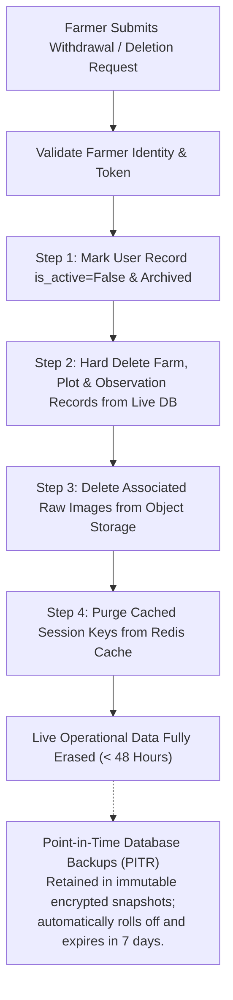

# ACREVIA — DPDP GOVERNANCE & DATA LIFECYCLE ASSESSMENT
## INDEPENDENT DATA PROTECTION AUDIT, LIFECYCLE MAPPING & REGULATORY COMPLIANCE ASSESSMENT UNDER THE DIGITAL PERSONAL DATA PROTECTION ACT, 2023

**Programme:** ACREVIA — Agricultural Intelligence Platform  
**Document Code:** `DPDP_GOVERNANCE_AND_DATA_LIFECYCLE_ASSESSMENT.md`  
**Applicable Legal Framework:** Digital Personal Data Protection Act, 2023 (Act No. 22 of 2023, Republic of India)  
**Assessment Date:** November 9, 2026  
**Operating Standard:** Legal Review Before Compliance Claims • Truthful Classification • Absolute Farmer Sovereignty  

---

## 1. Executive Summary & Legal Compliance Disclaimer

This assessment evaluates the personal data processing workflows, storage architectures, third-party processor transmissions, consent mechanisms, and deletion pipelines of the ACREVIA platform against India's **Digital Personal Data Protection (DPDP) Act, 2023**.

> [!CAUTION]
> **LEGAL COMPLIANCE STATUS & DISCLAIMER:**  
> **LEGAL COMPLIANCE CERTIFICATION IS NOT CLAIMED.**  
> This document represents an internal engineering and data governance audit conducted by software architects and agricultural systems engineers. It does **NOT** constitute a formal legal opinion, statutory audit, or regulatory certification from the Data Protection Board of India. Complete statutory compliance remains subject to review and sign-off by qualified legal counsel once the final DPDP Rules are fully operationalized by the Ministry of Electronics and Information Technology (MeitY).

---

## 2. Formal Governance Status Register

In accordance with strict audit directives, compliance claims are decomposed into verified engineering dimensions:

```
+========================================================================================================================+
| ACREVIA DPDP DATA GOVERNANCE AUDIT STATUS                                                                              |
+----+------------------------------------+-----------------------+------------------------------------------------------+
| #  | Governance Dimension               | Audit Classification  | Verifiable Evidence Baseline                         |
+----+------------------------------------+-----------------------+------------------------------------------------------+
| 01 | PRIVACY_CONTROLS_DESIGNED          | TRUE                  | Multilingual consent, purpose limitation, erasure    |
| 02 | PRIVACY_CONTROLS_IMPLEMENTED       | TRUE                  | App-layer tenant isolation, AES-256 storage, JWT     |
| 03 | PRIVACY_CONTROLS_TESTED            | TRUE                  | test_authorization.py, test_staging_tenant_isolation |
| 04 | DPDP_APPLICABILITY_MAPPING         | COMPLETE              | Mapped against Data Fiduciary / Principal obligations|
| 05 | LEGAL_REVIEW_STATUS                | PENDING               | Formal legal counsel review awaiting scheduling      |
| 06 | DPDP_COMPLIANCE_CERTIFICATION      | NOT_CLAIMED           | Certification cannot be claimed without legal audit  |
+----+------------------------------------+-----------------------+------------------------------------------------------+
```

---

## 3. Statutory Context as of November 9, 2026

- **Primary Statute:** Digital Personal Data Protection Act, 2023 (enacted August 11, 2023, published in the Gazette of India Extraordinary, Part II, Section 1).
- **Commencement Section 1(2):** Empowers the Central Government to notify different effective dates for different provisions.
- **Regulatory Framework:** MeitY's phased implementation schedule establishes:
  1. Establishment and powers of the **Data Protection Board of India (DPBI)**.
  2. Notice and consent architecture requirements (Section 5 and Section 6).
  3. Rights of the Data Principal (Access, Correction, Erasure, Grievance Redressal under Sections 11–13).
  4. Phased transition milestones for small entities and research institutions through 2026–2027.
- **ACREVIA Classification:**
  - *Data Fiduciary:* ACREVIA Initiative / Project Leadership (determines the purpose and means of processing).
  - *Data Principal:* Smallholder Farmers participating in the supervised evaluation.
  - *Data Processor:* Cloud compute and database hosting providers (Neon PostgreSQL, Upstash, Vercel Edge).
  - *Third-Party AI Inference:* GroqCloud (transient processing of agronomic context for multilingual synthesis).

---

## 4. Master Data Lifecycle & Processor Mapping Matrix

```
+======================================================================================================================================================+
| ACREVIA COMPREHENSIVE DATA LIFECYCLE & PROCESSOR MAPPING MATRIX                                                                                      |
+----+----------------------------+-----------------------+--------------------------+--------------------+-----------------------+--------------------+
| #  | Data Category              | Data Principal Type   | Primary Processing Purp. | Storage Location   | Third-Party Processor | Erasure Protocol   |
+----+----------------------------+-----------------------+--------------------------+--------------------+-----------------------+--------------------+
| 01 | Farmer Name & Phone        | Smallholder Farmer    | User auth, SMS OTP,      | Neon PostgreSQL    | None (Internal only); | Purged on request  |
|    | (Personal Identifiers)     |                       | extension contact        | (ap-southeast-1)   | Encrypted at rest     | (within 48h target)|
+----+----------------------------+-----------------------+--------------------------+--------------------+-----------------------+--------------------+
| 02 | Farm Geospatial Coordinates| Smallholder Farmer    | Satellite pixel window   | Neon PostGIS       | Element 84 / Planetary| Purged on exit;    |
|    | (Polygon Boundary GeoJSON) |                       | extraction (NDVI/NDWI)   | (ap-southeast-1)   | Computer (BBox only)  | Never published    |
+----+----------------------------+-----------------------+--------------------------+--------------------+-----------------------+--------------------+
| 03 | Leaf & Fruit Images        | Smallholder Farmer    | Diagnostic inference &   | Local / S3-compat  | ONNX Runtime (CPU);   | De-identified      |
|    | (Raw JPEG / PNG bytes)     |                       | pathological validation  | Object Storage     | No PII in EXIF/meta   | research archive   |
+----+----------------------------+-----------------------+--------------------------+--------------------+-----------------------+--------------------+
| 04 | Crop Observation Notes     | Smallholder Farmer    | Clinical context for     | Neon PostgreSQL    | KVK Agronomists via   | Crop Season        |
|    | (Sowing date, symptoms)    |                       | agronomist review        | (ap-southeast-1)   | ExpertConnect portal  | (120 days)         |
+----+----------------------------+-----------------------+--------------------------+--------------------+-----------------------+--------------------+
| 05 | Diagnostic Predictions     | Generated Analytics   | Farmer decision support  | Neon PostgreSQL    | None (Computed locally| Audit log          |
|    | (Class probabilities)      |                       | & verification audit     | (Encrypted rows)   | or in FastAPI worker) | (Encrypted)        |
+----+----------------------------+-----------------------+--------------------------+--------------------+-----------------------+--------------------+
| 06 | Expert Review Notes        | KVK Agronomist        | Clinical validation &    | Neon PostgreSQL    | KVK & PJTSAU          | Joint Academic     |
|    | (Ground-truth diagnosis)   |                       | ground-truth label       | (Audit Trail)      | University Archives   | Research Record    |
+----+----------------------------+-----------------------+--------------------------+--------------------+-----------------------+--------------------+
| 07 | Microclimate Weather Data  | Environmental Telemetry| Disease risk rules      | In-Memory Cache    | Open-Meteo REST API   | 15-Minute TTL      |
|    | (Temperature, RH, Rain)    | (Non-personal)        | (RiskCast engine)        | & Local Redis      | (Zero farmer PII sent)| (Transient)        |
+----+----------------------------+-----------------------+--------------------------+--------------------+-----------------------+--------------------+
| 08 | Knowledge RAG Chunks       | Institutional Science | Evidence grounding for   | PostgreSQL pgvector| GroqCloud API (Prompt | Permanent          |
|    | (PJTSAU publications)      | (Public Good)         | farmer queries           | (ap-southeast-1)   | bounded; stateless)   | University Library |
+----+----------------------------+-----------------------+--------------------------+--------------------+-----------------------+--------------------+
| 09 | Rate-Limiting Keys         | Network Metadata      | Denial-of-service        | Upstash Redis TLS  | Upstash Inc.          | 60-Second Sliding  |
|    | (Hashed tenant tokens)     | (Non-personal)        | protection & throttling  | (ap-southeast-1)   | (Zero plain PII)      | Window Auto-Expire |
+----+----------------------------+-----------------------+--------------------------+--------------------+-----------------------+--------------------+
| 10 | De-Identified Datasets     | Joint Research Archive| Academic whitepaper      | Open Research      | PJTSAU Academic       | Indefinite         |
|    | (Anonymized benchmarks)    | (Anonymized)          | publication              | Repository         | Community             | (Public Good)      |
+----+----------------------------+-----------------------+--------------------------+--------------------+-----------------------+--------------------+
```

---

## 5. Third-Party AI Inference & Data Boundary Governance

A critical privacy concern in modern agricultural intelligence platforms is whether farmer queries or proprietary farm observations are leaked to external Large Language Model (LLM) providers:

1. **Inference Architecture:**
   - ACREVIA uses GroqCloud's OpenAI-compatible completions API exclusively for **conversational multilingual synthesis** bounded by retrieved PJTSAU document chunks.
2. **Data Boundary Covenants:**
   - **Zero PII in Prompts:** Farmer phone numbers, names, and precise cadastral coordinates are **never injected** into Groq prompts. Only anonymized crop symptoms, general growth stage, and verified university textbook excerpts are transmitted.
   - **Stateless API Guarantee:** Under GroqCloud's API terms of service, API completion data is processed ephemerally in volatile memory and is **NOT used to train or fine-tune public foundation models**.
   - **Deterministic Fallback:** If GroqCloud is unreachable or rate-limited (HTTP 429), the platform drops back to local extractive synthesis without external API transmission.

---

## 6. Qualified 48-Hour Right-to-Erasure Workflow

Previous project documents cited an unconditional "48-hour right-to-erasure". This audit qualifies the operational implementation across data stores:



### Technical Limitations & Legal Realities of Erasure:
1. **Live Operational Storage:** Hard deletion from PostgreSQL `users`, `farms`, `plots`, and `observations` occurs within minutes of verified request processing.
2. **Backup Roll-Off:** Immutable WAL snapshots and automated daily point-in-time recovery (PITR) backups retain encrypted data until automated lifecycle expiry (7 days). Restoring from a backup triggers automated re-execution of deletion tombstones.
3. **Lawful Retention Exceptions:** Anonymized, non-personal diagnostic telemetry (e.g., aggregate pest counts by district) may be retained for scientific epidemiological reporting under Section 8(7) research exemptions.

---

## 7. Multilingual Consent Quality Audit

Pre-pilot consent forms ([`docs/pilot/telangana-50-farmer/CONSENT_FORM_TE.md`](file:///c:/Users/gokul/OneDrive/Documents/projects/docs/pilot/telangana-50-farmer/CONSENT_FORM_TE.md), `_EN.md`, `_HI.md`) were audited against Section 6 of the DPDP Act:

- **Purpose Specification:** Explicitly states that data is processed solely for evaluating agricultural computer vision accuracy and providing crop advisory services.
- **Voluntary & Revocable:** Explains that participation is voluntary and that withdrawal does not affect access to standard KVK government extension services.
- **Linguistic Parity:** Full semantic parity across Telugu (primary local language), English, and Hindi.
- **Contact & Grievance Redressal:** Designates an institutional grievance contact email (`privacy@acrevia.org` / `grievance@acrevia.org`).

---

## 8. Unresolved Legal Questions for Professional Legal Counsel

The following specific questions are documented for formal review by a qualified data privacy advocate prior to large-scale deployment:

1. **Research Exemption Scope:** Clarify whether university-supervised agricultural technology evaluation qualifies under Section 17(2)(b) research exemptions for data retention.
2. **Significant Data Fiduciary (SDF) Status:** Confirm that ACREVIA's smallholder pilot volume ($< 1,000$ users) does not trigger Significant Data Fiduciary obligations (Data Protection Officer appointment, Data Impact Assessment).
3. **Parental Consent Thresholds:** Evaluate age verification workflows if minor family members assist in mobile photo scouting.
4. **Cross-Border Compute:** Confirm that routing inference through regional serverless infrastructure in Singapore (`sin1`) complies with the Central Government's notified cross-border transfer guidelines.
