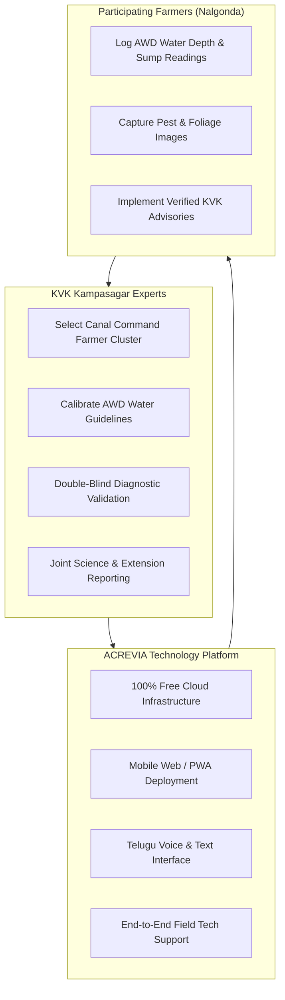

# ACREVIA & KVK KAMPASAGAR (NALGONDA) COLLABORATION PROPOSAL
## CONTROLLED AGRICULTURAL INTELLIGENCE PILOT: RICE & COTTON CANAL COMMAND WATER OPTIMIZATION, PEST FORECASTING & HUMAN-IN-THE-LOOP EXTENSION

> [!IMPORTANT]
> **DISCLAIMER & FORMAL STATUS:**  
> This proposal is an **internal preparatory document** authored by the ACREVIA engineering and agricultural systems team. **No formal partnership, institutional agreement, or endorsement has yet been finalized or executed** with Krishi Vigyan Kendra (KVK) Kampasagar or Professor Jayashankar Telangana State Agricultural University (PJTSAU). This document serves as the institutional proposal package prepared to initiate formal scientific consultations.

---

### Institutional Summary

| Entity | Details |
|---|---|
| **Proposed Institutional Partner** | Krishi Vigyan Kendra (KVK), Kampasagar, Nalgonda District, Telangana |
| **Parent University / Council** | Professor Jayashankar Telangana State Agricultural University (PJTSAU) / ICAR |
| **Technology Platform** | ACREVIA — Agricultural Intelligence Platform |
| **Target Agro-Climatic Zone** | Southern Telangana Zone (Nagarjuna Sagar Left Canal command area) |
| **Focal Crops** | Rice (Paddy - *Oryza sativa*) and Cotton (*Gossypium hirsutum*) |
| **Target Soil Ecosystems** | Heavy Deep Black Soils (Vertisols) and Mixed Red Sandy Loams (Chalka soils) |
| **Pilot Scale** | 20–30 Smallholder Farmers (1 Target Village, e.g., Kampasagar or Miryalaguda mandal cluster) |
| **Initial Trial Duration** | 30-Day Controlled Pilot Evaluation Phase |
| **Financial Terms** | 100% Free of Cost — Zero Financial Obligation for KVK or Farmers |

---

## 1. Executive Summary & Institutional Alignment

The agricultural landscape of Nalgonda district, particularly within the command area of the Nagarjuna Sagar Project (NSP) Left Canal, is defined by intensive paddy cultivation interspersed with commercial cotton. While canal irrigation affords substantial productive capacity, farmers confront acute challenges stemming from intermittent canal water rotations, excessive nitrogen fertilizer application, and severe pest flare-ups.

In paddy, improper water stagnation and surplus urea fuel explosive infestations of Brown Planthopper (BPH - *Nilaparvata lugens*) and widespread outbreaks of Neck Blast (*Magnaporthe oryzae*) and Sheath Blight (*Rhizoctonia solani*). In cotton, intermittent canal closures during boll development induce severe moisture stress and exacerbate susceptibility to sucking pests and Pink Bollworm.

In strict alignment with the extension and technology assessment mandate of ICAR and PJTSAU, the ACREVIA platform introduces a scientifically anchored decision-support system to empower KVK Kampasagar scientists:
1. **Canal Command Precision Water Optimization:** Coupling Sentinel-2 NDWI/NDVI satellite imagery with Open-Meteo evapotranspiration data to guide Alternate Wetting and Drying (AWD) in paddy;
2. **Computer Vision Disease & Pest Identification:** Rapid leaf symptom classification for Rice Blast, BPH hopper burn, and cotton foliage diseases;
3. **Trilingual Evidence-Grounded Advisories (KrishiBrain):** Direct retrieval from PJTSAU rice and cotton packages of practices with strict CIBRC label adherence;
4. **Human-in-the-Loop Safeguards:** Empowering KVK scientists to review, validate, and tailor every automated recommendation before field application.

This 30-day controlled pilot will evaluate the operational utility and agronomic fidelity of ACREVIA under the direct oversight of KVK Kampasagar agronomists and plant protection specialists.

---

## 2. Technological Overview

ACREVIA provides an integrated suite of five specialized agronomic engines adapted for canal-fed agricultural systems:

1. **CropVision Diagnostics:** On-device and cloud-based deep learning inference (ONNX Runtime) calibrated for distinguishing complex rice foliar diseases (Blast vs. Brown Spot vs. Bacterial Leaf Blight) and cotton pathology. Provides Grad-CAM visual attention maps explaining why a disease was diagnosed.
2. **KrishiBrain Grounded Knowledge System:** Hybrid dense-sparse retrieval over PostgreSQL `pgvector`, exclusively indexing verified documents from PJTSAU, ICAR-IIRR (Indian Institute of Rice Research), and ICAR-CICR. Hallucinations are prevented through citation enforcement and automated abstention.
3. **RiskCast Microclimate & Blast Forecasting Engine:** Daily agro-meteorological monitoring tracking relative humidity ($\ge 90\%$), nocturnal minimum temperatures ($20^\circ\text{C} - 24^\circ\text{C}$), and dew duration to predict Blast sporulation windows 48 hours prior to visual symptom emergence.
4. **Earth Geospatial & Water Stress Monitoring:** Anonymous, authentication-free STAC queries to Element 84 Earth Search and Microsoft Planetary Computer. Computes 10-meter Normalized Difference Water Index ($\text{NDWI} = \frac{\text{Green} - \text{NIR}}{\text{Green} + \text{NIR}}$) and Normalized Difference Vegetation Index ($\text{NDWI}$) with automated cloud masking to track field soil moisture and canopy vigor.
5. **Digital Twin Crop-Season Simulator (Stage 10):** Parametric state-space model tracking paddy tillering, panicle initiation, and water balance under canal rotation schedules.

---

## 3. Proposed Pilot Scope & Site Selection

- **Farmer Cohort:** 20 to 30 smallholder farmers.
- **Cropping Focus:** 15 Rice (Paddy) farmers and 10–15 Cotton farmers.
- **Location:** A representative village in the NSP Left Canal command network within Nalgonda district (e.g., Kampasagar village adjacent to the research station, or an accessible command village in Miryalaguda / Tripuraram mandal).
- **Target Acreage:** Parcels ranging from 1.0 to 4.0 acres per participant.
- **Duration:** 30-day active field trial following 4 weeks of preparatory setup and onboarding.

---

## 4. Institutional Roles & Responsibilities

### 4.1 Role of KVK Kampasagar
- Appoint a designated SMS (Agronomy / Plant Protection) as Institutional Pilot Lead.
- Facilitate farmer selection within the canal command area with diverse water accessibility (head-reach vs. tail-reach canal sections).
- Review and validate automated AI diagnoses and water advisories via the ExpertConnect portal.
- Co-evaluate agronomic outcomes and provide institutional feedback for algorithmic refinement.

### 4.2 Role of ACREVIA
- Supply fully operational platform instances, database storage, and inference compute at **zero cost**.
- Configure isolated staging environments with Upstash Redis namespace protection and Neon PostgreSQL staging partitions.
- Provide comprehensive farmer and extension officer onboarding materials in Telugu.
- Guarantee full adherence to data privacy and digital safety protocols.

---

## 5. Scientific Validation Protocol

1. **Agronomic Diagnostic Concordance:**
   - Double-blind protocol: 100% of farmer diagnostic submissions evaluated independently by both CropVision and KVK Kampasagar scientists.
   - Inter-rater agreement measured through Confusion Matrices, Precision-Recall curves, and Cohen's Kappa ($\kappa$).
2. **Canal Water Management & Alternate Wetting and Drying (AWD):**
   - In paddy test plots, farmers track irrigation timing with perforated field water pipes (pani pipe).
   - ACREVIA water optimization engine suggestions compared against physical sump readings and KVK recommended irrigation schedules.
3. **Pesticide Reduction & Input Efficiency:**
   - Documenting baseline pesticide applications versus targeted applications following RiskCast threshold alerts and KVK-verified advisories.

---

## 6. Data Governance, Farmer Protection & DPDP Act 2023 Compliance

- **Complete Farmer Privacy:** In strict compliance with India's Digital Personal Data Protection (DPDP) Act, 2023, farmer consent is voluntary, informed, and revocable at any time.
- **No Commercial Exploitation:** Farm-level spatial data, yield records, and mobile contacts are **never monetized, sold to input dealers, or shared with commercial credit/insurance underwriters**.
- **Tenancy & Land Sovereignty:** Tenant farmers and smallholders are fully protected. No land title deeds (Pahani/Passbooks) are collected; boundary mapping is used exclusively for localized satellite pixel extraction.
- **Cryptographic Security:** Data at rest encrypted via AES-256; data in transit encrypted via TLS 1.3; tenant isolation enforced at the database row level.

---

## 7. Risk Management, Safety & Ethical Guardrails

- **CIBRC Regulatory Strictness:** Chemical recommendations adhere rigidly to PJTSAU Vyavasaya Panchangam and CIBRC registrations.
- **Automated Chemical Guard:** High-risk queries regarding toxic insecticides (e.g., organophosphates, synthetic pyrethroids) trigger automated abstention with immediate referral to KVK agronomists.
- **Non-Replacement Guarantee:** ACREVIA is explicitly designated as a **decision-support tool**, not a replacement for qualified human agricultural scientists.

---

## 8. Hardware & Rural Connectivity Requirements

- **Farmer Devices:** Standard low-cost Android smartphones (Android 8+, $\ge$ 3GB RAM).
- **Rural Connectivity Adaptation:** PWA offline-first architecture with IndexedDB client caching. Observations logged during canal inspections without cellular reception sync immediately upon returning to cellular coverage.
- **Zero Cost to Farmers:** Mobile data consumption minimized through WebP image compression (< 200KB per observation) and lightweight JSON API responses.

---

## 9. Timeline & Key Milestones

| Timeline | Phase Focus | Key Deliverables |
|---|---|---|
| **Month 1 (Weeks 1–4)** | Institutional Alignment & Setup | Pilot charter review, cohort selection, farmer training workshops in Telugu |
| **Month 2 (Weeks 5–8)** | Controlled 30-Day Field Trial | Live diagnostic logging, weekly AWD monitoring, agronomist case verifications |
| **Month 3 (Weeks 9–10)** | Synthesis & Evaluation | Data audit, statistical concordance analysis, joint validation whitepaper release |

---

## 10. Expected Outcomes & Deliverables

1. **Canal Command Precision Water Whitepaper:** Joint scientific report documenting water conservation potential through satellite-assisted AWD in the Nagarjuna Sagar Left Canal command.
2. **Rice & Cotton Pathology Benchmark:** A validated dataset of high-resolution pest and disease imagery from Nalgonda district with verified expert annotations.
3. **Frontline Extension Delivery Model:** A scalable operational framework demonstrating how AI and KVK extension scientists collaborate seamlessly to serve smallholders.

---

## 11. Non-Binding Collaboration Agreement (MoU Outline)

The anticipated Memorandum of Understanding between ACREVIA and KVK Kampasagar will establish:
- Non-exclusive research partnership.
- Absolute zero-cost financial terms.
- Mutual indemnification and intellectual property safeguards.
- Academic publication covenants guaranteeing equal authorship for KVK researchers.
- Straightforward 30-day exit clause for either party.

---

## 12. Contact & Outreach Authorization

**Prepared by:**  
ACREVIA Engineering & Precision Agriculture Systems Team  
*Hyderabad & Nalgonda Research Group*  
Email: `collaborations@acrevia.org` / `nalgonda-pilot@acrevia.org`  
Platform Staging: `https://staging.acrevia.org`  

*Document Version 1.0 — Approved for Institutional Presentation*
