# ACREVIA & KVK MALYAL (MAHABUBABAD) COLLABORATION PROPOSAL
## CONTROLLED AGRICULTURAL INTELLIGENCE PILOT: COTTON & CHILLI PRECISION DIAGNOSTICS, PEST FORECASTING & HUMAN-IN-THE-LOOP EXTENSION

> [!IMPORTANT]
> **DISCLAIMER & FORMAL STATUS:**  
> This proposal is an **internal preparatory document** authored by the ACREVIA engineering and agricultural systems team. **No formal partnership, institutional agreement, or endorsement has yet been finalized or executed** with Krishi Vigyan Kendra (KVK) Malyal or Professor Jayashankar Telangana State Agricultural University (PJTSAU). This document serves as the institutional proposal package prepared to initiate formal scientific consultations.

---

### Institutional Summary

| Entity | Details |
|---|---|
| **Proposed Institutional Partner** | Krishi Vigyan Kendra (KVK), Malyal, Mahabubabad District, Telangana |
| **Parent University / Council** | Professor Jayashankar Telangana State Agricultural University (PJTSAU) / ICAR |
| **Technology Platform** | ACREVIA — Agricultural Intelligence Platform |
| **Target Agro-Climatic Zone** | Central Telangana Zone (Mahabubabad, Warangal rural tribal/smallholder belt) |
| **Focal Crops** | Cotton (*Gossypium hirsutum*) and Chilli (*Capsicum annuum*) |
| **Target Soil Ecosystems** | Red Sandy Loams (Chalka soils) and Mixed Medium Black Soils |
| **Pilot Scale** | 20–30 Smallholder / Tribal Farmers (1 Target Village, e.g., Malyal or Bayyaram Mandal) |
| **Initial Trial Duration** | 30-Day Controlled Pilot Evaluation Phase |
| **Financial Terms** | 100% Free of Cost — Zero Financial Obligation for KVK or Farmers |

---

## 1. Executive Summary & Institutional Alignment

Smallholder and tribal farmers in Mahabubabad district face escalating production risks in cotton and chilli crops due to volatile weather patterns, emerging invasive pests, and asymmetric access to scientific agricultural extension. In cotton, the persistent resurgence of Pink Bollworm (*Pectinophora gossypiella*) continues to erode farm economics; in chilli, recent catastrophic infestations of invasive Black Thrips (*Thrips parvispinus*) and fungal wilt complexes have caused extensive yield loss and prompted indiscriminate, costly chemical sprayings.

The Indian Council of Agricultural Research (ICAR) and PJTSAU mandate KVKs to assess, refine, and demonstrate frontline agricultural technologies for location-specific sustainable agriculture. The ACREVIA platform aligns directly with this mandate by providing:
1. Instant on-device computer vision diagnosis for leaf and fruit damage;
2. Evidence-grounded, trilingual (Telugu, English, Hindi) pest advisories anchored strictly in verified PJTSAU and CIBRC packages of practices;
3. Microclimate disease risk forecasts (RiskCast) integrating Open-Meteo and automated satellite vegetation monitoring;
4. Complete **Human-in-the-Loop** agronomist oversight, ensuring that automated suggestions never bypass qualified agricultural scientists.

This proposed 30-day pilot seeks to validate the diagnostic accuracy, usability, and scientific integrity of ACREVIA under the guidance and ground-truthing of KVK Malyal subject-matter specialists (SMS) in Plant Protection and Agronomy.

---

## 2. Technological Overview

ACREVIA integrates five core scientific engines engineered specifically for rural smallholder constraints:

1. **CropVision Engine:** Deep computer vision diagnostic model (MobileNetV4 / EfficientNet architecture exported to ONNX Runtime) trained and calibrated on cotton and chilli pathological manifestations. Runs locally in-browser or on server, returning disease classification, confidence score, and Grad-CAM spatial attention heatmaps.
2. **KrishiBrain RAG Engine:** Retrieval-Augmented Generation system backed by PostgreSQL `pgvector`, indexing verified publications from PJTSAU, ICAR-CICR, and ICAR-IIHR. Every advisory cites page-level institutional evidence and enforces strict abstention when evidence is insufficient or when unverified chemical dosages are queried.
3. **RiskCast Microclimate Forecaster:** Dynamic epidemiological rule engine that correlates daily temperature, relative humidity, and rainfall from Open-Meteo with pest development thresholds (e.g., degree-day models for Pink Bollworm moth emergence).
4. **Earth Geospatial & Satellite Engine:** Seamless integration with Element 84 Earth Search and Microsoft Planetary Computer Sentinel-2 L2A STAC APIs, computing parcel-level NDVI, NDWI, and vegetation health indices with cloud masking.
5. **Farm Digital Twin (Stage 10):** Parametric state-space model simulating soil moisture, crop stage progression, and nutrient uptake across the crop season.

---

## 3. Proposed Pilot Scope & Site Selection

- **Cohort Size:** 20 to 30 participating farmers.
- **Eligibility Criteria:** Smallholder farmers cultivating 0.5 to 5.0 acres of cotton or chilli with an Android smartphone (Android 8+, $\ge$ 3GB RAM) and active cropping in the current season.
- **Geographic Location:** One representative village in Mahabubabad district (e.g., Malyal village adjacent to the KVK station or a selected cluster in Bayyaram mandal).
- **Duration:** 30 calendar days active trial, preceded by 4 weeks of onboarding/training and followed by 2 weeks of joint evaluation.

---

## 4. Institutional Roles & Responsibilities

```mermaid
flowchart LR
    subgraph KVK["KVK Malyal Scientists"]
        S1["Farmer Cohort Selection"]
        S2["Ground-Truth Diagnostic Verification"]
        S3["ExpertConnect Case Review"]
        S4["Evaluation & Whitepaper"]
    end
    subgraph Platform["ACREVIA Engineering Team"]
        P1["Zero-Cost App Deployment"]
        P2["Offline-First Sync Engine"]
        P3["Telangana Cloud Infrastructure"]
        P4["Technical Field Support"]
    end
    subgraph Farmer["Smallholder Farmers"]
        F1["Capture Leaf Photos"]
        F2["Receive Telugu Advisory"]
        F3["Consult KVK via App"]
    end
    KVK --> Platform
    Platform --> Farmer
    Farmer --> KVK
```

### 4.1 Role of KVK Malyal
- Nominate a focal Subject Matter Specialist (Plant Protection / Agronomy) to serve as Pilot Coordinator.
- Assist in identifying and onboarding the cohort of 20–30 cotton/chilli farmers.
- Ground-truth automated diagnoses via the ExpertConnect dashboard: review flagged images, verify pest identifications, and override recommendations where necessary.
- Participate in joint bi-weekly review meetings and co-author the terminal pilot findings report.

### 4.2 Role of ACREVIA
- Provide complete platform infrastructure at **zero financial cost** to KVK and farmers.
- Configure dedicated staging and production instances with isolated data partitions.
- Conduct in-person or remote orientation for KVK scientists and participating farmers in Telugu.
- Ensure 99.5% service uptime and real-time technical debugging.
- Respect all data protection covenants and maintain complete farmer privacy.

---

## 5. Scientific Validation Protocol

To establish rigorous scientific validity without imposing operational friction on farmers, a double-blind ground-truthing methodology is instituted:

1. **Diagnostic Accuracy Evaluation:**
   - For every photo submitted by a participating farmer, the CropVision engine records its top-3 predictions and confidence scores.
   - The KVK Plant Protection specialist evaluates the anonymized image independently through the ExpertConnect portal without viewing the AI's prediction.
   - Diagnostic concordance is evaluated via Cohen's Kappa ($\kappa$) and Top-1 / Top-3 classification accuracy matrices.
2. **Advisory Precision Scoring:**
   - KVK agronomists evaluate KrishiBrain RAG advisories for factual fidelity to PJTSAU recommendations, dosage safety, and regional contextual appropriateness.
3. **Farmer Usability & Actionability Metrics:**
   - Measured via pre- and post-pilot surveys capturing comprehension of Telugu voice/text advisories, ease of photo capture, and adherence to recommended IPM practices.

---

## 6. Data Governance, Farmer Protection & DPDP Act 2023 Compliance

ACREVIA is built on an ethical, farmer-first data philosophy aligned with the Digital Personal Data Protection (DPDP) Act, 2023:

- **Non-Commercialization Guarantee:** Farmer data will **never be sold, rented, monetized, or shared with third-party chemical/seed commercial entities**.
- **Farmer Ownership:** Participating farmers retain 100% legal ownership of their agricultural records, geospatial coordinates, and farm imagery.
- **Explicit Informed Consent:** Multilingual consent forms (Telugu, English, Hindi) presented before enrollment, detailing data use for scientific validation only.
- **Right to Erasure:** Any participating farmer may withdraw from the pilot at any point and request permanent deletion of all stored personal and spatial data within 48 hours.
- **Land Rights Protection:** Platform data collection is restricted strictly to crop pathology and agronomy; no land registry, tenure titles, or revenue ownership documents are requested or accessed.

---

## 7. Risk Management, Safety & Ethical Guardrails

- **CIBRC Regulatory Compliance:** All chemical crop protection advisories strictly enforce Central Insecticide Board & Registration Committee (CIBRC) approved label claims. Automated recommendations will never advise off-label uses or unapproved tank mixtures.
- **Automated High-Risk Abstention:** Inquiries involving hazardous chemicals, lethal toxicity, or banned insecticides automatically trigger the `REQUIRES_EXPERT_REVIEW` abstention gate, requiring a verified human agronomist to approve before any guidance is displayed.
- **Prominent Liability Disclaimers:** Every advisory explicitly states: *"This diagnostic assessment is generated by agricultural AI and validated under KVK scientific supervision. Final chemical applications must follow CIBRC label directions and local agronomist guidance."*

---

## 8. Hardware & Rural Connectivity Requirements

- **Farmer Smartphone Specifications:** Low-end Android smartphones (Android 8.0 Oreo or higher, minimum 3GB RAM, rear camera $\ge$ 8MP).
- **Bandwidth Optimization:** Progressive Web Application (PWA) with lightweight assets (< 2MB initial bundle).
- **Offline-First Resilience:** Leaf images and observation notes can be recorded offline in remote fields (IndexedDB storage via Dexie.js); synchronization initiates automatically once 2G/3G/4G or Wi-Fi connectivity is detected.

---

## 9. Timeline & Key Milestones

| Phase | Duration | Core Activities | Deliverable / Output |
|---|---|---|---|
| **Phase 1: Institutional Alignment** | Weeks 1–2 | Formal consultation, MoU signing, scientist briefing | Executed collaboration charter |
| **Phase 2: Farmer Onboarding** | Weeks 3–4 | Village mobilization, consent execution, app installation | 25 farmers onboarded & mapped |
| **Phase 3: Active Controlled Trial** | Weeks 5–8 (30 Days) | Real-time diagnostics, daily weather sync, expert reviews | Real-time telemetry & expert cases |
| **Phase 4: Scientific Evaluation** | Weeks 9–10 | Statistical analysis, concordance scoring, joint review | Comprehensive pilot evaluation report |

---

## 10. Expected Outcomes & Deliverables

1. **Joint Technology Validation Whitepaper:** Co-authored by KVK Malyal scientists and ACREVIA engineers documenting real-world diagnostic precision and pest mitigation efficacy in Mahabubabad cotton/chilli.
2. **Refined Regional Pathology Dataset:** High-quality, ground-truthed image library of Telangana cotton and chilli pests, shared with PJTSAU for academic research.
3. **Farmer Economic Impact Assessment:** Preliminary measurement of input cost savings resulting from targeted, judicious pesticide application versus conventional indiscriminate spraying.

---

## 11. Non-Binding Collaboration Agreement (MoU Outline)

The anticipated Memorandum of Understanding between ACREVIA and KVK Malyal will formalize:
- Non-exclusive scientific research collaboration.
- Non-financial relationship (no funds exchanged).
- Data sharing covenants and intellectual property protection.
- Academic publication rights ensuring joint authorship for KVK scientists.
- Standard 30-day termination clause for either party without liability.

---

## 12. Contact & Outreach Authorization

**Prepared by:**  
ACREVIA Engineering & Precision Agriculture Systems Team  
*Hyderabad & Warangal Research Group*  
Email: `collaborations@acrevia.org` / `scientific-outreach@acrevia.org`  
Platform Staging: `https://staging.acrevia.org`  

*Document Version 1.0 — Approved for Institutional Presentation*
