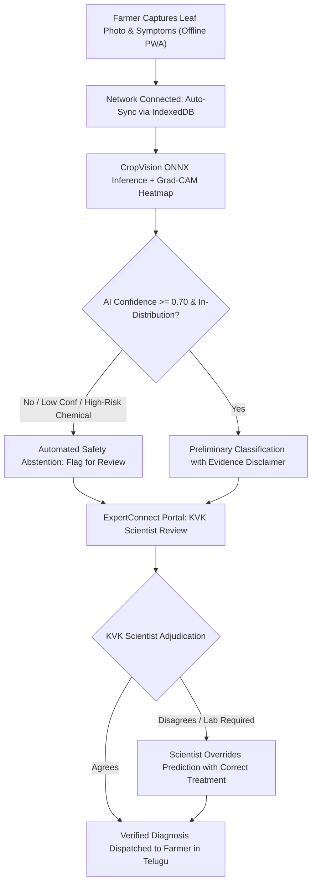

# ACREVIA — 30-DAY SUPERVISED FEASIBILITY EVALUATION PROTOCOL
## RESEARCH METHODOLOGY, WORKFLOW EVALUATION, EXPERT ADJUDICATION & SAFETY PROTOCOL FOR CONTROLLED FIELD PILOTS

> [!CAUTION]
> **RESEARCH PROTOCOL GOVERNANCE DIRECTIVE:**  
> **PROPOSED — NOT AUTHORIZED FOR FIELD EXECUTION**  
> This protocol is a scientific working draft prepared for peer review by agricultural scientists at KVK Malyal, KVK Kampasagar, and the PJTSAU Directorate of Extension.  
> **NO ON-FARM TRIALS MAY PROCEED**, and **NO FARMERS MAY BE ENROLLED** until formal institutional agreements (MoUs) are executed and written ethical approval is granted.

---

### Study Executive Profile

| Parameter | Provisional Research Specification |
|---|---|
| **Formal Study Title** | 30-Day Supervised Agricultural Technology Feasibility and Workflow Evaluation |
| **Research Sponsoring Partner** | ACREVIA Precision Agricultural Research Initiative |
| **Host Institutions** | KVK Malyal (Mahabubabad) & KVK Kampasagar (Nalgonda) under PJTSAU |
| **Provisional Cohort Scale** | 20–30 Smallholder Farmers per KVK (1 Target Village Cluster per KVK) |
| **Study Duration** | 30 Calendar Days (Active Scouting & Verification Window) |
| **Focal Agro-Ecosystems** | Cotton & Chilli (Central Telangana) • Rice & Cotton (Southern Canal Command) |
| **Field Execution Status** | **`FIELD_PILOT_STATUS = NOT_AUTHORIZED`** |

---

## 1. Research Objectives & Feasibility Hypotheses

Smallholder farmers in Telangana face significant barriers in adopting digital agriculture tools due to complex vernacular interfaces, erratic rural cellular connectivity, and black-box diagnostic models. 

This 30-day feasibility study evaluates whether an offline-first, vernacular PWA coupled with explainable computer vision (Grad-CAM) and human-in-the-loop expert oversight can function reliably within rural extension workflows:

### 1.1 Primary Research Questions:
1. **Technical Feasibility:** Can the ACREVIA Progressive Web App (PWA) reliably capture, compress, and queue high-resolution foliar imagery on low-cost Android smartphones ($\ge$ 3GB RAM) and synchronize seamlessly over intermittent 2G/3G networks via IndexedDB?
2. **Clinical Workflow Integration:** Does the ExpertConnect portal enable KVK plant pathologists to review, ground-truth, and calibrate AI-flagged disease predictions without creating excessive administrative burden ($< 5$ minutes per review)?
3. **Vernacular Usability:** Do smallholders effectively comprehend and act upon Telugu voice/text advisories grounded in verified PJTSAU *Vyavasaya Panchangam* packages of practices?

---

## 2. Separation of Research Metric Categories

To maintain uncompromising scientific discipline, this protocol strictly delineates between technical feasibility metrics, diagnostic validation metrics, and long-term agricultural outcomes:

```
+========================================================================================================================+
| ACREVIA METRIC CATEGORIZATION REGISTER                                                                                 |
+------------------------------+------------------------------------+----------------------------------------------------+
| Metric Category              | Scope & Evaluation Target          | Methodological Authority & Measurement             |
+------------------------------+------------------------------------+----------------------------------------------------+
| 1. Feasibility Metrics       | System reliability, app usability, | Direct system telemetry, IndexedDB sync audits,   |
|    (Study Primary Focus)     | offline queue success, review lag  | farmer SUS (System Usability Scale) survey         |
+------------------------------+------------------------------------+----------------------------------------------------+
| 2. Diagnostic Concordance    | Agreement between AI predictions   | Double-blind agronomist review, Cohen's Kappa,    |
|    (Secondary Research)      | and KVK expert reference diagnoses | top-1/top-3 accuracy, confusion matrices           |
+------------------------------+------------------------------------+----------------------------------------------------+
| 3. Prospective Agronomic     | Yield impact, input cost savings,  | PROSPECTIVE HYPOTHESES ONLY: Cannot be evaluated   |
|    Outcomes (Future Seasons) | disease reduction, AWD water saved | in a 30-day feasibility trial; requires multi-year |
+------------------------------+------------------------------------+----------------------------------------------------+
```

### 2.1 Category 1: Technical & Usability Feasibility Metrics
- **Upload Success Rate:** Percentage of leaf scouting submissions successfully transferred to server storage without payload corruption ($\text{Target} \ge 95\%$).
- **Offline Sync Latency:** Mean duration between network reconnection and successful batch dequeue.
- **Image Quality Filtering:** Proportion of low-quality, blurry, or over-exposed images successfully quarantined by the client-side Laplacian filter.
- **Scientist Review Turnaround:** Mean elapsed time from farmer submission to expert verification in the ExpertConnect portal ($\text{Target} < 24$ hours).
- **Abstention Frequency:** Percentage of ambiguous, low-confidence, or non-plant images safely routed to the `REQUIRES_EXPERT_REVIEW` queue.

### 2.2 Category 2: Diagnostic Evaluation Metrics
- **Reference Label Protocol:** A panel of KVK plant pathologists independently diagnoses anonymized images without viewing the AI's preliminary prediction.
- **Concordance Scoring:** Evaluated via inter-rater agreement statistics:
  $$\kappa = \frac{p_o - p_e}{1 - p_e}$$
  where $p_o$ is observed agreement and $p_e$ is hypothetical chance agreement.
- **Error Breakdown:** Per-class sensitivity, specificity, false-negative rate for critical quarantine diseases (e.g., Rice Blast, Chilli Black Thrips damage).

### 2.3 Category 3: Prospective Agronomic Hypotheses (NOT Claimed)
> [!NOTE]
> Claims of pesticide input reductions, yield enhancement, or canal water volumetric savings are **prospective hypotheses** requiring longitudinal, multi-season agronomical trials. They are **NOT** claimed as outcomes of this 30-day workflow feasibility study.

---

## 3. Clinical Workflow & Expert Adjudication Protocol



### 3.1 Adjudication Rules:
1. **Expert Override Authority:** A KVK scientist may overwrite an automated AI prediction at any time. The expert's finding is logged as the definitive clinical record.
2. **Disagreement Adjudication:** Where complex symptoms exhibit multiple overlapping pathogen markers (e.g., Chilli Leaf Curl Virus combined with Black Thrips infestation), the case is referred to a senior university pathologist for secondary review or microscopic laboratory leaf assay.
3. **Zero Automated Chemical Advice:** Chemical recommendations are never autonomously generated; they must cite approved CIBRC labels and be confirmed by a scientist.

---

## 4. Participant Selection & Onboarding Protocol

- **Target Profile:** Smallholder or tribal farmers actively cultivating Cotton, Chilli, or Rice.
- **Informed Consent:** Voluntary participation formalized via trilingual (Telugu, English, Hindi) consent forms in accordance with the DPDP Act, 2023.
- **Right of Immediate Withdrawal:** Any participant may withdraw verbally or via the mobile application at any point without losing access to standard government extension services.

---

## 5. Safety Escalation & Immediate Study Suspension Protocol

The evaluation must be **immediately halted** if any of the following critical triggers occur:
1. **Severe Agronomic Safety Hazard:** An automated advisory distributes unverified, hazardous, or off-label pesticide recommendations that bypass human expert review.
2. **Quarantine Pest Flare-Up:** Rapid regional outbreak of a high-consequence invasive pathogen requiring statutory state notification.
3. **Data Security / Privacy Breach:** Unauthorized cross-tenant data access, farm coordinate leakage, or security failure.
4. **Loss of Expert Supervision:** Inability of KVK scientific staff to maintain daily diagnostic oversight.

---

## 6. Regulatory & Field Execution Notice

This research protocol is currently an **internal working proposal**. No field activities, farmer onboarding, or software distribution may occur until:
- [ ] Formal institutional MoU signed with KVK Malyal and KVK Kampasagar.
- [ ] Scientific review and approval by the Directorate of Extension, PJTSAU.
- [ ] Institutional Ethics & Data Governance approval.
- [ ] Written authorization executed by the platform project owner.
