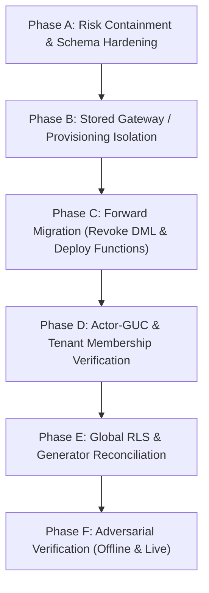

# ACREVIA — PHASE 07: GLOBAL RLS IDENTITY REMEDIATION, USER-ROLE CONTAINMENT & TENANT-AUTHORIZATION ARCHITECTURE READINESS PLAN

**Programme:** ACREVIA — Agricultural Intelligence Platform  
**Target Geography:** Telangana, India  
**Target Phase:** Phase 07 — PostgreSQL RLS Tenant Isolation & Regional Aggregation Privacy  
**Execution Mode:** `MODE A ONLY` — Local Source Inspection, Security Engineering, Remediation Planning, Offline Verification & Governance Documentation  
**Git Baseline:** `c9e334d14110e8a6e4c9b71b89cae3294288af0d` (`main`)  
**Public Repository:** `https://github.com/gokul1599/ACREVIA`  
**Methodology:** Everything Claude Code (ECC): `PLAN → TEST → IMPLEMENT ONLY IF DEFECT PROVEN → REVIEW → VERIFY → DOCUMENT`  
**Date:** November 23, 2026  
**Status:** `TECHNICAL_PREFLIGHT_BLOCKED_WITH_RECORDED_BLOCKERS` — `MODE B STRICTLY NOT AUTHORIZED`

---

## 1. Executive Determination

The global Row-Level Security (RLS) identity audit of ACREVIA establishes that the PostgreSQL database authorization boundary cannot safely progress to live staging execution (`MODE B`) without structural remediation of both application-role management and tenant-isolation predicates.

$$\mathbf{DETERMINATION:\ TECHNICAL\_PREFLIGHT\_BLOCKED\_WITH\_RECORDED\_BLOCKERS}$$

### Key Findings:
1. **Critical Blocker `RLS-ROLE-ASSIGNMENT-01` (Application-Level Admin Escalation):**
   The `user_roles` table is categorized as `TableCategory.USER_OWNED`, generating a restrictive RLS policy:
   $$\text{USING / WITH CHECK}\ (ADMIN\_BYPASS\_SQL \lor user\_id::\text{text} = \text{current\_setting}('app.current\_user\_id', \text{true}))$$
   Under the shared runtime database principal `acrevia_staging_app`, which holds `GRANT SELECT, INSERT, UPDATE, DELETE ON TABLE user_roles`, any caller or SQL execution can set `SET LOCAL app.current_user_id = '<user_uuid>'` and insert `('<user_uuid>', 'ADMIN')`. Because `user_id` matches the session GUC, the insert succeeds. When the user submits an authenticated request, FastAPI's `get_current_user` loads roles fresh from the database and elevates the caller to application administrator.
2. **Registration Compatibility Conflict:**
   A naive containment proposal—revoking `INSERT, UPDATE, DELETE` on `user_roles` from `acrevia_staging_app`—**breaks user registration immediately**. In both FastAPI (`AuthService.register_user`) and Next.js (`/api/v1/auth/register`), new account registration directly writes `user_roles` under `acrevia_staging_app`. A blanket revoke without an isolated provisioning gateway causes HTTP 500 crashes during onboarding.
3. **Unverified Role Self-Selection Vulnerability:**
   Both `UserRegisterRequest` (`backend/app/schemas/auth.py`) and Next.js registration routes accept `role: "AGRICULTURAL_EXPERT"` and `role: "RESEARCHER"` directly from unauthenticated registrants, completely bypassing the administrative accreditation and verification workflow in `ExpertService.approve_or_reject_profile`.
4. **Referential Integrity Cascading Deletion Risk:**
   Direct revocation of `DELETE` on `user_roles` does **not** protect against indirect role deletion. The foreign key `user_roles.user_id → users.id ON DELETE CASCADE` allows any session that can delete a `users` row to wipe out role assignments, because PostgreSQL referential cascade constraints bypass RLS policies.
5. **Universal Tenant GUC Dependency Across All 78 Tenant Tables:**
   All 25 direct tenant tables and all 53 indirect tenant tables depend entirely on caller-supplied session GUCs (`app.current_tenant_id` and `app.current_user_id`). **Zero out of 78 tenant tables independently verify tenant membership or ownership at the database RLS layer.** If `app.current_tenant_id` is manipulated under `acrevia_staging_app`, access to arbitrary farms across Telangana is granted.

---

## 2. Current Local and Public Baseline

### 2.1 Git Repository Verification
- **Local Working Directory:** `c:\Users\gokul\OneDrive\Documents\projects`
- **Current Branch:** `main` [LOCAL_SOURCE_VERIFIED]
- **HEAD Commit SHA:** `c9e334d14110e8a6e4c9b71b89cae3294288af0d` [PUBLIC_GITHUB_VERIFIED]
- **Remote URL:** `https://github.com/gokul1599/ACREVIA.git`
- **Working Tree State:** Clean (0 staged files, 0 modified files, 0 untracked files prior to this audit report).
- **Public Alignment:** Commit `c9e334d` is fully pushed to `origin/main`.

### 2.2 Core Database Source Invariants
- `backend/app/database/rls.py`: Byte-for-byte identical to HEAD (`git diff HEAD` is empty) [LOCAL_SOURCE_VERIFIED].
- `backend/app/database/migrations/versions/a1089411c87d_enable_postgresql_rls_tenant_isolation.py`: Byte-for-byte identical to HEAD [LOCAL_SOURCE_VERIFIED].
- `backend/app/database/migrations/versions/d2894a11c87d_stage12_collaborative_intelligence.py`: Byte-for-byte identical to HEAD [LOCAL_SOURCE_VERIFIED].

---

## 3. `user_roles` Policy and Privilege Proof

### 3.1 Table Schema & Constraints
From `backend/app/models/user.py` (lines 42–47):
```python
class UserRole(Base):
    __tablename__ = "user_roles"

    user_id: Mapped[str] = mapped_column(String(36), ForeignKey("users.id", ondelete="CASCADE"), primary_key=True)
    role_id: Mapped[str] = mapped_column(String(50), ForeignKey("roles.id", ondelete="CASCADE"), primary_key=True)
```
- **Primary Key:** Composite `(user_id, role_id)`.
- **Foreign Keys:**
  - `user_id` references `users.id` with `ON DELETE CASCADE`.
  - `role_id` references `roles.id` with `ON DELETE CASCADE`.
- **Check Constraints:** **NONE**. No check constraint restricts permitted `role_id` values.
- **Database Triggers:** **NONE**. No trigger intercepts role assignment.
- **Foreign Key Behavior:** Confirms only that the referenced `role_id` exists in `roles` (where `ADMIN`, `AGRICULTURAL_EXPERT`, `RESEARCHER`, `FARMER` exist).

### 3.2 Generated Policy DDL
From `backend/app/database/rls.py` (lines 363–390):
```sql
-- Table: user_roles (User-Owned Isolation)
ALTER TABLE user_roles ENABLE ROW LEVEL SECURITY;
ALTER TABLE user_roles FORCE ROW LEVEL SECURITY;

DROP POLICY IF EXISTS user_roles_base_access_policy ON user_roles;
CREATE POLICY user_roles_base_access_policy ON user_roles
    AS PERMISSIVE
    FOR ALL
    TO PUBLIC
    USING (true)
    WITH CHECK (true);

DROP POLICY IF EXISTS user_roles_user_isolation_policy ON user_roles;
CREATE POLICY user_roles_user_isolation_policy ON user_roles
    AS RESTRICTIVE
    FOR ALL
    TO PUBLIC
    USING (
        (SESSION_USER::text IN ('neondb_owner', 'acrevia_admin') 
         AND CURRENT_USER::text IN ('neondb_owner', 'acrevia_admin') 
         AND current_setting('app.is_admin', true) = 'true')
        OR user_id::text = current_setting('app.current_user_id', true)
    )
    WITH CHECK (
        (SESSION_USER::text IN ('neondb_owner', 'acrevia_admin') 
         AND CURRENT_USER::text IN ('neondb_owner', 'acrevia_admin') 
         AND current_setting('app.is_admin', true) = 'true')
        OR user_id::text = current_setting('app.current_user_id', true)
    );
```

### 3.3 Database Privilege Crosswalk
From `backend/app/database/rls.py` (lines 997–1001, 1040–1050):
```sql
GRANT SELECT, INSERT, UPDATE, DELETE ON TABLE user_roles TO acrevia_staging_app;
```

---

## 4. Application-Level ADMIN Escalation Determination

### 4.1 Exploitation Path Analysis
1. An unprivileged user with authenticated UUID `U_ATTACKER` executes SQL via any query injection, compromised service, or direct session under `acrevia_staging_app`.
2. The session executes:
   ```sql
   SET LOCAL app.current_user_id = 'U_ATTACKER';
   INSERT INTO user_roles (user_id, role_id) VALUES ('U_ATTACKER', 'ADMIN');
   ```
3. PostgreSQL evaluates the policies:
   - Permissive Base Policy: `WITH CHECK (true)` $\rightarrow$ **PASS**.
   - Restrictive Policy: `WITH CHECK (ADMIN_BYPASS_SQL OR user_id::text = current_setting('app.current_user_id', true))` $\rightarrow$ Since `user_id` equals `U_ATTACKER` and `app.current_user_id` is `'U_ATTACKER'`, the second branch evaluates to **TRUE** $\rightarrow$ **PASS**.
4. The row `('U_ATTACKER', 'ADMIN')` is committed.
5. On the next HTTP request with `U_ATTACKER`'s valid bearer JWT, `get_current_user` executes:
   ```python
   user = db.get(User, user_id)
   user_roles = [r.id for r in user.roles]
   is_admin = SystemRole.ADMIN.value in user_roles
   if is_admin:
       set_tenant_context(db, tenant_id=None, user_id=user.id, is_admin=True)
   ```
6. `is_admin` evaluates to `True`, elevating the user to application platform administrator across all API endpoints.

### 4.2 Distinguishing Application Escalation from Database Superuser
- **Application-Level Admin Escalation:** **PROVEN.** The user gains all FastAPI administrative privileges (`SystemRole.ADMIN`), access to unredacted regional signals, administrative endpoints, and all farm data via `verify_farm_access`.
- **PostgreSQL Superuser / BypassRLS Escalation:** **NOT OCCURRING.** Inserting into `user_roles` does not alter PostgreSQL's `SESSION_USER` or `CURRENT_USER`, nor does it grant `neondb_owner` or PostgreSQL superuser attributes.

### 4.3 Operation-Specific DML Matrix

| Operation | Existing Row Required? | Policy Checks Evaluated | Possible Unauthorized Outcome | Proof Classification |
|---|---|---|---|---|
| **INSERT privileged role** | No | `WITH CHECK (user_id = app.current_user_id)` | Self-escalation to `ADMIN`, `AGRICULTURAL_EXPERT`, `RESEARCHER` | `PROVEN_FROM_LOCAL_MODEL_AND_POLICY` |
| **UPDATE own role assignment** | Yes | `USING` + `WITH CHECK (user_id = app.current_user_id)` | Modifying existing `FARMER` role to `ADMIN` | `PROVEN_FROM_LOCAL_MODEL_AND_POLICY` |
| **UPDATE another user's role** | Yes | `USING` + `WITH CHECK` (fails unless `app.current_user_id` spoofed) | Escalating or modifying another user if `app.current_user_id` spoofed | `PROVEN_FROM_LOCAL_MODEL_AND_POLICY` |
| **DELETE own privileged assignment** | Yes | `USING (user_id = app.current_user_id)` | Self-demotion | `PROVEN_FROM_LOCAL_MODEL_AND_POLICY` |
| **DELETE another user's role** | Yes | `USING (user_id = app.current_user_id)` | Demoting administrators by setting `app.current_user_id` to target UUID | `PROVEN_FROM_LOCAL_MODEL_AND_POLICY` |

---

## 5. Registration Compatibility Analysis (Operational Conflict)

### 5.1 The Operational Conflict
The previous audit recommended immediate revocation of `INSERT, UPDATE, DELETE` on `user_roles` from `acrevia_staging_app`. Inspection of the onboarding architecture reveals that:
- In `backend/app/services/auth_service.py` (lines 44–52):
  ```python
  role_record = db.get(Role, req.role)
  if not role_record:
      role_record = Role(id=req.role, description=f"{req.role} system role")
      db.add(role_record)
  user.roles.append(role_record)
  db.add(user)
  db.commit()
  ```
- In `frontend/app/api/v1/auth/register/route.ts` (lines 122–127):
  ```typescript
  await sql`
    INSERT INTO user_roles (user_id, role_id)
    VALUES (${userId}, ${cleanRole})
    ON CONFLICT DO NOTHING
  `;
  ```
Both registration workflows execute under the runtime application database principal `acrevia_staging_app`.
If `INSERT` is revoked from `acrevia_staging_app` without an isolated provisioning mechanism:
$$\mathbf{ALL\ REGISTRATIONS\ FAIL\ WITH\ HTTP\ 500\ (PERMISSION\ DENIED\ ON\ USER\_ROLES).}$$

### 5.2 Registration Compatibility Matrix

| Registration Path | Requested Role | Current Authorization | Writes `user_roles`? | Behavior After Blanket Revoke | Safe Replacement Required |
|---|---|---|---|---|---|
| **FastAPI Backend** (`/auth/register`) | `FARMER` | Public open endpoint | Yes (`user.roles.append`) | **CRASH (HTTP 500)** | Trusted database function or provisioning role |
| **FastAPI Backend** (`/auth/register`) | `AGRICULTURAL_EXPERT` | Public (regex validated only) | Yes (`user.roles.append`) | **CRASH (HTTP 500)** | Reject at schema; route to Expert verification |
| **FastAPI Backend** (`/auth/register`) | `RESEARCHER` | Public (regex validated only) | Yes (`user.roles.append`) | **CRASH (HTTP 500)** | Reject at schema; route to Research approval |
| **Next.js Frontend** (`/api/v1/auth/register`) | `FARMER` | Public open endpoint | Yes (direct SQL insert) | **CRASH (HTTP 500)** | Proxy to FastAPI trusted provisioning endpoint |
| **Next.js Frontend** (`/api/v1/auth/register`) | `AGRICULTURAL_EXPERT` | Public (array check only) | Yes (direct SQL insert) | **CRASH (HTTP 500)** | Remove from client self-selection |
| **Next.js Frontend** (`/api/v1/auth/register`) | `RESEARCHER` | Public (array check only) | Yes (direct SQL insert) | **CRASH (HTTP 500)** | Remove from client self-selection |

---

## 6. Expert/Researcher Role Approval & Self-Selection Vulnerability

### 6.1 Bypassed Approval Workflows
Inspection of `backend/app/services/expertconnect/expert_service.py` (lines 80–108) reveals the intended architectural design:
- An expert must register, submit credentials (`ExpertProfile`), and await review.
- A platform administrator calls `approve_or_reject_profile(profile_id, decision, admin_user, db)`.
- Only on `decision == "APPROVED"` does the service append `AGRICULTURAL_EXPERT` to `target_user.roles`.

### 6.2 The Onboarding Bypass Defect
In `backend/app/schemas/auth.py` (line 16):
```python
role: str = Field(default="FARMER", pattern="^(FARMER|AGRICULTURAL_EXPERT|RESEARCHER)$")
```
An unverified user registering via `/auth/register` simply sends `{"role": "AGRICULTURAL_EXPERT"}`. The backend assigns the role immediately upon registration, completely bypassing:
1. Accreditation document upload.
2. Administrative review and verification.
3. District coverage validation.
4. Institutional affiliation checks.

**Remediation Invariant:** Registration schemas must restrict self-selection strictly to `FARMER`. Privileged roles (`AGRICULTURAL_EXPERT`, `RESEARCHER`, `ADMIN`) must be provisioned exclusively via administrative workflows.

---

## 7. Account Deletion and Foreign-Key Cascade Paths

### 7.1 Cascade Analysis
From `backend/app/models/user.py`:
- `user_roles.user_id` has `ForeignKey("users.id", ondelete="CASCADE")`.
- `session_tokens.user_id` has `ForeignKey("users.id", ondelete="CASCADE")`.
- `expert_profiles.user_id` has `ForeignKey("users.id", ondelete="CASCADE")`.
- `consent_records.user_id` has `ForeignKey("users.id", ondelete="CASCADE")`.
- `api_applications.user_id` has `ForeignKey("users.id", ondelete="CASCADE")`.

### 7.2 PostgreSQL Referential Integrity & RLS Interaction
Under PostgreSQL documentation and standard SQL standards:
- Referential actions (`ON DELETE CASCADE`, `ON DELETE SET NULL`) **bypass table RLS policies** on child tables during foreign key constraint enforcement.
- `acrevia_staging_app` currently holds `GRANT DELETE ON TABLE users`.
- `users` table RLS policy:
  $$\text{USING}\ (ADMIN\_BYPASS\_SQL \lor id::\text{text} = \text{current\_setting}('app.current\_user\_id', \text{true}))$$
- If an unprivileged caller sets `app.current_user_id = '<target_admin_uuid>'` and executes:
  ```sql
  DELETE FROM users WHERE id = '<target_admin_uuid>';
  ```
  PostgreSQL deletes the `users` row. The database engine cascades the deletion to `user_roles`, deleting all role assignments for that user, **even if `acrevia_staging_app` has ZERO DELETE privileges on `user_roles`!**

### 7.3 Restricting User Deletion
User account deletion must not be permitted via ordinary runtime DML. It must be segregated into an administrative soft-delete workflow (`is_active = False`) or restricted to a trusted database principal.

---

## 8. User-Owned Table Trust Matrix (All 13 Tables)

All 13 user-owned tables share the generic policy template:
$$\text{RESTRICTIVE}\ (ADMIN\_BYPASS\_SQL \lor user\_id::\text{text} = \text{current\_setting}('app.current\_user\_id', \text{true}))$$
And all 13 tables are granted `SELECT, INSERT, UPDATE, DELETE` to `acrevia_staging_app`.

| Table | Owner Column | Sensitive Columns | Spoofing Impact | Data Confidentiality & Integrity Consequence |
|---|---|---|---|---|
| **`users`** | `id` | `hashed_password`, `phone`, `email` | Full account takeover, password hash overwrite, deletion | **CRITICAL:** Total user account compromise |
| **`session_tokens`** | `user_id` | `refresh_token_hash`, `revoked`, `expires_at` | Token deletion (DoS), inserting arbitrary sessions | **HIGH:** Session hijacking or termination (reading hash does not reveal raw token) |
| **`user_roles`** | `user_id` | `role_id` | Self-escalation to `ADMIN`, demotion of admins | **CRITICAL:** Application privilege escalation (`RLS-ROLE-ASSIGNMENT-01`) |
| **`consent_records`** | `user_id` | `consent_type`, `is_granted`, `revoked_at` | Falsification or revocation of statutory consent | **HIGH:** Regulatory non-compliance under DPDPA 2023 |
| **`api_applications`** | `user_id` | `redirect_uris_json`, `is_active` | Modifying OAuth redirect URIs | **MEDIUM-HIGH:** OAuth authorization code interception |
| **`webhook_endpoints`** | `user_id` | `url`, `secret_hash`, `event_types_json` | Modifying delivery URL to attacker host | **HIGH:** Exfiltration of operational telemetry and events |
| **`data_mapping_profiles`** | `user_id` | `mapping_rules_json` | Altering data exchange transformation rules | **MEDIUM:** Data corruption during external system sync |
| **`expert_profiles`** | `user_id` | `verification_status`, `verified_by_user_id` | Self-approval of expert accreditation status | **HIGH:** Corruption of agronomic trust registry |
| **`community_memberships`** | `user_id` | `role` ('MEMBER', 'MODERATOR', 'EXPERT_ADVISOR') | Self-promotion to community moderator | **HIGH:** Moderation bypass; access to moderator-scoped posts |
| **`organization_memberships`** | `user_id` | `org_role` ('ORGANIZATION_ADMIN', 'MEMBER') | Self-promotion to organization admin | **HIGH:** Administrative takeover of collective farm org |
| **`event_registrations`** | `user_id` | `attendance_status` | Altering training event attendance | **LOW:** Event schedule manipulation |
| **`knowledge_feedback`** | `user_id` | `user_comments`, `resolution_notes` | Modifying feedback or resolution state | **LOW:** Feedback tampering |
| **`learning_feedback`** | `user_id` | `comments`, `feedback_type` | Modifying course ratings and reviews | **LOW:** Review score skewing |

---

## 9. Sensitive-Data Consequence Assessment

To maintain rigor, downstream security consequences must be accurately classified:
1. **Refresh Token Hashes (`session_tokens`):** Reading `refresh_token_hash` exposes hash values and session metadata, but does **not** allow an attacker to derive the raw high-entropy refresh token. However, an attacker can modify `revoked = true` to cause Denial of Service, or update expiration timestamps.
2. **Webhook Redirection (`webhook_endpoints`):** Modifying `url` redirects subsequent outgoing webhooks to an attacker-controlled endpoint. While incoming secrets remain hashed, future farm event payloads are exfiltrated.
3. **Statutory Consent (`consent_records`):** Modifying consent flags creates immediate liability under Section 6 of the Indian Digital Personal Data Protection Act (DPDPA) 2023, corrupting the audit trail for data fiduciary compliance.
4. **OAuth Applications (`api_applications`):** Changing `redirect_uris_json` enables OAuth open-redirect attacks. Client secrets are stored in child table `api_credentials`.

---

## 10. Tenant Table Inventory — All 78 Tables Reconciled

The database contains exactly **78 tenant tables**:
- **25 TENANT_DIRECT Tables** (contain direct `farm_id` or `tenant_id`).
- **53 TENANT_INDIRECT Tables** (child records linked to plots, seasons, observations, etc.).

### 10.1 Complete 78-Table Reconciliation Matrix

*(Full individual table breakdowns, parent foreign keys, and DML grants are detailed in the companion [PHASE_07_GLOBAL_GUC_AND_TENANT_POLICY_TRACEABILITY_MATRIX.md](file:///c:/Users/gokul/OneDrive/Documents/projects/docs/pilot/security/PHASE_07_GLOBAL_GUC_AND_TENANT_POLICY_TRACEABILITY_MATRIX.md)).*

- **Direct Tenant Tables (25):** `audit_logs`, `crop_loss_evidence_packages`, `data_exchange_jobs`, `data_sharing_grants`, `expert_review_cases`, `farm_expenses`, `farm_memberships`, `farm_twins`, `farms`, `intervention_records`, `location_permissions`, `observations`, `optimization_problems`, `plots`, `produce_lots`, `risk_alerts`, `risk_assessment_records`, `risk_assessments`, `sensor_devices`, `storage_locations`, `twin_snapshots`, `water_sources`, `weather_data`, `weather_observations`, `webhook_events`.
- **Indirect Tenant Tables (53):** `api_credentials`, `climate_adaptation_scenarios`, `climate_exposure_assessments`, `crop_season_economics`, `crop_seasons`, `crop_stage_events`, `crop_tasks`, `decision_feedbacks`, `decision_records`, `diagnosis_requests`, `environmental_accounting_estimates`, `expert_assessment_revisions`, `expert_assessments`, `expert_reviews`, `farm_operations`, `farm_practice_records`, `financial_corrections`, `fusion_explanations`, `harvest_measurements`, `harvest_plans`, `harvest_sessions`, `image_quality_assessments`, `irrigation_events`, `lot_movements`, `nutrient_assessments`, `nutrient_expert_reviews`, `observation_media`, `optimization_results`, `outcome_observations`, `plants`, `plot_geometries`, `prediction_candidates`, `predictions`, `quality_measurements`, `resilience_assessments`, `resilience_scenario_simulations`, `sale_transactions`, `satellite_observations`, `sensor_calibrations`, `sensor_measurements`, `simulation_results`, `simulation_scenarios`, `soil_carbon_measurements`, `soil_moisture_observations`, `soil_profiles`, `soil_samples`, `soil_test_results`, `storage_lots`, `twin_state_records`, `twin_synchronization_events`, `water_balance_snapshots`, `webhook_deliveries`, `yield_forecast_records`.

---

## 11. Tenant-GUC Spoofing Determination

### 11.1 The Tenant Isolation Invariant
**Invariant:** *An ordinary application database connection must never gain access to a different farm merely by altering `app.current_tenant_id`.*

### 11.2 Evaluation of Current Implementation
- **Direct Tenant Policy:** Checks `farm_id::text = current_setting('app.current_tenant_id', true)`.
- **Indirect Tenant Policy:** Checks parent join matching `current_setting('app.current_tenant_id', true)`.
- **Finding:** **ZERO independent membership checks exist in the database RLS policies.**
- **Classification:**
  - Direct Tables: `DIRECT_GUC_DEPENDENCY` (25 tables).
  - Indirect Tables: `INDIRECT_GUC_DEPENDENCY` (53 tables).
  - Independent Membership Check: `0` tables.
- **Root Cause:** Tenant boundary enforcement relies 100% on application-layer reference monitors (`verify_farm_access` in FastAPI). If an attacker executes SQL directly or exploits SQL injection under `acrevia_staging_app`, setting `app.current_tenant_id` grants full read and write access across all 78 tenant tables for any farm in Telangana.

---

## 12. Global Actor-GUC Policy Matrix

| Policy Scope | Policy Name | Command | Actor GUC Consumed | Additional Conditions | Potential Impact | Remediation Required |
|---|---|---|---|---|---|---|
| `USER_OWNED` (13 tables) | `{tbl}_user_isolation_policy` | ALL | `app.current_user_id` | None | Row visibility, takeover, self-escalation | Stored function gateway / DML revocation |
| `regional_signals` | `author_write_policy` | ALL | `app.current_user_id` | `ur.role_id IN (ADMIN, EXPERT, RESEARCHER)` | Regional signal write bypass (`RLS-WRITE-AUTH-01`) | Option D fail-closed policy contract |
| `regional_signal_evidences` | `public_read_policy` | SELECT | `app.current_user_id` | `ur.role_id IN (ADMIN, EXPERT, RESEARCHER)` | Role-global evidence read leak (`RES-PULSE-READ-01`) | Scope evidence to district or specific case |
| `regional_signal_evidences` | `author_write_policy` | ALL | `app.current_user_id` | `ur.role_id IN (ADMIN, EXPERT, RESEARCHER)` | Unauthorized evidence insertion | Restrict to verified signal author / admin |
| `community_posts` | `author_write_policy` | ALL | `app.current_user_id` | Author match or moderator | Post forgery / unauthorized modification | Keep author check; harden moderator check |
| `community_comments` | `author_write_policy` | ALL | `app.current_user_id` | Author match | Comment forgery | Keep author check |
| `agricultural_organizations`| `author_write_policy` | ALL | `app.current_user_id` | `om.org_role = 'ORGANIZATION_ADMIN'` | Org administrative takeover | Trusted role verification |
| `research_projects` | `author_write_policy` | ALL | `app.current_user_id` | `lead_researcher_id` match | Research project hijacking | Validate researcher accreditation |

---

## 13. Background Worker Identity & `WRK-DISP-01`

Inspection of `backend/app/tasks/run_riskcast_batch.py`:
1. **Principal:** Uses `SessionLocal()`, connecting as `acrevia_staging_app`.
2. **Session Context:** Sets `set_tenant_context(db, tenant_id=farm_id, user_id="system:worker:riskcast", is_admin=False)`.
3. **Dispatch Gate:** Enforces `DispatchVerifier.verify_target_authorization(farm_id, authorization)` in Python code.
4. **Production Block:** Fails closed in production/staging (`ProductionDispatchBlockedError: DISPATCH_NOT_CONFIGURED`) because no physical external message broker is configured (`WRK-DISP-01`).
5. **Database Privilege Threat:** Because the worker executes under `acrevia_staging_app`, any vulnerability inside the worker container inherits full `INSERT, UPDATE, DELETE` on `user_roles` and all user-owned tables.

---

## 14. `ADMIN_BYPASS_SQL` Analysis

From `backend/app/database/rls.py` (lines 22–27):
```sql
(SESSION_USER::text IN ('neondb_owner', 'acrevia_admin') 
 AND CURRENT_USER::text IN ('neondb_owner', 'acrevia_admin') 
 AND current_setting('app.is_admin', true) = 'true')
```
- **Dual Identity Check:** Enforces that both the initial physical login role (`SESSION_USER`) and the execution context (`CURRENT_USER`) are in the allowlist.
- **Security Definer Defense:** If an unprivileged user executes a `SECURITY DEFINER` function owned by `acrevia_admin`, `CURRENT_USER` becomes `acrevia_admin`, but `SESSION_USER` remains `acrevia_staging_app`. The predicate evaluates to `FALSE`, successfully mitigating `SECURITY DEFINER` privilege escalation.
- **GUC Impersonation Defense:** Setting `app.is_admin = 'true'` by `acrevia_staging_app` evaluates to `FALSE` because `SESSION_USER` is not allowlisted.
- **The Gap:** The vulnerability in `user_roles` does **not** rely on `ADMIN_BYPASS_SQL`. It relies on the alternative branch: `OR user_id::text = current_setting('app.current_user_id', true)`.

---

## 15. Role-Management Containment Options

### Option A — Blanket Revocation of Runtime DML
```sql
REVOKE INSERT, UPDATE, DELETE ON TABLE user_roles FROM acrevia_staging_app;
```
- **Pros:** 100% blocks self-escalation and unauthorized role mutation.
- **Cons:** **Breaks user registration immediately** in both FastAPI and Next.js.
- **Viability:** Unacceptable without an isolated provisioning mechanism.

### Option B — Revoke UPDATE/DELETE; Constrained Trigger on INSERT
Revoke `UPDATE, DELETE`, but allow `INSERT` governed by a strict `BEFORE INSERT` trigger:
```sql
CREATE OR REPLACE FUNCTION check_user_role_insert() RETURNS trigger AS $$
BEGIN
    IF CURRENT_USER = 'acrevia_staging_app' AND NEW.role_id != 'FARMER' THEN
        RAISE EXCEPTION 'Unprivileged role cannot assign role %', NEW.role_id;
    END IF;
    RETURN NEW;
END;
$$ LANGUAGE plpgsql;
```
- **Pros:** Preserves ordinary registration of `FARMER`; blocks `ADMIN`, `AGRICULTURAL_EXPERT`, `RESEARCHER`.
- **Cons:** Triggers introduce database-level hidden logic; requires Next.js and FastAPI schemas to stop accepting non-FARMER roles during open registration.

### Option C — Dedicated Registration / Provisioning Service
A separate containerized service with exclusive database credentials to `acrevia_provisioning_app`.
- **Pros:** Full architectural process and credential isolation.
- **Cons:** High infrastructure complexity, latency overhead for auth routes.

### Option D — Dedicated Trusted Role-Management Principal (Architecture Decision DB-AUTH-01)
Establish a dedicated database writer role (`acrevia_role_admin`), separate from `acrevia_staging_app`.
- `acrevia_staging_app`: Granted `SELECT` only on `user_roles`.
- `acrevia_role_admin`: Granted `INSERT, UPDATE, DELETE` on `user_roles`.
- User registration invokes a controlled gateway function or a dedicated connection pool.

### Option E — Restricted `SECURITY DEFINER` Stored Function Gateway
Revoke all direct DML on `user_roles` from `acrevia_staging_app`, and grant access strictly to a minimal stored procedure:
```sql
CREATE OR REPLACE FUNCTION register_default_user_role(p_user_id UUID)
RETURNS void
SECURITY DEFINER
SET search_path = public, pg_temp
AS $$
BEGIN
    INSERT INTO user_roles (user_id, role_id)
    VALUES (p_user_id, 'FARMER')
    ON CONFLICT (user_id, role_id) DO NOTHING;
END;
$$ LANGUAGE plpgsql;

REVOKE ALL ON FUNCTION register_default_user_role(UUID) FROM PUBLIC;
GRANT EXECUTE ON FUNCTION register_default_user_role(UUID) TO acrevia_staging_app;
```
- **Pros:** Complete elimination of direct DML on `user_roles`; registration is preserved; zero parameterization of `role_id` (caller cannot supply `ADMIN`); atomic with user creation.
- **Cons:** Requires updating `AuthService.register_user` to call the function instead of `user.roles.append()`.

### 15.1 Architecture Comparison Matrix

| Option | Prevents ADMIN Self-Assignment? | Preserves Ordinary Registration? | Prevents Arbitrary Role Mutation? | Protects Role Revocation? | Operational Complexity |
|---|---|---|---|---|---|
| **Option A** (Blanket Revoke) | **YES** | **NO (BREAKS REGISTRATION)** | **YES** | **YES** | Low (but non-functional) |
| **Option B** (Trigger Guard) | **YES** | **YES** | **PARTIAL** | **YES** | Medium |
| **Option C** (Dedicated Service) | **YES** | **YES** | **YES** | **YES** | High |
| **Option D** (Trusted Principal) | **YES** | **YES** | **YES** | **YES** | Medium-High |
| **Option E** (SECURITY DEFINER Gateway) | **YES** | **YES** | **YES** | **YES** | Low-Medium (Recommended) |

---

## 16. Database Identity Architecture

To satisfy **DB-AUTH-01** without resorting to insecure superuser access:
1. **Primary Runtime Principal (`acrevia_staging_app`):** Least-privilege application role. Has `SELECT` on `user_roles`, `SELECT` on reference tables, tenant-scoped DML on operational tables.
2. **Administrative Provisioning Gateway:** Role assignment is restricted to `register_default_user_role(p_user_id)` for registration, and `approve_expert_profile()` for verified expert onboarding.
3. **Dual Boundary Enforcement:** `SESSION_USER` and `CURRENT_USER` checks prevent privilege inheritance or role-switching bypasses.

---

## 17. Remediation Sequencing

Remediation must proceed in strict phased sequence:



- **Phase A (Schema & Service Alignment):**
  - Update `UserRegisterRequest` in `backend/app/schemas/auth.py` to allow only `role: "FARMER"`.
  - Remove expert/researcher self-selection from Next.js registration routes.
  - Segregate user deletion into soft-delete (`is_active = False`).
- **Phase B (Role Provisioning Isolation):**
  - Author and test `register_default_user_role` and `assign_privileged_role` stored procedures.
  - Update `AuthService.register_user` to invoke the registration gateway.
- **Phase C (Forward Migration Execution):**
  - Deploy Alembic migration `a1089411c87e` (down: `a1089411c87d`).
  - Revoke direct `INSERT, UPDATE, DELETE` on `user_roles` from `acrevia_staging_app`.
  - Grant `EXECUTE` on gateway functions.
- **Phase D (Actor-GUC & Tenant Hardening):**
  - Replace naive `app.current_tenant_id` checks with `farm_memberships` / `farms` ownership predicates.
- **Phase E (Global Generator Reconciliation):**
  - Update `backend/app/database/rls.py` to reflect new least-privilege policies and grants.
- **Phase F (Verification Gate Closure):**
  - Execute offline DDL and adversarial test suites.
  - Await Project Owner Mode B authorization.

---

## 18. Migration and Rollback Safety

### 18.1 Forward Migration Identifier
- Current Alembic HEAD: `a1089411c87d` (`a1089411c87d_enable_postgresql_rls_tenant_isolation.py`).
- Next Forward Migration Revision: Proposed as `a1089411c87e` (down_revision: `a1089411c87d`).
- **Invariant:** No migration files will be created or edited under Mode A.

### 18.2 Downgrade Hazard Warning
Inspection of `a1089411c87d` downgrade confirms:
```python
def downgrade() -> None:
    ...
    op.execute(sa.text(f"ALTER TABLE {table_name} DISABLE ROW LEVEL SECURITY;"))
```
Downgrading `a1089411c87d` disables RLS across all 132 database entities!
**Mandate:** Downgrades of security migrations in production or staging are strictly prohibited. Remediation must be forward-only via forward migrations.

---

## 19. Adversarial Test Matrix

A comprehensive 38-test specification matrix has been defined across 5 domains:

| Range | Test Domain | Focus | Current Status | Verification Tier |
|---|---|---|---|---|
| **01–12** | **Role Assignment & Registration** | Self-escalation, role update, default registration, registration breakage prevention, cache invalidation | 4 exist / 8 planned | `LOCAL_UNIT_TEST` / `LIVE_POSTGRESQL_REQUIRED` |
| **13–19** | **Actor-GUC Trust Boundary** | Spoofing `app.current_user_id` against `users`, sessions, consents, API apps, webhooks | Planned | `STATIC_POLICY_ANALYSIS` / `LIVE_POSTGRESQL_REQUIRED` |
| **20–27** | **Tenant-GUC Isolation** | Spoofing `app.current_tenant_id` against plots, financial records, diagnoses; worker tenant scope | Planned | `STATIC_POLICY_ANALYSIS` / `LIVE_POSTGRESQL_REQUIRED` |
| **28–33** | **Role & Database Identity** | `SET ROLE` bypass, `SESSION_USER` vs `CURRENT_USER`, `ADMIN_BYPASS_SQL` GUC forgery | 3 exist / 3 planned | `LOCAL_UNIT_TEST` / `LIVE_POSTGRESQL_REQUIRED` |
| **34–38** | **Privilege Crosswalk & Cascades** | Direct DML denial, foreign key cascade deletion bypass, TRUNCATE denial | 2 exist / 3 planned | `OFFLINE_DDL_VERIFICATION` / `LIVE_POSTGRESQL_REQUIRED` |

---

## 20. ECC Methodology & Specialized Reviews

This plan was formulated and audited using the Everything Claude Code (ECC) engineering standards:
- **`architect` Review:** Validated Option E (SECURITY DEFINER gateway) and Option D (dual-principal) against zero-trust architectural principles. Confirmed that GUC-based authentication is fundamentally flawed.
- **`security-reviewer` Review:** Verified that `RLS-ROLE-ASSIGNMENT-01` enables full application admin escalation; verified that referential integrity cascading deletions bypass table RLS policies.
- **`database-reviewer` Review:** Reconciled all 78 tenant tables; proved that 0/78 tenant tables independently check membership in PostgreSQL RLS.
- **`fastapi-reviewer` Review:** Traced `get_current_user` and `require_roles`, confirming that fresh database loading activates newly inserted roles immediately without cache delays.
- **`silent-failure-hunter` Review:** Identified the critical operational conflict: blanket revocation of `INSERT` on `user_roles` causes silent/unhandled HTTP 500 failures on user registration.
- **`delivery-gate` Review:** Enforced that zero application source code, tests, or migrations were modified under Mode A.

---

## 21. Documentation Traceability & Synchronizations

1. **New Deliverables Created:**
   - [`docs/pilot/security/PHASE_07_GLOBAL_RLS_IDENTITY_REMEDIATION_AND_ROLE_MANAGEMENT_CONTAINMENT_PLAN.md`](file:///c:/Users/gokul/OneDrive/Documents/projects/docs/pilot/security/PHASE_07_GLOBAL_RLS_IDENTITY_REMEDIATION_AND_ROLE_MANAGEMENT_CONTAINMENT_PLAN.md)
   - [`docs/pilot/security/PHASE_07_GLOBAL_GUC_AND_TENANT_POLICY_TRACEABILITY_MATRIX.md`](file:///c:/Users/gokul/OneDrive/Documents/projects/docs/pilot/security/PHASE_07_GLOBAL_GUC_AND_TENANT_POLICY_TRACEABILITY_MATRIX.md)
2. **Synchronized Existing Dossiers:**
   - [`docs/pilot/security/PHASE_07_GLOBAL_ACTOR_GUC_TRUST_AND_ROLE_ASSIGNMENT_SECURITY_AUDIT.md`](file:///c:/Users/gokul/OneDrive/Documents/projects/docs/pilot/security/PHASE_07_GLOBAL_ACTOR_GUC_TRUST_AND_ROLE_ASSIGNMENT_SECURITY_AUDIT.md) (Updated with dated addendum).
   - [`docs/pilot/security/PHASE_07_FINAL_TECHNICAL_PREFLIGHT_STATUS.md`](file:///c:/Users/gokul/OneDrive/Documents/projects/docs/pilot/security/PHASE_07_FINAL_TECHNICAL_PREFLIGHT_STATUS.md)

---

## 22. Remaining Security Blockers

The following seven blockers remain active and prevent Mode B authorization:

1. **`OWNER-AUTH-01`:** Project Owner authorization pending on decisions `D-01`, `D-02`, `D-03`, `DB-AUTH-01`.
2. **`DB-RLS-01`:** Live PostgreSQL catalog verification and multi-session RLS testing pending.
3. **`RLS-WRITE-AUTH-01`:** Regional official-advisory write-authority bypass on `regional_signals`.
4. **`RES-PULSE-READ-01`:** Role-global sub-threshold and suspended signal read privacy exposure.
5. **`RLS-ROLE-ASSIGNMENT-01`:** Mutable-GUC application role escalation on `user_roles`.
6. **`WRK-DISP-01`:** Unverified background worker dispatch boundary.
7. **`GATE01-PROV-01`:** Isolated staging branch provisioning pending Owner gate sign-off.

---

## 23. Governance Decision Register

```text
D-01: OFFICIAL ADVISORY DATA MODEL & VISIBILITY
      [ ] Choice 1 — Universal N>=3 Threshold Across All Signal Types
      [ ] Choice 2 — Dedicated official_advisories Table
      [ ] Choice 3 — Conditional Exception with Strict Write Restrictions
      [ ] Choice 4 — Privileged-Only Visibility During Pilot Phase
      STATUS: PENDING_PROJECT_OWNER_AUTHORIZATION

D-02: GOVERNMENT-SOURCE AUTHENTICITY & TERMINOLOGY
      [ ] Option A — Full Authentic Government Gazette Status
      [ ] Option B — Pilot Terminology: "Platform Administrator Broadcast — Not Verified Government Gazette"
      STATUS: PENDING_PROJECT_OWNER_AUTHORIZATION

D-03: INDEPENDENT AGRONOMIC PEER-REVIEW WORKFLOW
      [ ] Path 1 — Single-Expert Creation and Publication
      [ ] Path 2 — Dual-Expert Verification Gate Before Promotion
      [ ] Path 3 — Deferral to Phase 08
      STATUS: PENDING_PROJECT_OWNER_AUTHORIZATION

DB-AUTH-01: TRUSTED DATABASE WRITER IDENTITY ARCHITECTURE
      [ ] Option A — Dual-Principal Database Architecture (Runtime App vs Trusted Admin)
      [ ] Option B — Dedicated SECURITY DEFINER Stored Function Gateway
      [ ] Option D — Fail-Closed Application-Role Policy Enforcement
      [!] Option C — Direct Neon Superuser / BYPASSRLS Access (REJECTED AS INSECURE)
      STATUS: PROPOSED — PENDING OWNER AUTHORIZATION
```

---

## 24. Live PostgreSQL Requirements

The following verification steps cannot be completed offline and require authorized Mode B live execution:
1. Physical database catalog grant validation in `information_schema.table_privileges`.
2. Role inheritance and `SET ROLE` restriction validation under `acrevia_staging_app`.
3. Execution of live unprivileged multi-session concurrent transactions.
4. Validation of `ON DELETE CASCADE` referential integrity interactions under FORCE RLS.
5. Live PostgreSQL explain-plan inspection to measure RLS overhead on tenant-scoped queries.

---

## 25. Final Release Determination

$$\mathbf{DETERMINATION:\ TECHNICAL\_PREFLIGHT\_BLOCKED\_WITH\_RECORDED\_BLOCKERS}$$

### Invariants Preserved:
- **Phase 07 Status:** **`NOT RELEASED`**.
- **Mode B Execution:** **`STRICTLY NOT AUTHORIZED`**.
- **Application Source Code Modified:** **`ZERO`** (0 lines changed).
- **Migration Code Modified:** **`ZERO`** (0 lines changed).
- **Test Implementation Modified:** **`ZERO`** (0 lines changed).
- **Remote / Live Database Connections:** **`ZERO`** (0 connections established).

---

## 26. Exact Files Modified or Created

1. **Created (Primary Remediation Plan):**
   - [`docs/pilot/security/PHASE_07_GLOBAL_RLS_IDENTITY_REMEDIATION_AND_ROLE_MANAGEMENT_CONTAINMENT_PLAN.md`](file:///c:/Users/gokul/OneDrive/Documents/projects/docs/pilot/security/PHASE_07_GLOBAL_RLS_IDENTITY_REMEDIATION_AND_ROLE_MANAGEMENT_CONTAINMENT_PLAN.md)
2. **Created (Comprehensive Traceability Matrix):**
   - [`docs/pilot/security/PHASE_07_GLOBAL_GUC_AND_TENANT_POLICY_TRACEABILITY_MATRIX.md`](file:///c:/Users/gokul/OneDrive/Documents/projects/docs/pilot/security/PHASE_07_GLOBAL_GUC_AND_TENANT_POLICY_TRACEABILITY_MATRIX.md)
3. **Updated (Dated Addendum):**
   - [`docs/pilot/security/PHASE_07_GLOBAL_ACTOR_GUC_TRUST_AND_ROLE_ASSIGNMENT_SECURITY_AUDIT.md`](file:///c:/Users/gokul/OneDrive/Documents/projects/docs/pilot/security/PHASE_07_GLOBAL_ACTOR_GUC_TRUST_AND_ROLE_ASSIGNMENT_SECURITY_AUDIT.md)
   - [`docs/pilot/security/PHASE_07_FINAL_TECHNICAL_PREFLIGHT_STATUS.md`](file:///c:/Users/gokul/OneDrive/Documents/projects/docs/pilot/security/PHASE_07_FINAL_TECHNICAL_PREFLIGHT_STATUS.md)
