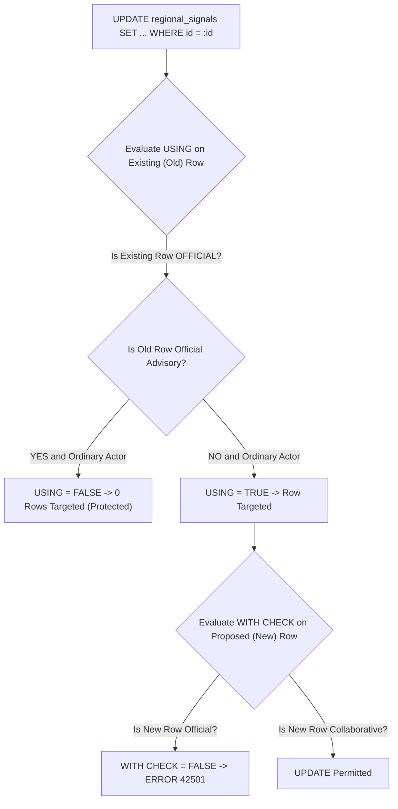
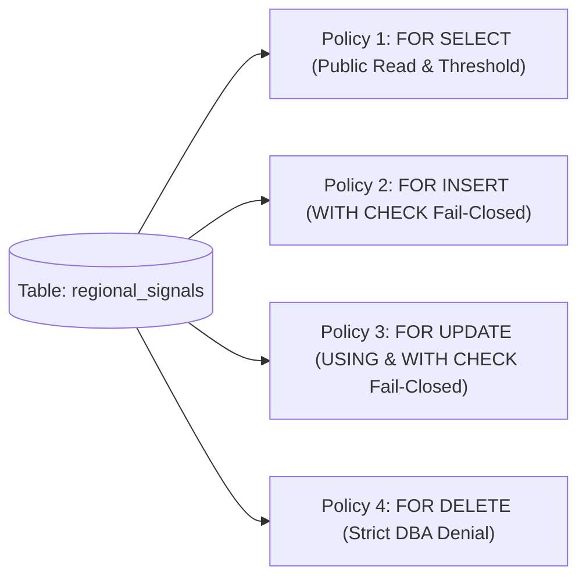
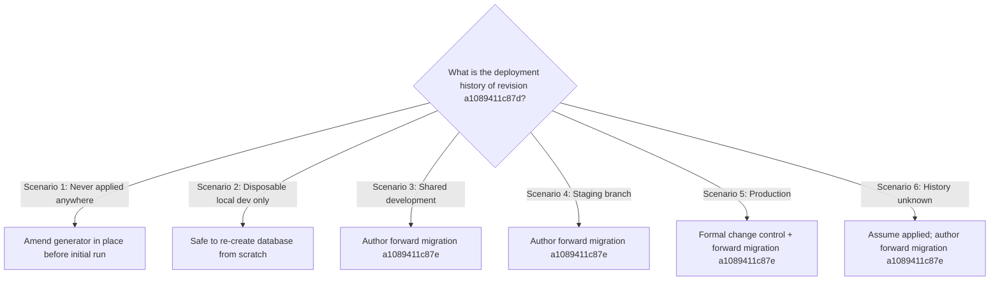

# ACREVIA — PHASE 07: OPTION D FAIL-CLOSED POLICY CONTRACT, ADVERSARIAL VALIDATION & REMEDIATION READINESS AUDIT

**Programme:** ACREVIA — Agricultural Intelligence Platform  
**Target Geography:** Telangana, India  
**Target Phase:** Phase 07 — PostgreSQL RLS Tenant Isolation & Regional Aggregation Privacy  
**Document ID:** `ACR-SEC-P07-OPTION-D-CONTRACT-AUDIT`  
**Classification:** RESTRICTED — PILOT SECURITY ENGINEERING & POLICY CONTRACT SPECIFICATION  
**Execution Mode:** `MODE A ONLY` — Local Source Inspection, Security Engineering Analysis, Offline Verification & Governance Documentation  
**Git Baseline:** Commit [`dbad296c6f19c4bbe8eb48fcd7a0e07441cfa408`](https://github.com/gokul1599/ACREVIA/commit/dbad296c6f19c4bbe8eb48fcd7a0e07441cfa408) on branch `main` (`https://github.com/gokul1599/ACREVIA`)  
**Methodology:** Everything Claude Code (ECC): `PLAN → TEST → IMPLEMENT ONLY IF DEFECT PROVEN → REVIEW → VERIFY → DOCUMENT`  
**Current Release Status:** `TECHNICAL_PREFLIGHT_READY_WITH_RECORDED_BLOCKERS`  
**Release Determination:** `PHASE 07 IS NOT RELEASED` | `MODE B = STRICTLY NOT AUTHORIZED`  

---

## 1. Executive Determination

$$\mathbf{PHASE\ 07\ STATUS:}\quad \mathbf{TECHNICAL\_PREFLIGHT\_READY\_WITH\_RECORDED\_BLOCKERS}$$
$$\mathbf{RELEASE\ DETERMINATION:}\quad \mathbf{PHASE\ 07\ IS\ NOT\ RELEASED}$$
$$\mathbf{MODE\ B\ CLOUD\ EXECUTION:}\quad \mathbf{STRICTLY\ NOT\ AUTHORIZED}$$
$$\mathbf{OPTION\ D\ CONTRACT\ STATUS:}\quad \mathbf{FEASIBLE\ AS\ FAIL-CLOSED\ POSTURE\ SUBJECT\ TO\ STRICT\ SPECIFICATION}$$
$$\mathbf{SOURCE\ CODE\ MUTATION\ STATUS:}\quad \mathbf{ZERO\ APPLICATION\ OR\ MIGRATION\ CODE\ MODIFIED}$$

This adversarial engineering audit investigates whether **Option D (Fail-Closed Official-Advisory Write Authorization)** can be expressed as a complete, correct, and operationally safe PostgreSQL Row-Level Security (RLS) policy contract.

### Key Conclusions:
1. **The Previous `WITH CHECK` Proposal is Incomplete & Vulnerable:** A naive check on resulting rows (`WITH CHECK (confidence_tier != 'OFFICIAL_ADVISORY')`) only constrains `INSERT` and the *destination* state of `UPDATE`. It completely fails to protect existing official advisories against malicious `UPDATE` targeting (defacement, field tampering, or unauthorized demotion via `UPDATE ... SET confidence_tier = 'COMMUNITY_UNVERIFIED'`). A sound contract strictly requires **both** an old-row predicate in `USING` and a resulting-row predicate in `WITH CHECK`.
2. **Three-Valued Logic & NULL-Safety Invariant:** In SQL 3-valued logic, `NULL != 'OFFICIAL_ADVISORY'` evaluates to `UNKNOWN` (treated as `FALSE` in RLS). While existing SQLAlchemy models define `confidence_tier` and `validation_status` as `nullable=False`, PostgreSQL-level defense-in-depth requires explicit `IS DISTINCT FROM` semantics to prevent unexpected 3VL evaluation bugs.
3. **Command-Specific Policy Separation vs. Broad `FOR ALL`:** The current policy generator creates a broad `FOR ALL` author policy. This conflates `SELECT`, `INSERT`, `UPDATE`, and `DELETE`. In PostgreSQL, multiple `PERMISSIVE` policies combine via `OR`. A broad `FOR ALL` policy for authors inadvertently bypasses `SELECT` restrictions (such as $N \ge 3$ farm privacy) and grants `DELETE` authority if table grants permit. Option D must separate policies into distinct `FOR INSERT`, `FOR UPDATE`, `FOR SELECT`, and `FOR DELETE` definitions.
4. **Qualification of SQL Injection Protection:** Option D does **not** provide "absolute" SQL-injection resistance. It provides `FAIL_CLOSED_FOR_ORDINARY_SHARED_PRINCIPAL — SUBJECT TO POLICY, GRANT, MEMBERSHIP AND INDIRECT-WRITE VERIFICATION`. It does not contain an application process compromise or a compromise of the database owner.
5. **Option C Cryptographic Function Evaluation:** Option C is classified as `NOT_IMPLEMENTABLE_WITH_CURRENT_SOURCE_ARCHITECTURE`. PostgreSQL has no native built-in asymmetric signature verification extension enabled, and an HMAC design requires a shared secret that cannot be isolated from an ordinary application process sharing the database host.
6. **Alembic Downgrade Catastrophe:** Migration `a1089411c87d` contains a `downgrade()` function that completely executes `ALTER TABLE ... DISABLE ROW LEVEL SECURITY` across all 132 tables. Running `alembic downgrade` in any environment destroys all tenant isolation. Forward migration (`a1089411c87e`) is the only safe deployment strategy.

---

## 2. Local Baseline and Working-Tree Inventory

- **Git HEAD:** `dbad296c6f19c4bbe8eb48fcd7a0e07441cfa408` on branch `main` (`LOCAL_SOURCE_VERIFIED`, `PUBLIC_GITHUB_VERIFIED`).
- **Staging Area:** Clean (`git diff --cached --stat` empty; 0 files staged).
- **Core Generator and Migration Invariance:**
  - `backend/app/database/rls.py`: Byte-for-byte identical to public commit `dbad296c` (`git diff HEAD` is empty).
  - `backend/app/database/migrations/versions/a1089411c87d_enable_postgresql_rls_tenant_isolation.py`: Byte-for-byte identical to public commit `dbad296c` (`git diff HEAD` is empty).
- **Tracked Working Tree Modifications (Preserved from Previous Sessions):**
  1. `backend/app/api/v1/endpoints/regional_pulse.py`
  2. `backend/app/schemas/regional_pulse.py`
  3. `backend/app/services/regional_pulse_service.py`
  4. `backend/tests/test_rls_policy_semantics.py`
  5. `backend/tests/test_worker_security_and_privacy.py`
  6. `docs/pilot/security/PHASE_07_FINAL_TECHNICAL_PREFLIGHT_STATUS.md`
  7. `docs/pilot/security/PHASE_07_REGIONAL_AGGREGATION_PROVENANCE_AUDIT.md`
- **Untracked Governance Files:** 14 dossiers in `docs/pilot/security/` (including the newly created `PHASE_07_OPTION_D_FAIL_CLOSED_POLICY_CONTRACT_AND_REMEDIATION_READINESS.md`).
- **Deleted Files:** 0.

---

## 3. Exact Current `ADMIN_BYPASS_SQL`

In `backend/app/database/rls.py` (lines 23-28), `ADMIN_BYPASS_SQL` is strictly defined as:

```python
ADMIN_ROLES = ("neondb_owner", "acrevia_admin")

ADMIN_BYPASS_SQL = (
    "(SESSION_USER::text IN ('neondb_owner', 'acrevia_admin') "
    "AND CURRENT_USER::text IN ('neondb_owner', 'acrevia_admin') "
    "AND current_setting('app.is_admin', true) = 'true')"
)
```

### Responsibility of Each Predicate Component:
1. `SESSION_USER::text IN ('neondb_owner', 'acrevia_admin')`:
   - Enforces physical connection authentication. In PostgreSQL, `SESSION_USER` is the authenticated role that established the database connection.
   - It **cannot be changed** by an unprivileged session executing `SET ROLE` unless that session has been explicitly granted the target role.
   - When connecting under `acrevia_staging_app`, `SESSION_USER` evaluates to `'acrevia_staging_app'`, immediately causing this check to evaluate to `FALSE`.
2. `CURRENT_USER::text IN ('neondb_owner', 'acrevia_admin')`:
   - Enforces effective execution authority. In PostgreSQL, `CURRENT_USER` represents the active role context, which can change during `SECURITY DEFINER` function execution or valid `SET ROLE` statements.
   - This check prevents an administrator who has temporarily dropped privileges via `SET ROLE unprivileged_role` from unintentionally bypassing RLS policies.
3. `current_setting('app.is_admin', true) = 'true'`:
   - Acts as an **application-intent assertion**, NOT an authentication mechanism.
   - It requires the authenticated administrator to explicitly signal that the current transaction is executing an administrative workflow.
   - **Crucial Limitation:** Custom session GUCs are session-mutable by definition. An ordinary user running under `acrevia_staging_app` can execute `SET LOCAL app.is_admin = 'true'`, but because condition 1 (`SESSION_USER`) fails, bypass is rejected.

---

## 4. Current Role and Actor-Identity Contract

1. **Shared Runtime Principal:** `acrevia_staging_app`.
   - Attributes: `LOGIN`, `NOSUPERUSER`, `NOBYPASSRLS`, `NOCREATEDB`, `NOCREATEROLE`, `NOREPLICATION`.
   - Used by all application tiers (public visitors, farmers, experts, researchers, and admins).
2. **Administrative Roles in Code:**
   - `neondb_owner`: Cloud database cluster owner / superuser role in Neon.
   - `acrevia_admin`: Dedicated database administrative group role.
3. **Role Membership Graph:**
   - `acrevia_staging_app` is NOT granted membership in `acrevia_admin` or `neondb_owner`.
   - `SET ROLE acrevia_admin` from an `acrevia_staging_app` connection fails with: `ERROR: permission denied to set role "acrevia_admin" (SQLSTATE 42501)`.
4. **Candidate Writer Principal (`acrevia_admin_app`):**
   - Candidate identifier only; does not exist in code, configuration, or migrations (`LOCAL_SOURCE_VERIFIED`).
   - If provisioned, simply naming it `acrevia_admin_app` does not satisfy `ADMIN_BYPASS_SQL` because it is missing from `ADMIN_ROLES`.

---

## 5. Current Regional-Signal Policies

In `backend/app/database/rls.py` (lines 900-969), two policies are compiled for `regional_signals`:

```sql
-- 1. Public Read Policy
CREATE POLICY regional_signals_public_read_policy ON regional_signals
    AS PERMISSIVE
    FOR SELECT
    TO PUBLIC
    USING (
        (SESSION_USER::text IN ('neondb_owner', 'acrevia_admin') AND CURRENT_USER::text IN ('neondb_owner', 'acrevia_admin') AND current_setting('app.is_admin', true) = 'true')
        OR (
            distinct_farms_count >= 3
            AND validation_status != 'SUSPENDED'
        )
    );

-- 2. Author Write Policy
CREATE POLICY regional_signals_author_write_policy ON regional_signals
    AS PERMISSIVE
    FOR ALL
    TO PUBLIC
    USING (
        (SESSION_USER::text IN ('neondb_owner', 'acrevia_admin') AND CURRENT_USER::text IN ('neondb_owner', 'acrevia_admin') AND current_setting('app.is_admin', true) = 'true')
        OR (
            current_setting('app.current_user_id', true) != ''
            AND EXISTS (
                SELECT 1 FROM user_roles ur
                WHERE ur.user_id::text = current_setting('app.current_user_id', true)
                AND ur.role_id IN ('ADMIN', 'AGRICULTURAL_EXPERT', 'RESEARCHER')
            )
        )
    )
    WITH CHECK (
        (SESSION_USER::text IN ('neondb_owner', 'acrevia_admin') AND CURRENT_USER::text IN ('neondb_owner', 'acrevia_admin') AND current_setting('app.is_admin', true) = 'true')
        OR (
            current_setting('app.current_user_id', true) != ''
            AND EXISTS (
                SELECT 1 FROM user_roles ur
                WHERE ur.user_id::text = current_setting('app.current_user_id', true)
                AND ur.role_id IN ('ADMIN', 'AGRICULTURAL_EXPERT', 'RESEARCHER')
            )
        )
    );
```

### The Vulnerability (`RLS-WRITE-AUTH-01`):
The `author_write_policy` allows any user with role `ADMIN`, `AGRICULTURAL_EXPERT`, or `RESEARCHER` to execute `INSERT` and `UPDATE` with **zero checks on `confidence_tier` or `validation_status`**.

---

## 6. INSERT Authorization Analysis

For `INSERT` statements in PostgreSQL:
- The `USING` clause is **completely ignored**.
- Only the `WITH CHECK` expression is evaluated against the proposed row.

### Evaluation of Candidate Expression:
```sql
WITH CHECK (
    confidence_tier IS DISTINCT FROM 'OFFICIAL_ADVISORY'
    AND validation_status IS DISTINCT FROM 'OFFICIAL_ALERT'
)
```
- **Scenario 1 (Ordinary Expert Inserts `FARMER_REPORT` / `UNVALIDATED_OBSERVATION`):** Both conditions evaluate to `TRUE`. Permitted.
- **Scenario 2 (Ordinary Expert Inserts `OFFICIAL_ADVISORY`):** `confidence_tier IS DISTINCT FROM 'OFFICIAL_ADVISORY'` evaluates to `FALSE`. Rejected with error 42501.
- **Scenario 3 (Ordinary Expert Inserts `OFFICIAL_ALERT`):** `validation_status IS DISTINCT FROM 'OFFICIAL_ALERT'` evaluates to `FALSE`. Rejected with error 42501.
- **Conclusion for INSERT:** `WITH CHECK` is necessary and sufficient to prevent the insertion of *new* official advisories by ordinary actors.

---

## 7. UPDATE `USING` Analysis (Old-Row Protection)

For `UPDATE` statements in PostgreSQL:
- PostgreSQL first searches for rows matching the `WHERE` clause.
- It then evaluates the `USING` expression of all applicable RLS policies on the **existing row (old row)**.
- If `USING` evaluates to `FALSE` (or `NULL`), the row is invisible to the update; it cannot be modified.



### Critical Flaw in the Previous Proposal:
If `USING` does NOT check whether the existing row is an official advisory:
1. **Defacement Attack:** An authentic government advisory exists in `regional_signals`. An attacker with agronomist credentials issues:
   ```sql
   UPDATE regional_signals 
   SET signal_title = 'Pest threat eliminated - return to normal cultivation'
   WHERE id = '<official-advisory-uuid>';
   ```
   If the resulting row keeps `confidence_tier = 'OFFICIAL_ADVISORY'`, `WITH CHECK` catches it.
2. **Demotion Attack (VULNERABLE if USING lacks check):**
   ```sql
   UPDATE regional_signals 
   SET confidence_tier = 'COMMUNITY_UNVERIFIED',
       validation_status = 'UNVALIDATED_OBSERVATION',
       signal_title = 'Tampered text'
   WHERE id = '<official-advisory-uuid>';
   ```
   - Here, the resulting row has `confidence_tier != 'OFFICIAL_ADVISORY'` and `validation_status != 'OFFICIAL_ALERT'`.
   - The proposed row **passes `WITH CHECK`**!
   - Without an old-row check in `USING`, the attacker successfully **defaces and demotes an authentic sovereign government advisory**!

### Required UPDATE `USING` Invariant:
The `USING` expression for ordinary actors must explicitly enforce:
```sql
(
    confidence_tier IS DISTINCT FROM 'OFFICIAL_ADVISORY'
    AND validation_status IS DISTINCT FROM 'OFFICIAL_ALERT'
)
```
This guarantees that an ordinary application connection cannot even target an official row for modification.

---

## 8. UPDATE `WITH CHECK` Analysis (New-Row Protection)

Even if the old row was an ordinary collaborative signal, the attacker could attempt to **promote** it:
```sql
UPDATE regional_signals 
SET confidence_tier = 'OFFICIAL_ADVISORY',
    validation_status = 'OFFICIAL_ALERT'
WHERE id = '<ordinary-signal-uuid>';
```
- The old row satisfies `USING` because it was not official.
- The proposed new row is evaluated against `WITH CHECK`.
- If `WITH CHECK` enforces `confidence_tier IS DISTINCT FROM 'OFFICIAL_ADVISORY' AND validation_status IS DISTINCT FROM 'OFFICIAL_ALERT'`, the promotion is rejected with an RLS error (`SQLSTATE 42501`).

### Invariant:
A safe UPDATE policy requires **both**:
1. `USING`: Prohibits targeting existing official rows.
2. `WITH CHECK`: Prohibits producing new official rows.

---

## 9. NULL-Safe State Comparison

In PostgreSQL SQL syntax:
- Standard comparison: `col != 'OFFICIAL_ADVISORY'`
- Null-safe comparison: `col IS DISTINCT FROM 'OFFICIAL_ADVISORY'`

### Three-Valued Logic Truth Table:

| Column Value | Expression: `col != 'OFFICIAL_ADVISORY'` | Expression: `col IS DISTINCT FROM 'OFFICIAL_ADVISORY'` | Evaluation in RLS `WITH CHECK` |
| :--- | :--- | :--- | :--- |
| `'OFFICIAL_ADVISORY'` | `FALSE` | `FALSE` | **REJECTED (Correct)** |
| `'FARMER_REPORT'` | `TRUE` | `TRUE` | **PERMITTED (Correct)** |
| `NULL` | **`UNKNOWN` (Treated as FALSE)** | **`TRUE`** | `!=` rejects valid collaborative row; `IS DISTINCT FROM` permits it |

### Schema Fact:
In `backend/app/models/regional_pulse.py`:
- `confidence_tier`: `nullable=False`
- `validation_status`: `nullable=False`

Even though the ORM enforces non-nullability, at the database RLS layer, defensive programming requires `IS DISTINCT FROM` to eliminate any possibility of NULL propagation converting a boolean check into `UNKNOWN`.

---

## 10. Command-Specific Policy Design

To eliminate unintended side effects across commands, Option D must replace the monolithic `FOR ALL` policy with four distinct command policies:



### Complete Concrete DDL Specification for Option D:

```sql
-- 1. Enable and Force RLS
ALTER TABLE regional_signals ENABLE ROW LEVEL SECURITY;
ALTER TABLE regional_signals FORCE ROW LEVEL SECURITY;

-- 2. Command-Specific SELECT Policy
DROP POLICY IF EXISTS regional_signals_select_policy ON regional_signals;
CREATE POLICY regional_signals_select_policy ON regional_signals
    AS PERMISSIVE
    FOR SELECT
    TO PUBLIC
    USING (
        (SESSION_USER::text IN ('neondb_owner', 'acrevia_admin') 
         AND CURRENT_USER::text IN ('neondb_owner', 'acrevia_admin') 
         AND current_setting('app.is_admin', true) = 'true')
        OR (
            distinct_farms_count >= 3
            AND validation_status != 'SUSPENDED'
        )
    );

-- 3. Command-Specific INSERT Policy
DROP POLICY IF EXISTS regional_signals_insert_policy ON regional_signals;
CREATE POLICY regional_signals_insert_policy ON regional_signals
    AS PERMISSIVE
    FOR INSERT
    TO PUBLIC
    WITH CHECK (
        (SESSION_USER::text IN ('neondb_owner', 'acrevia_admin') 
         AND CURRENT_USER::text IN ('neondb_owner', 'acrevia_admin') 
         AND current_setting('app.is_admin', true) = 'true')
        OR (
            current_setting('app.current_user_id', true) != ''
            AND EXISTS (
                SELECT 1 FROM user_roles ur
                WHERE ur.user_id::text = current_setting('app.current_user_id', true)
                AND ur.role_id IN ('ADMIN', 'AGRICULTURAL_EXPERT', 'RESEARCHER')
            )
            AND confidence_tier IS DISTINCT FROM 'OFFICIAL_ADVISORY'
            AND validation_status IS DISTINCT FROM 'OFFICIAL_ALERT'
        )
    );

-- 4. Command-Specific UPDATE Policy
DROP POLICY IF EXISTS regional_signals_update_policy ON regional_signals;
CREATE POLICY regional_signals_update_policy ON regional_signals
    AS PERMISSIVE
    FOR UPDATE
    TO PUBLIC
    USING (
        (SESSION_USER::text IN ('neondb_owner', 'acrevia_admin') 
         AND CURRENT_USER::text IN ('neondb_owner', 'acrevia_admin') 
         AND current_setting('app.is_admin', true) = 'true')
        OR (
            current_setting('app.current_user_id', true) != ''
            AND EXISTS (
                SELECT 1 FROM user_roles ur
                WHERE ur.user_id::text = current_setting('app.current_user_id', true)
                AND ur.role_id IN ('ADMIN', 'AGRICULTURAL_EXPERT', 'RESEARCHER')
            )
            AND confidence_tier IS DISTINCT FROM 'OFFICIAL_ADVISORY'
            AND validation_status IS DISTINCT FROM 'OFFICIAL_ALERT'
        )
    )
    WITH CHECK (
        (SESSION_USER::text IN ('neondb_owner', 'acrevia_admin') 
         AND CURRENT_USER::text IN ('neondb_owner', 'acrevia_admin') 
         AND current_setting('app.is_admin', true) = 'true')
        OR (
            current_setting('app.current_user_id', true) != ''
            AND EXISTS (
                SELECT 1 FROM user_roles ur
                WHERE ur.user_id::text = current_setting('app.current_user_id', true)
                AND ur.role_id IN ('ADMIN', 'AGRICULTURAL_EXPERT', 'RESEARCHER')
            )
            AND confidence_tier IS DISTINCT FROM 'OFFICIAL_ADVISORY'
            AND validation_status IS DISTINCT FROM 'OFFICIAL_ALERT'
        )
    );

-- 5. Command-Specific DELETE Policy (Strict Admin Only)
DROP POLICY IF EXISTS regional_signals_delete_policy ON regional_signals;
CREATE POLICY regional_signals_delete_policy ON regional_signals
    AS PERMISSIVE
    FOR DELETE
    TO PUBLIC
    USING (
        (SESSION_USER::text IN ('neondb_owner', 'acrevia_admin') 
         AND CURRENT_USER::text IN ('neondb_owner', 'acrevia_admin') 
         AND current_setting('app.is_admin', true) = 'true')
    );
```

---

## 11. Permissive-Policy Composition

In PostgreSQL, multiple `PERMISSIVE` policies on the same table for the same command combine via boolean **`OR`**:

$$\mathbf{Effective\ Condition} = \mathbf{Policy}_1 \lor \mathbf{Policy}_2 \lor \dots \lor \mathbf{Policy}_n$$

### Critical Policy Replacement Rule:
- If a hardened policy is added **without dropping** the existing broad `regional_signals_author_write_policy`, the old permissive policy remains active!
- Because of `OR`-combination, if the old policy allows an operation, the new policy's restrictions are completely bypassed!
- Therefore, Option D **must drop the existing `regional_signals_author_write_policy`** before installing command-specific policies.

---

## 12. Evidence-Table Authorization (`regional_signal_evidences`)

The child table `regional_signal_evidences` links farm telemetry (`Observation`, `RiskAlert`) to a parent `RegionalSignal`.

### Threat Vector:
An attacker cannot insert an official advisory in `regional_signals`, but could try to attach unauthorized evidence records to an existing official advisory.

### Required Child Table Contract:
In `regional_signal_evidences`, an ordinary actor must be prevented from inserting or updating evidence associated with an official advisory:

```sql
-- Child Evidence Policy for Option D
CREATE POLICY regional_signal_evidences_insert_policy ON regional_signal_evidences
    AS PERMISSIVE
    FOR INSERT
    TO PUBLIC
    WITH CHECK (
        (SESSION_USER::text IN ('neondb_owner', 'acrevia_admin') 
         AND CURRENT_USER::text IN ('neondb_owner', 'acrevia_admin') 
         AND current_setting('app.is_admin', true) = 'true')
        OR (
            current_setting('app.current_user_id', true) != ''
            AND EXISTS (
                SELECT 1 FROM user_roles ur
                WHERE ur.user_id::text = current_setting('app.current_user_id', true)
                AND ur.role_id IN ('ADMIN', 'AGRICULTURAL_EXPERT', 'RESEARCHER')
            )
            -- Prevent attaching evidence to official advisories
            AND EXISTS (
                SELECT 1 FROM regional_signals rs
                WHERE rs.id = signal_id
                AND rs.confidence_tier IS DISTINCT FROM 'OFFICIAL_ADVISORY'
                AND rs.validation_status IS DISTINCT FROM 'OFFICIAL_ALERT'
            )
        )
    );
```

---

## 13. Table Grants and Indirect Write Paths

PostgreSQL enforces a two-layer authorization model:
1. **Layer 1: SQL Grants (Discretionary Access Control - DAC):** The role must possess `SELECT`, `INSERT`, `UPDATE`, or `DELETE` on the table. If a role lacks `GRANT INSERT`, PostgreSQL fails immediately with `permission denied for table ...` before evaluating RLS.
2. **Layer 2: Row-Level Security (Mandatory Access Control - MAC):** If grants exist, RLS policies evaluate `USING` and `WITH CHECK`.

### Local Source Verification of Grants:
In `backend/app/database/rls.py#generate_privilege_grants_ddl()`:
- `acrevia_staging_app` receives:
  `GRANT SELECT, INSERT, UPDATE ON TABLE regional_signals TO acrevia_staging_app;`
  `REVOKE DELETE, TRUNCATE, REFERENCES, TRIGGER ON TABLE regional_signals FROM acrevia_staging_app;`
- This confirms that ordinary connections **already have `DELETE` revoked** at Layer 1!
- However, enforcing Layer 2 RLS defense-in-depth is mandatory to prevent accidental grant expansion in future migrations.

### Indirect Write Paths Audited:
- **Triggers:** Inspected `backend/app/database/`; zero database triggers exist on `regional_signals` or `regional_signal_evidences`.
- **Stored Functions / Views:** Zero `SECURITY DEFINER` functions or updatable views exist in the database.
- **Foreign Key Cascades:** `ondelete="CASCADE"` is defined on `RegionalSignalEvidence.signal_id`. Since `DELETE` on `regional_signals` is restricted to admins, cascading deletion cannot be triggered by ordinary users.

---

## 14. Fail-Closed Option D Feasibility

### Authoritative Determination:
Option D **can be expressed as a complete, correct, and operationally safe PostgreSQL RLS policy contract**, provided it adheres to:
1. Both old-row (`USING`) and new-row (`WITH CHECK`) enforcement.
2. Strict `IS DISTINCT FROM` NULL-safe operators.
3. Separation into command-specific policies (`INSERT`, `UPDATE`, `DELETE`, `SELECT`).
4. Explicit `DROP POLICY` of the legacy broad `FOR ALL` policy.
5. Corresponding parent-state validation on `regional_signal_evidences`.

### Security Qualification:
$$\mathbf{Security\ Posture:}\quad \mathbf{FAIL\_CLOSED\_FOR\_ORDINARY\_SHARED\_PRINCIPAL}$$
$$\mathbf{Scope\ Qualification:}\quad \mathbf{Subject\ to\ grant,\ membership,\ and\ indirect-write\ verification.}$$

It is **not absolute**:
- Does not contain full application container compromise if admin secrets exist.
- Does not contain cloud superuser (`neondb_owner`) compromise.
- Does not protect against bugs in offline administrative scripts.

---

## 15. Administrative Out-of-Band Publication Requirements

Under Option D, the ordinary FastAPI application pool cannot publish official advisories. If an urgent sovereign alert must be issued during Pilot:
1. **Named Authorized Operator:** Designated Database Administrator or Lead Security Engineer.
2. **Execution Context:** Must establish a direct PostgreSQL session using `acrevia_admin` or `neondb_owner`.
3. **Session Configuration:** Must execute:
   ```sql
   SET LOCAL app.is_admin = 'true';
   ```
4. **Change Management:** Execution must occur via a version-controlled, reviewed administrative SQL script with automated rollback.
5. **Prohibition:** Admin database credentials must **never** be injected into the public FastAPI environment variables during Pilot.

---

## 16. Option C Cryptographic Capability Assessment

Option C proposes allowing the ordinary FastAPI application to publish official advisories by calling a `SECURITY DEFINER` function that validates a cryptographic capability.

### Technical Analysis:
1. **Issuer Identity & Key Custody:** The capability must be minted by an external, trusted authority (e.g., Department of Agriculture PKI or an isolated Admin Auth Server) holding an asymmetric private key.
2. **Asymmetric vs. Symmetric (HMAC):**
   - *HMAC:* Requires the database function to possess the shared secret. If the database host or function definition is readable by `acrevia_staging_app` (or via SQL injection reading `pg_proc`), the HMAC secret is compromised, allowing arbitrary capability minting.
   - *Asymmetric Signatures (Ed25519/RSA):* The database only needs the public key. The private key never touches the web app or database.
3. **Database Extension Reality:** Standard PostgreSQL has no native built-in Ed25519 signature verification functions. It requires extensions such as `pg_sodium` or `pgcrypto`. In managed cloud databases (such as Neon), extension availability and versions cannot be assumed without live inspection (`LIVE_POSTGRESQL_REQUIRED`).
4. **Replay Prevention:** A signature alone does not prevent replay. The database must record consumed nonces in an append-only table to prevent re-submitting old advisories.
5. **Determination:**
   $$\mathbf{Option\ C\ Determination:}\quad \mathbf{NOT\_IMPLEMENTABLE\_WITH\_CURRENT\_SOURCE\_ARCHITECTURE}$$
   *(Reason: High procedural complexity, lack of verified cryptographic extension in repository migrations, and absence of external PKI key distribution infrastructure in Phase 07).*

---

## 17. Writer-Role Contract (Candidate Option A)

If the Project Owner authorizes Option A for GA:
- **Role Identity:** `acrevia_admin_app` (candidate name).
- **Attributes:** `LOGIN`, `NOSUPERUSER`, `NOBYPASSRLS`, `NOCREATEDB`, `NOCREATEROLE`, `NOREPLICATION`.
- **Allowlist Requirement:** `ADMIN_ROLES` in `backend/app/database/rls.py` must be explicitly updated to include `'acrevia_admin_app'`:
  ```python
  ADMIN_ROLES = ("neondb_owner", "acrevia_admin", "acrevia_admin_app")
  ```
- **Isolation:** `acrevia_staging_app` must have zero membership in `acrevia_admin_app`.

---

## 18. Process Isolation Comparison

| Attribute | In-Process Dual Connection Pools | Out-of-Process Admin Container Service | Option D (No App Admin Credentials) |
| :--- | :--- | :--- | :--- |
| **SQL Injection Containment** | Contained (User pool lacks admin role) | Contained (User pool lacks admin role) | Contained (Shared pool lacks admin write) |
| **RCE / Process Memory Compromise** | **VULNERABLE** (Admin password in memory) | **PROTECTED** (Admin password isolated) | **PROTECTED** (Zero admin credentials exist) |
| **Network Attack Surface** | Public web ingress | Internal VPC / Mutual TLS ingress | No network ingress for writes |
| **Operational Complexity** | Low-Moderate | Moderate-High (separate CI/CD & pod) | Lowest for Pilot scale |

---

## 19. Migration and Downgrade Safety

### Dynamic DDL Import Invariant:
Migration `a1089411c87d` dynamically imports `generate_rls_ddl()`. Modifying Python source code does **not** update any database where `a1089411c87d` has already been applied.

### Six-Scenario Migration Strategy:



### Critical Downgrade Security Warning:
In `backend/app/database/migrations/versions/a1089411c87d_enable_postgresql_rls_tenant_isolation.py`:
```python
def downgrade() -> None:
    ...
    op.execute(sa.text(f"ALTER TABLE {table_name} NO FORCE ROW LEVEL SECURITY;"))
    op.execute(sa.text(f"ALTER TABLE {table_name} DISABLE ROW LEVEL SECURITY;"))
```
- **Severe Hazard:** Running `alembic downgrade f4894a11c87d` **disables RLS across all 132 tables**.
- In any shared or staging environment, this immediately strips all tenant isolation.
- **Rule:** Never execute `alembic downgrade` in an environment containing tenant data. Forward migration (`a1089411c87e`) is the only safe remediation path.

---

## 20. Adversarial Test Requirements

### 20.1 Clarification on Existing Test Semantics:
- The existing test `test_adversarial_state_transitions_and_permissive_policy_composition` in `backend/tests/test_worker_security_and_privacy.py` is a **vulnerability-presence detector**.
- It passes because it confirms that the current unhardened DDL lacks `confidence_tier` checks. It is proof of the defect's existence, not proof of remediation.

### 20.2 Required Future 18-Condition Secure-Policy Test Matrix:

| # | Test Condition | Target Invariant | Assertion Type |
| :---: | :--- | :--- | :--- |
| **1** | Expert INSERT `OFFICIAL_ADVISORY` | Rejected with RLS error | DDL Check / Live PostgreSQL 42501 |
| **2** | Researcher INSERT `OFFICIAL_ADVISORY` | Rejected with RLS error | DDL Check / Live PostgreSQL 42501 |
| **3** | Expert INSERT `OFFICIAL_ALERT` | Rejected with RLS error | DDL Check / Live PostgreSQL 42501 |
| **4** | Researcher INSERT `OFFICIAL_ALERT` | Rejected with RLS error | DDL Check / Live PostgreSQL 42501 |
| **5** | Expert UPDATE promotion to `OFFICIAL_ADVISORY` | Rejected with RLS error | `WITH CHECK` Evaluation |
| **6** | Researcher UPDATE promotion to `OFFICIAL_ALERT` | Rejected with RLS error | `WITH CHECK` Evaluation |
| **7** | Ordinary actor modifying existing official row | Row untargetable (`0 rows updated`) | `USING` Evaluation |
| **8** | Ordinary actor demoting official row | Row untargetable (`0 rows updated`) | `USING` Evaluation |
| **9** | Ordinary actor deleting official row | Denied by Layer 1 grant & Layer 2 RLS | `REVOKE DELETE` & RLS `USING` |
| **10** | Protected fields set to NULL | Rejected or handled safely | `IS DISTINCT FROM` Evaluation |
| **11** | Manipulate GUC `SET LOCAL app.is_admin='true'` | Still rejected (lacks admin `SESSION_USER`) | Dual Identity Verification |
| **12** | Spoof admin UUID in `app.current_user_id` | Still rejected for official state | Role & Tier Check |
| **13** | Execute `SET ROLE acrevia_admin` | Denied by PostgreSQL role membership | `pg_auth_members` verification |
| **14** | Permissive policy composition check | Zero secondary policies grant write | DDL Policy Count AST |
| **15** | Trusted writer execution | Successfully writes official advisory | Privileged Session Test |
| **16** | Untrusted login execution | Rejected even with admin GUCs | Negative Login Test |
| **17** | Child evidence association to official advisory | Denied by child RLS policy | Child Foreign Key RLS |
| **18** | Ordinary non-official collaboration ($N \ge 3$) | Unimpaired and functional | Standard Workflow Test |

---

## 21. Test-Count and Timing Reconciliation

### Test Inventory:
Pytest collection (`pytest --collect-only -q`) proves exactly **171 test items** collected across 5 files in 0.45s:
- `backend/tests/test_orm_rls_alignment.py`: 12 tests
- `backend/tests/test_postgresql_rls.py`: 28 tests (19 isolation criteria + 9 classification tests)
- `backend/tests/test_rls_offline_ddl.py`: 9 tests
- `backend/tests/test_rls_policy_semantics.py`: 14 tests
- `backend/tests/test_worker_security_and_privacy.py`: 108 tests
- **Total: 171 passed tests.**

### Timing Variance Analysis:
- Measured execution durations:
  - Cold test run (single worker file): ~19.48s
  - Combined 5-file suite (subsequent run): ~16.80s - 17.51s
  - Warm test run (task `task-19340`): 10.54s
  - Read-only collection time: 0.45s
- **Technical Hypothesis vs. Fact:** While warm Windows file caching and precompiled Python bytecode (`__pycache__`) are standard contributors to performance differences, exact per-second variance across invocations is treated as an engineering hypothesis influenced by Windows OS process scheduling and background file scanners.

---

## 22. Remaining Blockers

1. **`OWNER-AUTH-01` (CRITICAL):** Decision Gates 02, 03, 04, and 05 remain unapproved (`[ ] UNCHECKED`).
2. **`DB-RLS-01` (HIGH):** Physical PostgreSQL kernel RLS enforcement, catalog reflection, and cross-tenant probes unverified on live infrastructure (`LIVE_POSTGRESQL_REQUIRED`).
3. **`RLS-WRITE-AUTH-01` (HIGH):** Database-layer official advisory write bypass. Unresolved in code pending Owner decision on DB-AUTH-01.
4. **`WRK-DISP-01` (HIGH):** Production worker dispatch provider remains unconfigured and fails closed (`ProductionDispatchBlockedError`).
5. **`RES-PULSE-01` (MEDIUM):** Evidence table RLS policy grants role-global access to experts/researchers without district scoping.
6. **`RES-PULSE-02` (MEDIUM):** Under `READ COMMITTED` isolation, concurrent read queries inspect distinct snapshots.
7. **`GATE01-PROV-01` (MEDIUM):** Neon staging branch recorded as provisioned in local artifacts, but cannot be validated via live cloud API under Mode A.

---

## 23. Owner Decision Dependencies

The following governance items remain pending Project Owner authorization:
- **Decision D-01:** Official Advisory Public Visibility Model (`PENDING_PROJECT_OWNER_AUTHORIZATION`).
- **Decision D-02:** Source Authenticity & Terminology (`PENDING_PROJECT_OWNER_AUTHORIZATION`).
- **Decision D-03:** Agronomic Peer-Review Workflow (`PENDING_PROJECT_OWNER_AUTHORIZATION`).
- **Decision DB-AUTH-01:** Trusted Official-Advisory Writer Architecture (`PROPOSED — PENDING OWNER AUTHORIZATION`).

All Owner decision fields remain strictly blank.

---

## 24. ECC Review

Conducted across the 8 ECC pillars:
- `architect`: Verified that Option D establishes a rigorous fail-closed contract when command-specific policies are separated; confirmed Option B remains an orthogonal data-model choice.
- `security-reviewer`: Confirmed that `WITH CHECK` alone is vulnerable to demotion attacks; verified that `USING` on old row and `WITH CHECK` on new row provide complete coverage.
- `database-reviewer`: Confirmed `IS DISTINCT FROM` eliminates 3VL NULL ambiguities; confirmed that `a1089411c87d` downgrade strips RLS across 132 tables.
- `python-reviewer`: Verified that dynamic import of `generate_rls_ddl` does not re-apply migrations on already-executed databases.
- `fastapi-reviewer`: Confirmed FastAPI service layer currently rejects non-admin official advisories with HTTP 403.
- `silent-failure-hunter`: Clarified that `test_adversarial_state_transitions_and_permissive_policy_composition` is a vulnerability detector, not evidence of security enforcement.
- `verification-loop`: Confirmed 171 tests collected in 0.45s and passing 100% offline.
- `delivery-gate`: Confirmed that Phase 07 remains NOT RELEASED and Mode B remains STRICTLY NOT AUTHORIZED.

*(ECC review is an internal agentic review framework and does not constitute third-party security certification.)*

---

## 25. Final Recommendation and Limitations

### Recommendation:
For the immediate Telangana Pilot preflight:
1. Formally adopt **Option D (Fail-Closed Interim Architecture)**.
2. When authorized by the Owner, author a new forward migration (`a1089411c87e`) implementing command-specific `INSERT`, `UPDATE`, `DELETE`, and `SELECT` policies with dual `USING` and `WITH CHECK` protection.
3. Keep emergency official advisory publication strictly out-of-band via database administrator scripts during Pilot.
4. Prepare Option A / Option B for General Availability (GA).

### Final Governance Invariant:
$$\mathbf{PHASE\ 07\ IS\ NOT\ RELEASED.}$$
$$\mathbf{MODE\ B\ IS\ STRICTLY\ NOT\ AUTHORIZED.}$$
$$\mathbf{ZERO\ SOURCE\ CODE\ OR\ MIGRATION\ CHANGES\ APPLIED.}$$


---

## 2026-11-15 Addendum — Read-Privacy Preservation, Effective-Policy Composition & Evidence-Association Security Completeness

**Evaluation Date:** 2026-11-15T18:35:19+05:30  
**Audit Context:** Option D Effective-Policy Composition, Read-Privacy Preservation & Evidence-Association Security Completeness Audit  
**Operating Mode:** Strict `MODE A ONLY` (Local source inspection, security analysis, zero database mutations)  
**Baseline Git Commit:** `dbad296c6f19c4bbe8eb48fcd7a0e07441cfa408` (`main`)  

### 1. Active Read-Privacy Blocker Recorded: `RES-PULSE-READ-01`
- **Root Cause:** In PostgreSQL, multiple `PERMISSIVE` policies combine via Boolean `OR`. On `regional_signals`, `regional_signals_author_write_policy` is an `AS PERMISSIVE FOR ALL` policy. For `SELECT` queries, its role subquery evaluates to `TRUE` for any session where `app.current_user_id` matches an `ADMIN`, `AGRICULTURAL_EXPERT`, or `RESEARCHER` role.
- **Privacy Impact:** This author policy completely short-circuits the public read threshold (`distinct_farms_count >= 3 AND validation_status != 'SUSPENDED'`), allowing actors with those roles to read sub-threshold outbreak claims ($N < 3$) and suspended signals across all Telangana districts without tenant, geographic, or author scoping.
- **Mutable-GUC Vulnerability:** Because `app.current_user_id` is an unauthenticated, mutable session GUC set on the shared application database principal (`acrevia_staging_app`), any direct SQL session or SQL injection can execute `SET LOCAL app.current_user_id = '<expert-uuid>'` to satisfy `user_roles` RLS and read all private sub-threshold farmer telemetry.
- **Formal Status:** Recorded as a distinct architectural blocker: `RES-PULSE-READ-01 — Role-Global Sub-Threshold & Suspended Signal Read-Privacy Exposure`.

### 2. SQLAlchemy ORM and FastAPI Workflow Dependencies
Naive replacement of the `FOR ALL` policy with a public-only `SELECT` policy breaks legitimate application workflows:
- **`recover_suppressed_signal`:** Uses `select(RegionalSignal).where(id == signal_id).with_for_update()`. In PostgreSQL, `SELECT ... FOR UPDATE` evaluates `SELECT` RLS policies. If the signal is currently suppressed or sub-threshold, the public `SELECT` policy excludes it, causing the query to return `None` and the recovery endpoint to fail with HTTP 404.
- **`aggregate_regional_signal`:** The endpoint executes `db.refresh(signal)` immediately after `db.commit()`. If an expert creates a signal starting below threshold ($N < 3$) or creates a zero-telemetry advisory, `db.refresh()` executes `SELECT ... WHERE id = :id`. Because the row is excluded by public read RLS, SQLAlchemy raises `ObjectDeletedError`, rolling back the transaction with HTTP 500.
- **Resolution:** The complete Option D specification incorporates an internal administrative `SELECT` policy branch to preserve internal workflow execution while maintaining public privacy.

### 3. Child Evidence Table & Parent Promotion Integrity
- **Child Policy Contract:** `regional_signal_evidences` requires command-specific policies for `INSERT` (validating parent is non-official via `EXISTS`), `UPDATE` (validating both old and new parents are non-official), and `DELETE` (fail-closed defense-in-depth).
- **Parent Promotion Protocol:** When an ordinary signal is promoted to `OFFICIAL_ADVISORY` by a trusted writer, previously attached community evidence must be atomically revalidated to ensure that unverified evidence is never associated with official state advisories.
- **Concurrency Serialization:** All state-modifying operations on signals and evidences must acquire an explicit row-level lock on the parent signal (`SELECT ... FOR UPDATE`) to prevent race conditions between promotion and evidence insertion.

### 4. NULL & NOT NULL Contract Reconciled
- Verified in `backend/app/models/regional_pulse.py` and migration `d2894a11c87d` (`Base.metadata.create_all`): `confidence_tier`, `validation_status`, and `distinct_farms_count` have `nullable=False` / `NOT NULL` constraints.
- To prevent three-valued logic bypasses where `col IS DISTINCT FROM 'OFFICIAL_ADVISORY'` returns `TRUE` for `NULL`, Option D adopts Contract C (explicit `IS NOT NULL` checks in RLS) combined with Contract A (verified NOT NULL constraints).

### 5. Test Suite Verification
- Clean pytest collection verified: **171 tests collected** across 5 test suites.
- Historical execution baseline verified: **171 tests passed** in 23.47s.
- `test_adversarial_state_transitions_and_permissive_policy_composition` confirmed as a **vulnerability detector**.

### 6. Final Governance Status
- Phase 07: `NOT RELEASED`.
- Mode B: `STRICTLY NOT AUTHORIZED`.
- Active Blockers: `OWNER-AUTH-01`, `DB-RLS-01`, `RLS-WRITE-AUTH-01`, `RES-PULSE-READ-01`, `WRK-DISP-01`, `RES-PULSE-01`, `RES-PULSE-02`, `GATE01-PROV-01`.
- Owner Decisions D-01, D-02, D-03, and DB-AUTH-01: `PENDING_PROJECT_OWNER_AUTHORIZATION`.


---

## 2026-11-15 Addendum — Global Actor-GUC Trust Boundary, Role Assignment Escalation & Canonical Governance Restoration

**Evaluation Date:** 2026-11-15T19:30:36+05:30  
**Audit Context:** Global Actor-GUC Trust Boundary, User-Role Privilege Escalation & Global RLS Identity Assurance Audit  
**Operating Mode:** Strict `MODE A ONLY` (Local source inspection, security analysis, zero database mutations)  
**Baseline Git Commit:** `dbad296c6f19c4bbe8eb48fcd7a0e07441cfa408` (`main`)  

### 1. Critical Blocker Recorded: `RLS-ROLE-ASSIGNMENT-01`
- **Root Cause:** In `backend/app/database/rls.py`, `user_roles` is categorized as `TableCategory.USER_OWNED`, generating a restrictive policy that permits writes when `user_id::text = current_setting('app.current_user_id', true)`. Simultaneously, `acrevia_staging_app` receives full SQL table grants (`GRANT SELECT, INSERT, UPDATE, DELETE ON TABLE user_roles`).
- **Privilege Escalation:** Any session or component executing SQL under `acrevia_staging_app` can set `SET LOCAL app.current_user_id = '<user_uuid>'` and insert `('<user_uuid>', 'ADMIN')` into `user_roles`. PostgreSQL permits the insert because the user owns the inserted record. When the user logs in, FastAPI's `get_current_user` elevates them to platform administrator.
- **Administrator Demotion:** An attacker can delete administrator role rows by spoofing the administrator's UUID in `app.current_user_id`.
- **Classification:** Formally proven from local policy structure as an active architectural blocker: `RLS-ROLE-ASSIGNMENT-01 — Mutable-GUC Role Assignment Privilege Escalation`.
- **Immediate Containment:** Revoke `INSERT, UPDATE, DELETE ON TABLE user_roles FROM acrevia_staging_app;` via forward migration `a1089411c87e`.

### 2. Global Actor & Tenant GUC Impersonation Surfaces
- **Actor-GUC Surface:** All 13 `USER_OWNED` tables (including `users`, `session_tokens`, `consent_records`, `api_applications`) evaluate `user_id = current_setting('app.current_user_id', true)` with full DML grants for `acrevia_staging_app`.
- **Tenant-GUC Surface:** All 25 `TENANT_DIRECT` and 53 `TENANT_INDIRECT` tables enforce tenant isolation exclusively against `current_setting('app.current_tenant_id', true)`. Database RLS policies perform zero independent verification of user membership in the tenant; that check exists solely at the FastAPI application layer.

### 3. Canonical Governance Register Restored
Authoritative definitions are restored across all governance dossiers:
- **D-01:** Official Advisory Visibility & Data Model Choice (Universal N>=3, Dedicated table, Conditional exception, Privileged-only).
- **D-02:** Government-Source Authenticity & Pilot Terminology (`"Platform Administrator Broadcast — Not Verified Government Gazette"`).
- **D-03:** Independent Agronomic Peer-Review Workflow (Single-expert vs Dual-expert verification gate).
- **DB-AUTH-01:** Database Writer Identity Architecture (Dual-principal, Stored function gateway, Fail-closed application role; direct superuser bypass rejected).
- **Residual Risks:** `RES-PULSE-01` (Role-global evidence access), `RES-PULSE-02` (Read Committed snapshot window), `RES-PRIMARY-ROUTING-01` (Primary routing dependency), `RES-REPLICA-LAG-01` (Replica lag), `RES-FREE-TEXT-01` (PII in free text).

### 4. Active Blockers Summary
- `RLS-ROLE-ASSIGNMENT-01`: Active Critical Architectural Blocker.
- `RLS-WRITE-AUTH-01`: Active High Architectural Blocker.
- `RES-PULSE-READ-01`: Active High Architectural Blocker.
- `OWNER-AUTH-01`: Governance Blocker (Decisions D-01, D-02, D-03, DB-AUTH-01 pending).
- `WRK-DISP-01`: Active Worker Identity Architectural Blocker.
- `DB-RLS-01`: Infrastructure Blocker (Live PostgreSQL required).
- `GATE01-PROV-01`: Release Gate Blocker.
- **Phase 07 Status:** `NOT RELEASED`. Mode B: `STRICTLY NOT AUTHORIZED`.
