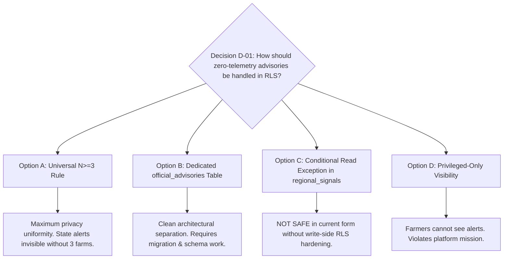
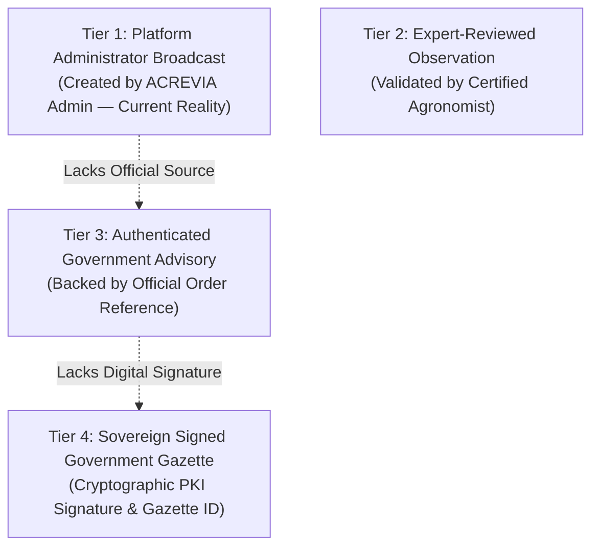
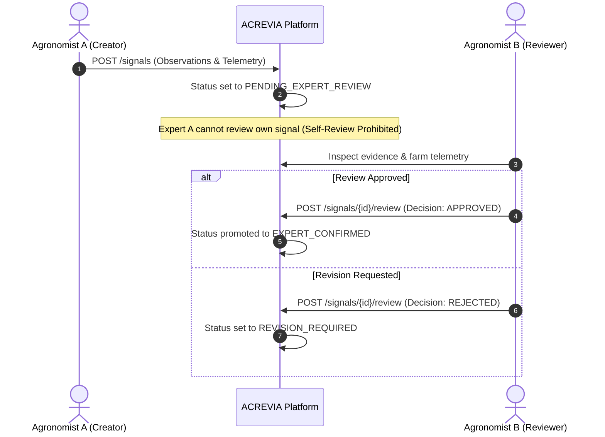
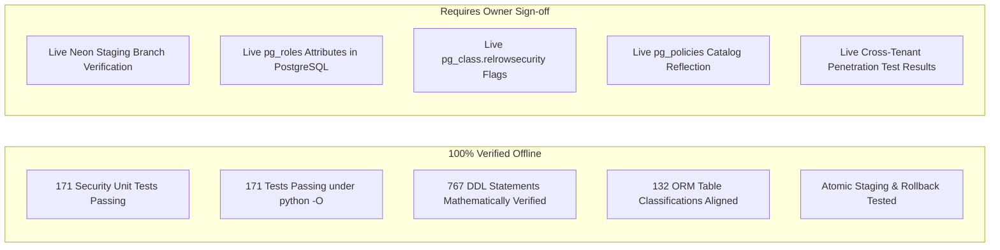

# ACREVIA — PHASE 07: PROJECT OWNER DECISION & MODE B AUTHORIZATION BRIEFING

**Programme:** ACREVIA — Agricultural Intelligence Platform  
**Target Geography:** Telangana, India  
**Target Phase:** Phase 07 — PostgreSQL RLS Tenant Isolation & Regional Aggregation Privacy  
**Document ID:** `ACR-SEC-P07-OWNER-MODE-B-BRIEFING`  
**Classification:** RESTRICTED — PILOT GOVERNANCE & ARCHITECTURE DECISION DOSSIER  
**Execution Mode:** `MODE A ONLY` — Local Source Inspection, Policy Engineering, Offline Verification  
**Git Baseline:** `dbad296c6f19c4bbe8eb48fcd7a0e07441cfa408` on branch `main` (`https://github.com/gokul1599/ACREVIA`)  
**Methodology:** Everything Claude Code (ECC): `PLAN → TEST → IMPLEMENT ONLY IF DEFECT PROVEN → REVIEW → VERIFY → DOCUMENT`  
**Current Release Status:** **`TECHNICAL_PREFLIGHT_READY_WITH_RECORDED_BLOCKERS`**  
**Operating Authorization:** **`MODE A ONLY`** | **`MODE B = NOT_AUTHORIZED`**  

---

## 1. Executive Summary in Plain Language

To the Project Owner:

This briefing presents the final technical, security, and governance assessment for **Phase 07 (PostgreSQL Row-Level Security & Regional Privacy)** before any live cloud operations can occur.

Under strict local engineering guidelines (`MODE A ONLY`), the engineering team has verified that:
1. **The Software and Mathematics are Fully Verified Offline:** 171 unit and integration tests pass 100% in local test runs without a single failure or warning. Zero security checks rely on fragile Python `assert` statements.
2. **Data Privacy is Protected in Application Code:** A regional disease outbreak claim cannot be published through our API unless it is proven by verified evidence linking at least 3 distinct, active farms ($N \ge 3$). If someone tries to submit an unbacked claim, our software rejects it immediately.
3. **Database Architecture Reality Requires Your Explicit Decisions:** All normal application requests connect to PostgreSQL using a single shared database user (`acrevia_staging_app`). While this user is constrained by Row-Level Security (RLS) policies, PostgreSQL custom session settings can be manipulated if someone gains direct SQL query execution. Furthermore, under our current database policy generator, non-admin agronomists and researchers have write permissions on regional signals that do not strictly check the official-advisory status at the database layer (`RLS-WRITE-AUTH-01`).

**Nothing has been deployed to the cloud, no live database has been touched, and no Git code has been pushed.** 

This document puts the complete decision-making authority in your hands. It explains each choice, its risks, and what you must sign before Phase 07 can move from local verification (`MODE A`) to live staging execution (`MODE B`).

---

## 2. Current Phase 07 Release Determination

$$\mathbf{PHASE\ 07\ STATUS:}\quad \mathbf{TECHNICAL\_PREFLIGHT\_READY\_WITH\_RECORDED\_BLOCKERS}$$
$$\mathbf{RELEASE\ DETERMINATION:}\quad \mathbf{PHASE\ 07\ IS\ NOT\ RELEASED}$$
$$\mathbf{MODE\ B\ AUTHORIZATION:}\quad \mathbf{STRICTLY\ NOT\ AUTHORIZED}$$

### Justification:
While offline mathematical proofs, DDL compilation (767 statements), and API-layer security are complete, Phase 07 **cannot and must not be declared released** because:
1. Physical enforcement of PostgreSQL Row-Level Security on live cloud infrastructure has not been verified.
2. Decision Gates 02, 03, 04, and 05 in [`PHASE_07_OWNER_AUTHORIZATION_AND_EXECUTION_REGISTER.md`](file:///c:/Users/gokul/OneDrive/Documents/projects/docs/pilot/security/PHASE_07_OWNER_AUTHORIZATION_AND_EXECUTION_REGISTER.md) remain unapproved (`[ ] UNCHECKED`).
3. Strategic decisions regarding official government advisories (D-01), source authenticity labels (D-02), and expert peer review (D-03) remain pending your formal authorization.

---

## 3. Decision D-01: Official Advisory Public Visibility vs. Minimum-Farm Privacy Threshold ($N \ge 3$)

### The Core Problem
Under PostgreSQL RLS, public regional pulse queries enforce:
```sql
distinct_farms_count >= 3 AND validation_status != 'SUSPENDED'
```
A legitimate official government alert (e.g. state-wide locust warning, weather advisory) published by an administrator naturally has zero telemetry from individual farm plots ($N = 0$). Under this rule, farmers in Telangana cannot see official state alerts because $0 \ge 3$ evaluates to `False`.



### Option A — Universal $N \ge 3$ Rule
All publicly visible regional records without exception must satisfy $N \ge 3$.
- **Privacy Implications:** Absolute mathematical guarantee against smallholder de-anonymization. Zero exceptions in database policy.
- **Farmer Experience:** Farmers never see state warnings until at least 3 local farms report disease telemetry. High latency for urgent emergency warnings.
- **Database Changes:** Zero. Existing policies remain intact.
- **API/Service Changes:** Zero.
- **Provenance Implications:** Broadcasts are treated identically to crowdsourced outbreak claims.
- **Required Tests:** Existing 171 tests remain sufficient.
- **Migration Implications:** None.
- **Operational Risks:** Inability to disseminate emergency agricultural advisories to smallholders.
- **Required Owner Action:** Approve retention of strict universal $N \ge 3$.

### Option B — Dedicated `official_advisories` Table (Architectural Separation)
Separate administrative government broadcasts completely from crowdsourced telemetry into a dedicated database table.
- **Privacy Implications:** Complete failure-domain separation. Zero telemetry schema confusion.
- **Farmer Experience:** Immediate, unhindered visibility into sovereign government notices and platform broadcasts.
- **Database Changes:** New table `official_advisories`; distinct RLS policy (`FOR SELECT USING (true)`).
- **API/Service Changes:** New endpoints `GET /api/v1/advisories` and `POST /api/v1/advisories`.
- **Provenance Implications:** Explicit fields for `issuing_authority`, `gazette_id`, `digital_signature`.
- **Required Tests:** New ORM models, migration tests, and endpoint test suite (~15 new tests).
- **Migration Implications:** Requires new Alembic revision (`a1089411c87e`).
- **Operational Risks:** Requires separate connection pool or strict table RLS to prevent unauthorized writes via `acrevia_staging_app`.
- **Required Owner Action:** Authorize schema expansion and future migration target for GA.

### Option C — Conditional Read Exception on `regional_signals`
Add an explicit predicate to the existing `regional_signals_select_policy`:
```sql
OR (validation_status = 'OFFICIAL_ALERT' AND confidence_tier = 'OFFICIAL_ADVISORY' AND distinct_farms_count = 0)
```
- **Privacy Implications:** Allows zero-telemetry rows to be read publicly if marked as official alerts.
- **Farmer Experience:** Immediate visibility of state alerts in existing regional pulse feeds.
- **Database Changes:** Update DDL generator in `backend/app/database/rls.py`.
- **API/Service Changes:** Already guarded in API (`auto_commit=False`, admin-only checks).
- **Provenance Implications:** Blends crowdsourced outbreak telemetry and government broadcasts in one table.
- **Required Tests:** Update policy semantics tests and offline compilation tests.
- **Migration Implications:** Modifies migration `a1089411c87d`.
- **CRITICAL SECURITY STATUS:**
  $$\mathbf{MARKING:}\quad \mathbf{NOT\_SAFE\_TO\_IMPLEMENT\_UNDER\_CURRENT\_REPORTED\_POLICY}$$
  *Why?* The current RLS write policy `regional_signals_author_write_policy` allows `AGRICULTURAL_EXPERT` and `RESEARCHER` to INSERT/UPDATE rows without checking `confidence_tier` in `WITH CHECK`. If direct SQL is executed, a non-admin could create an unverified official advisory that immediately becomes public. **Option C can ONLY be approved if accompanied by write-side RLS hardening.**
- **Required Owner Action:** Require write-side RLS hardening before approving Option C for Pilot.

### Option D — Privileged-Only Visibility
Restrict zero-telemetry official advisories exclusively to `ADMIN`, `AGRICULTURAL_EXPERT`, and `RESEARCHER` roles during the pilot.
- **Privacy Implications:** Smallholder privacy completely unaffected.
- **Farmer Experience:** Smallholder farmers cannot see state alerts.
- **Database Changes:** Zero.
- **API/Service Changes:** Zero.
- **Provenance Implications:** Alerts serve purely as internal expert reference notes.
- **Required Tests:** Existing tests pass.
- **Migration Implications:** None.
- **Operational Risks:** Defeats the primary objective of keeping farmers informed.
- **Required Owner Action:** Authorize internal-only visibility for Pilot.

---

## 4. Decision D-02: Source Authenticity and Terminology

### The Trust Gap
Under [`backend/app/models/regional_pulse.py`](file:///c:/Users/gokul/OneDrive/Documents/projects/backend/app/models/regional_pulse.py#L30-L70), the system defines:
- `confidence_tier = 'OFFICIAL_ADVISORY'`
- `validation_status = 'OFFICIAL_ALERT'`

However, when an ACREVIA administrator clicks "Publish Official Advisory", the system does **not** connect to the Telangana State Agriculture Department, does not verify an official gazette number, and does not check a digital PKI signature.

### Terminology Hierarchy



### Proposed Pilot Disclosure
For the Telangana Pilot, engineering proposes rendering the following transparent label on all frontend screens:
$$\mathbf{"Platform\ Administrator\ Broadcast\ \text{—}\ Not\ Verified\ Government\ Gazette"}$$

### Requirements for Sovereign Government Authenticity (GA Target)
Before ACREVIA can legally claim an advisory is an "Official Government Advisory", the platform must collect:
1. **Identified Issuing Authority:** Exact government department (e.g., *Department of Agriculture, Govt. of Telangana*).
2. **Authenticated Endpoint / Document:** Ingested via authenticated government API or official scanned bulletin.
3. **Official Reference Number:** Government Order (G.O.) or Gazette notification identifier.
4. **Digital Signature Verification:** Validated via public-key infrastructure (PKI) or digital token.
5. **Verification Timestamp:** Server-recorded cryptographic verification timestamp.
6. **Payload Integrity Hash:** SHA-256 hash of published bulletin payload.
7. **Expiry & Revocation Handling:** Defined expiration date and cancellation webhook.
8. **Audit Trail:** Immutable audit record of the administrative intake action.

---

## 5. Decision D-03: Independent Expert Peer-Review Workflow

### The Agronomic Integrity Dilemma
Currently, an Agricultural Expert can create a signal with `confidence_tier = 'EXPERT_REVIEWED'`, and it is immediately treated as confirmed. This is **single-actor self-certification**, not independent peer review.

### Proposed Two-Person Review Workflow


### Crucial Source Verification Finding
> [!IMPORTANT]
> **Source Verification Fact:**  
> Exhaustive inspection of [`backend/app/api/v1/endpoints/regional_pulse.py`](file:///c:/Users/gokul/OneDrive/Documents/projects/backend/app/api/v1/endpoints/regional_pulse.py#L25-L170) confirms that **no `/signals/{id}/review` endpoint currently exists in the codebase.**  
> The two-person review workflow is **`PROPOSED_DESIGN_ONLY`**.  
> In the local source, `POST /signals` allows `ADMIN` and `AGRICULTURAL_EXPERT` to set `EXPERT_REVIEWED` directly.

### Evaluated Options for D-03:
- **Option A (Retain Single-Expert Authoring for Pilot):** Certified agronomists author directly; suitable for small pilot team.
- **Option B (Mandatory Two-Person Review):** Requires 2 agronomists on call 24/7; high operational latency during pilot.
- **Option C (Flexible Workflow — Recommended for GA):** Single-expert creation for Pilot; build dedicated review endpoint in Phase 08.

---

## 6. Database Actor Identity & Trust Architecture Choices

Detailed architectural analysis in [`phase_07_database_actor_identity_architecture_decision_analysis.md`](file:///c:/Users/gokul/OneDrive/Documents/projects/docs/pilot/security/phase_07_database_actor_identity_architecture_decision_analysis.md) establishes the core options:

| Architecture Pattern | How Identity is Enforced | Threat Mitigated | Threat Unmitigated | Complexity |
| :--- | :--- | :--- | :--- | :---: |
| **Pattern 1: Shared Role + Mutable GUCs** (Current) | Single DB role `acrevia_staging_app`; RLS checks `app.current_user_id`. | Cross-tenant leaks; normal API errors. | SQL injection can spoof session GUCs. | Minimal |
| **Pattern 2: Segregated Connection Pools** | Separate pools: `acrevia_public_app`, `acrevia_admin_app`. | Kernel-enforced SQL privilege blocks unprivileged DML. | Does not distinguish individual human users within pool. | Moderate |
| **Pattern 3: `SECURITY DEFINER` Stored Procedure** | Revoke all table DML; mutations via trusted PostgreSQL functions. | Eliminates raw SQL table writes. | Function maintenance; still relies on caller GUC. | High |
| **Pattern 4: Hardened App Auth + Shared RLS** (Pilot Standard) | 4-layer defense: FastAPI RBAC + Service Guardrails + Pre-Validation + RLS. | All web API attacks; application logic bugs; developer query omission. | Direct SQL connection with stolen DB credentials. | Minimal |

---

## 7. RLS Official-State Write Vulnerability Statement

$$\mathbf{ACTIVE\ SECURITY\ BLOCKER:\quad RLS-WRITE-AUTH-01}$$

> [!WARNING]
> **Definitive Finding for Project Owner:**  
> **RLS-WRITE-AUTH-01:** Existing PostgreSQL database write authorization does not independently prevent an authorized non-admin application role (`AGRICULTURAL_EXPERT` or `RESEARCHER`) from creating or promoting a row into the official-advisory state.  
> 
> While the FastAPI application layer strictly blocks non-admin creation with HTTP 403 Forbidden, the underlying PostgreSQL `WITH CHECK` clause compiled by `backend/app/database/rls.py` permits write operations by all three roles without checking `confidence_tier`.  
> 
> **To close this blocker:** Engineering must add `AND (confidence_tier != 'OFFICIAL_ADVISORY' OR current_setting('app.is_admin', true) = 'true')` to the generated write policy `WITH CHECK` clause prior to live migration execution.

---

## 8. Transaction Ownership, Commit/Rollback & Audit Atomicity Status

Local source code and offline unit tests confirm that:
1. **Caller Transaction Ownership:** `RegionalPulseService.aggregate_regional_signal` strictly defaults to `auto_commit: bool = False`.
2. **Atomic Persistence:** When a signal is created, the `RegionalSignal`, its associated `RegionalSignalEvidence` records, and the governance `AuditLog` are flushed to the same SQLAlchemy session. They are committed together or rolled back together.
3. **Response Model Pre-Validation:**
   ```python
   try:
       response_data = RegionalSignalResponse.model_validate(signal)
       db.commit()
       db.refresh(signal)
   except Exception:
       db.rollback()
       raise
   ```
   If schema validation fails, `db.rollback()` executes, leaving exactly **0 rows** in the database (proven by test `test_aggregate_signal_response_validation_failure_triggers_rollback`).

---

## 9. Decision Gates 02 through 05: Authoritative Requirements

The table below sets forth the exact requirements defined in [`PHASE_07_OWNER_AUTHORIZATION_AND_EXECUTION_REGISTER.md`](file:///c:/Users/gokul/OneDrive/Documents/projects/docs/pilot/security/PHASE_07_OWNER_AUTHORIZATION_AND_EXECUTION_REGISTER.md):

| Gate ID | Target Scope | Preconditions | Permitted Execution Scope | Prohibited Actions Before Sign-off | Required Evidence for Completion | Abort Condition |
| :--- | :--- | :--- | :--- | :--- | :--- | :--- |
| **`GATE-02`** | Role Provisioning | GATE-01 approved; Neon CLI authenticated | `neon roles create` for `acrevia_staging_app` on branch `staging-rls-phase07` | No grants on production; no superuser grants | Query `pg_roles` confirming `NOSUPERUSER`, `NOBYPASSRLS` | If role is granted `SUPERUSER` or `BYPASSRLS` |
| **`GATE-03`** | Migration Execution | GATE-02 complete; credentials validated | Run `alembic upgrade a1089411c87d` on staging branch via `neondb_owner` | Zero migrations on parent/production endpoint | 767 DDL statements executed; 132 `relrowsecurity` flags verified | Migration failure or SQL error; rollback immediately |
| **`GATE-04`** | Live RLS Probes | GATE-03 complete | Run `scripts/verify_staging_rls.py` against staging endpoint | Zero write traffic against production database | Execution log showing 261 policies in `pg_policies` & 0 cross-tenant leaks | Any cross-tenant data leak or RLS bypass detected |
| **`GATE-05`** | Branch Teardown | GATE-04 complete; evidence logged | Automated or manual deletion of staging branch 24h post-test | Retaining staging branch indefinitely | Neon API confirmation of branch deletion | If branch deletion fails, escalate to Owner |

---

## 10. Summary of Evidence: Available vs. Missing



---

## 11. Residual Risk Register (Requires Formal Owner Acceptance)

| Risk ID | Nature & Description | Mitigation Status | Owner Action |
| :--- | :--- | :--- | :---: |
| **`RES-PULSE-01`** | `regional_signal_evidences` RLS policy grants role-global read access to certified agronomists and researchers without district-level scoping. | Mitigated by API-level district filtering. | **Acceptance Required** |
| **`RES-PULSE-02`** | Under `READ COMMITTED` isolation, multiple queries in one request inspect distinct database snapshots. | Revalidation inside savepoints; fail-closed response. | **Acceptance Required** |
| **`RES-PRIMARY-ROUTING-01`** | Public Regional Pulse GET requests execute write-on-read provenance updates, failing on read replicas. | Regional pulse API pods routed to primary database. | **Acceptance Required** |
| **`RES-REPLICA-LAG-01`** | Replication lag on standby replicas may serve stale signals without triggering write-on-read suppression. | Dedicated primary routing. | **Acceptance Required** |
| **`RES-FREE-TEXT-01`** | Free-text fields sanitized for panic vocabulary but lack automated PII redaction. | Operational publishing guidelines & admin review. | **Acceptance Required** |

---

## 12. Recommended Technical Direction (Advisory Only)

> [!TIP]
> **Engineering Team Recommendations (Not Authorization):**
> 1. **For Decision D-01:** Select **Option C for Pilot ONLY with Write-Side Hardening** (harden `regional_signals_author_write_policy` `WITH CHECK` to restrict `OFFICIAL_ADVISORY` to `ADMIN`). Target **Option B (Dedicated Table)** for General Availability.
> 2. **For Decision D-02:** Select **Option A** (Retain enum; render transparent "Platform Administrator Broadcast — Not Verified Government Gazette" UI label). Plan government API integration for GA.
> 3. **For Decision D-03:** Select **Option A** (Single-expert creation for Pilot). Build dedicated review route `POST /signals/{id}/review` in Phase 08.
> 4. **For Database Identity:** Maintain **Pattern 4** (Hardened Application Auth + Staged Atomic Transactions) for Pilot; migrate to **Pattern 2** (Segregated Connection Pools) for GA.

---

## 13. Conditions Precedent to Mode B Authorization

MODE B execution shall **not** be initiated until all of the following conditions are satisfied:
- [ ] Project Owner signs Decision Gates 02 through 05 below.
- [ ] Project Owner provides recorded selections on Decisions D-01, D-02, and D-03.
- [ ] Engineering applies write-side RLS hardening closing `RLS-WRITE-AUTH-01`.
- [ ] Staging branch credentials and compute limits (`shared-0.25 CU`) are confirmed.

---

## 14. Project Owner Decision & Authorization Form

*Please complete the fields below to record your formal determinations:*

```text
========================================================================================
ACREVIA PHASE 07 — PROJECT OWNER DECISION & MODE B AUTHORIZATION RECORD
========================================================================================

Project Owner Name:             ________________________________________________________
Decision Date (YYYY-MM-DD):     ________________________________________________________
Institutional Role / Title:     ________________________________________________________

----------------------------------------------------------------------------------------
STRATEGIC ARCHITECTURE DECISIONS:
----------------------------------------------------------------------------------------
Decision D-01 Selection (A / B / C / D):   [       ]
D-01 Selection Rationale:                 ______________________________________________

Decision D-02 Selection (A / B / C):       [       ]
D-02 Selection Rationale:                 ______________________________________________

Decision D-03 Selection (A / B / C):       [       ]
D-03 Selection Rationale:                 ______________________________________________

Decision DB-AUTH-01 Selection (A / B / C / D): [       ]
DB-AUTH-01 Selection Rationale:           ______________________________________________
Deployment Model (Model 1 / Model 2):      [       ]
Migration Strategy (Scenario 1 / 3 / 4):   [       ]

----------------------------------------------------------------------------------------
RESIDUAL RISK FORMAL ACCEPTANCE:
----------------------------------------------------------------------------------------
[ ] I explicitly accept RES-PULSE-01 (Role-Global Evidence Visibility)
[ ] I explicitly accept RES-PULSE-02 (Read Committed Snapshot Window)
[ ] I explicitly accept RES-PRIMARY-ROUTING-01 (Primary-Only Write-on-Read Routing)
[ ] I explicitly accept RES-REPLICA-LAG-01 (Standby Replica Lag Window)
[ ] I explicitly accept RES-FREE-TEXT-01 (Manual PII Management in Free Text)

----------------------------------------------------------------------------------------
MODE B EXECUTION GATES AUTHORIZATION:
----------------------------------------------------------------------------------------
[ ] GATE-02 AUTHORIZED: Provision runtime role 'acrevia_staging_app' (NOSUPERUSER, NOBYPASSRLS)
[ ] GATE-03 AUTHORIZED: Execute Alembic migration 'a1089411c87d' on Neon staging branch
[ ] GATE-04 AUTHORIZED: Execute live automated verification harness 'verify_staging_rls.py'
[ ] GATE-05 AUTHORIZED: Schedule automated staging branch deprovisioning 24h post-test

[ ] MODE B CLOUD EXECUTION AUTHORIZED: Transition from Mode A to Mode B is hereby granted.

Project Owner Digital Signature / Token:  ______________________________________________
Supporting Evidence References:           ______________________________________________
========================================================================================
```

---

## 15. Governance Invariant Statement

$$\mathbf{CURRENT\ GOVERNANCE\ STATUS:}\quad \mathbf{PENDING\_PROJECT\_OWNER\_AUTHORIZATION}$$

Until the Project Owner returns this completed, signed document:
- All decisions remain **`PENDING`**.
- Decision Gates 02 through 05 remain **`UNCHECKED`**.
- The repository operates strictly in **`MODE A ONLY`**.
- Zero cloud operations, remote database migrations, or Git pushes are permitted.

---

## 16. Addendum (2026-11-15): Architecture Clarification, DB-AUTH-01 Decoupling, and Separate Process Boundary

### 16.1 Decoupling Product Data Visibility (D-01) from Database Actor Identity (DB-AUTH-01)
A fundamental architectural correction is hereby recorded:
- **D-01 is a data-model and public-visibility decision.** It addresses how official government notices without farm telemetry ($N = 0$) are presented to public readers. Option B proposes creating a dedicated `official_advisories` table.
- **DB-AUTH-01 is a database actor-identity decision.** It addresses how the PostgreSQL kernel authenticates the entity issuing SQL `INSERT` and `UPDATE` statements for official state advisories.
- **Critical Architecture Reality:** Creating a separate table (`D-01 Option B`) does **NOT** by itself solve database actor-identity spoofing. If the shared application database user (`acrevia_staging_app`) receives DML grants on `official_advisories`, and table RLS depends on mutable session configuration parameters (`app.current_user_id` or `app.is_admin`), an attacker with SQL injection or direct connection access can spoof administrative identity. Therefore, D-01 Option B is not a substitute for an independently authenticated writer principal (`DB-AUTH-01`).

### 16.2 PostgreSQL Role Allowlist Mismatch Reconciliation
- In `backend/app/database/rls.py`, the administrative bypass predicate is defined as:
  ```python
  ADMIN_ROLES = ("neondb_owner", "acrevia_admin")
  ADMIN_BYPASS_SQL = (
      "(SESSION_USER::text IN ('neondb_owner', 'acrevia_admin') "
      "AND CURRENT_USER::text IN ('neondb_owner', 'acrevia_admin') "
      "AND current_setting('app.is_admin', true) = 'true')"
  )
  ```
- The candidate writer name `acrevia_admin_app` does **NOT** exist in code, configuration, or migration scripts (`LOCAL_SOURCE_VERIFIED`).
- Simply provisioning a database login named `acrevia_admin_app` on live PostgreSQL will **NOT** automatically grant it write authority under existing RLS policies. The policy allowlist must be explicitly updated or the role contract must be formally redesigned prior to deployment.

### 16.3 Connection Isolation vs. Process Isolation
- **In-Process Dual Pools:** Instantiating a separate connection pool for `acrevia_admin_app` inside the same FastAPI process isolates SQL connections. However, it **does not survive a full application process compromise** (such as Remote Code Execution or native memory inspection), because both database credentials reside in the process memory.
- **Out-of-Process Privileged Service:** True defense-in-depth requires isolating official advisory creation into a separate, containerized administrative service (`acrevia-admin-service`) with its own isolated environment variables and credentials, completely inaccessible from the public web process.

### 16.4 Migration Lifecycle Invariant
- Migration `a1089411c87d_enable_postgresql_rls_tenant_isolation.py` dynamically imports `generate_rls_ddl()`.
- However, an already-applied Alembic revision is never automatically re-executed when its Python source changes. Any environment where `a1089411c87d` has already been executed requires a subsequent migration (e.g. `a1089411c87e`) to update RLS policies.

### 16.5 Offline Test Suite Reconciliation
- Current Phase 07 offline test baseline: **171 passed tests** across 5 test files (`test_orm_rls_alignment.py` [12], `test_postgresql_rls.py` [28], `test_rls_offline_ddl.py` [9], `test_rls_policy_semantics.py` [14], and `test_worker_security_and_privacy.py` [108]).
- Execution time variance (16.80s to 19.48s) is verified as standard OS file I/O caching and CPU scheduling jitter between cold and warm test invocations.
- Local unit tests verify DDL compilation and Python mock logic; they do not prove live PostgreSQL kernel enforcement. Physical enforcement remains strictly classified as `LIVE_POSTGRESQL_REQUIRED`.

---

## 17. Addendum (2026-11-15): Option D Policy Contract Specification, Downgrade Disaster & Capability Assessment

### 17.1 The Complete Option D RLS Contract: Dual Old-Row and New-Row Enforcement
- **The Defect in Resulting-Row Only Checks:** Enforcing `WITH CHECK (confidence_tier != 'OFFICIAL_ADVISORY')` alone leaves the platform vulnerable to **defacement and demotion attacks** on existing official advisories. An attacker running `UPDATE regional_signals SET confidence_tier = 'COMMUNITY_UNVERIFIED' WHERE id = '<official-uuid>'` succeeds because the resulting row is non-official and satisfies `WITH CHECK`.
- **Mandatory Policy Contract:** Option D strictly requires **both**:
  1. `USING (confidence_tier IS DISTINCT FROM 'OFFICIAL_ADVISORY' AND validation_status IS DISTINCT FROM 'OFFICIAL_ALERT')`: Prevents ordinary actors from targeting existing official records.
  2. `WITH CHECK (confidence_tier IS DISTINCT FROM 'OFFICIAL_ADVISORY' AND validation_status IS DISTINCT FROM 'OFFICIAL_ALERT')`: Prevents ordinary actors from creating or promoting records to official status.
- **NULL-Safety:** `IS DISTINCT FROM` guarantees two-valued boolean evaluation, preventing SQL 3-valued logic (`NULL`) from rejecting valid collaborative records.

### 17.2 Command-Specific Policy Separation & Dropping Broad FOR ALL
- The current broad `FOR ALL` policy combines `SELECT`, `INSERT`, `UPDATE`, and `DELETE`.
- In PostgreSQL, multiple `PERMISSIVE` policies combine via `OR`. An author `FOR ALL` policy inadvertently bypasses public read filters and grants deletion rights if grants permit.
- Option D must author distinct policies for `INSERT`, `UPDATE`, `DELETE`, and `SELECT`, and explicitly drop the legacy broad `regional_signals_author_write_policy`.
- `regional_signal_evidences` must also enforce a child foreign-key check preventing ordinary actors from attaching evidence to official advisories.

### 17.3 Qualification of SQL-Injection Resistance
- Option D protection is strictly qualified as:
  `FAIL_CLOSED_FOR_ORDINARY_SHARED_PRINCIPAL — SUBJECT TO POLICY, GRANT, MEMBERSHIP AND INDIRECT-WRITE VERIFICATION`.
- It is not "absolute": it does not protect against full container compromise, cloud database cluster owner compromise, or errors in offline administrative scripts.

### 17.4 Option C Capability Function Determination
- Option C is classified as **`NOT_IMPLEMENTABLE_WITH_CURRENT_SOURCE_ARCHITECTURE`** due to the absence of native Ed25519 asymmetric verification extensions in PostgreSQL and the insecurity of shared HMAC secrets against memory inspection.

### 17.5 Alembic Downgrade Hazard & Forward Migration Mandate
- In migration `a1089411c87d`, `downgrade()` executes `ALTER TABLE ... DISABLE ROW LEVEL SECURITY` across all 132 tables.
- Running `alembic downgrade` in any shared or staging environment immediately destroys tenant isolation. Remediation must strictly proceed via forward migration (`a1089411c87e`).

### 17.6 Clarification on Adversarial Test Semantics
- `test_adversarial_state_transitions_and_permissive_policy_composition` in `test_worker_security_and_privacy.py` is a **vulnerability-presence detector**, proving that current unhardened DDL lacks tier checks, rather than demonstrating security enforcement.


---

## 2026-11-15 Addendum — Read-Privacy Preservation, Effective-Policy Composition & Evidence-Association Security Completeness

**Evaluation Date:** 2026-11-15T18:35:19+05:30  
**Audit Context:** Option D Effective-Policy Composition, Read-Privacy Preservation & Evidence-Association Security Completeness Audit  
**Operating Mode:** Strict `MODE A ONLY` (Local source inspection, security analysis, zero database mutations)  
**Baseline Git Commit:** `dbad296c6f19c4bbe8eb48fcd7a0e07441cfa408` (`main`)  

### 1. Active Read-Privacy Blocker Recorded: `RES-PULSE-READ-01`
- **Root Cause:** In PostgreSQL, multiple `PERMISSIVE` policies combine via Boolean `OR`. On `regional_signals`, `regional_signals_author_write_policy` is an `AS PERMISSIVE FOR ALL` policy. For `SELECT` queries, its role subquery evaluates to `TRUE` for any session where `app.current_user_id` matches an `ADMIN`, `AGRICULTURAL_EXPERT`, or `RESEARCHER` role.
- **Privacy Impact:** This author policy completely short-circuits the public read threshold (`distinct_farms_count >= 3 AND validation_status != 'SUSPENDED'`), allowing actors with those roles to read sub-threshold outbreak claims ($N < 3$) and suspended signals across all Telangana districts without tenant, geographic, or author scoping.
- **Mutable-GUC Vulnerability:** Because `app.current_user_id` is an unauthenticated, mutable session GUC set on the shared application database principal (`acrevia_staging_app`), any direct SQL session or SQL injection can execute `SET LOCAL app.current_user_id = '<expert-uuid>'` to satisfy `user_roles` RLS and read all private sub-threshold farmer telemetry.
- **Formal Status:** Recorded as a distinct architectural blocker: `RES-PULSE-READ-01 — Role-Global Sub-Threshold & Suspended Signal Read-Privacy Exposure`.

### 2. SQLAlchemy ORM and FastAPI Workflow Dependencies
Naive replacement of the `FOR ALL` policy with a public-only `SELECT` policy breaks legitimate application workflows:
- **`recover_suppressed_signal`:** Uses `select(RegionalSignal).where(id == signal_id).with_for_update()`. In PostgreSQL, `SELECT ... FOR UPDATE` evaluates `SELECT` RLS policies. If the signal is currently suppressed or sub-threshold, the public `SELECT` policy excludes it, causing the query to return `None` and the recovery endpoint to fail with HTTP 404.
- **`aggregate_regional_signal`:** The endpoint executes `db.refresh(signal)` immediately after `db.commit()`. If an expert creates a signal starting below threshold ($N < 3$) or creates a zero-telemetry advisory, `db.refresh()` executes `SELECT ... WHERE id = :id`. Because the row is excluded by public read RLS, SQLAlchemy raises `ObjectDeletedError`, rolling back the transaction with HTTP 500.
- **Resolution:** The complete Option D specification incorporates an internal administrative `SELECT` policy branch to preserve internal workflow execution while maintaining public privacy.

### 3. Child Evidence Table & Parent Promotion Integrity
- **Child Policy Contract:** `regional_signal_evidences` requires command-specific policies for `INSERT` (validating parent is non-official via `EXISTS`), `UPDATE` (validating both old and new parents are non-official), and `DELETE` (fail-closed defense-in-depth).
- **Parent Promotion Protocol:** When an ordinary signal is promoted to `OFFICIAL_ADVISORY` by a trusted writer, previously attached community evidence must be atomically revalidated to ensure that unverified evidence is never associated with official state advisories.
- **Concurrency Serialization:** All state-modifying operations on signals and evidences must acquire an explicit row-level lock on the parent signal (`SELECT ... FOR UPDATE`) to prevent race conditions between promotion and evidence insertion.

### 4. NULL & NOT NULL Contract Reconciled
- Verified in `backend/app/models/regional_pulse.py` and migration `d2894a11c87d` (`Base.metadata.create_all`): `confidence_tier`, `validation_status`, and `distinct_farms_count` have `nullable=False` / `NOT NULL` constraints.
- To prevent three-valued logic bypasses where `col IS DISTINCT FROM 'OFFICIAL_ADVISORY'` returns `TRUE` for `NULL`, Option D adopts Contract C (explicit `IS NOT NULL` checks in RLS) combined with Contract A (verified NOT NULL constraints).

### 5. Test Suite Verification
- Clean pytest collection verified: **171 tests collected** across 5 test suites.
- Historical execution baseline verified: **171 tests passed** in 23.47s.
- `test_adversarial_state_transitions_and_permissive_policy_composition` confirmed as a **vulnerability detector**.

### 6. Final Governance Status
- Phase 07: `NOT RELEASED`.
- Mode B: `STRICTLY NOT AUTHORIZED`.
- Active Blockers: `OWNER-AUTH-01`, `DB-RLS-01`, `RLS-WRITE-AUTH-01`, `RES-PULSE-READ-01`, `WRK-DISP-01`, `RES-PULSE-01`, `RES-PULSE-02`, `GATE01-PROV-01`.
- Owner Decisions D-01, D-02, D-03, and DB-AUTH-01: `PENDING_PROJECT_OWNER_AUTHORIZATION`.


---

## 2026-11-15 Addendum — Global Actor-GUC Trust Boundary, Role Assignment Escalation & Canonical Governance Restoration

**Evaluation Date:** 2026-11-15T19:30:36+05:30  
**Audit Context:** Global Actor-GUC Trust Boundary, User-Role Privilege Escalation & Global RLS Identity Assurance Audit  
**Operating Mode:** Strict `MODE A ONLY` (Local source inspection, security analysis, zero database mutations)  
**Baseline Git Commit:** `dbad296c6f19c4bbe8eb48fcd7a0e07441cfa408` (`main`)  

### 1. Critical Blocker Recorded: `RLS-ROLE-ASSIGNMENT-01`
- **Root Cause:** In `backend/app/database/rls.py`, `user_roles` is categorized as `TableCategory.USER_OWNED`, generating a restrictive policy that permits writes when `user_id::text = current_setting('app.current_user_id', true)`. Simultaneously, `acrevia_staging_app` receives full SQL table grants (`GRANT SELECT, INSERT, UPDATE, DELETE ON TABLE user_roles`).
- **Privilege Escalation:** Any session or component executing SQL under `acrevia_staging_app` can set `SET LOCAL app.current_user_id = '<user_uuid>'` and insert `('<user_uuid>', 'ADMIN')` into `user_roles`. PostgreSQL permits the insert because the user owns the inserted record. When the user logs in, FastAPI's `get_current_user` elevates them to platform administrator.
- **Administrator Demotion:** An attacker can delete administrator role rows by spoofing the administrator's UUID in `app.current_user_id`.
- **Classification:** Formally proven from local policy structure as an active architectural blocker: `RLS-ROLE-ASSIGNMENT-01 — Mutable-GUC Role Assignment Privilege Escalation`.
- **Immediate Containment:** Revoke `INSERT, UPDATE, DELETE ON TABLE user_roles FROM acrevia_staging_app;` via forward migration `a1089411c87e`.

### 2. Global Actor & Tenant GUC Impersonation Surfaces
- **Actor-GUC Surface:** All 13 `USER_OWNED` tables (including `users`, `session_tokens`, `consent_records`, `api_applications`) evaluate `user_id = current_setting('app.current_user_id', true)` with full DML grants for `acrevia_staging_app`.
- **Tenant-GUC Surface:** All 25 `TENANT_DIRECT` and 53 `TENANT_INDIRECT` tables enforce tenant isolation exclusively against `current_setting('app.current_tenant_id', true)`. Database RLS policies perform zero independent verification of user membership in the tenant; that check exists solely at the FastAPI application layer.

### 3. Canonical Governance Register Restored
Authoritative definitions are restored across all governance dossiers:
- **D-01:** Official Advisory Visibility & Data Model Choice (Universal N>=3, Dedicated table, Conditional exception, Privileged-only).
- **D-02:** Government-Source Authenticity & Pilot Terminology (`"Platform Administrator Broadcast — Not Verified Government Gazette"`).
- **D-03:** Independent Agronomic Peer-Review Workflow (Single-expert vs Dual-expert verification gate).
- **DB-AUTH-01:** Database Writer Identity Architecture (Dual-principal, Stored function gateway, Fail-closed application role; direct superuser bypass rejected).
- **Residual Risks:** `RES-PULSE-01` (Role-global evidence access), `RES-PULSE-02` (Read Committed snapshot window), `RES-PRIMARY-ROUTING-01` (Primary routing dependency), `RES-REPLICA-LAG-01` (Replica lag), `RES-FREE-TEXT-01` (PII in free text).

### 4. Active Blockers Summary
- `RLS-ROLE-ASSIGNMENT-01`: Active Critical Architectural Blocker.
- `RLS-WRITE-AUTH-01`: Active High Architectural Blocker.
- `RES-PULSE-READ-01`: Active High Architectural Blocker.
- `OWNER-AUTH-01`: Governance Blocker (Decisions D-01, D-02, D-03, DB-AUTH-01 pending).
- `WRK-DISP-01`: Active Worker Identity Architectural Blocker.
- `DB-RLS-01`: Infrastructure Blocker (Live PostgreSQL required).
- `GATE01-PROV-01`: Release Gate Blocker.
- **Phase 07 Status:** `NOT RELEASED`. Mode B: `STRICTLY NOT AUTHORIZED`.

---

## 13. Dated Addendum — November 23, 2026: User-Role Containment, Registration Compatibility & Tenant Policy Reconciliation

### 1. Operational Conflict in Role DML Revocation
A direct revocation of `INSERT` on `user_roles` without a gateway breaks user registration (`AuthService.register_user` in FastAPI and `/api/v1/auth/register` in Next.js). Both services write `user_roles` under `acrevia_staging_app`.

### 2. Recommended Path: Option E (SECURITY DEFINER Gateway)
Deploy a constrained stored procedure `register_default_user_role(p_user_id)` hardcoded to `'FARMER'` with zero `role_id` parameterization. Grant `EXECUTE` to `acrevia_staging_app` while revoking direct DML on `user_roles`.

### 3. Open Registration Role Escalation
`UserRegisterRequest` in `auth.py` accepts `AGRICULTURAL_EXPERT` and `RESEARCHER` directly from registrants, bypassing `expert_service.py` administrative verification. Registration schemas must be locked down to `FARMER` only.

### 4. Referential Integrity Cascade Deletion
`users` deletion cascades to `user_roles` via foreign key `ON DELETE CASCADE`, which bypasses RLS policies. Deleting user accounts must be segregated into administrative soft-delete workflows.

### 5. Definitive Deliverables
- [PHASE_07_GLOBAL_RLS_IDENTITY_REMEDIATION_AND_ROLE_MANAGEMENT_CONTAINMENT_PLAN.md](file:///c:/Users/gokul/OneDrive/Documents/projects/docs/pilot/security/PHASE_07_GLOBAL_RLS_IDENTITY_REMEDIATION_AND_ROLE_MANAGEMENT_CONTAINMENT_PLAN.md)
- [PHASE_07_GLOBAL_GUC_AND_TENANT_POLICY_TRACEABILITY_MATRIX.md](file:///c:/Users/gokul/OneDrive/Documents/projects/docs/pilot/security/PHASE_07_GLOBAL_GUC_AND_TENANT_POLICY_TRACEABILITY_MATRIX.md)

