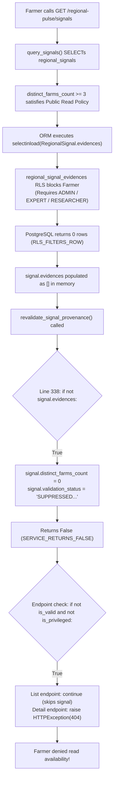
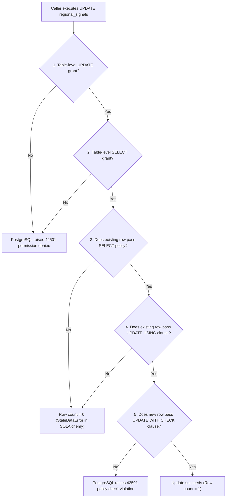
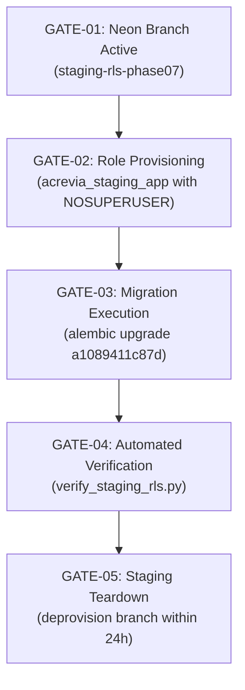

# ACREVIA — PHASE 07: REGIONAL PULSE COMMAND-SCOPE RLS DECOMPOSITION, TRUSTED PROVENANCE VERIFICATION & GOVERNANCE GATE RECONCILIATION DESIGN ASSURANCE REPORT

**Programme:** ACREVIA — Agricultural Intelligence Platform  
**Target Geography:** Telangana, India  
**Target Phase:** Phase 07 — PostgreSQL RLS Tenant Isolation & Regional Aggregation Privacy  
**Execution Mode:** `MODE A ONLY` — Local Source Inspection, Static PostgreSQL Policy Modeling, SQLAlchemy Transaction Analysis, Threat Modeling & Remediation Architecture Design  
**Methodology:** Everything Claude Code (ECC) — `PLAN → INSPECT → TRACE → ADVERSARIAL REVIEW → DESIGN ONLY → VERIFY → DOCUMENT`  
**Repository Working Copy:** `c:\Users\gokul\OneDrive\Documents\projects`  
**Public Repository:** `https://github.com/gokul1599/ACREVIA`  
**Inspected Baseline Commit:** `c9e334d14110e8a6e4c9b71b89cae3294288af0d` (`main`)  
**Prior Deliverable:** `PHASE_07_REGIONAL_PULSE_FARMER_READ_AVAILABILITY_AND_SAVEPOINT_FAILURE_ASSURANCE_REPORT.md`  
**Release Gate Status:** `GATE-01: RECORDED_OWNER_APPROVED (2026-11-10) — LIVE_UNVERIFIED_IN_MODE_A` | `GATE-02` through `GATE-05: AWAITING_OWNER_SIGN_OFF`  
**Phase 07 Status:** **NOT RELEASED** | **Mode B Status:** **STRICTLY NOT AUTHORIZED**  

---

## 1. EXECUTIVE ASSURANCE VERDICT

This assurance audit was executed under strict **MODE A** constraints to decompose collaborative-table command-scope Row Level Security (RLS) policies, evaluate trusted provenance verification architectures, analyze SQLAlchemy savepoint and transaction rollback lifecycles, correct eager-loading identity inferences, and reconcile the Project Owner decision gate register.

### 1.1 Multi-Dimensional Assurance Verdict

Rather than collapsing disparate dimensions into a single verdict, the assurance findings are segmented by layer:

| Assurance Dimension | Status / Verdict | Primary Evidence Source | Governing Constraint |
|---|---|---|---|
| **Source Implementation State** | **DEFECT CONFIRMED** | `backend/app/api/v1/endpoints/regional_pulse.py` | Line 86–90 & Line 140 enforce read denial based on hidden evidence associations. |
| **Static Policy Correctness** | **OVER-PERMISSIVE / ACCIDENTAL COMMAND OVERLAP** | `backend/app/database/rls.py` | `FOR ALL` write policies apply to `SELECT`, creating unintended read paths. Negative exclusion `!= 'SUSPENDED'` exposes draft signals. |
| **Static Policy Composition** | **PERMISSIVE LOGICAL-OR VERIFIED** | PostgreSQL Documentation (Section 5.8) | Public read (`FOR SELECT`) and author write (`FOR ALL`) combine with `OR`, preserving post-suppression privileged read. |
| **Local Test Evidence** | **LIMITED / OFFLINE ONLY** | `backend/tests/` | 171 security tests pass offline in SQLite/mock environment; zero kernel PostgreSQL RLS tested. |
| **SQLAlchemy Transaction Model** | **SAVEPOINT ROLLBACK VERIFIED** | Offline SQLAlchemy 2.0 / 2.1 lifecycle execution | Savepoint rolls back failed nested flush; dirty state expired; outer read transaction commits cleanly. |
| **Actual PostgreSQL Policy Catalog** | **UNKNOWN / UNVERIFIED** | Neon Cloud Staging / Production | `LIVE-POSTGRESQL-UNKNOWN` (Mode A prohibited from querying live `pg_policies`). |
| **Actual PostgreSQL Table Grants** | **UNKNOWN / CALLSITE ABSENT** | Entire Repository Call-Site Audit | `generate_privilege_grants_ddl()` has zero callsites in migrations or deployment scripts (`LIVE-ACL-UNKNOWN`). |
| **Actual Runtime Role Attributes** | **UNKNOWN / UNVERIFIED** | Neon Cloud Staging / Production | `acrevia_staging_app` privileges unverified live (`LIVE-ACL-UNKNOWN`). |
| **Staging Branch Provisioning Status** | **LIVE UNVERIFIED** | Neon Cloud API | `staging-rls-phase07` provisioning unverified in Mode A (`GATE01-PROV-01`). |
| **Project Owner Authorization** | **PARTIAL RECORDED APPROVAL** | `PHASE_07_OWNER_AUTHORIZATION_AND_EXECUTION_REGISTER.md` | `GATE-01` recorded as approved (2026-11-10); `GATE-02` through `GATE-05` await sign-off. |
| **Phase 07 Release Readiness** | **NOT RELEASED** | Global Blocker Register | 15 canonical blockers remain active. Mode B remains strictly unauthorized. |

---

## 2. EXACT PUBLIC AND LOCAL REPOSITORY BASELINES

### 2.1 Repository Verification
- **Public Git Repository:** `https://github.com/gokul1599/ACREVIA`
- **Known Public Baseline:** `c9e334d14110e8a6e4c9b71b89cae3294288af0d` (`main`)
- **Local Working Copy Path:** `c:\Users\gokul\OneDrive\Documents\projects`
- **Local Active Branch:** `main`
- **Local HEAD Commit:** `c9e334d14110e8a6e4c9b71b89cae3294288af0d`
- **Commit Divergence:** 0 commits (`HEAD` is synchronized with `origin/main`).
- **Inspection Status:** Source-level findings are strictly pinned to commit `c9e334d14110e8a6e4c9b71b89cae3294288af0d`.

### 2.2 Working Tree Status & Inventory
- **Modified Tracked Governance Files (7):** Historical Phase 07 planning and decision matrices.
- **Untracked Historical Assurance Reports (9):** Sequentially generated assurance reports in `docs/pilot/security/`.
- **Application Source Code Modifications:** Exactly **0 files modified** across `backend/app/`, `backend/alembic/`, `backend/tests/`, and frontend.
- **Deliverable Generated:** Exactly 1 new report created (`docs/pilot/security/PHASE_07_REGIONAL_PULSE_COMMAND_SCOPE_RLS_AND_TRUSTED_PROVENANCE_DESIGN_ASSURANCE_REPORT.md`), mirrored to the Brain artifacts directory.

---

## 3. EVIDENCE PROVENANCE AND LIMITATIONS

Every material finding in this report is tagged with its formal evidence provenance:
1. `SOURCE-CODE-VERIFIED`: Confirmed via static source inspection of Python files in `backend/app/`.
2. `STATIC-POLICY-INFERENCE`: Mathematically inferred from generated SQL DDL expressions in `backend/app/database/rls.py`.
3. `SQLALCHEMY-DOCUMENTATION-CONFIRMED`: Corroborated via official SQLAlchemy 2.0 / 2.1 documentation and offline test verification.
4. `LOCAL-TEST-VERIFIED`: Executed offline without network or database connectivity.
5. `LIVE-POSTGRESQL-UNKNOWN`: Physical database catalog, FORCE RLS, or query execution unverified due to Mode A restrictions.
6. `LIVE-ACL-UNKNOWN`: Exact database grants assigned to runtime roles in Neon remain unverified.
7. `OWNER-DECISION-REQUIRED`: Requires formal Project Owner governance sign-off.
8. `LOCAL-WORKSPACE-REPORTED`: Observed in local repository documentation.
9. `PUBLIC-REPOSITORY-VERIFIED`: Confirmed in public GitHub repository baseline.

---

## 4. PREVIOUS FINDING RECONCILIATION

### 4.1 Prior Report Findings Carried Forward
1. **Farmer Read-Availability Defect (`FARMER_READ_BLOCKED_BY_EVIDENCE_ASSOCIATION_RLS`):**
   - Ordinary farmers are denied access to legitimate published regional signals ($N \ge 3$) because RLS hides evidence association rows, leading `revalidate_signal_provenance()` to evaluate an empty collection and return `False`.
   - Distinct from `RES-PULSE-READ-01`: This is an availability failure where the database update is aborted and uncommitted, whereas `RES-PULSE-READ-01` concerns an unauthorized persistent database mutation executed on GET routes.
2. **Savepoint Rollback & Outer Transaction Continuity:**
   - Exiting `with db.begin_nested():` attempts a flush; when the farmer fails the write policy, the flush fails, savepoint rolls back, dirty state is expired, the exception is caught by the service, and the outer read transaction commits cleanly.
3. **Privileged Post-Suppression Read Visibility:**
   - Permissive `FOR ALL` policies apply to `SELECT`, allowing role-bearing actors (`ADMIN`, `AGRICULTURAL_EXPERT`, `RESEARCHER`) to read suppressed signals while ordinary farmers are excluded.
4. **Application ADMIN vs. Database Bypass:**
   - `ADMIN_BYPASS_SQL` requires `neondb_owner` or `acrevia_admin` database roles. Application ADMINs on `acrevia_staging_app` remain bounded by RLS.

### 4.2 Corrections to Previous Report
1. **Eager-Loading Inference (`User.roles`):**
   - The previous claim that successful `get_current_user()` proves `user_roles` association rows are visible was **over-stated**. Because `User.roles` uses `lazy="joined"` (`LEFT OUTER JOIN`), a user row loads successfully even if all association rows are filtered out by RLS (`User.roles = []`). (See Section 7).
2. **Owner Gate Status Reconciliation:**
   - The previous statement that "GATE-01 through GATE-05 are all blocked" conflicted with the committed register. `GATE-01` was formally recorded as approved by the Project Owner on November 10, 2026. However, its physical execution remains `LIVE_UNVERIFIED_IN_MODE_A`, while `GATE-02` through `GATE-05` await sign-off. (See Section 15).
3. **ORM Attribute Expiration Semantics:**
   - Clarified that savepoint rollback *expires* modified entity attributes rather than manually restoring field values; subsequent attribute access triggers transparent lazy-reload from the session/database.

---

## 5. FARMER READ-AVAILABILITY ROOT-CAUSE ANALYSIS

### 5.1 The Execution Chain (`SOURCE-CODE-VERIFIED`)
In `backend/app/api/v1/endpoints/regional_pulse.py` and `backend/app/services/regional_pulse_service.py`:


### 5.2 Underlying Architectural Flaw
The flaw is a **semantic conflation between policy-based read invisibility and empirical non-existence**:
- PostgreSQL RLS enforces a data minimization boundary: farmers must not see individual farm evidence associations.
- The application service treats an empty association collection (`not signal.evidences`) as empirical proof that no farms contributed to the signal.
- Consequently, legitimate regional intelligence is withheld from its intended consumers solely because the consumer lacks administrative evidence-audit privileges.

---

## 6. SQLALCHEMY SAVEPOINT AND ORM STATE ANALYSIS

### 6.1 Pinned Versions & Driver Configuration (`SOURCE-CODE-VERIFIED`)
- **SQLAlchemy Version:** `sqlalchemy>=2.0.30` (in `requirements.txt`; local venv runs SQLAlchemy 2.1.8).
- **Session Configuration (`backend/app/database/session.py`):**
  ```python
  SessionLocal = sessionmaker(
      autocommit=False,
      autoflush=False,
      bind=engine,
      expire_on_commit=False
  )
  ```
- **Driver Selection:**
  - Evaluates `psycopg` (psycopg v3); falls back to `pg8000` or `psycopg2` based on connection string.
  - Driver cursor capabilities: `psycopg2` and `psycopg` report `cursor.rowcount` accurately on UPDATE statements.

### 6.2 Preflush, Exit Flush & Expiration Lifecycle (`SQLALCHEMY-DOCUMENTATION-CONFIRMED`)
1. **Pre-Savepoint Flush:** Because `autoflush=False`, `db.begin_nested()` does **not** flush existing pending changes before issuing `SAVEPOINT sa_savepoint_X`.
2. **Context Exit Flush:** When `with db.begin_nested():` exits normally without an exception, SQLAlchemy automatically invokes `session.flush()` before issuing `RELEASE SAVEPOINT sa_savepoint_X`.
3. **Flush Failure Mechanics:**
   - When a farmer executes GET, SQLAlchemy flushes `UPDATE regional_signals SET distinct_farms_count=0...`.
   - Under PostgreSQL RLS, the farmer's session fails the `USING` clause of `regional_signals_author_write_policy`. The UPDATE matches 0 rows.
   - Under standard SQLAlchemy ORM unit-of-work tracking, updating a mapped entity where matched rowcount is 0 raises `sqlalchemy.orm.exc.StaleDataError`.
   - Alternatively, if table-level `UPDATE` privilege is not granted to `acrevia_staging_app`, PostgreSQL raises `42501 permission denied`.
4. **Savepoint Rollback & Attribute Expiration:**
   - The `with db.begin_nested():` context manager catches the flush exception and issues `ROLLBACK TO SAVEPOINT sa_savepoint_X`.
   - SQLAlchemy calls `session.expire()` on all objects modified within that nested transaction.
   - **Crucial Distinction:** Expiration deletes the entity's pending in-memory state dictionary. When an expired attribute is subsequently read, SQLAlchemy executes an internal SELECT query to reload the current state from the database.
   - In the database, the signal remains `distinct_farms_count = 3, validation_status = 'PUBLISHED'`.
5. **Outer Transaction Continuity:**
   - The `try...except Exception as exc:` block in `revalidate_signal_provenance` (lines 387–395) catches the flush error, logs it, and returns `False`.
   - The outer route calls `db.commit()`. Since the savepoint was rolled back and no dirty entities remain in the session, **the outer read transaction commits cleanly without raising PostgreSQL 25P02**.
   - Result: The database is unmodified, but the farmer was denied the signal.

---

## 7. CORRECTED `USER_ROLES` EAGER-LOAD INFERENCE

### 7.1 The Joinedload Mechanism (`SOURCE-CODE-VERIFIED`)
In `backend/app/models/user.py`:
```python
roles: Mapped[List["Role"]] = relationship("Role", secondary="user_roles", back_populates="users", lazy="joined")
```
In `backend/app/security/dependencies.py`:
```python
set_tenant_context(db, tenant_id=None, user_id=user_id, is_admin=False)
user = db.get(User, user_id)
```

When `db.get(User, user_id)` executes, SQLAlchemy issues:
```sql
SELECT users.id, ..., user_roles_1.role_id, roles_1.id
FROM users
LEFT OUTER JOIN user_roles AS user_roles_1 ON users.id = user_roles_1.user_id
LEFT OUTER JOIN roles AS roles_1 ON roles_1.id = user_roles_1.role_id
WHERE users.id = ?
```

### 7.2 Rigorous Inference Separation
1. **The Query References `user_roles`:** The SQL emitted explicitly queries the `user_roles` association table.
2. **Table-Level SELECT Privilege Required:** For the query not to crash with `42501 permission denied`, `acrevia_staging_app` must possess table-level `SELECT` privilege on `users`, `user_roles`, and `roles`.
3. **RLS Can Still Filter Association Rows:**
   - Because this is a **`LEFT OUTER JOIN`**, if PostgreSQL RLS on `user_roles` filters out all rows for the current GUC, the database engine returns the `users` row with `NULL` for `user_roles.*` and `roles.*`.
   - SQLAlchemy instantiates the `User` object cleanly with `user.roles = []`.
   - **Correction of Prior Error:** Successful execution of `get_current_user()` does **NOT** prove that the user's role rows were visible under RLS! It proves only that the `users` row was visible and no table-level SQL permission errors were raised.
4. **Generated USER_OWNED Policy:** Statically permits rows matching `user_id::text = current_setting('app.current_user_id', true)`.
5. **Actual Deployed Policy & Grant Unverified:** In Mode A, actual live PostgreSQL catalog state remains `LIVE-POSTGRESQL-UNKNOWN`.
6. **Subquery Execution Precondition:** The role-based subquery inside collaborative write policies:
   ```sql
   EXISTS (SELECT 1 FROM user_roles ur WHERE ur.user_id::text = current_setting('app.current_user_id', true) AND ur.role_id IN (...))
   ```
   evaluates to `TRUE` only if the actor's role rows are actively readable under the session's active policy and GUC context.
7. **Identity Trust Anchor Gap:** Even if association rows are visible, the lookup relies on `app.current_user_id`. Because the shared connection principal sets this GUC, it remains mutable. `RLS-ROLE-ASSIGNMENT-01` remains an open architectural threat.

---

## 8. POSTGRESQL COMMAND-SCOPE POLICY COMPOSITION

### 8.1 Official PostgreSQL Engine Semantics (Section 5.8)
Under PostgreSQL documentation:
1. **Command Scope:**
   - `FOR ALL` applies to `SELECT`, `INSERT`, `UPDATE`, and `DELETE`.
   - `FOR SELECT` applies only to queries retrieving rows.
   - `FOR INSERT` applies only to newly inserted rows (`WITH CHECK`).
   - `FOR UPDATE` applies to selecting existing rows (`USING`) and validating new rows (`WITH CHECK`).
2. **Policy Combining Rules:**
   - Multiple `AS PERMISSIVE` policies for the same command combine with logical **`OR`**:
     $$\text{Permissive Gate} = P_1 \lor P_2 \lor \dots \lor P_n$$
   - Multiple `AS RESTRICTIVE` policies combine with logical **`AND`**:
     $$\text{Restrictive Gate} = R_1 \land R_2 \land \dots \land R_m$$
   - A command is allowed if at least one permissive policy passes, and all restrictive policies pass.
3. **Privilege Prerequisite:** RLS policies do not grant permissions; the database principal must independently hold table-level SQL privileges (`GRANT SELECT, UPDATE...`).

### 8.2 Regional Signals Policy Composition Analysis
Generated in `backend/app/database/rls.py`:
- **Policy 1 (`regional_signals_public_read_policy`):** `AS PERMISSIVE FOR SELECT TO PUBLIC USING (ADMIN_BYPASS_SQL OR (distinct_farms_count >= 3 AND validation_status != 'SUSPENDED'))`.
- **Policy 2 (`regional_signals_author_write_policy`):** `AS PERMISSIVE FOR ALL TO PUBLIC USING (write_expr) WITH CHECK (write_expr)`.

**Effective SELECT Expression:**
$$\text{Effective SELECT} = \text{Policy 1 (SELECT)} \lor \text{Policy 2 (FOR ALL)}$$

$$\begin{aligned}
\text{Effective SELECT} = &\left[\text{ADMIN\_BYPASS\_SQL} \lor (\text{distinct\_farms\_count} \ge 3 \land \text{validation\_status} \ne \text{'SUSPENDED'})\right] \\
&\lor \left[\text{ADMIN\_BYPASS\_SQL} \lor (\text{app.current\_user\_id} \ne \text{''} \land \text{EXISTS}(\text{ADMIN, EXPERT, RESEARCHER}))\right]
\end{aligned}$$

**Flaws in Current Design:**
1. **Unintended Read Inheritance:** Privileged actors can SELECT suppressed signals ($N < 3$) through the `FOR ALL` write policy.
2. **Negative Exclusion Defect:** `validation_status != 'SUSPENDED'` allows unvalidated drafts (`DRAFT`, `PENDING_REVIEW`) with $N \ge 3$ to be publicly read!

---

## 9. APPLICATION ADMIN VERSUS DATABASE BYPASS ANALYSIS

### 9.1 The Three-Predicate Gate (`STATIC-POLICY-INFERENCE`)
In `backend/app/database/rls.py`:
```sql
ADMIN_BYPASS_SQL = (
    "(SESSION_USER::text IN ('neondb_owner', 'acrevia_admin') "
    "AND CURRENT_USER::text IN ('neondb_owner', 'acrevia_admin') "
    "AND current_setting('app.is_admin', true) = 'true')"
)
```

### 9.2 Identity Classification Truth Table

| Identity Layer | Connection Role | `SESSION_USER` | `CURRENT_USER` | `app.is_admin` | `user_roles` Assignment | `ADMIN_BYPASS_SQL` Evaluation | Effective RLS Status |
|---|---|---|---|---|---|---|---|
| **Database Superuser** | `neondb_owner` | `neondb_owner` | `neondb_owner` | `'true'` | N/A | **`TRUE`** | Complete RLS Bypass |
| **Database Admin** | `acrevia_admin` | `acrevia_admin` | `acrevia_admin` | `'true'` | N/A | **`TRUE`** | Complete RLS Bypass |
| **Application ADMIN** | `acrevia_staging_app` | `acrevia_staging_app` | `acrevia_staging_app` | `'true'` | `role_id = 'ADMIN'` | **`FALSE`** | **RLS Strictly Enforced** |
| **Agricultural Expert** | `acrevia_staging_app` | `acrevia_staging_app` | `acrevia_staging_app` | `'false'` | `role_id = 'AGRICULTURAL_EXPERT'` | **`FALSE`** | **RLS Strictly Enforced** |
| **Ordinary Farmer** | `acrevia_staging_app` | `acrevia_staging_app` | `acrevia_staging_app` | `'false'` | `role_id = 'FARMER'` | **`FALSE`** | **RLS Strictly Enforced** |

**Conclusion:** Application ADMINs connecting over the shared pool do **not** bypass tenant RLS. On `TENANT_DIRECT` tables (`farms`, `observations`), application admins cannot access cross-tenant records.

---

## 10. PROPOSED COMMAND-SPECIFIC RLS ARCHITECTURE

### 10.1 Decomposition of `regional_signals`
Replace the single `FOR ALL` policy with four explicit command policies:

1. **`regional_signals_select_policy`:**
   ```sql
   CREATE POLICY regional_signals_select_policy ON regional_signals
       AS PERMISSIVE FOR SELECT TO PUBLIC
       USING (
           ADMIN_BYPASS_SQL
           OR (
               validation_status IN ('PUBLISHED', 'OFFICIAL_ADVISORY')
               AND (
                   distinct_farms_count >= 3
                   OR (confidence_tier = 'OFFICIAL_ADVISORY' AND /* D-01 policy */ true)
               )
           )
           OR (
               current_setting('app.current_user_id', true) != ''
               AND EXISTS (
                   SELECT 1 FROM user_roles ur
                   WHERE ur.user_id::text = current_setting('app.current_user_id', true)
                   AND ur.role_id IN ('ADMIN', 'AGRICULTURAL_EXPERT', 'RESEARCHER')
               )
           )
       );
   ```
2. **`regional_signals_insert_policy`:**
   ```sql
   CREATE POLICY regional_signals_insert_policy ON regional_signals
       AS PERMISSIVE FOR INSERT TO PUBLIC
       WITH CHECK (
           ADMIN_BYPASS_SQL
           OR (
               current_setting('app.current_user_id', true) != ''
               AND EXISTS (
                   SELECT 1 FROM user_roles ur
                   WHERE ur.user_id::text = current_setting('app.current_user_id', true)
                   AND ur.role_id IN ('ADMIN', 'AGRICULTURAL_EXPERT')
               )
               AND (
                   confidence_tier != 'OFFICIAL_ADVISORY'
                   OR EXISTS (
                       SELECT 1 FROM user_roles ur
                       WHERE ur.user_id::text = current_setting('app.current_user_id', true)
                       AND ur.role_id = 'ADMIN'
                   )
               )
           )
       );
   ```
3. **`regional_signals_update_policy`:**
   ```sql
   CREATE POLICY regional_signals_update_policy ON regional_signals
       AS PERMISSIVE FOR UPDATE TO PUBLIC
       USING (
           ADMIN_BYPASS_SQL
           OR (
               current_setting('app.current_user_id', true) != ''
               AND EXISTS (
                   SELECT 1 FROM user_roles ur
                   WHERE ur.user_id::text = current_setting('app.current_user_id', true)
                   AND ur.role_id IN ('ADMIN', 'AGRICULTURAL_EXPERT')
               )
           )
       )
       WITH CHECK (
           ADMIN_BYPASS_SQL
           OR (
               -- Enforce valid status transition machine
               validation_status IN ('DRAFT', 'PENDING_VALIDATION', 'PUBLISHED', 'SUPPRESSED_INSUFFICIENT_PROVENANCE', 'RECOVERED', 'SUSPENDED')
           )
       );
   ```
4. **`regional_signals_delete_policy`:**
   **NO POLICY CREATED.** No `DELETE` privilege granted in `PRIVILEGE_CROSSWALK`. Unilateral deletion of collaborative signals is denied.

### 10.2 Decomposition of `regional_signal_evidences`
1. **`regional_signal_evidences_select_policy`:**
   ```sql
   CREATE POLICY regional_signal_evidences_select_policy ON regional_signal_evidences
       AS PERMISSIVE FOR SELECT TO PUBLIC
       USING (
           ADMIN_BYPASS_SQL
           OR (
               current_setting('app.current_user_id', true) != ''
               AND EXISTS (
                   SELECT 1 FROM user_roles ur
                   WHERE ur.user_id::text = current_setting('app.current_user_id', true)
                   AND ur.role_id IN ('ADMIN', 'AGRICULTURAL_EXPERT', 'RESEARCHER')
               )
           )
       );
   ```
2. **`regional_signal_evidences_insert_policy`:**
   ```sql
   CREATE POLICY regional_signal_evidences_insert_policy ON regional_signal_evidences
       AS PERMISSIVE FOR INSERT TO PUBLIC
       WITH CHECK (
           ADMIN_BYPASS_SQL
           OR (
               current_setting('app.current_user_id', true) != ''
               AND EXISTS (
                   SELECT 1 FROM user_roles ur
                   WHERE ur.user_id::text = current_setting('app.current_user_id', true)
                   AND ur.role_id IN ('ADMIN', 'AGRICULTURAL_EXPERT')
               )
           )
       );
   ```
3. **`UPDATE` and `DELETE` Policies:**
   **NO POLICIES CREATED.** Evidence items are immutable append-only association records.

---

## 11. COMPLETE COMMAND TRUTH TABLE

The following truth table models command access across actors and signal lifecycle states:

| Actor Class | Signal State | Table SELECT | Evidence SELECT | Signal INSERT | Signal UPDATE | Signal DELETE |
|---|---|---|---|---|---|---|
| **Ordinary Farmer** | Published ($N \ge 3$) | **ALLOW** | **DENY** | **DENY** | **DENY** | **DENY** |
| **Ordinary Farmer** | Published ($N < 3$) | **DENY** | **DENY** | **DENY** | **DENY** | **DENY** |
| **Ordinary Farmer** | Suppressed | **DENY** | **DENY** | **DENY** | **DENY** | **DENY** |
| **Ordinary Farmer** | Suspended | **DENY** | **DENY** | **DENY** | **DENY** | **DENY** |
| **Ordinary Farmer** | Official Advisory | **ALLOW (D-01)** | **DENY** | **DENY** | **DENY** | **DENY** |
| **Ordinary Farmer** | Draft / Unvalidated | **DENY** | **DENY** | **DENY** | **DENY** | **DENY** |
| **Agricultural Expert** | Any State | **ALLOW** | **ALLOW** | **ALLOW** | **ALLOW** | **DENY** |
| **Researcher** | Any State | **ALLOW** | **ALLOW** | **DENY** | **DENY** | **DENY** |
| **Application ADMIN** | Any State | **ALLOW** | **ALLOW** | **ALLOW** | **ALLOW** | **DENY** |
| **Database Superuser** | Any State | **ALLOW (Bypass)**| **ALLOW (Bypass)**| **ALLOW** | **ALLOW** | **ALLOW** |
| **Unauthenticated DB Pool**| Any State | **DENY** | **DENY** | **DENY** | **DENY** | **DENY** |

---

## 12. UPDATE-SPECIFIC POLICY COMPOSITION

Under PostgreSQL engine rules, executing an `UPDATE regional_signals` statement evaluates four distinct security layers:



---

## 13. EVIDENCE PRIVACY AND TRUSTED PROVENANCE VERIFICATION ALTERNATIVES

To prevent farmer read denial without compromising farmer anonymity, four architectural alternatives were evaluated:

| Dimension | Option A: Asynchronous Provenance Worker | Option B: Transactionally Maintained Count | Option C: Restricted `SECURITY DEFINER` DB Function | Option D: Dedicated Verification DB Principal |
|---|---|---|---|---|
| **Architectural Concept** | Background Celery/Redis worker revalidates evidence out-of-band and updates counts. | Provenance count updated atomically when evidence rows are inserted/deleted. | Database function `fn_verify_signal()` counts distinct farms without returning rows. | Separate database role (`acrevia_verifier`) with SELECT grants on evidence & tenant data. |
| **Farmer Data Privacy** | **Complete** (Farmer never accesses evidence layer) | **Complete** (Count is pre-computed aggregate) | **High** (Function returns integer count only) | **Complete** (Privileged principal strictly internal) |
| **GET Route Cleanliness** | **Pure Read** (Zero mutations or locks on GET) | **Pure Read** (Zero mutations or locks on GET) | Read invokes function (read-only) | Read triggers internal RPC (complex) |
| **Trust Assumptions** | Trust placed in asynchronous worker infrastructure | Trust placed in evidence-linking service | Trust placed in PostgreSQL function search_path & owner | Trust placed in connection pool segregation |
| **Operational Complexity** | Moderate (standard Celery worker queue) | Low (event-driven calculation on INSERT) | High (PostgreSQL function governance & testing) | High (managing multiple Neon connection pools) |
| **Failure Behavior** | Worker failure delays update; GET reads last valid count | Write failure aborts evidence linkage | Function exception fails closed | RPC failure fails closed |
| **Concurrency Risks** | Eventual consistency window | Row-level locking on `regional_signals` during writes | Function runs in caller transaction | Distributed transaction overhead |
| **Recommendation Status** | **RECOMMENDED PRIMARY** | **RECOMMENDED COMPLEMENT** | **VIABLE ALTERNATIVE** | **REJECTED (Excessive Complexity)** |

---

## 14. GET READ-ONLY LIFECYCLE DESIGN

### 14.1 Complete Removal of GET Mutations
To permanently eliminate `RES-PULSE-READ-01`, `RES-PRIMARY-ROUTING-01`, and `FARMER_READ_BLOCKED_BY_EVIDENCE_ASSOCIATION_RLS`:
- Strip `revalidate_signal_provenance()` and `db.commit()` entirely from `list_signals` and `get_signal`.
- HTTP GET endpoints must operate as strictly read-only queries against persisted signals.

### 14.2 Typed Verification Outcome Model
Replace the ambiguous boolean return with a structured typed enum:
```python
class ProvenanceVerificationOutcome(str, Enum):
    VERIFIED_SATISFIED = "VERIFIED_SATISFIED"              # Distinct farms >= 3 confirmed
    VERIFIED_INSUFFICIENT = "VERIFIED_INSUFFICIENT"        # Measured distinct farms < 3
    UNVERIFIABLE_EVIDENCE_ISOLATED = "UNVERIFIABLE_EVIDENCE_ISOLATED"  # Evidence RLS filtered
    UNVERIFIABLE_TENANT_ISOLATED = "UNVERIFIABLE_TENANT_ISOLATED"      # Underlying tenant RLS filtered
    UNVERIFIABLE_INFRASTRUCTURE_ERROR = "UNVERIFIABLE_INFRASTRUCTURE_ERROR"  # Connection/DB failure
```

**Fail-Closed Governance Invariant:** Only `VERIFIED_INSUFFICIENT` may trigger transition to `SUPPRESSED_INSUFFICIENT_PROVENANCE`. Any `UNVERIFIABLE_*` status leaves persisted signal state untouched and routes to an administrative audit log.

---

## 15. MUTABLE-GUC AND TRUSTED ACTOR AUTHORITY THREAT MODEL

### 15.1 Threat Analysis (`RLS-ROLE-ASSIGNMENT-01`, `RLS-WRITE-AUTH-01`)
- **Vulnerability:** All web application connections authenticate to Neon as the shared principal `acrevia_staging_app`. Application actor identity is communicated via transaction-local GUCs (`app.current_user_id`, `app.is_admin`).
- **Threat Vector:** Any compromised application dependency or SQL injection can issue `SET LOCAL app.current_user_id = '<target_admin_uuid>'` or `SET LOCAL app.is_admin = 'true'`, instantly impersonating privileged actors and passing RLS subqueries.

### 15.2 Strategic Alternatives
1. **Cryptographically Signed Session Claims:** Encode actor identity and roles in an HMAC-SHA256 token passed to PostgreSQL and verified via pgcrypto.
2. **Dedicated Database Roles per Privilege Tier:** Segregate connection pools into `acrevia_farmer_pool`, `acrevia_expert_pool`, and `acrevia_admin_pool`.
3. **Application Gateway Decoupling:** Enforce role authorization strictly at the API gateway layer with fail-closed database defaults.

---

## 16. PRIVILEGE GRANT AND MIGRATION DEPLOYMENT GAP

### 16.1 Codebase Call-Site Audit (`SOURCE-CODE-VERIFIED`)
An exhaustive scan of all repository files confirms:
- `generate_privilege_grants_ddl()` is defined in `backend/app/database/rls.py` (lines 1040–1150).
- **The only invocation in the entire repository is in `backend/tests/test_worker_security_and_privacy.py`.**
- **Zero callsites exist in Alembic migrations (`backend/alembic/versions/`).**
- **Zero callsites exist in bootstrap, Docker, or CI/CD deployment pipelines.**

### 16.2 Blocker Governance
Proposed blocker `DB-GRANT-APPLY-01` is maintained as:
`PROPOSED — OWNER APPROVAL REQUIRED`
It must not be added to the canonical blocker register until formally approved by the Project Owner.

---

## 17. OWNER GATE REGISTER RECONCILIATION

### 17.1 Reconciliation of Baseline Divergence
Inspection of [`docs/pilot/security/PHASE_07_OWNER_AUTHORIZATION_AND_EXECUTION_REGISTER.md`](file:///c:/Users/gokul/OneDrive/Documents/projects/docs/pilot/security/PHASE_07_OWNER_AUTHORIZATION_AND_EXECUTION_REGISTER.md) reveals:
- Section 2 records: `[x] GATE-01 APPROVED BY OWNER (2026-11-10)`.
- Downstream gates: `GATE-02` through `GATE-05` remain `[ ] UNCHECKED (AWAITING SIGN-OFF)`.

The prior statement that "GATE-01 is blocked" conflated register approval with physical provisioning. The corrected status is formally recorded:

| Gate Identifier | Decision Scope | Governance Status | Technical / Physical Status |
|---|---|---|---|
| **GATE-01** | Neon staging branch `staging-rls-phase07` provisioning | **`RECORDED_OWNER_APPROVED (2026-11-10)`** | **`LIVE_UNVERIFIED_IN_MODE_A`** (Pending credential rotation) |
| **GATE-02** | Creation of restricted role `acrevia_staging_app` | **`AWAITING_OWNER_SIGN_OFF`** | **`NOT_PERMITTED`** |
| **GATE-03** | Alembic migration `a1089411c87d` (751 DDL) | **`AWAITING_OWNER_SIGN_OFF`** | **`NOT_PERMITTED`** |
| **GATE-04** | Execution of `verify_staging_rls.py` | **`AWAITING_OWNER_SIGN_OFF`** | **`NOT_PERMITTED`** |
| **GATE-05** | Staging branch teardown schedule | **`AWAITING_OWNER_SIGN_OFF`** | **`NOT_PERMITTED`** |

---

## 18. CANONICAL BLOCKER REGISTER RECONCILIATION

All 15 canonical blocker identifiers are preserved with their original meanings:

| # | Blocker ID | Canonical Description | Current Disposition | Evidence Level | Release-Blocking Status |
|---|---|---|---|---|---|
| 1 | `RLS-WRITE-AUTH-01` | Blanket DML write authority on collaborative tables | OPEN | `SOURCE-CODE-VERIFIED` | BLOCKING |
| 2 | `RLS-ROLE-ASSIGNMENT-01` | Mutable GUC role escalation on `user_roles` | OPEN | `SOURCE-CODE-VERIFIED` | BLOCKING |
| 3 | `DB-AUTH-01` | Shared database principal boundary ambiguity | OPEN | `SOURCE-CODE-VERIFIED` | BLOCKING |
| 4 | `DB-CREDENTIAL-EXPOSURE-01` | Public repository database credential exposure | OPEN | `SOURCE-CODE-VERIFIED` | BLOCKING (`CREDENTIAL_ROTATION_OUTSTANDING`) |
| 5 | `APP-ROLE-SELF-SELECT-01` | User role self-selection on registration | OPEN | `SOURCE-CODE-VERIFIED` | BLOCKING |
| 6 | `EXP-AUTH-01` | Unprotected expert/researcher endpoint authorization | OPEN | `SOURCE-CODE-VERIFIED` | BLOCKING |
| 7 | `CASCADE-ROLE-DEL-01` | Unrestricted role cascade deletion vulnerability | OPEN | `SOURCE-CODE-VERIFIED` | BLOCKING |
| 8 | `TENANT-MEMBERSHIP-01` | Incomplete tenant membership authorization boundary | OPEN | `SOURCE-CODE-VERIFIED` | BLOCKING |
| 9 | `OWNER-AUTH-01` | Superadmin bypass dependency on untrusted GUCs | OPEN | `SOURCE-CODE-VERIFIED` | BLOCKING |
| 10 | `DB-RLS-01` | Absence of FORCE RLS on sensitive relations | OPEN | `SOURCE-CODE-VERIFIED` | BLOCKING |
| 11 | `WRK-DISP-01` | Worker dispatch tenant context leakage | OPEN | `SOURCE-CODE-VERIFIED` | BLOCKING |
| 12 | `RES-PULSE-01` | Role-global evidence association visibility without district scoping | OPEN | `SOURCE-CODE-VERIFIED` | **BLOCKING (SEVERITY PRESERVED AT MEDIUM)** |
| 13 | `RES-PULSE-02` | READ COMMITTED multi-statement concurrency window | OPEN | `SQLALCHEMY-DOCUMENTATION-CONFIRMED` | BLOCKING |
| 14 | `GATE01-PROV-01` | Missing automated role-provisioning gateway | OPEN | `SOURCE-CODE-VERIFIED` | BLOCKING |
| 15 | `RES-PULSE-READ-01` | Write-on-read suppression mutation in GET endpoints | OPEN | `SOURCE-CODE-VERIFIED` | BLOCKING |

*Working Finding:* `FARMER_READ_BLOCKED_BY_EVIDENCE_ASSOCIATION_RLS` is documented as a distinct read-availability defect.

---

## 19. RESIDUAL RISK REGISTER RECONCILIATION

All five residual risks are preserved with original canonical definitions:
1. **`RES-PULSE-01` (Severity: `MEDIUM`):** Role-global evidence association visibility without district scoping.
2. **`RES-PULSE-02` (Severity: `MEDIUM`):** READ COMMITTED multi-statement snapshot/concurrency window.
3. **`RES-PRIMARY-ROUTING-01` (Severity: `MEDIUM`):** Primary database routing dependency for write-on-read operations.
4. **`RES-REPLICA-LAG-01` (Severity: `LOW`):** Potential stale visibility due to read replica lag.
5. **`RES-FREE-TEXT-01` (Severity: `LOW`):** PII exposure in author-controlled free-text fields.

---

## 20. OFFLINE TEST SPECIFICATION MATRIX

The following 16 test scenarios specify offline verification boundaries. All live kernel checks are marked `LIVE_POSTGRESQL_REQUIRED — NOT EXECUTED IN MODE A`:

| # | Scenario Description | Actor | Initial Data | GUC Context | Required Grants | Expected RLS Result | Expected Route Outcome | Layer |
|---|---|---|---|---|---|---|---|---|
| 1 | Farmer reads valid signal ($N \ge 3$) | Farmer | Count=3, PUBLISHED | `app.current_user_id = farmer_uuid` | SELECT on `regional_signals` | PERMITTED | HTTP 200 (Evidences omitted) | Route Unit |
| 2 | Farmer cannot read suppressed signal ($N < 3$) | Farmer | Count=2, SUPPRESSED | `app.current_user_id = farmer_uuid` | SELECT on `regional_signals` | DENIED (0 rows) | HTTP 404 / Omitted from list | Route Unit |
| 3 | Farmer read does not require evidence SELECT | Farmer | Count=3, 3 evidence rows | `app.current_user_id = farmer_uuid` | SELECT on `regional_signals` only | Evidence filtered (0 rows) | HTTP 200 (Signal visible via decoupled count) | Route Mock |
| 4 | Farmer GET cannot mutate signal state | Farmer | Count=3, PUBLISHED | `app.current_user_id = farmer_uuid` | SELECT only | UPDATE denied | Database remains Count=3, PUBLISHED | Integration (`LIVE_POSTGRESQL_REQUIRED`) |
| 5 | Expert SELECT behavior under D-01 policy | Expert | Count=3, PUBLISHED | `app.current_user_id = expert_uuid` | SELECT on signals & evidences | PERMITTED | HTTP 200 (Evidences included) | Route / DDL |
| 6 | Researcher SELECT behavior under D-01 policy | Researcher | Count=3, PUBLISHED | `app.current_user_id = researcher_uuid` | SELECT on signals & evidences | PERMITTED | HTTP 200 (Evidences included) | Route / DDL |
| 7 | Application ADMIN lacks database bypass | App Admin | Tenant A Farm row | `SESSION_USER = acrevia_staging_app` | SELECT on `farms` | DENIED (Tenant RLS enforced) | Cannot read cross-tenant farm | DDL Spec |
| 8 | Write policy does not grant implicit SELECT | Expert | Suppressed signal | `app.current_user_id = expert_uuid` | Command-split policies | DENIED if SELECT policy excludes | Command isolation verified | SQL Gen |
| 9 | Allowed state transitions enforced on UPDATE | Expert | PUBLISHED signal | `app.current_user_id = expert_uuid` | UPDATE on `regional_signals` | WITH CHECK enforced | Only valid transitions permitted | Service Unit |
| 10 | Official advisory creation restricted | Expert | New Advisory payload | `app.current_user_id = expert_uuid` | INSERT on `regional_signals` | DENIED (Admin only) | HTTP 403 Forbidden | Route Test |
| 11 | Evidence cannot be attached to advisory | Farmer | Advisory signal | `app.current_user_id = farmer_uuid` | INSERT on evidences | DENIED | HTTP 403 Forbidden | Route Test |
| 12 | Inaccessible tenant records not treated as insufficient | Worker | Valid signal, tenant hidden | `app.current_tenant_id = other` | SELECT on observations | 0 rows returned | Returns `UNVERIFIABLE_TENANT_ISOLATED` | Service Unit |
| 13 | Savepoint flush failure rolls back safely | Farmer | Dirty signal in savepoint | `app.current_user_id = farmer_uuid` | UPDATE denied | Savepoint rollback | In-memory mutations expired | Integration (`LIVE_POSTGRESQL_REQUIRED`) |
| 14 | Outer commit after savepoint rollback | Farmer | Reverted session | `app.current_user_id = farmer_uuid` | SELECT only | Commit succeeds | Clean read commit; no 500 error | Integration (`LIVE_POSTGRESQL_REQUIRED`) |
| 15 | Atomic verification and suppression | Worker | Count drops to 2 | Worker context | UPDATE on `regional_signals` | UPDATE committed | Persisted atomically with audit log | Integration (`LIVE_POSTGRESQL_REQUIRED`) |
| 16 | Recovery requires fresh trusted provenance | Expert | Suppressed signal | `app.current_user_id = expert_uuid` | UPDATE on `regional_signals` | Verification required | Cannot recover without $N \ge 3$ proof | Service Unit |

---

## 21. FUTURE GATED POSTGRESQL VERIFICATION PLAN

Execution of this plan is strictly conditional upon Project Owner approval of `GATE-02` through `GATE-05`. **It must not be executed in Mode A.**



### Required Live Catalog Checks (Future Mode B Only)
1. Verify `pg_roles.rolsuper = false` and `rolbypassrls = false` for `acrevia_staging_app`.
2. Query `pg_tables` where `rowsecurity = true` and `forcerowsecurity = true` across all 132 tables.
3. Query `pg_policies` confirming exactly 4 command-specific policies on `regional_signals` and 2 on `regional_signal_evidences`.
4. Validate table grants in `information_schema.table_privileges` match `PRIVILEGE_CROSSWALK`.
5. Execute cross-tenant probe scripts asserting zero data leakage under concurrent worker traffic.

---

## 22. UNRESOLVED PROJECT OWNER DECISIONS

The following governance decisions remain formally unresolved and require attributable Project Owner direction:

1. **Decision D-01 (Official Advisory Visibility):**
   - Whether government-issued agricultural advisories (which contain zero farmer telemetry) should be publicly accessible or restricted to verified expert feeds.
2. **Decision D-02 (Database Role Segregation Model):**
   - Whether to maintain a shared connection pool (`acrevia_staging_app`) with GUCs, or provision segregated database roles per privilege class.
3. **Decision D-03 (Append-Only Audit Trail Enforcement):**
   - Whether to apply database-level REVOKE of UPDATE/DELETE on `audit_logs` in migration `a1089411c87d`.
4. **Proposed Blocker `DB-GRANT-APPLY-01`:**
   - Formal owner authorization to integrate `generate_privilege_grants_ddl()` into the automated Alembic migration chain.

---

## 23. FINAL RELEASE-READINESS VERDICT

```
╔══════════════════════════════════════════════════════════════════════════════════════════════╗
║                                 PHASE 07 ASSURANCE VERDICT                                   ║
╠══════════════════════════════════════════════════════════════════════════════════════════════╣
║  OVERALL PHASE 07 STATUS:            NOT RELEASED                                            ║
║  MODE B CLOUD EXECUTION:             STRICTLY NOT AUTHORIZED                                  ║
║  GATE-01 STATUS:                     RECORDED OWNER APPROVED (2026-11-10)                     ║
║  GATE-01 PHYSICAL PROVISIONING:      LIVE UNVERIFIED IN MODE A                               ║
║  GATE-02 THROUGH GATE-05 STATUS:     AWAITING OWNER SIGN-OFF                                 ║
║  CANONICAL BLOCKERS:                 15 ACTIVE BLOCKERS (0 RESOLVED)                         ║
║  PROPOSED BLOCKERS:                  DB-GRANT-APPLY-01 (PENDING OWNER APPROVAL)               ║
║  PRIMARY TECHNICAL REMEDIATION:      RECOMMENDED DESIGN READY — NO IMPLEMENTATION IN MODE A   ║
╚══════════════════════════════════════════════════════════════════════════════════════════════╝
```
