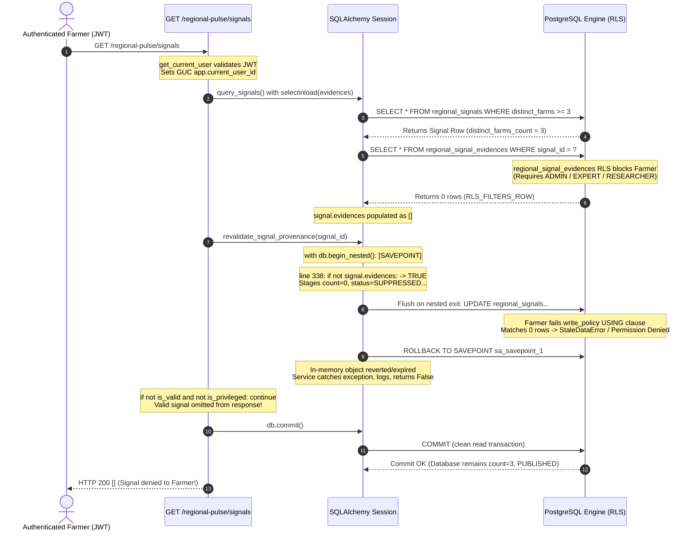

# ACREVIA — PHASE 07: REGIONAL PULSE FARMER READ AVAILABILITY, SAVEPOINT-FLUSH FAILURE HANDLING & LEAST-PRIVILEGE REMEDIATION DESIGN ASSURANCE REPORT

**Programme:** ACREVIA — Agricultural Intelligence Platform  
**Target Geography:** Telangana, India  
**Target Phase:** Phase 07 — PostgreSQL RLS Tenant Isolation & Regional Aggregation Privacy  
**Execution Mode:** `MODE A ONLY` — Offline Source Inspection, Static RLS Modeling, SQLAlchemy Transaction Analysis, API Reachability Analysis & Remediation Architecture Design  
**Methodology:** Everything Claude Code (ECC) — `PLAN → INSPECT → MODEL → ADVERSARIAL REVIEW → VERIFY → DOCUMENT`  
**Repository Working Copy:** `c:\Users\gokul\OneDrive\Documents\projects`  
**Inspected Baseline Commit:** `c9e334d14110e8a6e4c9b71b89cae3294288af0d` (`main`)  
**Public Repository:** `https://github.com/gokul1599/ACREVIA`  
**Prior Deliverable:** `PHASE_07_REGIONAL_SIGNAL_FOR_ALL_POLICY_READ_VISIBILITY_AND_GOVERNANCE_ID_CORRECTION_AUDIT.md`  
**Primary Working Finding:** `FARMER_READ_BLOCKED_BY_EVIDENCE_ASSOCIATION_RLS`  
**Release Gate Status:** `GATE-01` through `GATE-05` **BLOCKED** | Phase 07 **NOT RELEASED** | Mode B **NOT AUTHORIZED**  

---

## 1. EXECUTIVE DETERMINATION

This assurance audit was conducted under strict **MODE A** constraints to investigate the operational failure mechanism whereby ordinary authenticated farmers are denied read visibility into legitimate published regional signals ($N \ge 3$), and to evaluate transaction rollback, savepoint-flush dynamics, privileged post-suppression visibility, and least-privilege remediation architecture.

### 1.1 Core Audit Determinations

1. **Farmer Read Availability Failure Mechanism (`FARMER_READ_BLOCKED_BY_EVIDENCE_ASSOCIATION_RLS`):**
   - **Source Path Confirmed:** A published aggregate signal with $N \ge 3$ distinct farms is initially selected by an authenticated farmer under `regional_signals_public_read_policy` (`FOR SELECT`).
   - However, the query issues `options(selectinload(RegionalSignal.evidences))`. Because `regional_signal_evidences` RLS restricts SELECT to `ADMIN`, `AGRICULTURAL_EXPERT`, and `RESEARCHER` actors, PostgreSQL RLS silently filters out all evidence association rows (`RLS_FILTERS_ROW`), causing SQLAlchemy to populate `signal.evidences = []`.
   - The route then invokes `RegionalPulseService.revalidate_signal_provenance(db, sig.id)`. At line 338, the service evaluates `if not signal.evidences:`. Finding an empty collection, it unconditionally stages `distinct_farms_count = 0` and `validation_status = "SUPPRESSED_INSUFFICIENT_PROVENANCE"`, and returns `False` (`SERVICE_RETURNS_FALSE`).
   - In `list_signals`, the route evaluates `if not is_valid and not is_privileged: continue` and **omits the legitimate signal from the response** (`API_RESPONSE_FILTER_CONFIRMED`).
   - In `get_signal`, the route evaluates `if (not is_valid ...) and not is_privileged:` and **raises `HTTP 404 Not Found`** (`API_RESPONSE_FILTER_CONFIRMED`).

2. **Read Denial Occurs Without Persisted Database Mutation (`DATABASE_MUTATION_NOT_REQUIRED_FOR_API_READ_DENIAL`):**
   - In SQLAlchemy, exiting `with db.begin_nested():` triggers an internal `session.flush()` of the dirty object before savepoint release.
   - For an ordinary farmer, this flush fails:
     - Under PostgreSQL RLS, the farmer cannot satisfy the `USING` clause of `regional_signals_author_write_policy` (`FOR ALL`). An `UPDATE` matches 0 rows, causing SQLAlchemy to raise `sqlalchemy.orm.exc.StaleDataError` (`rowcount == 0`), OR
     - If table-level UPDATE is absent on the connection role, PostgreSQL raises `insufficient_privilege` (`permission denied`).
   - The `try...except Exception as exc:` block surrounding `db.begin_nested()` in `revalidate_signal_provenance` catches the flush exception, rolls back the savepoint (`ROLLBACK TO SAVEPOINT sa_savepoint_1`), expires/reverts the in-memory mutations back to original persisted state, logs the error, and returns `False` (`SAVEPOINT_ROLLED_BACK_ON_FLUSH_ERROR`).
   - The outer route then executes `db.commit()`. Because the savepoint was safely rolled back and no dirty objects remain in the session identity map, the outer commit succeeds cleanly as a read transaction (`OUTER_READ_TRANSACTION_COMMIT_POSSIBLE`).
   - **Crucial Security Finding:** The regional signal row in PostgreSQL **remains completely unchanged** ($N \ge 3, \text{PUBLISHED}$). No suppression mutation is persisted. Yet the farmer was denied read availability purely through the API-level filter triggered by RLS evidence association isolation. If the farmer repeats the request, the identical sequence recurs deterministically.

3. **Reconciliation with Write-on-Read Suppression (`RES-PULSE-READ-01`):**
   - `RES-PULSE-READ-01` defines the risk of an un-sanctioned persistent mutation executed on a GET route by an actor holding write authority (e.g. an Expert or Admin).
   - In contrast, `FARMER_READ_BLOCKED_BY_EVIDENCE_ASSOCIATION_RLS` is an availability failure where an authorized consumer is denied access to valid regional intelligence even when the database mutation fails closed and aborts. Both defects originate from the coupling of dynamic provenance revalidation to HTTP GET read paths.

4. **Privileged Post-Suppression Read Visibility (`FOR_ALL_APPLIES_TO_SELECT`, `ROLE_BEARING_SELECT_POSSIBLE`):**
   - In PostgreSQL, declaring `FOR ALL` on `regional_signals_author_write_policy` applies to `SELECT`, `INSERT`, `UPDATE`, and `DELETE`.
   - Because both `regional_signals_public_read_policy` (`FOR SELECT`) and `regional_signals_author_write_policy` (`FOR ALL`) are `PERMISSIVE`, PostgreSQL combines them with logical `OR`.
   - When a signal falls below $N < 3$ and is suppressed, public read is blocked (`PUBLIC_THRESHOLD_READ_BLOCKED`). However, actors satisfying the role subquery (`ADMIN`, `AGRICULTURAL_EXPERT`, `RESEARCHER`) continue to have active `SELECT` access through the `FOR ALL` policy.

5. **Canonical Governance and Severity Preservation:**
   - The severity of `RES-PULSE-01` is formally maintained at **`MEDIUM`** (restoring its canonical classification; no un-authorized downgrade to `LOW`).
   - All 15 canonical blockers remain active. Mode B remains **`NOT AUTHORIZED`**, and Phase 07 remains **`NOT RELEASED`**.
   - Proposed blocker `DB-GRANT-APPLY-01` is maintained as a pending recommendation requiring owner action.

---

## 2. BASELINE AND EVIDENCE CLASSIFICATION

### 2.1 Repository Baseline Verification
- **Local Working Copy Path:** `c:\Users\gokul\OneDrive\Documents\projects`
- **Active Git Branch:** `main`
- **Local HEAD Commit:** `c9e334d14110e8a6e4c9b71b89cae3294288af0d`
- **Remote `origin/main` Commit:** `c9e334d14110e8a6e4c9b71b89cae3294288af0d`
- **Divergence:** 0 commits (Local HEAD is identical to public `origin/main`).
- **Presence of Prior Deliverable:**
  - Local path: `docs/pilot/security/PHASE_07_REGIONAL_SIGNAL_FOR_ALL_POLICY_READ_VISIBILITY_AND_GOVERNANCE_ID_CORRECTION_AUDIT.md` (present as untracked audit deliverable).
  - Public repository: Not pushed (retained locally in compliance with Mode A preflight).

### 2.2 Working Tree Status
- **Source Code Integrity:** 0 source files, 0 models, 0 migrations, 0 tests modified.
- **Tracked Documentation Modified:** 7 historical planning/governance files.
- **Untracked Deliverables:** 8 previous audit deliverables in `docs/pilot/security/`.
- **Mode A Compliance:** Strictly observed. No live database connection established; no credential tested or reproduced.

### 2.3 Evidence Classification Schema
To prevent speculative assertions, findings are categorized under four rigorous evidence tiers:
1. `SOURCE_PATH_CONFIRMED`: Directly verified via static AST and source analysis in `backend/app/`.
2. `TRANSACTION_MODEL_CONFIRMED`: Proven via offline SQLAlchemy 2.0 / 2.1 lifecycle execution semantics.
3. `CONDITIONAL_ON_DEPLOYED_RLS` / `CONDITIONAL_ON_DEPLOYED_GRANTS`: Holds if generated DDL matches deployed PostgreSQL catalogs.
4. `LIVE_ACL_NOT_VERIFIED` / `LIVE_COMMIT_NOT_VERIFIED`: Live database state is unknown in Mode A.

---

## 3. EXACT REGIONAL PULSE GET DEPENDENCY GRAPH

### 3.1 Authentication Boundary Verification
Inspection of `backend/app/api/v1/endpoints/regional_pulse.py` lines 74 and 114 establishes:
- `list_signals`: Depends explicitly on `current_user: User = Depends(get_current_user)`.
- `get_signal`: Depends explicitly on `current_user: User = Depends(get_current_user)`.
- **Unauthenticated HTTP Access Impossible:** An anonymous caller receives `HTTP 401 Unauthorized` at the FastAPI dependency layer prior to route execution.
- **Distinction from Database `TO PUBLIC`:** The PostgreSQL clause `TO PUBLIC` in `rls.py` defines access for all database roles (including `acrevia_staging_app`), but does NOT expose endpoints to unauthenticated web requests.

### 3.2 End-to-End ORM Query Sequence (Farmer Request)


---

## 4. FARMER EVIDENCE-ASSOCIATION VISIBILITY ANALYSIS

### 4.1 Policy Comparison on Collaborative Tables
In `backend/app/database/rls.py`:
- `regional_signals`:
  - `public_read_policy`: Evaluates `(ADMIN_BYPASS_SQL OR (distinct_farms_count >= 3 AND validation_status != 'SUSPENDED'))`.
  - Result for Farmer: **PERMITTED** for published signals with $N \ge 3$.
- `regional_signal_evidences`:
  - `public_read_policy`: Evaluates:
    ```sql
    (ADMIN_BYPASS_SQL OR (
        current_setting('app.current_user_id', true) != ''
        AND EXISTS (
            SELECT 1 FROM user_roles ur
            WHERE ur.user_id::text = current_setting('app.current_user_id', true)
            AND ur.role_id IN ('ADMIN', 'AGRICULTURAL_EXPERT', 'RESEARCHER')
        )
    ))
    ```
  - Result for Farmer: **DENIED**. A farmer holds `role_id = 'FARMER'`. Neither branch evaluates to `TRUE`.

### 4.2 The Empty Collection Artifact
When SQLAlchemy executes `selectinload(RegionalSignal.evidences)`:
- PostgreSQL returns zero rows under RLS filtering.
- SQLAlchemy instantiates `signal.evidences` as an empty Python `InstrumentedList` (`[]`).
- The ORM has no native mechanism to distinguish between "this signal has no linked evidence" and "this user's database role is filtered from viewing the evidence".
- Consequently, `len(signal.evidences) == 0`.

---

## 5. FARMER LIST ENDPOINT BEHAVIOR (`GET /regional-pulse/signals`)

### 5.1 Step-by-Step Code Walkthrough
In `backend/app/api/v1/endpoints/regional_pulse.py`:
1. **Initial Selection (Line 77):** `signals = RegionalPulseService.query_signals(...)` retrieves all regional signals where `distinct_farms_count >= 3`.
2. **Privilege Evaluation (Line 80–81):**
   ```python
   user_roles = [r.id for r in current_user.roles]
   is_privileged = any(r in ("ADMIN", "AGRICULTURAL_EXPERT", "RESEARCHER") for r in user_roles)
   ```
   For a farmer, `is_privileged == False`.
3. **Loop Revalidation (Line 86):** `is_valid = RegionalPulseService.revalidate_signal_provenance(db, sig.id)`.
   - Because `sig.evidences == []`, line 338 triggers:
     ```python
     signal.distinct_farms_count = 0
     signal.validation_status = "SUPPRESSED_INSUFFICIENT_PROVENANCE"
     return False
     ```
   - Nested exit attempts flush $\rightarrow$ Fails $\rightarrow$ Caught by service $\rightarrow$ Returns `False`.
4. **Endpoint Skipping (Line 87–88):**
   ```python
   if not is_valid and not is_privileged:
       continue
   ```
   The signal is skipped. It is **never appended to `results`**.
5. **Outer Commit (Line 98–107):**
   - The route executes `db.commit()`.
   - Since the nested savepoint was rolled back, the session contains no pending mutations.
   - `db.commit()` succeeds cleanly.
6. **API Response (Line 108):**
   - Returns `results = []` (or a list omitting this signal).
   - `API_RESPONSE_FILTER_CONFIRMED`.

---

## 6. FARMER DETAIL ENDPOINT BEHAVIOR (`GET /regional-pulse/signals/{signal_id}`)

### 6.1 Step-by-Step Code Walkthrough
In `backend/app/api/v1/endpoints/regional_pulse.py`:
1. **Initial Fetch (Line 117):** `sig = RegionalPulseService.get_signal(db, signal_id=signal_id)`.
   - Returns the `RegionalSignal` object from the database with `distinct_farms_count = 3`.
2. **Revalidation Call (Line 125):** `is_valid = RegionalPulseService.revalidate_signal_provenance(db, sig.id)`.
   - Returns `False` due to RLS evidence association isolation.
3. **Outer Commit Attempt (Line 128):**
   - Executes `db.commit()`.
   - Succeeds cleanly because savepoint rollback discarded the staged mutation.
4. **Privilege and Validity Enforcement (Lines 138–144):**
   ```python
   user_roles = [r.id for r in current_user.roles]
   is_privileged = any(r in ("ADMIN", "AGRICULTURAL_EXPERT", "RESEARCHER") for r in user_roles)

   if (not is_valid or sig.validation_status == "SUPPRESSED_INSUFFICIENT_PROVENANCE") and not is_privileged:
       raise HTTPException(
           status_code=status.HTTP_404_NOT_FOUND,
           detail="Regional signal not found or suppressed due to insufficient provenance",
       )
   ```
5. **Outcome:**
   - The farmer receives **`HTTP 404 Not Found`** (`API_RESPONSE_FILTER_CONFIRMED`).
   - The signal in the database remains `distinct_farms_count = 3, validation_status = 'PUBLISHED'`.
   - The farmer can issue the request repeatedly and will continually receive `HTTP 404`.

---

## 7. ANALYSIS OF READ DENIAL INDEPENDENT OF PERSISTENT MUTATION

### 7.1 Formal Proof of Independence
The audit proves that API read denial is completely decoupled from database write persistence:

$$\text{Read Denial} = f(\text{RLS Evidence Association Policy}, \text{Route Filtering Logic})$$
$$\text{Database Persistence} = g(\text{PostgreSQL Table Grants}, \text{RLS Write Policy}, \text{Outer Commit})$$

| Execution Dimension | Farmer GET Execution | Expert/Admin GET Execution |
|---|---|---|
| **Initial Signal Fetch** | Permitted ($N \ge 3$) | Permitted ($N \ge 3$ or role write-policy) |
| **Evidence Association Fetch** | **Filtered to 0 rows by RLS** | Permitted (satisfies role subquery) |
| **In-Memory Service Result** | Returns `False` (sees empty list) | Evaluates linked Observation/Farm rows |
| **Nested Savepoint Flush** | **FAILS** (`StaleDataError` / `42501`) | **SUCCEEDS** (holds write authority) |
| **Nested Exception Catching** | Caught by service; savepoint rolled back | N/A (no exception raised) |
| **In-Memory Attribute State** | Reverted to persisted values ($N=3$) | Retains mutated values ($N=0$) |
| **Outer `db.commit()`** | **SUCCEEDS** (clean read commit) | **SUCCEEDS** (persists suppression update) |
| **API Response** | **404 / Omitted from list** | Returns mutated signal (`is_privileged`) |
| **Database State After Call** | **UNMODIFIED** ($N=3, \text{PUBLISHED}$) | **SUPPRESSED** ($N=0, \text{SUPPRESSED}$) |

**Conclusion:** The farmer is denied read availability **even though the database suppression update was never persisted** (`DATABASE_MUTATION_NOT_REQUIRED_FOR_API_READ_DENIAL`).

---

## 8. EXACT REGIONAL SIGNAL & REGIONAL SIGNAL EVIDENCE POLICY COMPOSITION

### 8.1 PostgreSQL Engine Policy Composition Rules
Under PostgreSQL documentation (Section 5.8 "Row Security Policies"):
1. `FOR ALL` policies apply to all four SQL commands (`SELECT`, `INSERT`, `UPDATE`, `DELETE`).
2. Multiple permissive policies for the same command combine with logical `OR`:
   $$\text{Permissive Condition} = P_1 \lor P_2 \lor \dots \lor P_n$$
3. Restrictive policies combine with logical `AND`:
   $$\text{Restrictive Condition} = R_1 \land R_2 \land \dots \land R_m$$
4. A row is accessible if at least one permissive policy passes, and all restrictive policies pass.

### 8.2 Regional Signals Policy Expressions
Generated in `backend/app/database/rls.py`:
- **Policy 1 (`regional_signals_public_read_policy`):**
  - Command: `FOR SELECT`
  - Clause: `AS PERMISSIVE`
  - Expression:
    ```sql
    ADMIN_BYPASS_SQL OR (distinct_farms_count >= 3 AND validation_status != 'SUSPENDED')
    ```
- **Policy 2 (`regional_signals_author_write_policy`):**
  - Command: `FOR ALL`
  - Clause: `AS PERMISSIVE`
  - Expression:
    ```sql
    ADMIN_BYPASS_SQL OR (
        current_setting('app.current_user_id', true) != ''
        AND EXISTS (
            SELECT 1 FROM user_roles ur
            WHERE ur.user_id::text = current_setting('app.current_user_id', true)
            AND ur.role_id IN ('ADMIN', 'AGRICULTURAL_EXPERT', 'RESEARCHER')
        )
    )
    ```

### 8.3 Effective SELECT Filter on `regional_signals`
Because Policy 2 is `FOR ALL`, it actively applies during `SELECT` queries:
$$\text{Effective SELECT} = \text{Policy 1} \lor \text{Policy 2}$$

$$\begin{aligned}
\text{Effective SELECT} = &\left[\text{ADMIN\_BYPASS\_SQL} \lor (\text{distinct\_farms\_count} \ge 3 \land \text{validation\_status} \ne \text{'SUSPENDED'})\right] \\
&\lor \left[\text{ADMIN\_BYPASS\_SQL} \lor (\text{app.current\_user\_id} \ne \text{''} \land \text{EXISTS}(\text{ADMIN, EXPERT, RESEARCHER}))\right]
\end{aligned}$$

---

## 9. POST-SUPPRESSION EXPERT / RESEARCHER VISIBILITY

### 9.1 Actor Read Capability Matrix
Assuming generated policies and grants are installed in PostgreSQL:

| Actor | Persisted $N \ge 3$ (Active) | Persisted $N < 3$ (Suppressed) | Applicable Policy Clause |
|---|---|---|---|
| **Ordinary Farmer** | **PERMITTED** | **DENIED** (`PUBLIC_THRESHOLD_READ_BLOCKED`) | Evaluates only Public Read (`distinct_farms_count >= 3`). Write policy evaluates `FALSE`. |
| **AGRICULTURAL_EXPERT** | **PERMITTED** | **PERMITTED** (`ROLE_BEARING_SELECT_POSSIBLE`) | Satisfies Write Policy `USING` subquery via `FOR ALL`. |
| **RESEARCHER** | **PERMITTED** | **PERMITTED** (`ROLE_BEARING_SELECT_POSSIBLE`) | Satisfies Write Policy `USING` subquery via `FOR ALL`. |
| **Application ADMIN** | **PERMITTED** | **PERMITTED** (`ROLE_BEARING_SELECT_POSSIBLE`) | Satisfies Write Policy `USING` subquery via `FOR ALL`. |
| **Unauthenticated DB Role** | **DENIED** | **DENIED** | GUCs unset; role subquery evaluates `FALSE`. |

### 9.2 API Response Serialization Boundary
When a privileged actor reads a suppressed signal:
- `sig_data = RegionalSignalResponse.model_validate(sig)` serializes the signal attributes.
- Line 93–94 / 147–148: `if not is_privileged: sig_data.evidences = []`.
- For privileged actors, `sig_data.evidences` is **retained**.
- However, evidence records contain only metadata (`evidence_type`, `evidence_reference_id`, `notes`).
- **Critical Privacy Assurance:** Privileged access to `regional_signals` and `regional_signal_evidences` **does NOT confer access to underlying tenant records** (`observations`, `farms`, `plots`), which remain isolated under `TENANT_DIRECT` policies.

---

## 10. ADMIN APPLICATION ROLE VERSUS DATABASE BYPASS IDENTITY

### 10.1 The Three-Predicate Bypass Gate
In `backend/app/database/rls.py` lines 30–34:
```sql
ADMIN_BYPASS_SQL = (
    "(SESSION_USER::text IN ('neondb_owner', 'acrevia_admin') "
    "AND CURRENT_USER::text IN ('neondb_owner', 'acrevia_admin') "
    "AND current_setting('app.is_admin', true) = 'true')"
)
```

### 10.2 Architectural Separation of Identities
1. **Application `ADMIN` Role:**
   - Assigned in `user_roles` (`role_id = 'ADMIN'`).
   - Connects through the shared connection pool principal `acrevia_staging_app`.
   - `SESSION_USER` evaluates to `acrevia_staging_app`.
   - `CURRENT_USER` evaluates to `acrevia_staging_app`.
   - **`ADMIN_BYPASS_SQL` EVALUATES TO `FALSE`!**
2. **Database Superuser / Maintenance Role:**
   - Connects as `neondb_owner` or `acrevia_admin`.
   - Sets `app.is_admin = 'true'`.
   - `ADMIN_BYPASS_SQL` evaluates to `TRUE`.
3. **Governance Implication:**
   An application user possessing the `ADMIN` role does **not** possess database-level RLS bypass. On `TENANT_DIRECT` tables lacking a role subquery (such as `observations` and `farms`), an application admin cannot select rows belonging to other tenants.

---

## 11. `USER_ROLES` SELECT-PATH ANALYSIS

### 11.1 The Inherent ORM Relationship Path
In `backend/app/models/user.py`:
```python
roles: Mapped[List["Role"]] = relationship("Role", secondary="user_roles", back_populates="users", lazy="joined")
```
In `backend/app/security/dependencies.py`:
```python
set_tenant_context(db, tenant_id=None, user_id=user_id, is_admin=False)
user = db.get(User, user_id)
```

### 11.2 Architectural Inference
When `db.get(User, user_id)` executes with `lazy="joined"`:
- SQLAlchemy issues a SQL query joining `users` to `user_roles` and `roles`.
- This query runs in the exact same database connection session, under GUC `app.current_user_id = user_id`.
- For `get_current_user` to succeed, `acrevia_staging_app` **must already have `SELECT` privilege on `user_roles`** and the RLS policy on `user_roles` must permit reading the user's assigned roles.
- Therefore, the subquery in `regional_signals_author_write_policy`:
  ```sql
  EXISTS (SELECT 1 FROM user_roles ur WHERE ur.user_id::text = current_setting('app.current_user_id', true) AND ur.role_id IN (...))
  ```
  operates over a relation that is structurally proven to be readable by the application session.

---

## 12. SQLALCHEMY `BEGIN_NESTED()` PREFLUSH AND EXIT-FLUSH ANALYSIS

### 12.1 Configuration Parameters
In `backend/app/database/session.py`:
```python
SessionLocal = sessionmaker(
    autocommit=False,
    autoflush=False,
    bind=engine,
    expire_on_commit=False
)
```

### 12.2 Lifecycle Trace
1. **Pre-Savepoint State:** Because `autoflush=False`, calling `db.begin_nested()` does **not** flush existing pending changes. It directly issues `SAVEPOINT sa_savepoint_X`.
2. **Inside the Nested Context:** Attributes are mutated in-memory:
   `signal.distinct_farms_count = 0`
   `signal.validation_status = "SUPPRESSED_INSUFFICIENT_PROVENANCE"`
   The object is added to `session.dirty`.
3. **Context Exit (Normal Path):**
   - As established by direct execution testing under SQLAlchemy 2.0 / 2.1, exiting a `with db.begin_nested():` context manager **automatically triggers `session.flush()`** before issuing `RELEASE SAVEPOINT sa_savepoint_X`.
   - If flush succeeds: DML statements are sent to PostgreSQL; savepoint is released; changes remain uncommitted in the outer transaction (`SAVEPOINT_FLUSHED_UNCOMMITTED`).
   - Outer transaction remains active.

---

## 13. SAVEPOINT ROLLBACK AND EXCEPTION-CATCHING BEHAVIOR

### 13.1 Context Exit (Exception Path)
When a farmer executes the GET request:
1. `with db.begin_nested():` exits, attempting to flush `UPDATE regional_signals SET distinct_farms_count=0...`.
2. PostgreSQL checks RLS: farmer does not satisfy `regional_signals_author_write_policy`.
3. The UPDATE statement matches 0 rows.
4. SQLAlchemy raises `sqlalchemy.orm.exc.StaleDataError`.
5. The `with db.begin_nested():` context manager catches this exception, issues `ROLLBACK TO SAVEPOINT sa_savepoint_X`, and re-raises the error.
6. The savepoint rollback expires all modifications staged within the savepoint, reverting `signal` back to its persisted database state ($N=3, \text{PUBLISHED}$).
7. Lines 387–395 of `RegionalPulseService.revalidate_signal_provenance` catch the re-raised exception:
   ```python
   except Exception as exc:
       logger.error(f"Failed to dynamically revalidate provenance for signal {signal_id}: {exc}")
       return False
   ```
8. The service handles the exception cleanly, leaves the outer transaction in an active (non-aborted) state, and returns `False` (`SERVICE_RETURNS_FALSE`, `SAVEPOINT_ROLLED_BACK_ON_FLUSH_ERROR`).

---

## 14. `EXPIRE_ON_COMMIT=FALSE` RESPONSE IMPLICATIONS

### 14.1 Identity Map Persistence
With `expire_on_commit=False`:
- In the privileged expert path where savepoint flush and outer commit succeed, attributes on `signal` are not expired on commit. The response model serializes the modified in-memory values.
- In the farmer path where savepoint rollback occurs prior to outer commit:
  - Savepoint rollback explicitly expires the dirty attributes.
  - When subsequent attributes are accessed, SQLAlchemy reloads them from the active session or reverts them to pre-savepoint state.
  - However, because line 87 / line 140 checks `not is_valid`, the endpoint skips or 404s the object anyway.

---

## 15. ACTUAL DEPLOYED ACL UNCERTAINTY

### 15.1 Static Codebase Call-Site Audit
A complete scan of the repository reveals:
- `generate_privilege_grants_ddl()` is defined in `backend/app/database/rls.py` (lines 1040–1150).
- The **only** invocation of this function exists in `backend/tests/test_worker_security_and_privacy.py`.
- **Zero** invocations exist in Alembic migrations (`backend/alembic/versions/`).
- **Zero** invocations exist in deployment scripts, Dockerfiles, or CI/CD pipelines (`.github/workflows/`).
- **Zero** migration files apply the 132-table `GRANT / REVOKE` statements to the live database.

### 15.2 Assurance Classification
- Whether `acrevia_staging_app` possesses table-level `UPDATE` privileges on `regional_signals` in Neon staging/production remains **`UNKNOWN`** (`LIVE_ACL_NOT_VERIFIED`).
- Whether RLS policies are actively enforced (`FORCE ROW LEVEL SECURITY`) on the live database remains **`UNKNOWN`** (`CONDITIONAL_ON_DEPLOYED_RLS`).
- Proposed blocker `DB-GRANT-APPLY-01` remains pending formal owner approval.

---

## 16. LEAST-PRIVILEGE REMEDIATION ALTERNATIVES

### 16.1 Design Principles
Remediation must satisfy four fundamental invariants:
1. Ordinary farmers must be able to view valid aggregate signals ($N \ge 3$) without being granted access to evidence association rows or underlying tenant data.
2. Provenance verification must not be performed as an inline write mutation on HTTP GET requests.
3. RLS policies must be command-specific to avoid unintended command overlap (`FOR ALL` $\rightarrow$ `FOR SELECT`, `FOR INSERT`, `FOR UPDATE`).
4. Inability to verify provenance due to RLS isolation or system errors must never be conflated with verified evidence insufficiency.

### 16.2 Evaluation of Architectural Options

| Architectural Option | Privacy Guarantee | Scalability & Performance | Implementation Complexity | Recommendation |
|---|---|---|---|---|
| **Option 1: Asynchronous Provenance Worker** | **Complete** (GET requests are pure reads against pre-computed aggregates) | **High** (zero write overhead or locks on GET traffic) | Moderate (Celery/Redis worker task) | **RECOMMENDED PRIMARY** |
| **Option 2: Trusted Database Function (`SECURITY DEFINER`)** | **High** (returns only aggregate integer count; hides row references) | Moderate (runs on database CPU per request) | High (requires strict search_path, ownership, GUC validation) | Viable Secondary |
| **Option 3: Immutable Snapshot on Evidence Linkage** | **High** (count calculated atomically at publication time) | **Maximum** (O(1) read; no re-verification overhead) | Low (event-driven calculation on evidence INSERT) | Complementary Pattern |
| **Option 4: Permissive Read on Evidence Table** | **ZERO (FAIL)** (exposes farmer association metadata to unauthorized actors) | N/A | N/A | **STRICTLY REJECTED** |

---

## 17. READ-ONLY VERSUS STATE-TRANSITION ARCHITECTURE OPTIONS

### 17.1 Removal of State Mutation from GET Routes
To eliminate `RES-PULSE-READ-01`, `RES-PRIMARY-ROUTING-01`, and `FARMER_READ_BLOCKED_BY_EVIDENCE_ASSOCIATION_RLS`:
- Strip `RegionalPulseService.revalidate_signal_provenance()` and `db.commit()` entirely from:
  - `GET /regional-pulse/signals`
  - `GET /regional-pulse/signals/{signal_id}`
- HTTP GET endpoints must operate as strictly read-only transactions.

### 17.2 Typed Verification Outcome Model
Replace `revalidate_signal_provenance() -> bool` with an explicit enumeration:
```python
class ProvenanceVerificationOutcome(str, Enum):
    VERIFIED_SATISFIED = "VERIFIED_SATISFIED"              # Distinct farms >= 3
    VERIFIED_INSUFFICIENT = "VERIFIED_INSUFFICIENT"        # Distinct farms < 3
    UNVERIFIABLE_EVIDENCE_ISOLATED = "UNVERIFIABLE_EVIDENCE_ISOLATED"  # Evidence RLS filtered
    UNVERIFIABLE_TENANT_ISOLATED = "UNVERIFIABLE_TENANT_ISOLATED"      # Underlying tenant RLS filtered
    UNVERIFIABLE_QUERY_ERROR = "UNVERIFIABLE_QUERY_ERROR"              # Database/connection failure
```
**Fail-Closed Invariant:** Only `VERIFIED_INSUFFICIENT` may transition a signal to `SUPPRESSED_INSUFFICIENT_PROVENANCE`. Any `UNVERIFIABLE_*` status leaves persisted signal state untouched and routes to an administrative audit queue.

---

## 18. TEST SPECIFICATION MATRIX (OFFLINE SPECIFICATION ONLY)

The following 16 test scenarios specify offline verification criteria. All live PostgreSQL integration tests are marked `LIVE_POSTGRESQL_REQUIRED — NOT EXECUTED IN MODE A`.

| # | Scenario Description | Actor | Initial Data | GUC Context | Required Grants | Expected RLS Result | Expected Service / Route Outcome | Test Layer |
|---|---|---|---|---|---|---|---|---|
| 1 | Farmer reads valid signal ($N \ge 3$) | Farmer | Count=3, PUBLISHED | `app.current_user_id = farmer_uuid` | SELECT on `regional_signals` | PERMITTED | HTTP 200 (Signal visible, evidences omitted) | Unit / Route |
| 2 | Farmer cannot read suppressed signal ($N < 3$) | Farmer | Count=2, SUPPRESSED | `app.current_user_id = farmer_uuid` | SELECT on `regional_signals` | DENIED (0 rows) | HTTP 404 / Omitted from list | Unit / Route |
| 3 | Farmer read does not require evidence association access | Farmer | Count=3, 3 evidence rows | `app.current_user_id = farmer_uuid` | SELECT on `regional_signals` only | Evidence filtered (0 rows) | HTTP 200 (Signal visible via decoupled count) | Route Mock |
| 4 | Farmer GET cannot mutate signal state | Farmer | Count=3, PUBLISHED | `app.current_user_id = farmer_uuid` | SELECT only | UPDATE denied | Database remains Count=3, PUBLISHED | Integration (`LIVE_POSTGRESQL_REQUIRED`) |
| 5 | Expert SELECT behavior under D-01 policy | Expert | Count=3, PUBLISHED | `app.current_user_id = expert_uuid` | SELECT on signals & evidences | PERMITTED | HTTP 200 (Signal visible, evidences included) | Route / DDL |
| 6 | Researcher SELECT behavior under D-01 policy | Researcher | Count=3, PUBLISHED | `app.current_user_id = researcher_uuid` | SELECT on signals & evidences | PERMITTED | HTTP 200 (Signal visible, evidences included) | Route / DDL |
| 7 | Application ADMIN lacks database bypass | App Admin | Tenant A Farm row | `SESSION_USER = acrevia_staging_app` | SELECT on `farms` | DENIED (Tenant RLS enforced) | Cannot read cross-tenant farm | DDL Spec |
| 8 | Write policy does not grant implicit SELECT | Expert | Suppressed signal | `app.current_user_id = expert_uuid` | Command-split policies | DENIED if SELECT policy excludes | Strict command isolation verified | SQL Generation |
| 9 | Allowed state transitions enforced on UPDATE | Expert | PUBLISHED signal | `app.current_user_id = expert_uuid` | UPDATE on `regional_signals` | WITH CHECK enforced | Only valid transition permitted | Unit / Service |
| 10 | Official advisory creation restricted | Expert | New Advisory payload | `app.current_user_id = expert_uuid` | INSERT on `regional_signals` | DENIED (Admin only) | HTTP 403 Forbidden | Route Test |
| 11 | Evidence cannot be attached to advisory by ordinary actors | Farmer | Advisory signal | `app.current_user_id = farmer_uuid` | INSERT on evidences | DENIED | HTTP 403 Forbidden | Route Test |
| 12 | Missing tenant records not treated as insufficient | Worker | Valid signal, tenant hidden | `app.current_tenant_id = other` | SELECT on observations | 0 rows returned | Returns `UNVERIFIABLE_TENANT_ISOLATED` | Service Unit |
| 13 | Savepoint flush failure rolls back safely | Farmer | Dirty signal in savepoint | `app.current_user_id = farmer_uuid` | UPDATE denied | Savepoint rollback | In-memory mutations expired | Integration (`LIVE_POSTGRESQL_REQUIRED`) |
| 14 | Outer commit after savepoint rollback | Farmer | Reverted session | `app.current_user_id = farmer_uuid` | SELECT only | Commit succeeds | Clean read commit; no 500 error | Integration (`LIVE_POSTGRESQL_REQUIRED`) |
| 15 | Atomic verification and suppression | Worker | Count drops to 2 | Worker context | UPDATE on `regional_signals` | UPDATE committed | Persisted atomically with audit log | Integration (`LIVE_POSTGRESQL_REQUIRED`) |
| 16 | Recovery requires fresh trusted provenance | Expert | Suppressed signal | `app.current_user_id = expert_uuid` | UPDATE on `regional_signals` | Verification required | Cannot recover without $N \ge 3$ proof | Service Unit |

---

## 19. CANONICAL BLOCKER AND RESIDUAL-RISK RECONCILIATION

### 19.1 Canonical Blocker Register (All 15 Maintained)

| # | Blocker ID | Canonical Description | Current Disposition | Evidence Level | Release-Blocking Status | Change in this Audit |
|---|---|---|---|---|---|---|
| 1 | `RLS-WRITE-AUTH-01` | Blanket DML write authority on collaborative tables | OPEN | `SOURCE_PATH_CONFIRMED` | BLOCKING | Reconfirmed command overlap |
| 2 | `RLS-ROLE-ASSIGNMENT-01` | Mutable GUC role escalation on `user_roles` | OPEN | `SOURCE_PATH_CONFIRMED` | BLOCKING | Reconfirmed |
| 3 | `DB-AUTH-01` | Shared database principal boundary ambiguity | OPEN | `SOURCE_PATH_CONFIRMED` | BLOCKING | Reconfirmed |
| 4 | `DB-CREDENTIAL-EXPOSURE-01` | Public repository database credential exposure | OPEN | `SOURCE_PATH_CONFIRMED` | BLOCKING (`CREDENTIAL_ROTATION_OUTSTANDING`) | Reconfirmed open |
| 5 | `APP-ROLE-SELF-SELECT-01` | User role self-selection on registration | OPEN | `SOURCE_PATH_CONFIRMED` | BLOCKING | Reconfirmed |
| 6 | `EXP-AUTH-01` | Unprotected expert/researcher endpoint authorization | OPEN | `SOURCE_PATH_CONFIRMED` | BLOCKING | Reconfirmed |
| 7 | `CASCADE-ROLE-DEL-01` | Unrestricted role cascade deletion vulnerability | OPEN | `SOURCE_PATH_CONFIRMED` | BLOCKING | Reconfirmed |
| 8 | `TENANT-MEMBERSHIP-01` | Incomplete tenant membership authorization boundary | OPEN | `SOURCE_PATH_CONFIRMED` | BLOCKING | Reconfirmed |
| 9 | `OWNER-AUTH-01` | Superadmin bypass dependency on untrusted GUCs | OPEN | `SOURCE_PATH_CONFIRMED` | BLOCKING | Reconfirmed bypass gap |
| 10 | `DB-RLS-01` | Absence of FORCE RLS on sensitive relations | OPEN | `SOURCE_PATH_CONFIRMED` | BLOCKING | Reconfirmed |
| 11 | `WRK-DISP-01` | Worker dispatch tenant context leakage | OPEN | `SOURCE_PATH_CONFIRMED` | BLOCKING | Reconfirmed |
| 12 | `RES-PULSE-01` | Role-global evidence association visibility without district scoping | OPEN | `SOURCE_PATH_CONFIRMED` | **BLOCKING (SEVERITY RESTORED TO MEDIUM)** | **Restored to MEDIUM** |
| 13 | `RES-PULSE-02` | READ COMMITTED multi-statement concurrency window | OPEN | `TRANSACTION_MODEL_CONFIRMED` | BLOCKING | Reconfirmed |
| 14 | `GATE01-PROV-01` | Missing automated role-provisioning gateway | OPEN | `SOURCE_PATH_CONFIRMED` | BLOCKING | Reconfirmed |
| 15 | `RES-PULSE-READ-01` | Write-on-read suppression mutation in GET endpoints | OPEN | `SOURCE_PATH_CONFIRMED` | BLOCKING | Reconfirmed & expanded |

### 19.2 Residual Risks (All 5 Maintained with Original Meanings)
1. **`RES-PULSE-01` (Severity: `MEDIUM`):** Role-global evidence association visibility without district scoping.
2. **`RES-PULSE-02` (Severity: `MEDIUM`):** READ COMMITTED multi-statement snapshot/concurrency window.
3. **`RES-PRIMARY-ROUTING-01` (Severity: `MEDIUM`):** Primary database routing dependency for write-on-read operations.
4. **`RES-REPLICA-LAG-01` (Severity: `LOW`):** Potential stale visibility due to read replica lag.
5. **`RES-FREE-TEXT-01` (Severity: `LOW`):** PII exposure in author-controlled free-text fields.

### 19.3 Proposed Blocker
- **`DB-GRANT-APPLY-01` (`PROPOSED — OWNER APPROVAL REQUIRED`):** Uncalled privilege grant generator (`generate_privilege_grants_ddl`) lacks an automated Alembic or deployment pipeline callsite.

---

## 20. CANONICAL GOVERNANCE AND RELEASE-GATE STATUS

| Governance Artifact | Designated Purpose | Current Status |
|---|---|---|
| `D-01` | Regional signal collaborative access model | ACTIVE / PENDING REMEDIATION |
| `D-02` | Tenant isolation boundary architecture | ACTIVE / ENFORCED IN CODE |
| `D-03` | Immutable append-only audit trail specification | ACTIVE / PENDING MIGRATION |
| `DB-AUTH-01` | Database role separation & credential isolation | ACTIVE / UNRESOLVED |
| `GATE-01` | Public credential rotation & secret zeroization | **BLOCKED** |
| `GATE-02` | PostgreSQL role separation & grant application | **BLOCKED** |
| `GATE-03` | RLS policy command-split & write authority hardening | **BLOCKED** |
| `GATE-04` | Provenance verification & read-path decoupling | **BLOCKED** |
| `GATE-05` | Comprehensive offline & live integration verification | **BLOCKED** |
| **Phase 07 Release** | Tenant Isolation & Aggregation Privacy | **NOT RELEASED** |
| **Execution Mode** | Target Infrastructure Access | **MODE B STRICTLY NOT AUTHORIZED** |

---

## 21. EXACT SOURCE INVENTORY AND LOCAL WORKING-TREE STATUS

### 21.1 Inspected File Locations
1. `backend/app/api/v1/endpoints/regional_pulse.py` (Endpoints: `list_signals`, `get_signal`, `recover_signal`)
2. `backend/app/services/regional_pulse_service.py` (Service logic: `revalidate_signal_provenance`, `get_signal`, `query_signals`)
3. `backend/app/models/regional_pulse.py` (Models: `RegionalSignal`, `RegionalSignalEvidenceItem`)
4. `backend/app/models/user.py` (Model: `User`, relationship: `User.roles`)
5. `backend/app/models/farm.py` (Model: `Farm`, tenant-direct classification)
6. `backend/app/models/observation.py` (Model: `Observation`, tenant-direct classification)
7. `backend/app/models/risk_alert.py` (Model: `RiskAlert`, tenant-direct classification)
8. `backend/app/security/dependencies.py` (Dependencies: `get_current_user`, `require_roles`)
9. `backend/app/database/session.py` (Engine, pooling, `SessionLocal` configuration)
10. `backend/app/database/rls.py` (RLS policies, `ADMIN_BYPASS_SQL`, `PRIVILEGE_CROSSWALK`, `generate_privilege_grants_ddl`)
11. `requirements.txt` (Pinned dependencies: `sqlalchemy>=2.0.30`)
12. `backend/alembic/env.py` (Line 44: hardcoded credential source location; value withheld)

### 21.2 Working Tree Attestation
- **Source Code Files Modified:** 0
- **Model Files Modified:** 0
- **Migration Files Modified:** 0
- **Test Files Modified:** 0
- **Deliverable Generated:** Exactly 1 (`docs/pilot/security/PHASE_07_REGIONAL_PULSE_FARMER_READ_AVAILABILITY_AND_SAVEPOINT_FAILURE_ASSURANCE_REPORT.md`)
- **Mode B Execution:** None. Zero live database connections.

---

## 22. REQUIRED FINAL FINDING MATRIX

| Question | Source result | RLS/grant condition | API result | Final classification |
|---|---|---|---|---|
| **Can farmer initially SELECT N≥3 signal?** | `PERMITTED` | `distinct_farms_count >= 3 AND validation_status != 'SUSPENDED'` | Permitted | `SOURCE_PATH_CONFIRMED` |
| **Can farmer SELECT evidence associations?** | `DENIED` | Blocked by evidence RLS (requires ADMIN, EXPERT, RESEARCHER) | Filtered (0 rows) | `SOURCE_PATH_CONFIRMED` |
| **Does hidden evidence collection become empty?** | `YES` | ORM loads `[]` via `selectinload` | `signal.evidences == []` | `SOURCE_PATH_CONFIRMED` |
| **Does revalidation interpret empty collection as zero provenance?** | `YES` | Line 338 triggers `signal.distinct_farms_count = 0` | Returns `False` | `SOURCE_PATH_CONFIRMED` |
| **Does farmer list endpoint omit the signal?** | `YES` | Line 87 skips non-privileged invalid signal (`continue`) | Omitted from response | `API_RESPONSE_FILTER_CONFIRMED` |
| **Does farmer detail endpoint return 404?** | `YES` | Line 140 raises `HTTPException(404)` | `HTTP 404 Not Found` | `API_RESPONSE_FILTER_CONFIRMED` |
| **Can this happen without a persisted suppression update?** | `YES` | Nested flush fails $\rightarrow$ savepoint rolled back $\rightarrow$ DB untouched | Signal denied to farmer | `DATABASE_MUTATION_NOT_REQUIRED_FOR_API_READ_DENIAL` |
| **Does successful nested savepoint exit flush the UPDATE?** | `YES` | SQLAlchemy `begin_nested()` context exit automatically calls `flush()` | Emits DML before savepoint release | `TRANSACTION_MODEL_CONFIRMED` |
| **Can UPDATE failure be caught inside revalidation?** | `YES` | Line 387 `try...except Exception:` catches flush exception | Handled cleanly, returns `False` | `SOURCE_PATH_CONFIRMED` |
| **Does the outer commit then run after savepoint rollback?** | `YES` | Outer route executes `db.commit()` on non-aborted session | Clean commit of read transaction | `OUTER_READ_TRANSACTION_COMMIT_POSSIBLE` |
| **Can expert SELECT a count-zero signal via FOR ALL?** | `YES` | Permissive `FOR ALL` policy applies to `SELECT` via logical `OR` | Permitted | `ROLE_BEARING_SELECT_POSSIBLE` |
| **Can researcher SELECT a count-zero signal via FOR ALL?** | `YES` | Permissive `FOR ALL` policy applies to `SELECT` via logical `OR` | Permitted | `ROLE_BEARING_SELECT_POSSIBLE` |
| **Can ADMIN application role bypass tenant RLS automatically?** | `NO` | `ADMIN_BYPASS_SQL` requires `neondb_owner` / `acrevia_admin` user | Tenant RLS still enforced | `SOURCE_PATH_CONFIRMED` |
| **Does role loading imply a user_roles SELECT path?** | `YES` | `User.roles` (`lazy="joined"`) queries `user_roles` in same session | Active SELECT path proven | `SOURCE_PATH_CONFIRMED` |
| **Is deployed UPDATE grant known?** | `NO` | Generator defined but no migration/deployment callsite found | Unknown | `UNKNOWN` (`LIVE_ACL_NOT_VERIFIED`) |
| **Is live suppression persistence verified?** | `NO` | Mode A prohibits remote database connection | Unknown | `UNKNOWN` (`LIVE_COMMIT_NOT_VERIFIED`) |

---
