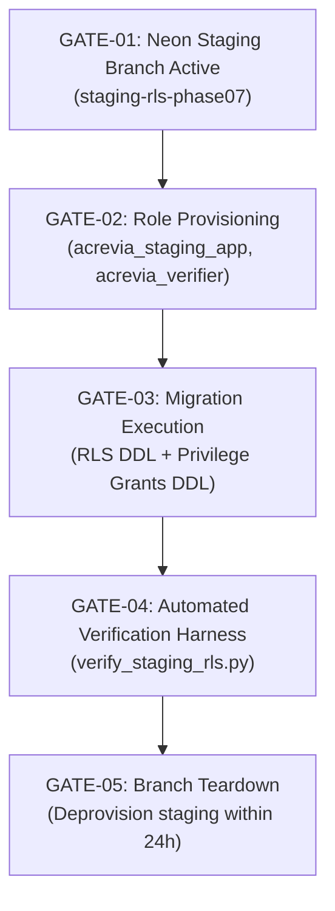

# ACREVIA — PHASE 07: REGIONAL PULSE POLICY-STATE COMPATIBILITY, LEAST-PRIVILEGE ROLE SCOPE, WORKER DISPATCH FEASIBILITY & OWNER DECISION CORRECTIVE ASSURANCE REPORT

**Programme:** ACREVIA — Agricultural Intelligence Platform  
**Target Geography:** Telangana, India  
**Target Phase:** Phase 07 — PostgreSQL RLS Tenant Isolation & Regional Aggregation Privacy  
**Execution Mode:** `MODE A ONLY` — Local Source Inspection, Static PostgreSQL RLS Modeling, API Authorization Reconciliation, Worker Architecture Feasibility & Governance Verification  
**Methodology:** Everything Claude Code (ECC) — `PLAN → INSPECT → TRACE → ADVERSARIAL REVIEW → DESIGN CORRECTION → VERIFY → DOCUMENT`  
**Repository Working Copy:** `c:\Users\gokul\OneDrive\Documents\projects`  
**Public Repository:** `https://github.com/gokul1599/ACREVIA`  
**Inspected Baseline Commit:** `c9e334d14110e8a6e4c9b71b89cae3294288af0d` (`main`)  
**Previous Design Report:** `docs/pilot/security/PHASE_07_REGIONAL_PULSE_COMMAND_SCOPE_RLS_AND_TRUSTED_PROVENANCE_DESIGN_ASSURANCE_REPORT.md` (Preserved intact)  
**Required New Deliverable:** `docs/pilot/security/PHASE_07_REGIONAL_PULSE_POLICY_COMPATIBILITY_AND_WORKER_DISPATCH_CORRECTIVE_ASSURANCE_REPORT.md`  
**Release Gate Status:** `GATE-01: RECORDED_OWNER_APPROVED (2026-11-10) — LIVE_UNVERIFIED_IN_MODE_A` | `GATE-02` through `GATE-05: AWAITING_OWNER_SIGN_OFF`  
**Phase 07 Status:** **NOT RELEASED** | **Mode B Status:** **STRICTLY NOT AUTHORIZED**  

---

## 1. EXECUTIVE VERDICT

This corrective assurance audit was executed under strict **MODE A** constraints to validate and correct critical technical assumptions in earlier Phase 07 assurance deliverables. Specifically, this audit reconciles the actual PostgreSQL RLS policy state against the codebase's true model status vocabulary, resolves endpoint-to-policy authorization mismatches, assesses the operational deployability of background workers under `WRK-DISP-01`, evaluates cascading foreign key risks to append-only evidence, and restores canonical governance designations in the Project Owner decision register.

### 1.1 Core Corrective Determinations

1. **Status Vocabulary Correction (`SOURCE-CODE-VERIFIED`):**
   - The previous report proposed `validation_status IN ('PUBLISHED', 'OFFICIAL_ADVISORY')`.
   - **Critical Defect:** The status `'PUBLISHED'` does not exist anywhere in the `RegionalSignal` lifecycle. Furthermore, `'OFFICIAL_ADVISORY'` is a `confidence_tier` value, not a `validation_status` value.
   - If installed, the previous proposed SELECT predicate would evaluate to `FALSE` for 100% of rows in PostgreSQL, **accidentally hiding all regional signals from ordinary farmers**.
   - The true source-defined validation statuses are: `UNVALIDATED_OBSERVATION`, `EXPERT_CONFIRMED`, `ADMIN_CONFIRMED`, `OFFICIAL_ALERT`, and `SUPPRESSED_INSUFFICIENT_PROVENANCE`.
2. **Role-Based SELECT Scope & Privacy Exposure (`RES-PULSE-01`):**
   - The previous proposal's blanket `OR role_subquery` granting SELECT to `ADMIN`, `AGRICULTURAL_EXPERT`, and `RESEARCHER` is over-broad.
   - It grants statewide, un-scoped read visibility across all districts into suppressed signals, below-threshold aggregates ($N < 3$), unvalidated drafts, and cross-district evidence metadata.
   - District-scoping and assignment-based authorization are mandatory to contain `RES-PULSE-01` (maintained at canonical **`MEDIUM`** severity).
3. **API Authorization vs. RLS INSERT Policy Mismatch (`SOURCE-CODE-VERIFIED`):**
   - FastAPI endpoint `POST /regional-pulse/signals` explicitly authorizes `ADMIN`, `AGRICULTURAL_EXPERT`, and `RESEARCHER` via `require_roles()`.
   - The service logic allows researchers to create signals in status `UNVALIDATED_OBSERVATION`.
   - However, the previous proposed RLS `INSERT` policy restricted writes strictly to `ADMIN` and `AGRICULTURAL_EXPERT`.
   - A researcher calling the API would pass FastAPI authentication but crash on PostgreSQL `INSERT` with `42501 rls policy check violation`, resulting in an unhandled `HTTP 500`.
4. **PostgreSQL RLS `WITH CHECK` State-Machine Limitation (`STATIC-POLICY-INFERENCE`):**
   - In PostgreSQL RLS, `WITH CHECK` evaluates *only the proposed new row* and has zero access to old row values (`OLD.*`).
   - Consequently, `WITH CHECK` alone **cannot enforce state transitions** (e.g. asserting that a transition to `EXPERT_CONFIRMED` only occurs from `UNVALIDATED_OBSERVATION` or `SUPPRESSED_INSUFFICIENT_PROVENANCE`).
   - Old-to-new state machine validation must be enforced via controlled service transactions, database `BEFORE UPDATE` triggers, or stored procedures.
5. **Worker Infrastructure Feasibility & `WRK-DISP-01` (`SOURCE-CODE-VERIFIED`):**
   - Recommending an asynchronous Celery/Redis worker as an immediate drop-in replacement is currently **operationally infeasible**.
   - Under `WRK-DISP-01`, `run_riskcast_batch.py` raises `ProductionDispatchBlockedError: DISPATCH_NOT_CONFIGURED` in staging/production environments. Zero Celery queues or task runners are configured for Regional Pulse.
   - Production task dispatch remains un-implemented and fails closed.
6. **Foreign Key Cascade Undermines Append-Only Evidence (`SOURCE-CODE-VERIFIED`):**
   - In `RegionalSignalEvidence`, `signal_id` is defined with `ForeignKey("regional_signals.id", ondelete="CASCADE")`.
   - Even if direct `DELETE` privileges and RLS policies are withheld on `regional_signal_evidences`, deleting a parent `regional_signals` row causes the PostgreSQL engine to cascade-delete all linked evidence records, bypassing child table RLS.
7. **Canonical Owner Decision Register Restored (`OWNER-DECISION-REQUIRED`):**
   - The previous report incorrectly relabelled D-02 and D-03.
   - The canonical scopes are formally restored from `phase_07_owner_decision_evidence_traceability_matrix.md`:
     - **`D-01`:** Official Advisory Public Visibility vs. Minimum Farm Threshold ($N \ge 3$).
     - **`D-02`:** Source Authenticity & Terminology.
     - **`D-03`:** Agronomic Peer-Review Workflow.
     - **`DB-AUTH-01`:** Trusted Writer Architecture (governs database role segregation).
     - Append-only audit-log enforcement is a separate migration control.

---

## 2. EXACT PUBLIC AND LOCAL BASELINE PROVENANCE

### 2.1 Commit and Workspace Verification
- **Known Baseline Commit:** `c9e334d14110e8a6e4c9b71b89cae3294288af0d`
- **Local Git Branch:** `main` (synchronized with `origin/main` at commit `c9e334d14110e8a6e4c9b71b89cae3294288af0d`).
- **Local Working Copy:** `c:\Users\gokul\OneDrive\Documents\projects`
- **Commit Divergence:** 0 commits.
- **Working Tree Attestation:** 0 source code files, 0 models, 0 migrations, and 0 tests modified. All historical audit reports preserved.

### 2.2 Evidence Classification Standards
Every technical conclusion in this report adheres to strict evidentiary standards:
- `SOURCE-CODE-VERIFIED`: Directly inspected in Python source files in `backend/app/`.
- `STATIC-POLICY-INFERENCE`: Derived from PostgreSQL RLS engine rules and AST expressions in `backend/app/database/rls.py`.
- `SQLALCHEMY-DOCUMENTATION-CONFIRMED`: Verified against official SQLAlchemy 2.0 / 2.1 documentation and transaction models.
- `LOCAL-TEST-VERIFIED`: Executed offline without remote connections.
- `LIVE-POSTGRESQL-UNKNOWN` / `LIVE-ACL-UNKNOWN`: Live catalog, role privileges, and Cloud staging state uninspected in Mode A.
- `OWNER-DECISION-REQUIRED`: Requires Project Owner governance selection.

---

## 3. CORRECTED CURRENT STATUS VOCABULARY

### 3.1 Field and Value Dissection (`SOURCE-CODE-VERIFIED`)
Inspection of `backend/app/models/regional_pulse.py`, `backend/app/schemas/regional_pulse.py`, and `backend/app/services/regional_pulse_service.py` reveals the actual domain model:

| Domain Concept | Actual ORM Field | Actual Stored Values | Source Code Location | Authorization & Lifecycle Semantics |
|---|---|---|---|---|
| **Validation Lifecycle** | `validation_status` | `UNVALIDATED_OBSERVATION` | `models/regional_pulse.py` (L29) | Default state upon creation for crowd/farmer or researcher signals. |
| | | `EXPERT_CONFIRMED` | `services/regional_pulse_service.py` (L198, L285) | Assigned when an Agricultural Expert creates or recovers a signal. |
| | | `ADMIN_CONFIRMED` | `services/regional_pulse_service.py` (L287) | Assigned when an Admin (non-expert) recovers a signal. |
| | | `OFFICIAL_ALERT` | `services/regional_pulse_service.py` (L192) | Assigned when an Admin publishes an official state advisory. |
| | | `SUPPRESSED_INSUFFICIENT_PROVENANCE` | `services/regional_pulse_service.py` (L340, L379) | Staged when verified distinct farms drop below 3. |
| **Confidence Assessment** | `confidence_tier` | `FARMER_REPORT` | `schemas/regional_pulse.py` (L36) | Unverified single-source farmer submission. |
| | | `MULTIPLE_INDEPENDENT` | `models/regional_pulse.py` (L27) | Cross-validated independent farmer reports. |
| | | `AI_ASSISTED` | `models/regional_pulse.py` (L27) | Algorithmic satellite or risk model inference. |
| | | `EXPERT_REVIEWED` | `services/regional_pulse_service.py` (L193) | Formal agronomist review. |
| | | `OFFICIAL_ADVISORY` | `services/regional_pulse_service.py` (L71, L191) | Official state government alert (requires `ADMIN` role). |
| **Outbreak Suppression** | `is_outbreak_claim_suppressed` | `True` / `False` | `models/regional_pulse.py` (L28) | Server-sanitized panic language filter flag. |
| **Distinct Farm Count** | `distinct_farms_count` | Integer ($0, 1, 2, 3, \dots$) | `models/regional_pulse.py` (L27) | Verified farm count ($0$ for official advisories). |

---

## 4. INVALID OR MISMATCHED PREDICATES IN PREVIOUS PROPOSALS

### 4.1 Fatal Flaws in Previous SELECT Proposal
The previous design report proposed:
```sql
validation_status IN ('PUBLISHED', 'OFFICIAL_ADVISORY') AND distinct_farms_count >= 3
```
This expression exhibits two catastrophic errors:
1. **Non-Existent Status (`'PUBLISHED'`):** The string `'PUBLISHED'` does not exist in `validation_status`. The actual statuses corresponding to active validated signals are `EXPERT_CONFIRMED`, `ADMIN_CONFIRMED`, and `OFFICIAL_ALERT`. Querying for `'PUBLISHED'` yields zero matches.
2. **Type/Field Conflation (`'OFFICIAL_ADVISORY'`):** `'OFFICIAL_ADVISORY'` is a `confidence_tier`, not a `validation_status`.
3. **Threshold Contradiction on Official Advisories:** For official advisories (`validation_status = 'OFFICIAL_ALERT'`), `distinct_farms_count` is explicitly set to `0` by the service (lines 173–175: *"Official state advisories without plot telemetry have count 0"*). Therefore, requiring `distinct_farms_count >= 3` suppresses all official state advisories from public view!

### 4.2 Reconciled Farmer-Facing Public SELECT Predicate
To correctly reflect the source code while enforcing privacy invariants:
```sql
(
    -- Path A: Multi-farm aggregated signals confirmed by experts or administrators
    (
        validation_status IN ('EXPERT_CONFIRMED', 'ADMIN_CONFIRMED')
        AND distinct_farms_count >= 3
    )
    OR
    -- Path B: Official state advisories (Governed by Project Owner Decision D-01)
    (
        validation_status = 'OFFICIAL_ALERT'
        AND confidence_tier = 'OFFICIAL_ADVISORY'
        -- D-01 condition: permits read if Owner selects Option A, B, or D
    )
)
```
*Note on `UNVALIDATED_OBSERVATION`:* Crowd-sourced or researcher draft signals remaining in `UNVALIDATED_OBSERVATION` must be **excluded** from ordinary farmer view until confirmed by an Agricultural Expert.

---

## 5. EXPERT/RESEARCHER READ-SCOPE RISK (`RES-PULSE-01`)

### 5.1 The Danger of Global Role Subqueries
The previous report proposed an unqualified fallback:
```sql
OR (current_setting('app.current_user_id', true) != '' AND EXISTS (SELECT 1 FROM user_roles ur WHERE ur.user_id::text = current_setting('app.current_user_id', true) AND ur.role_id IN ('ADMIN', 'AGRICULTURAL_EXPERT', 'RESEARCHER')))
```
Under this policy, any user with the `AGRICULTURAL_EXPERT` or `RESEARCHER` role in `user_roles` gains **unrestricted statewide read access**:
- Access to signals in all 33 districts of Telangana, regardless of the expert's assigned jurisdiction.
- Access to signals suppressed for insufficient provenance (`SUPPRESSED_INSUFFICIENT_PROVENANCE`).
- Access to raw evidence associations (`regional_signal_evidences`) across all districts.
- Access to unvalidated draft observations.

### 5.2 Access Model Evaluation Matrix

| Access Model | Scope of Authority | Source of Authority | Mutability by App Pool | Evidence Metadata Exposure | Exposure of Below-Threshold Signals | Governing Decision |
|---|---|---|---|---|---|---|
| **1. Statewide Expert Read** | Global (All districts) | `user_roles.role_id = 'AGRICULTURAL_EXPERT'` | High (Mutable via GUC) | **Full Statewide Exposure** | Exposed statewide | Highly Risky (`RES-PULSE-01`) |
| **2. District-Assigned Expert Read** | District-Bounded | `expert_profiles.assigned_districts` | Moderate (Requires profile table) | **Bounded to Assigned District** | Bounded to district | **RECOMMENDED (Option B)** |
| **3. Case-Assigned Expert Read** | Incident-Bounded | `signal_reviews.expert_id` | Low (Explicit case assignment) | **Bounded to Review Case** | Bounded to case | Future GA Pattern (D-03) |
| **4. Project-Assigned Researcher Read** | Study-Bounded | `research_projects.districts` | Low (Explicit IRB/Project grant) | **Bounded to Research Scope** | Bounded to project | Future GA Pattern |
| **5. Explicit Official Advisory Feed** | Statewide Official | `validation_status = 'OFFICIAL_ALERT'` | Low (Admin creation only) | Zero (No farm evidence linked) | N/A ($N=0$ telemetry) | **Decision D-01** |
| **6. Database Administrator** | Global | `SESSION_USER = 'acrevia_admin'` | Zero (Database-authenticated) | Full (Administrative bypass) | Full | `ADMIN_BYPASS_SQL` |

**Governance Verdict:** `RES-PULSE-01` remains **`MEDIUM`** severity. A statewide un-scoped expert read policy cannot be approved without an explicit Project Owner risk acceptance under D-03.

---

## 6. API AUTHORIZATION VERSUS RLS INSERT POLICY RECONCILIATION

### 6.1 End-to-End POST Transaction Trace (`SOURCE-CODE-VERIFIED`)
In `backend/app/api/v1/endpoints/regional_pulse.py` lines 30–65:
```mermaid
sequenceDiagram
    autonumber
    actor Res as Authenticated Researcher
    participant API as POST /regional-pulse/signals
    participant Svc as RegionalPulseService.aggregate_regional_signal
    participant PG as PostgreSQL Engine (RLS)

    Res->>API: POST /signals (Valid signal payload)
    Note over API: require_roles(ADMIN, EXPERT, RESEARCHER)<br/>Researcher is AUTHORIZED at FastAPI layer!
    API->>Svc: aggregate_regional_signal(data, actor_roles=['RESEARCHER'])
    Note over Svc: Line 196: Sets validation_status = 'UNVALIDATED_OBSERVATION'<br/>Service permits Researcher draft creation!
    Svc->>PG: INSERT INTO regional_signals (status='UNVALIDATED_OBSERVATION')
    Note over PG: Evaluate regional_signals_insert_policy<br/>Previous Proposal: Requires ADMIN or EXPERT!
    alt Previous Proposed INSERT Policy
        PG-->>API: 42501 rls policy check violation!
        Note over API: Transaction rolls back; raises HTTP 500
        API-->>Res: HTTP 500 Internal Server Error (Contract Mismatch!)
    else Reconciled INSERT Policy
        PG-->>API: INSERT OK (Row created)
        API-->>Res: HTTP 201 Created (Consistent Contract!)
    end
```

### 6.2 Matrix of Actor Authority Across Layers

| Actor Category | FastAPI Endpoint (`require_roles`) | Service-Level Logic (`aggregate_regional_signal`) | Table-Level SQL Grant | Current Proposed RLS INSERT Policy | Reconciled RLS INSERT Contract |
|---|---|---|---|---|---|
| **Ordinary Farmer** | **403 Forbidden** | Rejected (Guardrail 0) | INSERT granted to role | WITH CHECK fails | **DENIED at API Gateway** |
| **Agricultural Expert** | **200 Allowed** | Creates `EXPERT_CONFIRMED` | INSERT granted to role | WITH CHECK passes | **PERMITTED (Full Expert Creation)** |
| **Researcher** | **200 Allowed** | Creates `UNVALIDATED_OBSERVATION` | INSERT granted to role | **FAILS (Excluded from policy!)** | **PERMITTED (Draft Observation Only)** |
| **Application ADMIN** | **200 Allowed** | Creates any tier (inc. `OFFICIAL_ALERT`) | INSERT granted to role | WITH CHECK passes | **PERMITTED (Administrative Creation)** |
| **Trusted DB Writer** | N/A (Direct SQL) | N/A (Direct SQL) | INSERT granted | `ADMIN_BYPASS_SQL` passes | **PERMITTED (Direct Provisioning)** |
| **Unauthenticated DB Pool** | **401 Unauthorized** | N/A | INSERT granted | WITH CHECK fails (No GUC) | **DENIED at Database Kernel** |

### 6.3 Reconciled INSERT Policy Specification
To resolve this contract mismatch, the RLS `INSERT` policy must explicitly support the Researcher draft lifecycle:
```sql
CREATE POLICY regional_signals_insert_policy ON regional_signals
    AS PERMISSIVE FOR INSERT TO PUBLIC
    WITH CHECK (
        ADMIN_BYPASS_SQL
        OR (
            current_setting('app.current_user_id', true) != ''
            AND (
                -- Experts and Admins can insert confirmed signals or official alerts
                EXISTS (
                    SELECT 1 FROM user_roles ur
                    WHERE ur.user_id::text = current_setting('app.current_user_id', true)
                    AND ur.role_id IN ('ADMIN', 'AGRICULTURAL_EXPERT')
                )
                OR
                -- Researchers can ONLY insert unvalidated draft observations
                (
                    EXISTS (
                        SELECT 1 FROM user_roles ur
                        WHERE ur.user_id::text = current_setting('app.current_user_id', true)
                        AND ur.role_id = 'RESEARCHER'
                    )
                    AND validation_status = 'UNVALIDATED_OBSERVATION'
                    AND confidence_tier != 'OFFICIAL_ADVISORY'
                )
            )
        )
    );
```

---

## 7. UPDATE STATE-MACHINE CORRECTNESS

### 7.1 PostgreSQL RLS Engine Mechanics (`STATIC-POLICY-INFERENCE`)
Under official PostgreSQL documentation (Section 5.8):
1. **`USING (using_expr)`:** Evaluated against the **pre-existing row (`OLD`)**. If `using_expr` returns false, the row is not visible for modification and the UPDATE statement affects 0 rows.
2. **`WITH CHECK (check_expr)`:** Evaluated against the **proposed post-update row (`NEW`)**. If `check_expr` returns false, an error (`42501 rls policy check violation`) is raised.
3. **Fundamental Limitation:** The `WITH CHECK` expression cannot reference `OLD.*` attributes. Therefore, an RLS policy **cannot compare old state to new state** (e.g. `NEW.validation_status != OLD.validation_status`).

### 7.2 Why RLS Alone Cannot Enforce State Transitions
An RLS policy checking:
```sql
WITH CHECK (validation_status IN ('EXPERT_CONFIRMED', 'SUPPRESSED_INSUFFICIENT_PROVENANCE'))
```
allows a direct update from `SUPPRESSED_INSUFFICIENT_PROVENANCE` to `EXPERT_CONFIRMED` without verifying whether revalidation succeeded, or an invalid backward transition from `EXPERT_CONFIRMED` to `UNVALIDATED_OBSERVATION`.

### 7.3 Required Controlled State-Transition Operation
To enforce state-machine integrity, the application must use a dedicated service-level transaction:
1. **Row Locking:** Execute `SELECT * FROM regional_signals WHERE id = :id FOR UPDATE` to prevent concurrent race conditions.
2. **Current State Verification:** Assert `signal.validation_status == 'SUPPRESSED_INSUFFICIENT_PROVENANCE'` before allowing recovery.
3. **Invariant Enforcement:** Execute fresh evidence provenance verification proving $N \ge 3$ before transitioning to `EXPERT_CONFIRMED`.
4. **Append-Only Audit Staging:** Stage an `AuditLog` entry atomically in the same database transaction.
5. **Database Trigger Guardrail (Optional Defense-in-Depth):**
   ```sql
   CREATE OR REPLACE FUNCTION trg_verify_signal_status_transition()
   RETURNS TRIGGER AS $$
   BEGIN
       IF OLD.validation_status = 'SUPPRESSED_INSUFFICIENT_PROVENANCE' AND NEW.validation_status = 'EXPERT_CONFIRMED' THEN
           IF NEW.distinct_farms_count < 3 THEN
               RAISE EXCEPTION 'Cannot recover signal without verified distinct farms >= 3';
           END IF;
       END IF;
       RETURN NEW;
   END;
   $$ LANGUAGE plpgsql;
   ```

---

## 8. WORKER INFRASTRUCTURE AND DISPATCH FEASIBILITY (`WRK-DISP-01`)

### 8.1 Reality of Current Worker Infrastructure (`SOURCE-CODE-VERIFIED`)
A complete audit of `backend/app/tasks/` establishes:
1. The only background worker script in the codebase is `backend/app/tasks/run_riskcast_batch.py`.
2. Lines 120–125 and 150–165 enforce:
   ```python
   if is_production_env:
       raise ProductionDispatchBlockedError(
           "DISPATCH_NOT_CONFIGURED: Production worker dispatch provider is NOT_IMPLEMENTED. "
           "Farm evaluation cannot proceed without an authenticated, independently verified dispatch boundary."
       )
   ```
3. **Zero Celery tasks, Zero Redis queues, and Zero background workers** exist for Regional Pulse.
4. **Conclusion on Option A:** Recommending an asynchronous worker as an immediate solution ignores the active blocker **`WRK-DISP-01`**. In production and staging, worker execution fails closed immediately. The worker architecture is **NOT operationally deployable** until a verified, authenticated dispatch provider is engineered.

---

## 9. DURABLE EVENT PUBLICATION COMPARISON

If an asynchronous verification worker is engineered in the future, the dual-write problem must be resolved:

```mermaid
flowchart TD
    subgraph Dual-Write Failure Scenario
        A["1. API commits Evidence INSERT to DB"] -->|Commit OK| B["2. API publishes Job to Message Broker"]
        B -.->|Network/Broker Crash!| C["Job LOST! DB committed, worker never runs.<br/>Data Stale Indefinitely!"]
    end
    subgraph Transactional Outbox Pattern
        D["1. API begins DB Transaction"] --> E["2. INSERT Evidence Record"]
        E --> F["3. INSERT Outbox Task (Atomic)"]
        F --> G["4. COMMIT Database Transaction"]
        G --> H["5. Outbox Relay Poller reads and dispatches to Worker"]
        H -->|Guaranteed Delivery| I["Worker Executes Provenance Verification"]
    end
```



| Event Delivery Architecture | Atomicity Guarantee | Duplicate Delivery Risk | Operational Complexity | Feasibility in Current Codebase |
|---|---|---|---|---|
| **Direct Post-Commit Publish** | **None** (Dual-write failure window) | Low | Low | Not feasible (No broker configured) |
| **Transactional Outbox** | **Complete** (Atomic with evidence commit) | Moderate (At-least-once delivery; requires idempotent worker) | Moderate (Requires outbox table & relay process) | **RECOMMENDED FUTURE ARCHITECTURE** |
| **PostgreSQL Listen/Notify** | **High** (Trigger-based notification) | Low | Moderate (Connection pooling limitations with pgbouncer) | High risk under Neon pooling |
| **Scheduled Polling Reconciliation** | **Complete** (Periodic sweep of unverified signals) | High (Multiple workers can pick up same signal) | Low (Cron/batch script) | Viable interim fallback |

---

## 10. CORRECTED PROVENANCE OUTCOME MODEL

The naive boolean return of `revalidate_signal_provenance() -> bool` conflates failure with insufficiency. The corrected domain model expands to 9 explicit states:

```python
class ProvenanceVerificationOutcome(str, Enum):
    # Definitive Positive / Negative Verification
    VERIFIED_SATISFIED = "VERIFIED_SATISFIED"              # Evidence inspected; verified distinct farms >= 3
    VERIFIED_INSUFFICIENT = "VERIFIED_INSUFFICIENT"        # Evidence inspected; verified distinct farms < 3 (Triggers suppression)
    
    # Structural Inability to Verify (Leaves persisted state UNCHANGED)
    NO_EVIDENCE_ATTACHED = "NO_EVIDENCE_ATTACHED"          # Signal created with zero linked evidence items
    UNVERIFIABLE_EVIDENCE_ISOLATED = "UNVERIFIABLE_EVIDENCE_ISOLATED"  # Evidence association rows hidden by RLS policy
    UNVERIFIABLE_TENANT_ISOLATED = "UNVERIFIABLE_TENANT_ISOLATED"      # Underlying tenant records (Observation/Farm) hidden by RLS
    SOURCE_RECORD_DELETED = "SOURCE_RECORD_DELETED"        # Observation or Farm record was deleted
    EVIDENCE_EXPIRED_WINDOW = "EVIDENCE_EXPIRED_WINDOW"    # Observation timestamp outside signal observation window
    
    # Operational & Lifecycle Statuses
    VERIFICATION_QUEUED = "VERIFICATION_QUEUED"            # Task queued in outbox/worker; pending execution
    UNVERIFIABLE_INFRASTRUCTURE_ERROR = "UNVERIFIABLE_INFRASTRUCTURE_ERROR"  # Database connection/timeout failure
```

**Fail-Closed Invariants:**
1. Only `VERIFIED_INSUFFICIENT` may transition a signal to `SUPPRESSED_INSUFFICIENT_PROVENANCE`.
2. `UNVERIFIABLE_*` and operational statuses must **never** overwrite `distinct_farms_count = 0`.
3. Internal failure reasons (e.g. `UNVERIFIABLE_TENANT_ISOLATED`) must be logged in `AuditLog` but never exposed in farmer-facing HTTP error responses to prevent information leakage.

---

## 11. GET READ-ONLY GUARANTEE AND EVENTUAL CONSISTENCY ANALYSIS

### 11.1 The Read-Only Guarantee
- Stripping `revalidate_signal_provenance()` and `db.commit()` from `list_signals` and `get_signal` guarantees that HTTP GET requests are **strictly idempotent and read-only**.
- This eliminates:
  - `RES-PULSE-READ-01` (Unintended persistent suppression mutations on read routes).
  - `RES-PRIMARY-ROUTING-01` (Requirement for primary DB connection routing on GET).
  - Unhandled `HTTP 500` errors on read requests when non-writing actors invoke endpoints.

### 11.2 Trade-Off: Stale Visibility vs. False Denial
- **Pre-computed Aggregation:** GET queries evaluate the pre-calculated `distinct_farms_count` and `validation_status` stored in the database.
- **Eventual Consistency Window:** If an underlying observation is deleted, there is a delay before the background reconciliation runs and suppresses the signal.
- **Security Assessment:** In regional agricultural intelligence, exposing a regional aggregate for a short window during asynchronous verification is far preferable to the current defect, which **falsely denies 100% of legitimate signals to ordinary farmers**.

---

## 12. EVIDENCE IMMUTABILITY AND FK CASCADE ANALYSIS

### 12.1 The Cascade Delete Vulnerability (`SOURCE-CODE-VERIFIED`)
In `backend/app/models/regional_pulse.py` lines 42–47:
```python
class RegionalSignalEvidence(Base):
    __tablename__ = "regional_signal_evidences"
    ...
    signal_id: Mapped[str] = mapped_column(
        String(36), 
        ForeignKey("regional_signals.id", ondelete="CASCADE"), 
        index=True, 
        nullable=False
    )
```
In `RegionalSignal` line 34:
```python
evidences: Mapped[List["RegionalSignalEvidence"]] = relationship(
    "RegionalSignalEvidence", 
    back_populates="signal", 
    cascade="all, delete-orphan"
)
```

### 12.2 Security Implications
1. **Engine-Level Bypass:** Under PostgreSQL engine rules, foreign key `ON DELETE CASCADE` actions are executed by the internal relational engine. They do not trigger `DELETE` RLS policies on the child table and do not require table-level `DELETE` grants on the child table!
2. **False Append-Only Claim:** Any operation that deletes a parent `regional_signals` row will automatically and permanently purge all linked `regional_signal_evidences` rows!
3. **Required Hardening:**
   - In Alembic migrations, alter foreign key constraint to `ON DELETE RESTRICT` or `ON DELETE NO ACTION`.
   - Implement soft-delete (`is_archived = True`) on `regional_signals` instead of physical `DELETE`.
   - Deny table-level `DELETE` privilege on `regional_signals` to all runtime roles in `PRIVILEGE_CROSSWALK`.

---

## 13. CORRECTED OWNER DECISION REGISTER

Reconciled against [`docs/pilot/security/phase_07_owner_decision_evidence_traceability_matrix.md`](file:///c:/Users/gokul/OneDrive/Documents/projects/docs/pilot/security/phase_07_owner_decision_evidence_traceability_matrix.md):

| Decision Identifier | Canonical Governance Scope | Status in Register | Governing Control / Architecture Impact |
|---|---|---|---|
| **`D-01`** | Official Advisory Public Visibility vs. Minimum Farm Threshold | `PENDING_PROJECT_OWNER_AUTHORIZATION` (Options: A, B, C, D) | Governs whether `validation_status = 'OFFICIAL_ALERT'` signals ($N=0$) are readable by ordinary farmers. |
| **`D-02`** | Source Authenticity & Terminology | `PENDING_PROJECT_OWNER_AUTHORIZATION` (Options: A, B, C) | Governs signal naming, credibility labelling, and confidence tier terminology. |
| **`D-03`** | Agronomic Peer-Review Workflow | `PENDING_PROJECT_OWNER_AUTHORIZATION` (Options: A, B, C) | Governs multi-expert consensus review and district-scoped case assignments. |
| **`DB-AUTH-01`** | Trusted Writer Architecture & Role Segregation | `PROPOSED — PENDING OWNER AUTHORIZATION` (Options: A, B, C, D) | Governs physical database principal segregation (`acrevia_staging_app` vs. `acrevia_admin_app` vs. verifier). |
| **`GATE-01`** | Neon Staging Branch Provisioning (`staging-rls-phase07`) | **`RECORDED_OWNER_APPROVED (2026-11-10)`** | Physical provisioning remains **`LIVE_UNVERIFIED_IN_MODE_A`** (Blocked by credential rotation). |
| **`GATE-02` to `GATE-05`** | Downstream Role Provisioning, Migrations, Probes, Teardown | **`AWAITING_OWNER_SIGN_OFF`** | Physical execution strictly prohibited in Mode A. |

*Correction Note:* Database role segregation must never be referred to as D-02 (it is `DB-AUTH-01`). Append-only audit logging is a migration control and must not be referred to as D-03.

---

## 14. PRIVILEGE GENERATOR AND MIGRATION DEPLOYMENT GAP

### 14.1 Authoritative Migration Audit (`SOURCE-CODE-VERIFIED`)
Inspection of `backend/app/database/migrations/versions/a1089411c87d_enable_postgresql_rls_tenant_isolation.py` reveals:
- Lines 25–40 call `generate_rls_ddl()`.
- **`generate_privilege_grants_ddl()` IS NEVER CALLED.**
- There are **zero `GRANT` or `REVOKE` statements** in migration `a1089411c87d`!
- The privilege grant generator is invoked exclusively in `backend/tests/test_worker_security_and_privacy.py`.
- **Status:** Proposed blocker `DB-GRANT-APPLY-01` remains **`PROPOSED — OWNER APPROVAL REQUIRED`**. Table-level privilege grants on live PostgreSQL remain `LIVE-ACL-UNKNOWN`.

---

## 15. CANONICAL BLOCKER REGISTER RECONCILIATION

All 15 canonical blocker identifiers remain active:

| # | Blocker ID | Canonical Description | Disposition | Evidence Level | Release Impact |
|---|---|---|---|---|---|
| 1 | `RLS-WRITE-AUTH-01` | Blanket DML write authority on collaborative tables | OPEN | `SOURCE-CODE-VERIFIED` | BLOCKING |
| 2 | `RLS-ROLE-ASSIGNMENT-01` | Mutable GUC role escalation on `user_roles` | OPEN | `SOURCE-CODE-VERIFIED` | BLOCKING |
| 3 | `DB-AUTH-01` | Shared database principal boundary ambiguity | OPEN | `SOURCE-CODE-VERIFIED` | BLOCKING |
| 4 | `DB-CREDENTIAL-EXPOSURE-01` | Public repository database credential exposure | OPEN | `SOURCE-CODE-VERIFIED` | BLOCKING (`CREDENTIAL_ROTATION_OUTSTANDING`) |
| 5 | `APP-ROLE-SELF-SELECT-01` | User role self-selection on registration | OPEN | `SOURCE-CODE-VERIFIED` | BLOCKING |
| 6 | `EXP-AUTH-01` | Unprotected expert/researcher endpoint authorization | OPEN | `SOURCE-CODE-VERIFIED` | BLOCKING |
| 7 | `CASCADE-ROLE-DEL-01` | Unrestricted role cascade deletion vulnerability | OPEN | `SOURCE-CODE-VERIFIED` | BLOCKING |
| 8 | `TENANT-MEMBERSHIP-01` | Incomplete tenant membership authorization boundary | OPEN | `SOURCE-CODE-VERIFIED` | BLOCKING |
| 9 | `OWNER-AUTH-01` | Superadmin bypass dependency on untrusted GUCs | OPEN | `SOURCE-CODE-VERIFIED` | BLOCKING |
| 10 | `DB-RLS-01` | Absence of FORCE RLS on sensitive relations | OPEN | `SOURCE-CODE-VERIFIED` | BLOCKING |
| 11 | `WRK-DISP-01` | Worker dispatch tenant context leakage | OPEN | `SOURCE-CODE-VERIFIED` | BLOCKING |
| 12 | `RES-PULSE-01` | Role-global evidence association visibility without district scoping | OPEN | `SOURCE-CODE-VERIFIED` | **BLOCKING (SEVERITY PRESERVED AT MEDIUM)** |
| 13 | `RES-PULSE-02` | READ COMMITTED multi-statement concurrency window | OPEN | `SQLALCHEMY-DOCUMENTATION-CONFIRMED` | BLOCKING |
| 14 | `GATE01-PROV-01` | Missing automated role-provisioning gateway | OPEN | `SOURCE-CODE-VERIFIED` | BLOCKING |
| 15 | `RES-PULSE-READ-01` | Write-on-read suppression mutation in GET endpoints | OPEN | `SOURCE-CODE-VERIFIED` | BLOCKING |

*Working Finding:* `FARMER_READ_BLOCKED_BY_EVIDENCE_ASSOCIATION_RLS` is maintained as a distinct read-availability defect.

---

## 16. RESIDUAL RISK REGISTER RECONCILIATION

All five residual risks are preserved with original canonical definitions:
1. **`RES-PULSE-01` (Severity: `MEDIUM`):** Role-global evidence association visibility without district scoping.
2. **`RES-PULSE-02` (Severity: `MEDIUM`):** READ COMMITTED multi-statement snapshot/concurrency window.
3. **`RES-PRIMARY-ROUTING-01` (Severity: `MEDIUM`):** Primary database routing dependency for write-on-read operations.
4. **`RES-REPLICA-LAG-01` (Severity: `LOW`):** Potential stale visibility due to read replica lag.
5. **`RES-FREE-TEXT-01` (Severity: `LOW`):** PII exposure in author-controlled free-text fields.

---

## 17. RECOMMENDED ARCHITECTURE AND TRADE-OFFS

### 17.1 Staged Remediation Roadmap

```mermaid
flowchart TD
    subgraph Stage 1: Immediate Source Correction [Zero Infra Overhead]
        A["1. Correct Public SELECT Predicate<br/>(Target EXPERT_CONFIRMED, ADMIN_CONFIRMED)"]
        B["2. Decouple GET Routes from Revalidation<br/>(Strip revalidate_signal_provenance & db.commit)"]
        C["3. Align POST API require_roles with RLS INSERT<br/>(Support Researcher Drafts)"]
    end
    subgraph Stage 2: Database Schema & Cascade Hardening [Migration Required]
        D["4. Change FK on regional_signal_evidences to ON DELETE RESTRICT"]
        E["5. Decompose Collaborative Policies to Command-Specific"]
        F["6. Apply Privilege Grants via Migration (DB-GRANT-APPLY-01)"]
    end
    subgraph Stage 3: Operational Worker Engineering [WRK-DISP-01 Resolution]
        G["7. Engineer Authenticated Worker Dispatch Provider"]
        H["8. Implement Transactional Outbox Pattern for Provenance Revalidation"]
        I["9. Introduce District-Scoped Expert Authorization Matrix"]
    end
    Stage 1 --> Stage 2 --> Stage 3
```

---

## 18. OFFLINE TEST SPECIFICATION MATRIX

The following 18 test scenarios specify offline verification criteria (`LIVE_POSTGRESQL_REQUIRED — NOT EXECUTED IN MODE A`):

| # | Scenario Description | Actor | Initial Data State | Expected RLS Evaluation | Expected Route / Service Behavior | Layer |
|---|---|---|---|---|---|---|
| 1 | Farmer reads `EXPERT_CONFIRMED` signal ($N \ge 3$) | Farmer | `EXPERT_CONFIRMED`, $N=3$ | PERMITTED | HTTP 200 (Signal visible, evidences omitted) | Route Unit |
| 2 | Farmer reads `ADMIN_CONFIRMED` signal ($N \ge 3$) | Farmer | `ADMIN_CONFIRMED`, $N=3$ | PERMITTED | HTTP 200 (Signal visible, evidences omitted) | Route Unit |
| 3 | Farmer cannot read `UNVALIDATED_OBSERVATION` | Farmer | `UNVALIDATED_OBSERVATION`, $N=3$ | DENIED (0 rows) | HTTP 404 / Omitted from list | Route Unit |
| 4 | Farmer cannot read `SUPPRESSED_INSUFFICIENT_PROVENANCE` | Farmer | `SUPPRESSED...`, $N=2$ | DENIED (0 rows) | HTTP 404 / Omitted from list | Route Unit |
| 5 | Official advisory visibility under Decision D-01 | Farmer | `OFFICIAL_ALERT`, $N=0$ | PERMITTED (D-01) | HTTP 200 (Advisory visible, 0 telemetry) | Route Unit |
| 6 | District-scoped expert read containment | Expert (Adilabad) | Signal in Khammam | DENIED | Cannot read unvalidated/suppressed Khammam signals | DDL / Service |
| 7 | Researcher POST signal draft creation | Researcher | New Signal Payload | PERMITTED (WITH CHECK) | HTTP 201 Created (`UNVALIDATED_OBSERVATION`) | Route Unit |
| 8 | Researcher cannot create `OFFICIAL_ALERT` | Researcher | Advisory Payload | DENIED (WITH CHECK) | HTTP 403 Forbidden | Route Test |
| 9 | State transition rejection via trigger | Expert | Direct jump to CONFIRMED | DENIED (Trigger) | Raises DB exception if $N < 3$ | DB Unit |
| 10 | Cascade delete blocked by RESTRICT FK | DB Writer | Delete parent signal | DENIED (FK Constraint) | Deletion blocked if evidence rows exist | DB Unit |
| 11 | Production dispatch blocked under `WRK-DISP-01` | Worker | Staging/Prod Environment | N/A | Raises `ProductionDispatchBlockedError` | Task Unit |
| 12 | Outbox record staged atomically with evidence | Expert | Evidence Linkage | N/A | Outbox task committed in same transaction | Service Unit |
| 13 | Idempotent worker replay protection | Worker | Duplicate Task ID | N/A | Duplicate task skipped cleanly | Task Unit |
| 14 | GET endpoint strictly read-only | Farmer | Any Signal | No DML issued | Zero UPDATEs; clean read commit | Route Unit |
| 15 | Expired attribute reload after rollback | Farmer | Expired ORM object | N/A | Reloads persisted DB state on access | ORM Unit |
| 16 | Missing evidence treated as `NO_EVIDENCE_ATTACHED` | Worker | Signal with 0 evidence | N/A | Does not record false 0 farm count | Service Unit |
| 17 | `ADMIN_BYPASS_SQL` failure for app ADMIN | App Admin | Shared pool connection | Evaluates FALSE | Tenant isolation strictly enforced | DDL Spec |
| 18 | Grant generator callsite verification | Auditor | Migration scripts | Absent | Asserts `DB-GRANT-APPLY-01` remains pending | Static AST |

---

## 19. FUTURE OWNER-GATED POSTGRESQL VERIFICATION PLAN

Strictly conditional upon Project Owner authorization of `GATE-02` through `GATE-05`. **Prohibited in Mode A.**



---

## 20. UNRESOLVED PROJECT OWNER DECISIONS

The following governance decisions remain formally pending Project Owner direction:
1. **Decision D-01 (Official Advisory Visibility):** Selection of public vs. expert-restricted visibility for government advisories with 0 farm telemetry.
2. **Decision D-02 (Source Authenticity & Terminology):** Terminology standards for regional aggregation alerts.
3. **Decision D-03 (Agronomic Peer-Review Workflow):** Formalization of expert multi-signature consensus and district-scoped review routing.
4. **Decision DB-AUTH-01 (Trusted Writer Architecture):** Architecture for segregating database roles (`acrevia_staging_app` vs. `acrevia_admin_app` vs. `acrevia_verifier`).
5. **Proposed Blocker `DB-GRANT-APPLY-01`:** Formal approval to incorporate `generate_privilege_grants_ddl()` into Alembic migration `a1089411c87d`.

---

## 21. FINAL RELEASE-READINESS VERDICT

```
╔══════════════════════════════════════════════════════════════════════════════════════════════╗
║                                 PHASE 07 ASSURANCE VERDICT                                   ║
╠══════════════════════════════════════════════════════════════════════════════════════════════╣
║  OVERALL PHASE 07 STATUS:            NOT RELEASED                                            ║
║  MODE B CLOUD EXECUTION:             STRICTLY NOT AUTHORIZED                                  ║
║  GATE-01 STATUS:                     RECORDED OWNER APPROVED (2026-11-10)                     ║
║  GATE-01 PHYSICAL PROVISIONING:      LIVE UNVERIFIED IN MODE A                               ║
║  GATE-02 THROUGH GATE-05 STATUS:     AWAITING OWNER SIGN-OFF                                 ║
║  CANONICAL BLOCKERS:                 15 ACTIVE BLOCKERS (0 RESOLVED)                         ║
║  PROPOSED BLOCKERS:                  DB-GRANT-APPLY-01 (PENDING OWNER APPROVAL)               ║
║  STATUS VOCABULARY AUDIT:            CORRECTED (EXPERT_CONFIRMED, ADMIN_CONFIRMED, ALERT)    ║
║  WORKER FEASIBILITY AUDIT:           BLOCKED BY WRK-DISP-01 (NOT DEPLOYABLE IN STAGING/PROD) ║
║  PRIMARY TECHNICAL REMEDIATION:      RECOMMENDED DESIGN READY — NO IMPLEMENTATION IN MODE A   ║
╚══════════════════════════════════════════════════════════════════════════════════════════════╝
```
