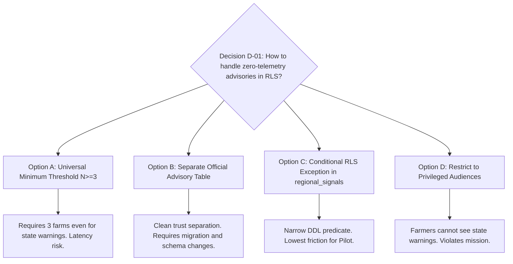

# ACREVIA — PHASE 07: REGIONAL PULSE PROJECT OWNER DECISION RECORD

**Programme:** ACREVIA — Agricultural Intelligence Platform  
**Target Geography:** Telangana, India  
**Target Phase:** Phase 07 — PostgreSQL RLS Tenant Isolation & Regional Aggregation Privacy  
**Document ID:** `ACR-DEC-P07-REGIONAL-PULSE-DOSSIER`  
**Classification:** RESTRICTED — GOVERNANCE & ARCHITECTURE DECISION DOSSIER  
**Execution Mode:** `MODE A ONLY` (Architecture Assessment & Governance Documentation)  
**Document Status:** `PENDING_PROJECT_OWNER_AUTHORIZATION`

---

## 1. Executive Summary & Purpose

This Decision Record compiles three architectural, trust, and privacy policy choices for the ACREVIA Regional Pulse subsystem that require formal Project Owner authorization before Pilot release.

Under strict Mode A constraints, engineering has verified that:
- Local technical defects (`SERVICE-AUTH-01`, `COUNT-INTEG-02`, `TX-OWN-01`) have been corrected and verified across 144 offline tests.
- Outer transaction ownership is enforced with `auto_commit=False` as the default.
- However, product policy choices regarding external government authenticity, zero-telemetry official advisory visibility in PostgreSQL RLS, and independent agronomic peer-review workflows cannot and must not be implemented by assumption.

| Decision ID | Subject | Current State | Evaluated Options | Engineering Recommendation | Owner Decision |
| :--- | :--- | :---: | :---: | :---: | :---: |
| **`D-01`** | Official Advisory Visibility vs. Minimum-Farm Privacy ($N \ge 3$) | `STATIC_DDL_EXEMPTION_ABSENT` & `RLS-WRITE-AUTH-01` (Unreadable by Farmers; Non-Admin Write Permitted) | Options A, B, C, D | **Option B for GA (Dedicated Table); Option C for Pilot ONLY with Write-Side Hardening** | **`PENDING`** |
| **`D-02`** | `OFFICIAL_ADVISORY` Terminology and Source Authenticity | `OFFICIAL_SOURCE_NOT_INDEPENDENTLY_VERIFIED` (Admin Authoring) | Options A, B, C | **Option A (Retain Enum, Mandate Transparent "Platform Broadcast" UI Label for Pilot; Implement Option C for GA)** | **`PENDING`** |
| **`D-03`** | Independent Agronomic Peer-Review Workflow | `EXPERT_SELF_CERTIFIED` (Single-Actor Creation) | Options A, B, C | **Option C (Flexible Review Workflow: Accept Expert-Authored for Pilot; Build Dedicated Review Route for GA)** | **`PENDING`** |

---

## 2. Decision D-01: Official Advisory Public Visibility vs. Minimum-Farm Privacy Threshold

### 2.1 The Issue
Under `backend/app/database/rls.py`, the generated PostgreSQL Row-Level Security policy for `regional_signals` enforces:
```sql
CREATE POLICY regional_signals_select_policy ON regional_signals
FOR SELECT USING (
    (current_setting('app.is_admin', true) = 'true')
    OR (
        distinct_farms_count >= 3
        AND validation_status != 'SUSPENDED'
    )
);
```
An official government advisory published by an administrator legitimately has zero plot telemetry (`distinct_farms_count = 0`). Under the current generated policy, any non-admin query (including all `FARMER` queries) evaluates `0 >= 3`, which is `False`. Consequently, official state advisories are unreadable by farmers in Telangana under PostgreSQL kernel RLS (`STATIC_DDL_EXEMPTION_ABSENT`).

### 2.2 Evaluated Architectural Options



#### Option A: Preserve the Universal Minimum Threshold ($N \ge 3$)
- **Mechanism:** Mandate that all regional signals, without exception, link $\ge 3$ verified active farms.
- **Advantages:** Zero database policy changes; zero risk of de-anonymization; absolute uniformity.
- **Disadvantages:** Prevents publishing legitimate district-wide state agricultural warnings (e.g., locust swarm, weather alert, input subsidy) before local farm disease reports have been filed.

#### Option B: Separate Official Advisory Data Model (`official_advisories` table)
- **Mechanism:** Introduce a dedicated `official_advisories` table completely detached from the telemetry-driven `regional_signals` table, with its own open public read RLS policy.
- **Advantages:** Clean architectural separation between crowd-sourced telemetry and administrative broadcasts; eliminates RLS exemption complexity; zero risk of telemetry leakage.
- **Disadvantages:** Requires Alembic migration, new REST API endpoints, and frontend component updates.

#### Option C: Conditional RLS Exception in `regional_signals`
- **Mechanism:** Update `backend/app/database/rls.py` to compile an explicit predicate:
  ```sql
  (current_setting('app.is_admin', true) = 'true')
  OR (validation_status = 'OFFICIAL_ALERT' AND confidence_tier = 'OFFICIAL_ADVISORY' AND distinct_farms_count = 0)
  OR (distinct_farms_count >= 3 AND validation_status != 'SUSPENDED')
  ```
- **Advantages:** Immediately restores farmer visibility for state alerts without schema alterations.
- **Disadvantages & Security Vulnerability (`RLS-WRITE-AUTH-01`):** Adversarial analysis confirmed that `regional_signals_author_write_policy` allows `AGRICULTURAL_EXPERT` and `RESEARCHER` to INSERT and UPDATE rows without status restrictions in `WITH CHECK`. In its current policy form, Option C is **`NOT_SAFE_TO_IMPLEMENT_IN_CURRENT_POLICY_FORM`**. If direct SQL were executed by a non-admin account, an unverified official advisory could be inserted and immediately exposed to farmers. Option C is only viable if accompanied by write-side policy hardening.

#### Option D: Restrict Zero-Telemetry Advisories to Privileged Audiences
- **Mechanism:** Keep current behavior where $N=0$ advisories are visible only to `ADMIN` and `AGRICULTURAL_EXPERT`.
- **Advantages:** Zero code changes.
- **Disadvantages:** The farmers who most need official state warnings cannot receive them through the platform.

### 2.3 Engineering Recommendation
- **General Availability (GA):** **Option B (Dedicated Table `official_advisories`)** is strongly recommended as the cleanest, most defensible architecture. It eliminates RLS status-predicate fragility, guarantees true admin-only write grants, and supports verifiable government provenance fields.
- **Pilot Release:** If Option C is selected to avoid schema changes for the pilot, it **must** be accompanied by write-side RLS policy hardening (splitting write policy into `FOR INSERT` and `FOR UPDATE` with explicit `WITH CHECK` restrictions denying non-admin creation of `OFFICIAL_ADVISORY` or `OFFICIAL_ALERT`). Without write hardening, Option C cannot be deployed safely.

---

## 3. Decision D-02: `OFFICIAL_ADVISORY` Terminology and External Source Authenticity

### 3.1 The Issue
The platform permits an authenticated user with the `ADMIN` role to publish a signal with `confidence_tier="OFFICIAL_ADVISORY"` and `validation_status="OFFICIAL_ALERT"`. However:
$$\mathbf{\text{Platform Administrator Authorization} \ne \text{Government Source Authenticity}}$$
The platform currently has zero integrations with Telangana state gazettes, commissionerate feeds, or digital signatures. Calling an internally authored message an "Official Advisory" creates an unsubstantiated impression that the platform cryptographically or legally represents the State Government.

### 3.2 Evaluated Architectural Options

#### Option A: Retain Database Enum, Mandate Transparent UI Labeling
- **Mechanism:** Keep `confidence_tier = "OFFICIAL_ADVISORY"` in database and API schemas, but update frontend cards to display: *"Platform Administrator Broadcast (Manual Notice)"*.
- **Advantages:** Zero database migrations; zero breaking API changes; immediate transparency for pilot farmers.
- **Disadvantages:** Internal schema names remain somewhat misleading.

#### Option B: Rename to Platform-Specific Classification
- **Mechanism:** Rename enum/string to `ADMINISTRATIVE_BROADCAST` or `PLATFORM_ADVISORY`.
- **Advantages:** Unambiguous semantic truth at all layers of the stack.
- **Disadvantages:** Requires database migration, API deprecation cycle, and synchronization across frontend types.

#### Option C: Introduce Source Provenance Before Official Designation
- **Mechanism:** Add required metadata fields (`issuing_agency`, `source_url`, `gazette_id`, `verification_doc_hash`) and grant the "Official" badge only when backed by an external verified record.
- **Advantages:** Full cryptographic/documentary source provenance.
- **Disadvantages:** Requires external integration or administrative document upload workflow not yet built.

### 3.3 Engineering Recommendation
**Option A for Pilot, roadmap to Option C for GA.**  
Retaining the enum while updating UI copy provides complete ethical transparency during the Pilot without breaking API contracts. Option C should be scheduled for Phase 08.

---

## 4. Decision D-03: Independent Agronomic Peer Review

### 4.1 The Issue
Currently:
1. When an `AGRICULTURAL_EXPERT` creates a signal requesting `confidence_tier="EXPERT_REVIEWED"`, the service immediately assigns `validation_status="EXPERT_CONFIRMED"`. The creator and reviewer are the same person (self-certification, zero independent review event).
2. When a `RESEARCHER` creates an `EXPERT_REVIEWED` signal, the service downgrades it to `validation_status="UNVALIDATED_OBSERVATION"`.
3. However, `recover_suppressed_signal` strictly requires `SUPPRESSED_INSUFFICIENT_PROVENANCE` and rejects `UNVALIDATED_OBSERVATION` with `HTTP 400 Bad Request`. There is currently no endpoint allowing an Agricultural Expert to review and approve a researcher's unvalidated signal.

### 4.2 Evaluated Architectural Options

#### Option A: Retain Current Pilot Status
- **Mechanism:** Permit Agricultural Experts to author confirmed signals directly for Pilot; treat researcher submissions as unvalidated observation drafts.
- **Advantages:** Zero operational latency; matches small pilot team size where single certified agronomists manage regional alerts.
- **Disadvantages:** Lacks four-eyes verification; researcher drafts cannot be promoted.

#### Option B: Mandatory Two-Person Peer Review
- **Mechanism:** All expert signals are created as `PENDING_EXPERT_REVIEW`. A different authenticated expert ($Actor_{reviewer} \ne Actor_{creator}$) must approve via `POST /signals/{id}/review`.
- **Advantages:** Maximum agronomic integrity; eliminates single-expert bias or rogue advice.
- **Disadvantages:** Requires 2 certified agronomists on call 24/7; high latency for urgent pest alerts during pilot.

#### Option C: Flexible Review Workflow (Evolutionary)
- **Mechanism:**
  - Authoring by an Agricultural Expert produces `EXPERT_CONFIRMED` with creator metadata logged.
  - Authoring by a Researcher produces `UNVALIDATED_OBSERVATION`.
  - Introduce a dedicated endpoint `POST /signals/{id}/review` allowing an Agricultural Expert to review, add notes, and promote an `UNVALIDATED_OBSERVATION` signal to `EXPERT_CONFIRMED`.
- **Advantages:** Solves the researcher workflow gap without imposing paralyzing two-person requirements on small pilot field teams.
- **Disadvantages:** Requires building one new route handler and review audit logging event.

### 4.3 Engineering Recommendation
**Option C (Flexible Review Workflow).**  
Allows rapid pilot operations while creating a formal, auditable bridge for researcher submissions.

---

## 5. Owner Decision Sign-Off Form

| Decision ID | Selected Option (A / B / C / D) | Authorizing Signature | Date | Implementation Phase Target |
| :---: | :---: | :---: | :---: | :---: |
| **`D-01`** | `[ PENDING OWNER INPUT ]` | `____________________` | `____-__-__` | Phase 07 Staging / Phase 08 |
| **`D-02`** | `[ PENDING OWNER INPUT ]` | `____________________` | `____-__-__` | Phase 07 Pilot Frontend / Phase 08 |
| **`D-03`** | `[ PENDING OWNER INPUT ]` | `____________________` | `____-__-__` | Phase 08 Sprint 1 |

*Note: In accordance with Mode A restrictions, zero code changes reflecting these decisions have been implemented.*
