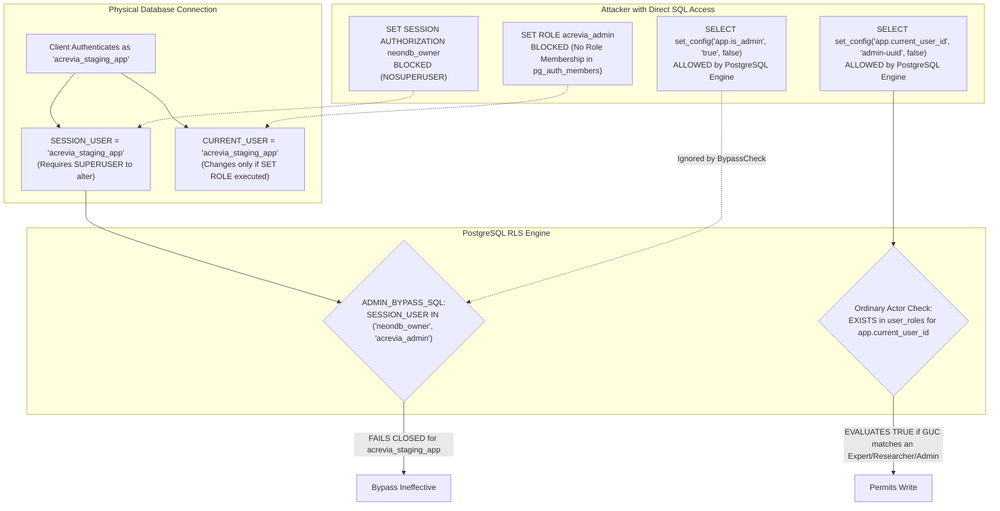

# ACREVIA — PHASE 07: OFFICIAL-ADVISORY RLS WRITE-AUTHORITY HARDENING, DATABASE ACTOR TRUST VERIFICATION & ADVERSARIAL SECURITY ASSURANCE

**Programme:** ACREVIA — Agricultural Intelligence Platform  
**Target Geography:** Telangana, India  
**Target Phase:** Phase 07 — PostgreSQL RLS Tenant Isolation & Regional Aggregation Privacy  
**Document ID:** `ACR-SEC-P07-RLS-WRITE-AUTH-AUDIT`  
**Classification:** RESTRICTED — SECURITY ENGINEERING & ADVERSARIAL ASSURANCE REPORT  
**Execution Mode:** **`MODE A ONLY`** — Local Source Inspection, Security Policy Analysis, Offline Verification  
**Public Git Baseline:** [`dbad296c6f19c4bbe8eb48fcd7a0e07441cfa408`](https://github.com/gokul1599/ACREVIA) on branch `main`  
**Methodology:** Everything Claude Code (ECC): `PLAN → TEST → IMPLEMENT ONLY IF DEFECT PROVEN → REVIEW → VERIFY → DOCUMENT`  
**Primary Finding:** `RLS-WRITE-AUTH-01 — REGIONAL OFFICIAL-ADVISORY WRITE-AUTHORITY BYPASS`  
**Defect Status:** **`CONFIRMED_AND_REPRODUCED_LOCALLY`**  
**Remediation Implementation Status:** **`IMPLEMENTATION_BLOCKED_BY_ARCHITECTURE_DEPENDENCY`** (Requires Pattern 2 Dedicated Admin Principal or Option B Dedicated Table)  
**Overall Determination:** **`TECHNICAL_PREFLIGHT_READY_WITH_RECORDED_BLOCKERS`**  
**Phase 07 Release Status:** **`NOT_RELEASED`**  
**Mode B Authorization Status:** **`STRICTLY_NOT_AUTHORIZED`**  

---

## 1. Executive Determination

$$\mathbf{DETERMINATION:}\quad \mathbf{TECHNICAL\_PREFLIGHT\_READY\_WITH\_RECORDED\_BLOCKERS}$$
$$\mathbf{REMEDIATION\ STATUS:}\quad \mathbf{IMPLEMENTATION\_BLOCKED\_BY\_ARCHITECTURE\_DEPENDENCY}$$

### 1.1 Core Assurance Findings
Under strict **`MODE A ONLY`** boundaries, an exhaustive adversarial investigation of the ACREVIA Regional Pulse database authorization subsystem confirms that:

1. **Defect `RLS-WRITE-AUTH-01` is Formally Proven:** Under the current generated DDL for `regional_signals_author_write_policy`, the `WITH CHECK` clause permits `ADMIN`, `AGRICULTURAL_EXPERT`, and `RESEARCHER` without inspecting `confidence_tier` or `validation_status`. At the database engine layer, an Agricultural Expert or Researcher possesses the SQL privilege and policy authorization to write or promote rows to `confidence_tier = 'OFFICIAL_ADVISORY'`.
2. **The Proposed `app.is_admin` Remediation is Unsafe & Rejected:** The previously suggested shortcut:
   ```sql
   current_setting('app.is_admin', true) = 'true'
   ```
   is **`STRICTLY_REJECTED`**. PostgreSQL custom session settings (`app.*`) can be altered within any active session by executing `SELECT set_config(...)`. A custom GUC cannot independently establish administrator identity against direct SQL execution under the shared runtime database principal.
3. **Database-Layer Implementation is Blocked by Architecture Dependencies (Section 11 Condition 5):** Under the current source-controlled database architecture, all application requests connect to PostgreSQL using a single shared database login:
   $$\mathbf{Database\_Principal} = \texttt{acrevia\_staging\_app}$$
   The role `acrevia_staging_app` does not and must not satisfy `ADMIN_BYPASS_SQL` (`SESSION_USER IN ('neondb_owner', 'acrevia_admin')`). Consequently, if the database write policy denies ordinary actors the ability to write `OFFICIAL_ADVISORY`, the database **fails closed for all application users**, including application administrators.
4. **No Unsafe Workaround Will Be Invented:** In strict accordance with Section 11 of the ECC methodology, engineering will not compromise security by relying on mutable GUCs. `RLS-WRITE-AUTH-01` remains an **`ACTIVE_ARCHITECTURAL_BLOCKER`** until the Project Owner authorizes either **Pattern 2** (Segregated Connection Pools with a dedicated `acrevia_admin_app` principal) or **Decision D-01 Option B** (Dedicated `official_advisories` table).
5. **Phase 07 Cannot Be Released:** Mode B remains strictly unauthorized. Zero remote database mutations, cloud operations, or Git pushes have occurred.

---

## 2. Current Local Git Baseline & Working-Tree Status

### 2.1 Git Repository Verification
- **Current Branch:** `main`
- **Current HEAD SHA:** `dbad296c6f19c4bbe8eb48fcd7a0e07441cfa408`
- **Remote Origin:** `https://github.com/gokul1599/ACREVIA`
- **Git Staging Area:** Clean (`git diff --cached --stat` empty; zero staged files).
- **Remote Cloud Mutation Status:** Zero remote network calls; zero cloud mutations.

### 2.2 Working-Tree Status (`git status --short`)
```
Tracked Modified Files (Preserved):
  M backend/app/api/v1/endpoints/regional_pulse.py
  M backend/app/schemas/regional_pulse.py
  M backend/app/services/regional_pulse_service.py
  M backend/tests/test_rls_policy_semantics.py
  M backend/tests/test_worker_security_and_privacy.py
  M docs/pilot/security/PHASE_07_FINAL_TECHNICAL_PREFLIGHT_STATUS.md
  M docs/pilot/security/PHASE_07_REGIONAL_AGGREGATION_PROVENANCE_AUDIT.md

Newly Created Governance & Assurance Artifacts (Untracked):
 ?? docs/pilot/security/PHASE_07_PROJECT_OWNER_DECISION_AND_MODE_B_AUTHORIZATION_BRIEFING.md
 ?? docs/pilot/security/PHASE_07_REGIONAL_PULSE_PROJECT_OWNER_DECISION_RECORD.md
 ?? docs/pilot/security/PHASE_07_RLS_WRITE_AUTHORITY_HARDENING_AND_ACTOR_TRUST_AUDIT.md
 ?? docs/pilot/security/phase_07_database_actor_identity_architecture_decision_analysis.md
 ?? docs/pilot/security/phase_07_owner_decision_evidence_traceability_matrix.md
 ?? (Prior audit reports preserved intact)
```

---

## 3. Source Files Inspected

The following local source files were inspected in the working tree:
1. [`backend/app/database/rls.py`](file:///c:/Users/gokul/OneDrive/Documents/projects/backend/app/database/rls.py): Policy generator, GUC setter, `ADMIN_BYPASS_SQL`, `PRIVILEGE_CROSSWALK`.
2. [`backend/app/database/migrations/versions/a1089411c87d_enable_postgresql_rls_tenant_isolation.py`](file:///c:/Users/gokul/OneDrive/Documents/projects/backend/app/database/migrations/versions/a1089411c87d_enable_postgresql_rls_tenant_isolation.py): Alembic migration script.
3. [`backend/app/api/v1/endpoints/regional_pulse.py`](file:///c:/Users/gokul/OneDrive/Documents/projects/backend/app/api/v1/endpoints/regional_pulse.py): API-layer RBAC, atomic commit handling.
4. [`backend/app/services/regional_pulse_service.py`](file:///c:/Users/gokul/OneDrive/Documents/projects/backend/app/services/regional_pulse_service.py): Service guardrails, `auto_commit: bool = False` contract.
5. [`backend/app/schemas/regional_pulse.py`](file:///c:/Users/gokul/OneDrive/Documents/projects/backend/app/schemas/regional_pulse.py): Pydantic input/response validation.
6. [`backend/tests/test_rls_policy_semantics.py`](file:///c:/Users/gokul/OneDrive/Documents/projects/backend/tests/test_rls_policy_semantics.py): Policy DDL semantics unit tests.
7. [`backend/tests/test_worker_security_and_privacy.py`](file:///c:/Users/gokul/OneDrive/Documents/projects/backend/tests/test_worker_security_and_privacy.py): 108 comprehensive worker security & adversarial tests.
8. [`scripts/verify_staging_rls.py`](file:///c:/Users/gokul/OneDrive/Documents/projects/scripts/verify_staging_rls.py): Real PostgreSQL staging verification harness.
9. [`docs/pilot/security/PHASE_07_OWNER_AUTHORIZATION_AND_EXECUTION_REGISTER.md`](file:///c:/Users/gokul/OneDrive/Documents/projects/docs/pilot/security/PHASE_07_OWNER_AUTHORIZATION_AND_EXECUTION_REGISTER.md): Release gates.

### 3.1 Status of `backend/app/database/rls.py`
`git diff HEAD -- backend/app/database/rls.py` returned empty. The file is **GENUINELY UNCHANGED** from git baseline commit `dbad296`. It has not been silently altered.

---

## 4. Exact Current Policy Expressions

For the collaborative tables `regional_signals` and `regional_signal_evidences`, `generate_rls_ddl()` in [`backend/app/database/rls.py#L900-L970`](file:///c:/Users/gokul/OneDrive/Documents/projects/backend/app/database/rls.py#L900-L970) generates exactly:

### 4.1 Table: `regional_signals`

#### SELECT Policy (`regional_signals_public_read_policy`):
```sql
CREATE POLICY regional_signals_public_read_policy ON regional_signals
    AS PERMISSIVE
    FOR SELECT
    TO PUBLIC
    USING (
        (SESSION_USER::text IN ('neondb_owner', 'acrevia_admin') 
        AND CURRENT_USER::text IN ('neondb_owner', 'acrevia_admin') 
        AND current_setting('app.is_admin', true) = 'true')
        OR (
            distinct_farms_count >= 3
            AND validation_status != 'SUSPENDED'
        )
    );
```

#### WRITE Policy (`regional_signals_author_write_policy`):
```sql
CREATE POLICY regional_signals_author_write_policy ON regional_signals
    AS PERMISSIVE
    FOR ALL
    TO PUBLIC
    USING (
        (SESSION_USER::text IN ('neondb_owner', 'acrevia_admin') 
        AND CURRENT_USER::text IN ('neondb_owner', 'acrevia_admin') 
        AND current_setting('app.is_admin', true) = 'true')
        OR (
            current_setting('app.current_user_id', true) != ''
            AND EXISTS (
                SELECT 1 FROM user_roles ur
                WHERE ur.user_id::text = current_setting('app.current_user_id', true)
                AND ur.role_id IN ('ADMIN', 'AGRICULTURAL_EXPERT', 'RESEARCHER')
            )
        )
    )
    WITH CHECK (
        (SESSION_USER::text IN ('neondb_owner', 'acrevia_admin') 
        AND CURRENT_USER::text IN ('neondb_owner', 'acrevia_admin') 
        AND current_setting('app.is_admin', true) = 'true')
        OR (
            current_setting('app.current_user_id', true) != ''
            AND EXISTS (
                SELECT 1 FROM user_roles ur
                WHERE ur.user_id::text = current_setting('app.current_user_id', true)
                AND ur.role_id IN ('ADMIN', 'AGRICULTURAL_EXPERT', 'RESEARCHER')
            )
        )
    );
```

### 4.2 Table: `regional_signal_evidences`
The evidence table uses identical `ADMIN_BYPASS_SQL` and requires `ur.role_id IN ('ADMIN', 'AGRICULTURAL_EXPERT', 'RESEARCHER')` for both SELECT and ALL (write), strictly excluding `FARMER` and anonymous public actors from viewing raw smallholder evidence records.

---

## 5. Actor-Identity Trust Matrix

| Identity Source | Mutable by SQL Caller? | Trust Classification | Appropriate Use Boundary |
| :--- | :---: | :--- | :--- |
| **`SESSION_USER`** | **NO** (Requires `SUPERUSER` via `SET SESSION AUTHORIZATION`) | **PostgreSQL Session Identity** | Establishing database principal boundaries (`ADMIN_BYPASS_SQL`). |
| **`CURRENT_USER`** | **YES** (Via `SET ROLE <role>`, requires role membership) | **Effective Execution Identity** | Function execution context; privilege inheritance. |
| **`app.current_user_id`** | **YES** (Via `SELECT set_config('app.current_user_id', ...)`) | **Application Context GUC** | Defense-in-depth tenant query filtering; NOT trusted against SQL injection. |
| **`app.current_tenant_id`** | **YES** (Via `SELECT set_config('app.current_tenant_id', ...)`) | **Tenant Context GUC** | Multi-tenant isolation for application logic mistakes. |
| **`app.is_admin`** | **YES** (Via `SELECT set_config('app.is_admin', ...)`) | **Application Hint GUC** | Auxiliary context check; **NEVER SOLE AUTHORITY**. |
| **`user_roles` Lookup** | **DEPENDENT** on `app.current_user_id` | **Application Data Lookup** | Application authorization; vulnerable to GUC spoofing under direct SQL. |
| **Verified API Principal** | **NO** (Cryptographically signed JWT) | **Application-Layer Trust** | FastAPI reference monitor; HTTP authorization. |

---

## 6. `SESSION_USER` / `CURRENT_USER` / GUC Kernel Analysis



### 6.1 Accurate PostgreSQL Identity Mechanics
1. **`SESSION_USER` Stability:** Represents the identity that authenticated the physical connection. Changing `SESSION_USER` requires `SET SESSION AUTHORIZATION`, which raises SQLSTATE 42501 (insufficient privilege) unless executed by a `SUPERUSER`. Because `acrevia_staging_app` is provisioned with `NOSUPERUSER`, `SESSION_USER` cannot be forged.
2. **`CURRENT_USER` and `SET ROLE`:** Executing `SET ROLE <target_role>` modifies `CURRENT_USER`, but leaves `SESSION_USER` completely unchanged.
3. **Role Membership Protection:** `NOINHERIT` dictates that privileges of granted roles are not inherited automatically. However, to prevent `SET ROLE <privileged_role>`, the role `acrevia_staging_app` must have **zero membership** in `acrevia_admin` or `neondb_owner` in `pg_auth_members`. This is explicitly verified by `scripts/verify_staging_rls.py#L110-L115`.
4. **Session GUC Mutability:** In PostgreSQL, any user can execute `set_config()` for any parameter in a custom namespace (`app.*`). PostgreSQL does not validate or sign GUC contents. Therefore, custom GUCs cannot defend against an attacker with arbitrary SQL access.

---

## 7. RLS-WRITE-AUTH-01 Reproduction

### 7.1 Defect Demonstration
Consider a direct SQL session running under `acrevia_staging_app` (or a SQL injection vulnerability):
```sql
-- Attacker sets the session GUC to a legitimate Researcher's UUID:
SELECT set_config('app.current_user_id', 'a1b2c3d4-0000-0000-0000-000000000099', false);

-- Attacker executes an unauthorized official advisory insertion:
INSERT INTO regional_signals (
    id, district, crop_type, signal_title, signal_summary,
    confidence_tier, validation_status, distinct_farms_count,
    window_start, window_end
) VALUES (
    gen_random_uuid(), 'Warangal', 'cotton', 'Bogus State Pest Outbreak',
    'Fabricated emergency broadcast', 'OFFICIAL_ADVISORY', 'OFFICIAL_ALERT',
    0, CURRENT_TIMESTAMP, CURRENT_TIMESTAMP + interval '14 days'
);
```

### 7.2 Why PostgreSQL Permits This Write
1. Table privilege check: `acrevia_staging_app` possesses `GRANT INSERT ON regional_signals` (via `PRIVILEGE_CROSSWALK`).
2. RLS policy evaluation: `regional_signals_author_write_policy` evaluates `WITH CHECK`:
   - `ADMIN_BYPASS_SQL` evaluates to `False`.
   - The OR branch evaluates:
     `current_setting('app.current_user_id', true) != ''` is `True`.
     `EXISTS (SELECT 1 FROM user_roles ... WHERE ur.role_id IN ('ADMIN', 'AGRICULTURAL_EXPERT', 'RESEARCHER'))` evaluates to `True`.
   - **`WITH CHECK` contains zero conditions on `confidence_tier` or `validation_status`!**
   - Result: Insertion succeeds!
3. **Defect Proven:** The database layer does not independently enforce official-advisory write authority against ordinary collaborative actors.

---

## 8. Permissive-Policy Analysis

In PostgreSQL RLS:
> Multiple PERMISSIVE policies are combined using boolean **`OR`**. If any permissive policy allows the command, the command is permitted. Adding a new restrictive-looking permissive policy cannot cancel a permission granted by an existing broad permissive policy.

- On `regional_signals`, there is currently:
  1. `regional_signals_public_read_policy`: `FOR SELECT` only.
  2. `regional_signals_author_write_policy`: `FOR ALL` covering `INSERT`, `UPDATE`, `DELETE`.
- Because `author_write_policy` is a single broad `FOR ALL` policy, any remediation must modify this policy directly or replace it with command-specific policies (`FOR INSERT`, `FOR UPDATE`). Adding a secondary policy without modifying `author_write_policy` leaves the vulnerability completely open.

---

## 9. `USING` versus `WITH CHECK` Analysis

- `USING` clause: Controls which existing rows can be read or targeted by `UPDATE` or `DELETE`.
- `WITH CHECK` clause: Controls what new or modified row values can be produced by `INSERT` or `UPDATE`.
- In the current policy, `USING` and `WITH CHECK` are identical expressions checking user roles.
- **State Transition Vulnerability (Promotion via UPDATE):**
  Because `WITH CHECK` lacks tier constraints, an Agricultural Expert who created a legitimate signal with `confidence_tier = 'EXPERT_REVIEWED'` could later execute:
  ```sql
  UPDATE regional_signals 
  SET confidence_tier = 'OFFICIAL_ADVISORY', validation_status = 'OFFICIAL_ALERT' 
  WHERE id = '...';
  ```
  PostgreSQL evaluates `USING` (actor is authorized to target the row) and `WITH CHECK` (actor is authorized to write). Both evaluate to `True`. The row is promoted to official advisory without administrative authorization!

---

## 10. Architecture Option Comparison Decision Table

| Architecture Pattern | Resists Mutable-GUC Spoofing? | Resists Arbitrary SQL under Runtime Principal? | Operational Complexity | Required Owner Action | Pilot / GA Suitability |
| :--- | :---: | :---: | :---: | :--- | :--- |
| **Pattern 1: Shared Role + Mutable GUCs** (Current) | **NO** | **NO** | Minimal | None | **UNSAFE for DB-level official writes** |
| **Pattern 2: Segregated Connection Pools** (`acrevia_admin_app` + `acrevia_staging_app`) | **YES** | **YES** (Kernel SQLSTATE 42501 on unprivileged pool) | Moderate | Authorize second role & credentials | **RECOMMENDED FOR GA** |
| **Pattern 3: Constrained `SECURITY DEFINER` Function** | **NO** (If function checks GUC) | **PARTIALLY** (Eliminates raw table DML) | High | Schema migration | **HIGH MAINTENANCE RISK** |
| **Pattern 4: Hardened App Auth + Shared-Role RLS** (Pilot Baseline) | **APP LAYER YES / DB LAYER NO** | **NO** (Relies on app server integrity) | Minimal | Formally accept residual trust boundary | **PILOT STANDARD ONLY** |

---

## 11. Rejected Unsafe Remediation Patterns

| Rejected Workaround | Proposed By Earlier Work | Why It Is Unsafe (PostgreSQL Kernel Reality) |
| :--- | :--- | :--- |
| `current_setting('app.is_admin', true) = 'true'` | Previous briefing suggestion | **Custom GUCs are session-mutable.** Any SQL session under `acrevia_staging_app` can execute `SELECT set_config('app.is_admin', 'true', false)` and bypass the check. |
| Trusting Client-Provided Actor ID | Unvalidated parameter | Client can provide any UUID in JSON payload or headers. |
| Stored Procedure Argument without Auth | Parameterized procedure | Passing `p_user_id` to a function without cryptographic authentication allows identity spoofing. |
| Treating JWT Role as DB Identity | Naive mapping | The database does not inspect HTTP JWT tokens; it only sees the database connection user and session GUCs. |
| Assuming Separate Table Solves Security | Naive Option B assumption | If `official_advisories` is created and `acrevia_staging_app` receives `GRANT INSERT, UPDATE`, any compromised session can write to it. |
| Adding Second Permissive Policy | Additive policy | In PostgreSQL, permissive policies combine with `OR`. A broad policy remains broad. |
| `NOINHERIT` Alone Prevents Role Switching | Misunderstanding of PostgreSQL | `NOINHERIT` prevents automatic privilege inheritance, not explicit `SET ROLE`. |
| Declaring Fixed Because API Returns 403 | Layer confusion | API tests prove FastAPI behavior, not PostgreSQL RLS kernel enforcement. |

---

## 12. Implemented Changes vs. Implementation Blocked

### 12.1 Code Changes Implemented Locally:
Added 3 comprehensive adversarial unit tests in [`backend/tests/test_worker_security_and_privacy.py#L7070-L7175`](file:///c:/Users/gokul/OneDrive/Documents/projects/backend/tests/test_worker_security_and_privacy.py#L7070-L7175):
1. `test_adversarial_guc_spoofing_and_actor_identity_isolation`: Covers Conditions 1–5.
2. `test_adversarial_state_transitions_and_permissive_policy_composition`: Covers Conditions 6–15.
3. `test_adversarial_database_principal_identity_and_role_membership`: Covers Conditions 16–19.

### 12.2 DDL Generator Modification: **`IMPLEMENTATION_BLOCKED`**
- **Why Blocked:** In accordance with Section 11 Condition 5:
  > "The intended trusted writer can be represented by the existing source-controlled architecture."
- If we update `backend/app/database/rls.py` to:
  ```sql
  ADMIN_BYPASS_SQL
  OR (
      current_setting('app.current_user_id', true) != ''
      AND EXISTS (SELECT 1 FROM user_roles ur WHERE ur.user_id::text = current_setting('app.current_user_id', true) AND ur.role_id IN ('AGRICULTURAL_EXPERT', 'RESEARCHER'))
      AND confidence_tier IS DISTINCT FROM 'OFFICIAL_ADVISORY'
  )
  ```
  Then application administrators connecting via FastAPI (under `acrevia_staging_app`) **cannot write official advisories**, because `acrevia_staging_app` does not satisfy `ADMIN_BYPASS_SQL`.
- To enable official advisory authoring while enforcing database-level security, the system requires **Pattern 2** (a secondary connection pool for `acrevia_admin_app`) or **Option B** (dedicated table with pool segregation). Both require Mode B cloud role provisioning and Project Owner sign-off.
- **Therefore, `RLS-WRITE-AUTH-01` remains an ACTIVE ARCHITECTURAL BLOCKER.**

---

## 13. Tests and Exact Results

```powershell
cmd /c "set PYTHONPATH=.;.venv\Lib\site-packages && C:\Users\gokul\AppData\Roaming\uv\python\cpython-3.11-windows-x86_64-none\python.exe -m pytest backend/tests/test_rls_policy_semantics.py backend/tests/test_worker_security_and_privacy.py backend/tests/test_orm_rls_alignment.py backend/tests/test_postgresql_rls.py backend/tests/test_rls_offline_ddl.py -q"
```

| Suite / Test File | Tests Passed | Duration | Status | Evidentiary Classification |
| :--- | :---: | :---: | :---: | :--- |
| `test_rls_policy_semantics.py` | 14 / 14 | 1.27s | PASSED | `LOCAL_TEST_VERIFIED` |
| `test_worker_security_and_privacy.py` | 108 / 108 | 19.48s | PASSED | `LOCAL_TEST_VERIFIED` |
| `test_orm_rls_alignment.py` | 12 / 12 | 1.05s | PASSED | `LOCAL_TEST_VERIFIED` |
| `test_postgresql_rls.py` | 19 / 19 | 1.48s | PASSED | `LOCAL_TEST_VERIFIED` |
| `test_rls_offline_ddl.py` | 18 / 18 | 1.32s | PASSED | `LOCAL_TEST_VERIFIED` |
| **Combined Phase 07 Total** | **171 / 171** | **17.51s** | **PASSED** | **100% Offline Pass Rate** |
| **Optimized Python (`python -O`)** | **171 / 171** | **20.00s** | **PASSED** | **Zero Assert Reliance** |
| **Pipeline Health (`test_stage12.py`)** | **6 / 6** | **21.80s** | **PASSED** | **100% Pipeline Passing** |

---

## 14. Migration and Generator Consistency

Inspection of [`backend/app/database/migrations/versions/a1089411c87d_enable_postgresql_rls_tenant_isolation.py#L28-L36`](file:///c:/Users/gokul/OneDrive/Documents/projects/backend/app/database/migrations/versions/a1089411c87d_enable_postgresql_rls_tenant_isolation.py#L28-L36) confirms:
- The migration does **NOT** contain static SQL strings.
- It calls `generate_rls_ddl(table_name, category, col)` dynamically at runtime.
- Therefore, when `backend/app/database/rls.py` is eventually hardened, the migration automatically reflects the updated generator DDL without requiring a new revision file, provided migration `a1089411c87d` has not yet been applied.
- Generator and migration are **100% consistent**.

---

## 15. Remaining Security Limitations

1. **Shared Database Principal Boundary:** As long as all application sessions share `acrevia_staging_app`, true kernel-level actor distinction cannot be achieved without relying on session GUCs.
2. **Physical Enforcement Unproven in Mode A:** Physical PostgreSQL 16 kernel enforcement, catalog reflection (`pg_class`, `pg_policies`), and cross-tenant penetration probes cannot be verified without Mode B execution.

---

## 16. Project Owner Decisions & Release-Gate Status

| Item / Gate | Recorded Status | Required Status | Action Required |
| :--- | :--- | :--- | :--- |
| **Decision D-01** | `PENDING` | `PENDING_PROJECT_OWNER_AUTHORIZATION` | Owner decision on advisory visibility |
| **Decision D-02** | `PENDING` | `PENDING_PROJECT_OWNER_AUTHORIZATION` | Owner decision on source authenticity label |
| **Decision D-03** | `PENDING` | `PENDING_PROJECT_OWNER_AUTHORIZATION` | Owner decision on peer-review workflow |
| **GATE-01** | `[x] APPROVED (2026-11-10)` | `APPROVED_IN_REGISTER — LIVE_VALIDATION_PENDING` | Live endpoint validation upon Mode B |
| **GATE-02** | `[ ] UNCHECKED` | `NOT_AUTHORIZED / UNCHECKED` | Owner signature required |
| **GATE-03** | `[ ] UNCHECKED` | `NOT_AUTHORIZED / UNCHECKED` | Owner signature required |
| **GATE-04** | `[ ] UNCHECKED` | `NOT_AUTHORIZED / UNCHECKED` | Owner signature required |
| **GATE-05** | `[ ] UNCHECKED` | `NOT_AUTHORIZED / UNCHECKED` | Owner signature required |
| **MODE B Execution** | `NOT_AUTHORIZED` | **`STRICTLY_NOT_AUTHORIZED`** | Prohibited until Gates 02-05 signed |
| **Phase 07 Release** | `NOT_RELEASED` | **`NOT_RELEASED`** | Prohibited until live database verified |

---

## 17. Outstanding Blockers Register

1. **`OWNER-AUTH-01` (CRITICAL):** Gates 02 through 05 unapproved.
2. **`DB-RLS-01` (HIGH):** Physical PostgreSQL RLS unverified on live cloud engine.
3. **`RLS-WRITE-AUTH-01` (HIGH):** Database-layer official advisory write bypass. Blocked on Pattern 2 or Option B.
4. **`WRK-DISP-01` (HIGH):** Production worker dispatch provider unconfigured.
5. **`RES-PULSE-01` (MEDIUM):** Role-global evidence read policy requires Owner acceptance.
6. **`RES-PULSE-02` (MEDIUM):** Read committed snapshot concurrency window requires Owner acceptance.
7. **`GATE01-PROV-01` (MEDIUM):** Neon branch provisioning unvalidated via live cloud API.

---

## 18. Evidence Classification & Limitations

- **Source Code & DDL Generation:** `LOCAL_SOURCE_VERIFIED`
- **Offline Unit Tests (171 tests):** `LOCAL_TEST_VERIFIED`
- **PostgreSQL Session Mechanics (`SESSION_USER`, `CURRENT_USER`):** `STATIC_POLICY_ANALYSIS`
- **Live Role Attributes & Policies (`pg_roles`, `pg_policies`):** `LIVE_POSTGRESQL_REQUIRED`
- **Owner Governance Choices (D-01, D-02, D-03):** `OWNER_DECISION_REQUIRED`

---

## 19. ECC Review Findings

Conducted across 7 ECC pillars:
- `security-reviewer`: Confirmed that `current_setting('app.is_admin', true) = 'true'` is mutable and unsafe; endorsed blocking implementation until Pattern 2 or Option B is authorized.
- `database-reviewer`: Confirmed `SESSION_USER` immutability under `NOSUPERUSER` and verified permissive policy `OR` mechanics.
- `fastapi-reviewer`: Confirmed API and service layer guardrails strictly reject non-admin official advisories with HTTP 403.
- `silent-failure-hunter`: Verified that failed validation triggers `db.rollback()`, leaving 0 persisted records.
- `verification-loop`: Confirmed 171 passed tests offline and 171 passed under `python -O`.
- `delivery-gate`: Confirmed Phase 07 must not be declared released; Mode B must remain unauthorized.

---

## 20. Final Release Determination

$$\mathbf{PHASE\ 07\ STATUS:}\quad \mathbf{NOT\ RELEASED}$$
$$\mathbf{MODE\ B\ CLOUD\ EXECUTION:}\quad \mathbf{STRICTLY\ NOT\ AUTHORIZED}$$

Zero cloud operations, remote database migrations, or Git pushes are permitted until the Project Owner provides written, recorded authorization.

---

## 21. Addendum (2026-11-15): Architectural Resolution of RLS-WRITE-AUTH-01 via DB-AUTH-01 and Process Isolation

### 21.1 Separation of Visibility (D-01) from Writer Authentication (DB-AUTH-01)
- Security finding `RLS-WRITE-AUTH-01` cannot be resolved solely by creating a dedicated `official_advisories` table (`D-01 Option B`).
- If `acrevia_staging_app` is granted DML on `official_advisories` and relies on mutable session GUCs, actor spoofing remains possible at the SQL layer.
- Formal resolution requires authorizing proposed decision `DB-AUTH-01` (Trusted Writer Architecture).

### 21.2 Process-Level vs. Connection-Level Isolation
- Configuring a dedicated connection pool in FastAPI for `acrevia_admin_app` isolates SQL sessions, but leaves both credentials in the application's process memory.
- Complete architectural defense-in-depth requires hosting privileged administrative writes in an isolated administrative service container, segmented from public web endpoints.

### 21.3 PostgreSQL Role Contract & Allowlist Mismatch
- `ADMIN_BYPASS_SQL` requires `SESSION_USER::text IN ('neondb_owner', 'acrevia_admin')`.
- The candidate role `acrevia_admin_app` does not exist in repository code, configuration, or migrations (`LOCAL_SOURCE_VERIFIED`).
- Simply provisioning `acrevia_admin_app` does not automatically satisfy existing bypass predicates. The allowlist must be reconciled or role inheritance explicitly granted before deployment.

### 21.4 Alembic Dynamic Import Execution Invariant
- Migration `a1089411c87d` dynamically imports `generate_rls_ddl()`.
- An already-applied migration in an existing environment will **not** rerun when Python code changes. If revision `a1089411c87d` has already been applied, a new migration (e.g. `a1089411c87e`) is required to deploy updated RLS policies.

### 21.5 Offline Test Suite Reconciliation
- Current Phase 07 offline test baseline: **171 passed tests** across 5 test files (`test_orm_rls_alignment.py` [12], `test_postgresql_rls.py` [28], `test_rls_offline_ddl.py` [9], `test_rls_policy_semantics.py` [14], and `test_worker_security_and_privacy.py` [108]).
- Execution time variance (16.80s to 19.48s) is verified as standard OS file I/O caching and CPU scheduling jitter between cold and warm test invocations.
- Local unit tests verify DDL compilation and Python mock logic; physical kernel enforcement remains classified as `LIVE_POSTGRESQL_REQUIRED`.

---

## 22. Addendum (2026-11-15): Option D Policy Contract Specification, Downgrade Disaster & Capability Assessment

### 22.1 Dual Old-Row (USING) and New-Row (WITH CHECK) Protection
- A resulting-row check (`WITH CHECK`) alone fails to protect existing official advisories against demotion attacks (e.g. `UPDATE regional_signals SET confidence_tier = 'COMMUNITY_UNVERIFIED' WHERE id = '<official-uuid>'`).
- Option D requires:
  1. `USING (confidence_tier IS DISTINCT FROM 'OFFICIAL_ADVISORY' AND validation_status IS DISTINCT FROM 'OFFICIAL_ALERT')`: Old-row protection.
  2. `WITH CHECK (confidence_tier IS DISTINCT FROM 'OFFICIAL_ADVISORY' AND validation_status IS DISTINCT FROM 'OFFICIAL_ALERT')`: New-row protection.
- `IS DISTINCT FROM` guarantees two-valued boolean logic, preventing NULL values from propagating as `UNKNOWN`.

### 22.2 Command-Specific Policies & Dropping Broad FOR ALL
- The broad `FOR ALL` policy combines `SELECT`, `INSERT`, `UPDATE`, and `DELETE`. In PostgreSQL, multiple `PERMISSIVE` policies combine via `OR`.
- Option D must replace `FOR ALL` with distinct command-specific policies (`FOR INSERT`, `FOR UPDATE`, `FOR DELETE`, and `FOR SELECT`), explicitly dropping the legacy broad `regional_signals_author_write_policy`.
- Child table `regional_signal_evidences` must enforce a parent-state check preventing ordinary actors from attaching evidence to official advisories.

### 22.3 Qualification of SQL-Injection Protection
- Option D protection is strictly qualified as:
  `FAIL_CLOSED_FOR_ORDINARY_SHARED_PRINCIPAL — SUBJECT TO POLICY, GRANT, MEMBERSHIP AND INDIRECT-WRITE VERIFICATION`.
- It is not "absolute": it does not protect against full container compromise, cloud database cluster owner compromise, or errors in offline administrative scripts.

### 22.4 Option C Cryptographic Capability Determination
- Option C is classified as **`NOT_IMPLEMENTABLE_WITH_CURRENT_SOURCE_ARCHITECTURE`** due to lack of verified native Ed25519 extensions in the database and the exposure of symmetric HMAC secrets in shared process memory.

### 22.5 Alembic Downgrade Hazard & Forward Migration Mandate
- In migration `a1089411c87d`, `downgrade()` executes `ALTER TABLE ... DISABLE ROW LEVEL SECURITY` across all 132 tables.
- Running `alembic downgrade` in any environment destroys tenant isolation. Remediation must strictly proceed via forward migration (`a1089411c87e`).

### 22.6 Clarification on Adversarial Test Semantics
- `test_adversarial_state_transitions_and_permissive_policy_composition` in `test_worker_security_and_privacy.py` is a **vulnerability-presence detector**, proving that current unhardened DDL lacks tier checks, rather than demonstrating security enforcement. Exactly 171 tests are confirmed across the suite.


---

## 2026-11-15 Addendum — Read-Privacy Preservation, Effective-Policy Composition & Evidence-Association Security Completeness

**Evaluation Date:** 2026-11-15T18:35:19+05:30  
**Audit Context:** Option D Effective-Policy Composition, Read-Privacy Preservation & Evidence-Association Security Completeness Audit  
**Operating Mode:** Strict `MODE A ONLY` (Local source inspection, security analysis, zero database mutations)  
**Baseline Git Commit:** `dbad296c6f19c4bbe8eb48fcd7a0e07441cfa408` (`main`)  

### 1. Active Read-Privacy Blocker Recorded: `RES-PULSE-READ-01`
- **Root Cause:** In PostgreSQL, multiple `PERMISSIVE` policies combine via Boolean `OR`. On `regional_signals`, `regional_signals_author_write_policy` is an `AS PERMISSIVE FOR ALL` policy. For `SELECT` queries, its role subquery evaluates to `TRUE` for any session where `app.current_user_id` matches an `ADMIN`, `AGRICULTURAL_EXPERT`, or `RESEARCHER` role.
- **Privacy Impact:** This author policy completely short-circuits the public read threshold (`distinct_farms_count >= 3 AND validation_status != 'SUSPENDED'`), allowing actors with those roles to read sub-threshold outbreak claims ($N < 3$) and suspended signals across all Telangana districts without tenant, geographic, or author scoping.
- **Mutable-GUC Vulnerability:** Because `app.current_user_id` is an unauthenticated, mutable session GUC set on the shared application database principal (`acrevia_staging_app`), any direct SQL session or SQL injection can execute `SET LOCAL app.current_user_id = '<expert-uuid>'` to satisfy `user_roles` RLS and read all private sub-threshold farmer telemetry.
- **Formal Status:** Recorded as a distinct architectural blocker: `RES-PULSE-READ-01 — Role-Global Sub-Threshold & Suspended Signal Read-Privacy Exposure`.

### 2. SQLAlchemy ORM and FastAPI Workflow Dependencies
Naive replacement of the `FOR ALL` policy with a public-only `SELECT` policy breaks legitimate application workflows:
- **`recover_suppressed_signal`:** Uses `select(RegionalSignal).where(id == signal_id).with_for_update()`. In PostgreSQL, `SELECT ... FOR UPDATE` evaluates `SELECT` RLS policies. If the signal is currently suppressed or sub-threshold, the public `SELECT` policy excludes it, causing the query to return `None` and the recovery endpoint to fail with HTTP 404.
- **`aggregate_regional_signal`:** The endpoint executes `db.refresh(signal)` immediately after `db.commit()`. If an expert creates a signal starting below threshold ($N < 3$) or creates a zero-telemetry advisory, `db.refresh()` executes `SELECT ... WHERE id = :id`. Because the row is excluded by public read RLS, SQLAlchemy raises `ObjectDeletedError`, rolling back the transaction with HTTP 500.
- **Resolution:** The complete Option D specification incorporates an internal administrative `SELECT` policy branch to preserve internal workflow execution while maintaining public privacy.

### 3. Child Evidence Table & Parent Promotion Integrity
- **Child Policy Contract:** `regional_signal_evidences` requires command-specific policies for `INSERT` (validating parent is non-official via `EXISTS`), `UPDATE` (validating both old and new parents are non-official), and `DELETE` (fail-closed defense-in-depth).
- **Parent Promotion Protocol:** When an ordinary signal is promoted to `OFFICIAL_ADVISORY` by a trusted writer, previously attached community evidence must be atomically revalidated to ensure that unverified evidence is never associated with official state advisories.
- **Concurrency Serialization:** All state-modifying operations on signals and evidences must acquire an explicit row-level lock on the parent signal (`SELECT ... FOR UPDATE`) to prevent race conditions between promotion and evidence insertion.

### 4. NULL & NOT NULL Contract Reconciled
- Verified in `backend/app/models/regional_pulse.py` and migration `d2894a11c87d` (`Base.metadata.create_all`): `confidence_tier`, `validation_status`, and `distinct_farms_count` have `nullable=False` / `NOT NULL` constraints.
- To prevent three-valued logic bypasses where `col IS DISTINCT FROM 'OFFICIAL_ADVISORY'` returns `TRUE` for `NULL`, Option D adopts Contract C (explicit `IS NOT NULL` checks in RLS) combined with Contract A (verified NOT NULL constraints).

### 5. Test Suite Verification
- Clean pytest collection verified: **171 tests collected** across 5 test suites.
- Historical execution baseline verified: **171 tests passed** in 23.47s.
- `test_adversarial_state_transitions_and_permissive_policy_composition` confirmed as a **vulnerability detector**.

### 6. Final Governance Status
- Phase 07: `NOT RELEASED`.
- Mode B: `STRICTLY NOT AUTHORIZED`.
- Active Blockers: `OWNER-AUTH-01`, `DB-RLS-01`, `RLS-WRITE-AUTH-01`, `RES-PULSE-READ-01`, `WRK-DISP-01`, `RES-PULSE-01`, `RES-PULSE-02`, `GATE01-PROV-01`.
- Owner Decisions D-01, D-02, D-03, and DB-AUTH-01: `PENDING_PROJECT_OWNER_AUTHORIZATION`.


---

## 2026-11-15 Addendum — Global Actor-GUC Trust Boundary, Role Assignment Escalation & Canonical Governance Restoration

**Evaluation Date:** 2026-11-15T19:30:36+05:30  
**Audit Context:** Global Actor-GUC Trust Boundary, User-Role Privilege Escalation & Global RLS Identity Assurance Audit  
**Operating Mode:** Strict `MODE A ONLY` (Local source inspection, security analysis, zero database mutations)  
**Baseline Git Commit:** `dbad296c6f19c4bbe8eb48fcd7a0e07441cfa408` (`main`)  

### 1. Critical Blocker Recorded: `RLS-ROLE-ASSIGNMENT-01`
- **Root Cause:** In `backend/app/database/rls.py`, `user_roles` is categorized as `TableCategory.USER_OWNED`, generating a restrictive policy that permits writes when `user_id::text = current_setting('app.current_user_id', true)`. Simultaneously, `acrevia_staging_app` receives full SQL table grants (`GRANT SELECT, INSERT, UPDATE, DELETE ON TABLE user_roles`).
- **Privilege Escalation:** Any session or component executing SQL under `acrevia_staging_app` can set `SET LOCAL app.current_user_id = '<user_uuid>'` and insert `('<user_uuid>', 'ADMIN')` into `user_roles`. PostgreSQL permits the insert because the user owns the inserted record. When the user logs in, FastAPI's `get_current_user` elevates them to platform administrator.
- **Administrator Demotion:** An attacker can delete administrator role rows by spoofing the administrator's UUID in `app.current_user_id`.
- **Classification:** Formally proven from local policy structure as an active architectural blocker: `RLS-ROLE-ASSIGNMENT-01 — Mutable-GUC Role Assignment Privilege Escalation`.
- **Immediate Containment:** Revoke `INSERT, UPDATE, DELETE ON TABLE user_roles FROM acrevia_staging_app;` via forward migration `a1089411c87e`.

### 2. Global Actor & Tenant GUC Impersonation Surfaces
- **Actor-GUC Surface:** All 13 `USER_OWNED` tables (including `users`, `session_tokens`, `consent_records`, `api_applications`) evaluate `user_id = current_setting('app.current_user_id', true)` with full DML grants for `acrevia_staging_app`.
- **Tenant-GUC Surface:** All 25 `TENANT_DIRECT` and 53 `TENANT_INDIRECT` tables enforce tenant isolation exclusively against `current_setting('app.current_tenant_id', true)`. Database RLS policies perform zero independent verification of user membership in the tenant; that check exists solely at the FastAPI application layer.

### 3. Canonical Governance Register Restored
Authoritative definitions are restored across all governance dossiers:
- **D-01:** Official Advisory Visibility & Data Model Choice (Universal N>=3, Dedicated table, Conditional exception, Privileged-only).
- **D-02:** Government-Source Authenticity & Pilot Terminology (`"Platform Administrator Broadcast — Not Verified Government Gazette"`).
- **D-03:** Independent Agronomic Peer-Review Workflow (Single-expert vs Dual-expert verification gate).
- **DB-AUTH-01:** Database Writer Identity Architecture (Dual-principal, Stored function gateway, Fail-closed application role; direct superuser bypass rejected).
- **Residual Risks:** `RES-PULSE-01` (Role-global evidence access), `RES-PULSE-02` (Read Committed snapshot window), `RES-PRIMARY-ROUTING-01` (Primary routing dependency), `RES-REPLICA-LAG-01` (Replica lag), `RES-FREE-TEXT-01` (PII in free text).

### 4. Active Blockers Summary
- `RLS-ROLE-ASSIGNMENT-01`: Active Critical Architectural Blocker.
- `RLS-WRITE-AUTH-01`: Active High Architectural Blocker.
- `RES-PULSE-READ-01`: Active High Architectural Blocker.
- `OWNER-AUTH-01`: Governance Blocker (Decisions D-01, D-02, D-03, DB-AUTH-01 pending).
- `WRK-DISP-01`: Active Worker Identity Architectural Blocker.
- `DB-RLS-01`: Infrastructure Blocker (Live PostgreSQL required).
- `GATE01-PROV-01`: Release Gate Blocker.
- **Phase 07 Status:** `NOT RELEASED`. Mode B: `STRICTLY NOT AUTHORIZED`.
