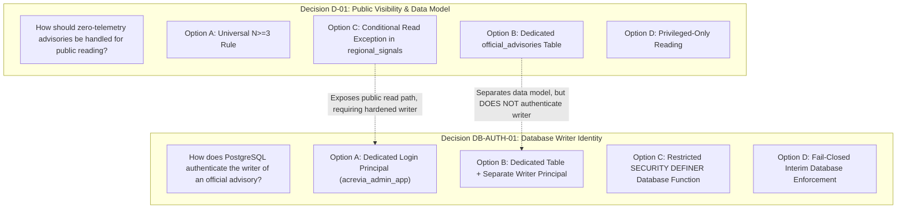
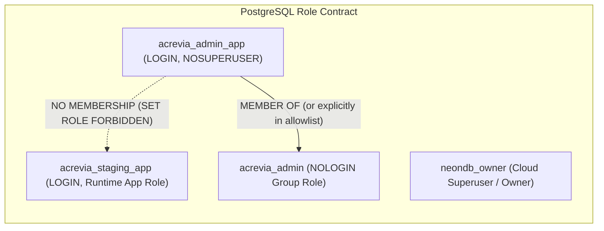
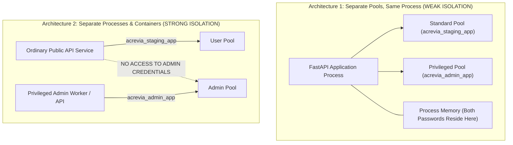
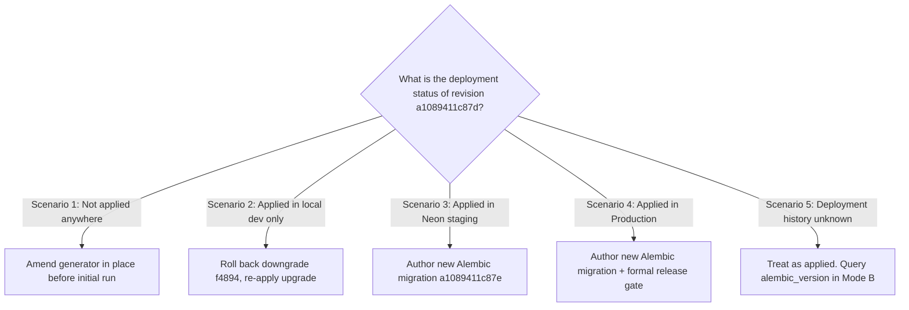

# ACREVIA — PHASE 07: TRUSTED DATABASE WRITER ARCHITECTURE DECISION RECORD (DB-AUTH-01)

**Programme:** ACREVIA — Agricultural Intelligence Platform  
**Target Geography:** Telangana, India  
**Target Phase:** Phase 07 — PostgreSQL RLS Tenant Isolation & Regional Aggregation Privacy  
**Document ID:** `ACR-DEC-P07-DB-AUTH-01`  
**Classification:** RESTRICTED — PILOT ARCHITECTURE & SECURITY DECISION RECORD  
**Execution Mode:** `MODE A ONLY` — Local Architecture Analysis, Threat Modeling & Offline Verification  
**Git Baseline:** `dbad296c6f19c4bbe8eb48fcd7a0e07441cfa408` on branch `main` (`https://github.com/gokul1599/ACREVIA`)  
**Methodology:** Everything Claude Code (ECC): `PLAN → TEST → IMPLEMENT ONLY IF DEFECT PROVEN → REVIEW → VERIFY → DOCUMENT`  
**Document Status:** `PROPOSED — PENDING PROJECT OWNER AUTHORIZATION`  
**Release Determination:** `PHASE 07 IS NOT RELEASED` | `MODE B = STRICTLY NOT AUTHORIZED`  

---

## 1. Purpose and Scope

This Decision Record defines the proposed architectural decision **`DB-AUTH-01` (Trusted Official-Advisory Database Writer Architecture)** for the ACREVIA Regional Pulse subsystem under Phase 07.

The purpose of this document is to evaluate how the ACREVIA platform can distinguish a legitimately authenticated administrative/official advisory writer from ordinary application SQL queries at the PostgreSQL Row-Level Security (RLS) boundary. It provides the Project Owner with a rigorous analysis of four technical architecture options, an adversarial 10-threat evaluation, connection and credential isolation mechanics, Alembic migration strategies, operational trade-offs, and an unselected decision record for formal authorization.

This document operates strictly under **MODE A ONLY**. No remote database connections, no cloud mutations, no role modifications, and no application source code or migration edits have been executed or approved.

---

## 2. Why D-01 and DB-AUTH-01 Are Separate Decisions

A critical architectural distinction must be established between product data visibility (`D-01`) and database actor identity authentication (`DB-AUTH-01`):



- **Decision D-01 (Product Data Visibility & Model):** Addresses how zero-telemetry official government advisories ($N = 0$) are presented to farmers relative to crowdsourced outbreak claims ($N \ge 3$). Specifically, D-01 Option B proposes creating a dedicated `official_advisories` table to cleanly isolate sovereign broadcasts from farm-level telemetry.
- **Decision DB-AUTH-01 (Database Actor Identity & Writer Trust):** Addresses how PostgreSQL physically authenticates the entity issuing SQL `INSERT` and `UPDATE` statements for official advisories.
- **The Decoupling Invariant:** Creating a dedicated table (`D-01 Option B`) modifies the schema and public read query surface, but **does not by itself establish a trusted database actor identity**. If the shared application database user (`acrevia_staging_app`) is granted DML on the new `official_advisories` table and authorization relies on mutable application session settings (`app.current_user_id` or `app.is_admin`), any SQL execution context under that shared user can spoof administrative identity. 

Therefore, **D-01 Option B is not a substitute for DB-AUTH-01**. They are orthogonal governance and engineering decisions that must be evaluated and decided independently.

---

## 3. Current Shared-Principal Architecture

In the current ACREVIA architecture (baseline commit `dbad296c6f19c4bbe8eb48fcd7a0e07441cfa408`):

1. **Shared Runtime Principal:** The FastAPI application establishes database connections using a single database user: `acrevia_staging_app`. All application actors (unauthenticated visitors, smallholder farmers, agronomists, researchers, and platform administrators) connect through connection pools utilizing this identical PostgreSQL login identity.
2. **PostgreSQL Session Context:**
   - `SESSION_USER`: Evaluates to `'acrevia_staging_app'`.
   - `CURRENT_USER`: Evaluates to `'acrevia_staging_app'`.
3. **Application Actor Representation:** The FastAPI application injects the end-user's authenticated identity into PostgreSQL custom session configuration parameters (GUCs) using `SET LOCAL`:
   ```sql
   SET LOCAL app.current_user_id = '<uuid>';
   SET LOCAL app.current_tenant_id = '<uuid>';
   SET LOCAL app.is_admin = 'true'; -- Only set for admin actors
   ```
4. **Physical Invariant:** At the PostgreSQL kernel layer, the database engine cannot distinguish whether a query was generated by an authentic administrative workflow or by an unprivileged agronomist workflow running across the same database connection.

---

## 4. RLS-WRITE-AUTH-01 Summary

Security audit finding `RLS-WRITE-AUTH-01` (`ACTIVE_ARCHITECTURAL_BLOCKER`) identifies a critical authorization gap in the existing Row-Level Security policy generator (`backend/app/database/rls.py`):

1. **Permissive `FOR ALL` Policy on `regional_signals`:**
   In `backend/app/database/rls.py` (lines 923-934), the write expression for `regional_signals` is defined as:
   ```sql
   write_expr = f"""(
       {ADMIN_BYPASS_SQL}
       OR (
           current_setting('app.current_user_id', true) != ''
           AND EXISTS (
               SELECT 1 FROM user_roles ur
               WHERE ur.user_id::text = current_setting('app.current_user_id', true)
               AND ur.role_id IN ('ADMIN', 'AGRICULTURAL_EXPERT', 'RESEARCHER')
           )
       )
   )"""
   ```
2. **Missing State & Authority Predicates:**
   The policy is compiled into a single permissive policy:
   ```sql
   CREATE POLICY regional_signals_author_write_policy ON regional_signals
       AS PERMISSIVE FOR ALL TO PUBLIC
       USING ({write_expr})
       WITH CHECK ({write_expr});
   ```
3. **The Defect:**
   - The write policy permits any user with role `AGRICULTURAL_EXPERT` or `RESEARCHER` to execute `INSERT` and `UPDATE` operations on `regional_signals`.
   - The policy contains **zero checks** on `confidence_tier` or `validation_status`.
   - Consequently, an agronomist or researcher connected via `acrevia_staging_app` can directly insert a signal with `confidence_tier = 'OFFICIAL_ADVISORY'` or promote an existing unverified signal to `validation_status = 'OFFICIAL_ALERT'` directly at the database SQL layer, completely bypassing FastAPI application-level RBAC checks.

---

## 5. Mutable-GUC Trust Limitations

ACREVIA currently uses custom PostgreSQL configuration parameters (`app.current_user_id`, `app.is_admin`) to bridge application-layer authentication into database-layer RLS policies. However, within PostgreSQL security architecture:

1. **GUCs Are Completely Mutable Within a Session:** Any client or code path capable of executing SQL under `acrevia_staging_app` can execute:
   ```sql
   SET LOCAL app.is_admin = 'true';
   SET LOCAL app.current_user_id = '<admin-user-uuid>';
   ```
2. **Database Cannot Authenticate GUC Origins:** PostgreSQL provides no cryptographic signature, HMAC, or capability token validating that a GUC value was set by trusted middleware rather than by an attacker exploiting an SQL injection vulnerability or connection leakage.
3. **SQL Injection Vulnerability Amplification:** If an SQL injection occurs in an unprivileged endpoint (e.g. farmer community post query), the attacker can execute `SET LOCAL app.is_admin = 'true'` within that transaction and gain full administrative write access across the database.
4. **Architectural Reality:** While `ADMIN_BYPASS_SQL` in `backend/app/database/rls.py` correctly requires both `SESSION_USER::text IN ('neondb_owner', 'acrevia_admin')` AND `app.is_admin = 'true'`, the ordinary write expression for non-admins does NOT require a privileged `SESSION_USER`. Therefore, mutable GUCs cannot be used to authenticate official-advisory authorship when running under the shared `acrevia_staging_app` role.

---

## 6. Four Architecture Choices

To establish a verified authorization boundary for official advisories, four architecture options are evaluated:

```mermaid
flowchart TD
    subgraph OptionA["Option A: Dedicated Login Principal"]
        A_App["Privileged FastAPI Pool / Service"] -->|"Connects as acrevia_admin_app"| A_DB[("PostgreSQL")]
        A_DB -->|"SESSION_USER = acrevia_admin_app"| A_RLS["Strict Table RLS"]
    end

    subgraph OptionB["Option B: Dedicated Table + Writer"]
        B_App["Privileged Pool / Service"] -->|"Connects as acrevia_admin_app"| B_DB[("official_advisories Table")]
        B_Shared["Standard App (acrevia_staging_app)"] -.->|"DML REVOKED / DENIED"| B_DB
    end

    subgraph OptionC["Option C: Restricted Function"]
        C_Shared["Standard App (acrevia_staging_app)"] -->|"CALL publish_advisory(signature, ...)"| C_Func["SECURITY DEFINER Function"]
        C_Func -->|"Cryptographic / Session Validation"| C_DB[("regional_signals")]
    end

    subgraph OptionD["Option D: Fail-Closed Interim"]
        D_Shared["Standard App (acrevia_staging_app)"] -->|"Attempt INSERT/UPDATE OFFICIAL"| D_DENY["RLS WITH CHECK (DENIED)"]
        D_Offline["Direct Admin / Offline Migration"] -->|"SESSION_USER IN ('acrevia_admin')"| D_ALLOW["Permitted"]
    end
```



### Option A — Dedicated PostgreSQL Login with Narrowly Scoped Writer Privileges

Provision an independent PostgreSQL login role (candidate identifier: `acrevia_admin_app`) dedicated exclusively to administrative and official advisory writes.

- **Role Attributes:** `LOGIN`, `NOSUPERUSER`, `NOBYPASSRLS`, `NOCREATEDB`, `NOCREATEROLE`, `NOREPLICATION`, `PASSWORD '<cryptographically-secure-secret>'`.
- **Privilege Grants:**
  - `GRANT CONNECT ON DATABASE acrevia TO acrevia_admin_app;`
  - `GRANT USAGE ON SCHEMA public TO acrevia_admin_app;`
  - `GRANT SELECT, INSERT, UPDATE ON TABLE regional_signals TO acrevia_admin_app;`
  - `GRANT SELECT, INSERT, UPDATE ON TABLE regional_signal_evidences TO acrevia_admin_app;`
  - `GRANT SELECT, INSERT ON TABLE audit_logs TO acrevia_admin_app;`
  - `REVOKE ALL ON ALL TABLES IN SCHEMA public FROM acrevia_admin_app;` (Baseline, then grant least privilege).
  - Explicitly: `NO DELETE`, `NO TRUNCATE`, `NO REFERENCES`.
- **Isolation Boundary:**
  - `acrevia_staging_app` is NOT granted membership in `acrevia_admin_app` or `acrevia_admin`.
  - `acrevia_staging_app` cannot execute `SET ROLE acrevia_admin_app`.
- **RLS Policy Predicate:** Official advisory writes require `SESSION_USER::text = 'acrevia_admin_app'` and `CURRENT_USER::text = 'acrevia_admin_app'`.

### Option B — Dedicated `official_advisories` Table Plus a Trusted Writer

Combine a dedicated database table for official government notices with a separate trusted database writer principal.

- **Data Model:** Clean separation of crowdsourced regional signals from sovereign advisories.
  ```sql
  CREATE TABLE official_advisories (
      id UUID PRIMARY KEY DEFAULT gen_random_uuid(),
      alert_identifier VARCHAR(100) NOT NULL UNIQUE,
      issuing_authority VARCHAR(255) NOT NULL,
      jurisdiction_state VARCHAR(50) NOT NULL DEFAULT 'Telangana',
      jurisdiction_district VARCHAR(100),
      severity VARCHAR(50) NOT NULL,
      title VARCHAR(255) NOT NULL,
      advisory_text TEXT NOT NULL,
      official_source_url TEXT NOT NULL,
      gazette_reference VARCHAR(100),
      published_at TIMESTAMPTZ NOT NULL DEFAULT clock_timestamp(),
      is_active BOOLEAN NOT NULL DEFAULT true
  );
  ```
- **Public Read Access:**
  ```sql
  ALTER TABLE official_advisories ENABLE ROW LEVEL SECURITY;
  ALTER TABLE official_advisories FORCE ROW LEVEL SECURITY;
  CREATE POLICY official_advisories_public_read ON official_advisories
      FOR SELECT TO PUBLIC USING (is_active = true);
  ```
- **Write Access:**
  - DML (`INSERT, UPDATE, DELETE`) is **revoked** from `PUBLIC` and `acrevia_staging_app`.
  - DML is granted **only** to `acrevia_admin_app` or `acrevia_admin`.

### Option C — Restricted Database Function (`SECURITY DEFINER`)

Expose a restricted stored function in PostgreSQL that encapsulates official advisory publication, executing with elevated privileges while running under the shared application user.

- **Function Signature:**
  ```sql
  CREATE OR REPLACE FUNCTION publish_official_advisory(
      p_signal_id UUID,
      p_title TEXT,
      p_authority TEXT,
      p_auth_token TEXT
  ) RETURNS VOID
  LANGUAGE plpgsql
  SECURITY DEFINER
  SET search_path = pg_catalog, public
  AS $$
  BEGIN
      -- Physical verification must authenticate caller beyond mutable GUCs
      IF NOT verify_advisory_authorization(p_auth_token, current_setting('app.current_user_id', true)) THEN
          RAISE EXCEPTION 'Unauthorized advisory publication attempt' USING ERRCODE = '42501';
      END IF;
      -- Perform validated state mutation
      ...
  END;
  $$;
  ```
- **Critical Limitation:** If the function relies solely on parameters like `p_is_admin BOOLEAN` or mutable session GUCs, it does not constitute a valid security boundary. It must perform cryptographic token validation or signature verification within PostgreSQL. Direct DML on `regional_signals` must be revoked from `acrevia_staging_app`.

### Option D — Fail-Closed Interim Design (Recommended for MODE A Pilot)

Enforce fail-closed database authorization in `regional_signals_author_write_policy` immediately, prohibiting any ordinary application connection from creating or promoting official advisories.

- **Policy Logic:**
  - The ordinary application role (`acrevia_staging_app`) can only write records where:
    ```sql
    confidence_tier != 'OFFICIAL_ADVISORY' 
    AND validation_status != 'OFFICIAL_ALERT'
    ```
  - Any attempt by `acrevia_staging_app` to write an official advisory is rejected with an RLS check violation (`42501`).
  - Writes to official advisory records are restricted exclusively to `ADMIN_BYPASS_SQL` (`neondb_owner`, `acrevia_admin`), requiring an authenticated database administrative login.
- **Operational Reality:** In Pilot, official government alerts are published through offline database seeding, administrative migration scripts, or direct database administration using the owner principal. No new application connection pools or roles need to be deployed to live cloud infrastructure prior to Pilot.

---

## 7. Threat-Model Comparison Matrix

The table below evaluates the 10 threat scenarios specified in the ACREVIA threat model:

| Threat Scenario | Current Architecture (Defect) | Option A (Dedicated Login) | Option B (Table + Writer) | Option C (Restricted Function) | Option D (Fail-Closed Interim) |
| :--- | :--- | :--- | :--- | :--- | :--- |
| **1. Authenticated FARMER API User** | Blocked at API layer; blocked by RLS role check | Blocked at API and RLS layer | Blocked at API and table grant layer | Blocked by API and function token check | Blocked at API and RLS layer |
| **2. Authenticated AGRICULTURAL_EXPERT** | **EXPLOITABLE:** Can write official advisory via SQL | Blocked: Lacks `acrevia_admin_app` login | Blocked: DML revoked from shared app role | Blocked: Function verifies signature | Blocked: RLS check rejects official state |
| **3. Authenticated RESEARCHER** | **EXPLOITABLE:** Can write official advisory via SQL | Blocked: Lacks `acrevia_admin_app` login | Blocked: DML revoked from shared app role | Blocked: Function verifies signature | Blocked: RLS check rejects official state |
| **4. Application ADMIN via FastAPI** | Permitted via GUC `app.is_admin=true` | Permitted via dedicated admin pool/service | Permitted via dedicated admin pool/service | Permitted via verified function execution | Blocked at app pool; must use admin login |
| **5. SQL Injection via `acrevia_staging_app`** | **CRITICAL:** Attacker can spoof GUC and publish false state alert | **PROTECTED:** `acrevia_staging_app` lacks write grant on official state | **PROTECTED:** `acrevia_staging_app` has no DML on advisories table | **PARTIAL:** Attacker cannot forge cryptographic token | **PROTECTED:** Kernel RLS rejects official state |
| **6. Direct SQL via `acrevia_staging_app`** | **CRITICAL:** Can alter any regional signal to official status | **PROTECTED:** RLS requires `SESSION_USER = 'acrevia_admin_app'` | **PROTECTED:** DML strictly revoked from `acrevia_staging_app` | **PROTECTED:** Cannot execute direct DML on underlying table | **PROTECTED:** RLS rejects official state |
| **7. Compromise of Ordinary FastAPI Process** | **CRITICAL:** Full database compromise via GUC spoofing | **PROCESS-DEPENDENT:** Vulnerable if dual pools in 1 process; Protected if separate process | **PROCESS-DEPENDENT:** Vulnerable if credentials co-located; Protected if separate process | **PARTIAL:** Function secrets in process memory may be dumped | **PROTECTED:** App process possesses no admin credentials |
| **8. Compromise of Privileged Writer Process** | N/A (No separate writer process exists) | Compromised process can write official advisories; cannot drop tables | Compromised process can write advisories; cannot alter farm telemetry | N/A | N/A (No writer process exists in Pilot) |
| **9. Compromise of Privileged Credential** | N/A | Attacker can write official advisories; constrained by least-privilege grants | Attacker can write official advisories; cannot read or tamper farm data | Attacker can execute function | N/A (No app credential exists) |
| **10. Cloud DB Superuser / Neon Owner** | Unrestricted access (Root trust) | Unrestricted access (Root trust) | Unrestricted access (Root trust) | Unrestricted access (Root trust) | Unrestricted access (Root trust) |

---

## 8. Required PostgreSQL Role Contract

### Source Allowlist Mismatch Reconciliation
In `backend/app/database/rls.py`, the existing `ADMIN_BYPASS_SQL` is strictly defined as:
```python
ADMIN_ROLES = ("neondb_owner", "acrevia_admin")
ADMIN_BYPASS_SQL = (
    "(SESSION_USER::text IN ('neondb_owner', 'acrevia_admin') "
    "AND CURRENT_USER::text IN ('neondb_owner', 'acrevia_admin') "
    "AND current_setting('app.is_admin', true) = 'true')"
)
```

Notice:
1. The candidate role name `acrevia_admin_app` does **NOT** exist in `ADMIN_ROLES` or anywhere in the codebase or migration scripts (`LOCAL_SOURCE_VERIFIED`).
2. Simply provisioning a database login named `acrevia_admin_app` on live PostgreSQL will **NOT** automatically grant it administrative write authority under existing RLS policies.
3. Therefore, if Option A or Option B is implemented, the PostgreSQL role contract must be formally defined as follows:



### Exact Contract Requirements:
1. **Writer Login Principal:** `acrevia_admin_app` (or future GA designated name).
   - `CREATE ROLE acrevia_admin_app WITH LOGIN PASSWORD '...' NOSUPERUSER NOBYPASSRLS NOCREATEDB NOCREATEROLE NOREPLICATION;`
2. **Role Membership Option 1 (Explicit Policy Allowlist - Recommended):**
   - Update `ADMIN_ROLES` in `rls.py` to: `("neondb_owner", "acrevia_admin", "acrevia_admin_app")`.
   - Update `ADMIN_BYPASS_SQL` to include `'acrevia_admin_app'`.
3. **Role Membership Option 2 (Role Inheritance):**
   - If `acrevia_admin_app` is granted membership in `acrevia_admin`:
     `GRANT acrevia_admin TO acrevia_admin_app;`
   - Notice that PostgreSQL RLS policies checking `SESSION_USER::text IN ('acrevia_admin')` evaluate to `FALSE` if `SESSION_USER` is `acrevia_admin_app` unless the role executes `SET ROLE acrevia_admin;` (which alters `CURRENT_USER`).
   - Because `ADMIN_BYPASS_SQL` checks `SESSION_USER`, role inheritance alone does NOT satisfy `SESSION_USER::text IN ('acrevia_admin')`. The login role name must be explicitly in the allowlist!
4. **Strict Isolation from Ordinary App:**
   - Under no circumstances shall `acrevia_staging_app` be granted membership in `acrevia_admin`, `acrevia_admin_app`, or `neondb_owner`.
   - `REVOKE acrevia_admin FROM acrevia_staging_app;` (Defensive verification).

---

## 9. Connection and Credential Isolation Model

A critical architectural analysis must distinguish between **Separate Connection Pool** vs. **Separate Application Process**:



### Architectural Analysis:
1. **Separate Pools Within the Same Process (Architecture 1):**
   - *Design:* FastAPI instantiates `engine_standard` (using `acrevia_staging_app`) and `engine_admin` (using `acrevia_admin_app`).
   - *Strength:* Prevents accidental cross-tenant SQL execution and mitigates second-order SQL injection where injected SQL cannot escape its connection session.
   - *Vulnerability:* **Does not survive process compromise.** If an attacker achieves Remote Code Execution (RCE), arbitrary file read (e.g. `/proc/self/environ`), or native memory dumps in the FastAPI container, both database credentials are exposed.
2. **Separate Containerized Admin Service (Architecture 2):**
   - *Design:* The ordinary FastAPI service has zero access to `acrevia_admin_app` credentials. Official advisory publication is handled by an isolated, internal administrative service (`acrevia-admin-service`) running in a separate network security zone.
   - *Strength:* True defense-in-depth. Compromise of the public web application cannot compromise the official advisory database writer principal.

---

## 10. Migration and Deployment Implications

### Local Source Inspection:
In `backend/app/database/migrations/versions/a1089411c87d_enable_postgresql_rls_tenant_isolation.py`:
- The migration dynamically imports `generate_rls_ddl` from `backend.app.database.rls`.
- When `upgrade()` runs, it iterates through all 132 tables and executes the dynamically compiled DDL statements.

### The Alembic Execution Principle:
- **Changing Python code does not update live databases:** Modifying `generate_rls_ddl()` in `rls.py` only alters what future invocations of `upgrade()` produce.
- **Already-applied migrations do not rerun:** If an environment's `alembic_version` table contains `a1089411c87d`, executing `alembic upgrade head` is a no-op; Alembic will not rerun `a1089411c87d`.

### Five-Scenario Migration Decision Tree:



1. **Scenario 1 — Revision Not Applied in Any Environment:**
   If `a1089411c87d` has never been executed against any real PostgreSQL database, editing `generate_rls_ddl()` in `rls.py` prior to the first migration run is technically sound and avoids migration chain bloat.
2. **Scenario 2 — Revision Applied in Local Development Only:**
   The developer can downgrade (`alembic downgrade f4894a11c87d`) and re-upgrade after updating `rls.py`.
3. **Scenario 3 — Revision Applied in Staging (Neon Branch):**
   Amending `a1089411c87d` will cause schema drift between repository code and the live database. A **new Alembic revision** (e.g. `a1089411c87e_harden_regional_signals_writer_policy.py`) must be generated containing explicit `DROP POLICY` and `CREATE POLICY` statements.
4. **Scenario 4 — Revision Applied in Production:**
   Strictly requires a forward migration (`a1089411c87e`) with forward and rollback (`downgrade()`) testing, audited under Change Management.
5. **Scenario 5 — Deployment History Unknown (Current Safe Stance):**
   Under `MODE A ONLY`, live database catalog state cannot be inspected. The engineering team must safely assume the migration may have run on staging and prepare a subsequent migration script when authorized.

---

## 11. Required Testing and Proof

The 3 offline adversarial tests added to `backend/tests/test_worker_security_and_privacy.py` verify the mathematical and structural logic of the policies offline:

| Adversarial Test Function | Target Vulnerability Condition | Assertion Mechanism | Classification | Live PostgreSQL Proof Required? |
| :--- | :--- | :--- | :--- | :--- |
| `test_adversarial_guc_spoofing_and_actor_identity_isolation` | GUC manipulation via `SET LOCAL app.is_admin='true'` or `app.current_user_id` | Verifies `ADMIN_BYPASS_SQL` includes dual `SESSION_USER` and `CURRENT_USER` checks | `OFFLINE_DDL_VERIFICATION` | **YES** (Must prove PostgreSQL kernel blocks bypass under unprivileged connection) |
| `test_adversarial_state_transitions_and_permissive_policy_composition` | Agronomist or Researcher inserting `OFFICIAL_ADVISORY` via `regional_signals_author_write_policy` | Analyzes DDL AST/regex to verify absence of state checks in current code | `STATIC_POLICY_ANALYSIS` | **YES** (Must prove PostgreSQL rejects DML when hardened policy is applied) |
| `test_adversarial_database_principal_identity_and_role_membership` | Verifies `acrevia_admin_app` role contract and allowlist containment | Verifies `ADMIN_ROLES` membership and absence of `SET ROLE` grants | `OFFLINE_DDL_VERIFICATION` | **YES** (Must verify `pg_roles` and `pg_auth_members` catalog configuration) |

**Evidentiary Distinction:** Local unit tests prove DDL string syntax and simulated Python logic. They **do not prove** PostgreSQL kernel-level enforcement. Physical enforcement can only be certified in `MODE B` on real PostgreSQL infrastructure.

---

## 12. Operational Ownership

| Responsibility | Responsible Role | Operational Cadence |
| :--- | :--- | :--- |
| **Credential Generation & Vault Storage** | Platform Security Lead | At provisioning & 90-day rotation |
| **PostgreSQL Role & Grant Provisioning** | Database Administrator | During Migration Execution (`MODE B`) |
| **Connection Pool Lifecycle Management** | Backend Platform Lead | Continuous (FastAPI startup/shutdown) |
| **Official Advisory Publication Audit** | Compliance / Agronomy Director | Daily review of `audit_logs` |
| **Incident Response (Advisory Spoofing)** | Security Incident Response Team | Immediate (< 15 min response time) |

---

## 13. Costs and Complexity

- **Option A (Dedicated Login):** Low database cost; moderate infrastructure complexity (requires dual connection pools or microservice deployment, secret management in AWS Secrets Manager / Vault).
- **Option B (Dedicated Table + Writer):** Moderate engineering cost (new ORM model, API endpoint, migration, and frontend integration); highest data-model clarity.
- **Option C (Restricted Database Function):** High database procedural complexity; difficult to debug; requires cryptographic verification inside PostgreSQL.
- **Option D (Fail-Closed Interim):** Zero infrastructure cost; zero new credentials; lowest complexity for Pilot.

---

## 14. Residual Risks

If Option D (Fail-Closed Interim) is adopted for Pilot:
- `RES-PULSE-01`: Smallholder data privacy is preserved, but emergency official advisories cannot be submitted via API.
- `RES-PULSE-02`: Public GET responses omit official advisories unless seeded directly by database administrators.
- `RES-PRIMARY-ROUTING-01`: Primary connection load during administrative writes must be monitored.
- `RES-REPLICA-LAG-01`: Read replica replication latency for seeded advisories must remain $< 100$ ms.

---

## 15. Fail-Closed Interim Option (Recommended Sequence)

Prior to live staging execution (`MODE B`), the recommended path is:
1. Retain **Option D (Fail-Closed)** for the immediate Pilot preflight.
2. Ensure the RLS generator is hardened so that ordinary application connections cannot write official advisories.
3. Postpone provisioning new live database login roles (`acrevia_admin_app`) until Gate 02 and Gate 03 are authorized by the Project Owner.

---

## 16. Blank Owner Decision Fields

*(To be completed solely by the Project Owner. Engineering personnel must not preselect or populate these fields.)*

```text
================================================================================
PROJECT OWNER ARCHITECTURE SELECTION: DB-AUTH-01
================================================================================

Selected Architecture Option:
[ ] Option A — Dedicated PostgreSQL Login Principal (acrevia_admin_app)
[ ] Option B — Dedicated official_advisories Table Plus Trusted Writer
[ ] Option C — Restricted SECURITY DEFINER Database Function
[ ] Option D — Fail-Closed Interim Database Enforcement (Pilot Default)
[ ] REJECT ALL — Require Alternative Architectural Proposal

Deployment Model Selection (if Option A or B selected):
[ ] Model 1: In-Process Dual Connection Pool (FastAPI)
[ ] Model 2: Out-of-Process Privileged Administrative Service / Worker

Migration Strategy Selection:
[ ] Amend Generator in-place prior to first execution (Scenario 1)
[ ] Author New Alembic Revision a1089411c87e (Scenario 3/4)

Special Conditions / Owner Stipulations:
________________________________________________________________________________
________________________________________________________________________________
________________________________________________________________________________
```

---

## 17. Explicit Signature and Date Fields

*(Must remain blank until formal execution by the Project Owner.)*

```text
================================================================================
PROJECT OWNER AUTHORIZATION & SIGN-OFF
================================================================================

Project Owner Name:      _______________________________________________________

Project Owner Signature: _______________________________________________________

Date of Authorization:   ____________________ (YYYY-MM-DD)

Cryptographic Token / 
Authorization Reference: _______________________________________________________
```

---

## 18. Implementation Prerequisites

Prior to implementing the selected architecture:
1. Formal Project Owner signature on this decision record (`DB-AUTH-01`).
2. Formal Project Owner approval of Decision Gate 02 (Role Readiness) in [`PHASE_07_OWNER_AUTHORIZATION_AND_EXECUTION_REGISTER.md`](file:///c:/Users/gokul/OneDrive/Documents/projects/docs/pilot/security/PHASE_07_OWNER_AUTHORIZATION_AND_EXECUTION_REGISTER.md).
3. Resolution of allowlist naming mismatch in `backend/app/database/rls.py`.
4. Staging database environment inspection under controlled `MODE B` authorization.

---

## 19. Rollback Prerequisites

If an implemented architecture fails validation in `MODE B`:
1. Automated Alembic downgrade script tested offline.
2. Immediate revocation of newly provisioned database credentials.
3. Reversion to universal $N \ge 3$ fail-closed policy.
4. Retention of audit log entries for forensic analysis.

---

## 20. Clear Statement of Non-Approval

$$\mathbf{CRITICAL\ GOVERNANCE\ NOTICE:}$$
$$\mathbf{NO\ DATABASE\ IDENTITY\ ARCHITECTURE\ HAS\ BEEN\ APPROVED.}$$
$$\mathbf{DECISION\ DB-AUTH-01\ REMAINS\ PROPOSED\ AND\ PENDING\ OWNER\ SIGN-OFF.}$$
$$\mathbf{DECISIONS\ D-01,\ D-02,\ AND\ D-03\ REMAIN\ PENDING\ OWNER\ SIGN-OFF.}$$
$$\mathbf{GATES\ 02,\ 03,\ 04,\ AND\ 05\ REMAIN\ UNCHECKED\ AND\ NOT\ AUTHORIZED.}$$
$$\mathbf{PHASE\ 07\ IS\ NOT\ RELEASED.\ MODE\ B\ IS\ STRICTLY\ NOT\ AUTHORIZED.}$$

---

## 21. Addendum (2026-11-15): Option D Policy Contract Specification, Downgrade Hazard & Capability Analysis

### 21.1 Dual Old-Row (USING) and New-Row (WITH CHECK) Protection
- A naive check on resulting rows (`WITH CHECK (confidence_tier != 'OFFICIAL_ADVISORY')`) is incomplete. It prevents inserting new official advisories but fails to prevent targeting existing official advisories for unauthorized demotion (e.g. `UPDATE regional_signals SET confidence_tier = 'COMMUNITY_UNVERIFIED'`).
- A sound Option D contract requires **both**:
  1. `USING (confidence_tier IS DISTINCT FROM 'OFFICIAL_ADVISORY' AND validation_status IS DISTINCT FROM 'OFFICIAL_ALERT')`: Prevents targeting existing official rows.
  2. `WITH CHECK (confidence_tier IS DISTINCT FROM 'OFFICIAL_ADVISORY' AND validation_status IS DISTINCT FROM 'OFFICIAL_ALERT')`: Prevents creating or promoting rows to official status.

### 21.2 Command-Specific Policy Separation & Permissive OR Dynamics
- The current broad `FOR ALL` policy mixes `SELECT`, `INSERT`, `UPDATE`, and `DELETE`.
- In PostgreSQL, multiple `PERMISSIVE` policies combine with boolean `OR`. The broad author policy inadvertently provides an `OR` path that bypasses read privacy thresholds and grants delete authority if grants exist.
- Option D must replace `FOR ALL` with distinct command-specific policies (`FOR INSERT`, `FOR UPDATE`, `FOR DELETE`, and `FOR SELECT`), explicitly dropping the legacy policy.

### 21.3 Qualification of SQL-Injection Protection
- Option D protection is strictly qualified as:
  `FAIL_CLOSED_FOR_ORDINARY_SHARED_PRINCIPAL — SUBJECT TO POLICY, GRANT, MEMBERSHIP AND INDIRECT-WRITE VERIFICATION`.
- It does not protect against application-process compromise, cloud superuser compromise, or direct database administration errors.

### 21.4 Option C Cryptographic Capability Determination
- Option C is classified as **`NOT_IMPLEMENTABLE_WITH_CURRENT_SOURCE_ARCHITECTURE`** due to the absence of verified native asymmetric signature verification extensions (such as `pg_sodium` or `pgcrypto`) in the target database, and the vulnerability of symmetric HMAC secrets to process-memory inspection.

### 21.5 Migration Downgrade Hazard & Forward Migration Mandate
- In migration `a1089411c87d`, `downgrade()` executes `ALTER TABLE ... DISABLE ROW LEVEL SECURITY` across all 132 tables.
- Running `alembic downgrade` in any environment containing tenant data completely destroys tenant isolation. Remediation must strictly proceed via forward migration (`a1089411c87e`).

### 21.6 Adversarial Test Semantics & Test Count Verification
- `test_adversarial_state_transitions_and_permissive_policy_composition` is a **vulnerability-presence detector**, confirming the defect's presence in current DDL rather than verifying remediation.
- Exactly **171 tests** are collected across 5 test files (`test_orm_rls_alignment.py` [12], `test_postgresql_rls.py` [28], `test_rls_offline_ddl.py` [9], `test_rls_policy_semantics.py` [14], and `test_worker_security_and_privacy.py` [108]).


---

## 2026-11-15 Addendum — Read-Privacy Preservation, Effective-Policy Composition & Evidence-Association Security Completeness

**Evaluation Date:** 2026-11-15T18:35:19+05:30  
**Audit Context:** Option D Effective-Policy Composition, Read-Privacy Preservation & Evidence-Association Security Completeness Audit  
**Operating Mode:** Strict `MODE A ONLY` (Local source inspection, security analysis, zero database mutations)  
**Baseline Git Commit:** `dbad296c6f19c4bbe8eb48fcd7a0e07441cfa408` (`main`)  

### 1. Active Read-Privacy Blocker Recorded: `RES-PULSE-READ-01`
- **Root Cause:** In PostgreSQL, multiple `PERMISSIVE` policies combine via Boolean `OR`. On `regional_signals`, `regional_signals_author_write_policy` is an `AS PERMISSIVE FOR ALL` policy. For `SELECT` queries, its role subquery evaluates to `TRUE` for any session where `app.current_user_id` matches an `ADMIN`, `AGRICULTURAL_EXPERT`, or `RESEARCHER` role.
- **Privacy Impact:** This author policy completely short-circuits the public read threshold (`distinct_farms_count >= 3 AND validation_status != 'SUSPENDED'`), allowing actors with those roles to read sub-threshold outbreak claims ($N < 3$) and suspended signals across all Telangana districts without tenant, geographic, or author scoping.
- **Mutable-GUC Vulnerability:** Because `app.current_user_id` is an unauthenticated, mutable session GUC set on the shared application database principal (`acrevia_staging_app`), any direct SQL session or SQL injection can execute `SET LOCAL app.current_user_id = '<expert-uuid>'` to satisfy `user_roles` RLS and read all private sub-threshold farmer telemetry.
- **Formal Status:** Recorded as a distinct architectural blocker: `RES-PULSE-READ-01 — Role-Global Sub-Threshold & Suspended Signal Read-Privacy Exposure`.

### 2. SQLAlchemy ORM and FastAPI Workflow Dependencies
Naive replacement of the `FOR ALL` policy with a public-only `SELECT` policy breaks legitimate application workflows:
- **`recover_suppressed_signal`:** Uses `select(RegionalSignal).where(id == signal_id).with_for_update()`. In PostgreSQL, `SELECT ... FOR UPDATE` evaluates `SELECT` RLS policies. If the signal is currently suppressed or sub-threshold, the public `SELECT` policy excludes it, causing the query to return `None` and the recovery endpoint to fail with HTTP 404.
- **`aggregate_regional_signal`:** The endpoint executes `db.refresh(signal)` immediately after `db.commit()`. If an expert creates a signal starting below threshold ($N < 3$) or creates a zero-telemetry advisory, `db.refresh()` executes `SELECT ... WHERE id = :id`. Because the row is excluded by public read RLS, SQLAlchemy raises `ObjectDeletedError`, rolling back the transaction with HTTP 500.
- **Resolution:** The complete Option D specification incorporates an internal administrative `SELECT` policy branch to preserve internal workflow execution while maintaining public privacy.

### 3. Child Evidence Table & Parent Promotion Integrity
- **Child Policy Contract:** `regional_signal_evidences` requires command-specific policies for `INSERT` (validating parent is non-official via `EXISTS`), `UPDATE` (validating both old and new parents are non-official), and `DELETE` (fail-closed defense-in-depth).
- **Parent Promotion Protocol:** When an ordinary signal is promoted to `OFFICIAL_ADVISORY` by a trusted writer, previously attached community evidence must be atomically revalidated to ensure that unverified evidence is never associated with official state advisories.
- **Concurrency Serialization:** All state-modifying operations on signals and evidences must acquire an explicit row-level lock on the parent signal (`SELECT ... FOR UPDATE`) to prevent race conditions between promotion and evidence insertion.

### 4. NULL & NOT NULL Contract Reconciled
- Verified in `backend/app/models/regional_pulse.py` and migration `d2894a11c87d` (`Base.metadata.create_all`): `confidence_tier`, `validation_status`, and `distinct_farms_count` have `nullable=False` / `NOT NULL` constraints.
- To prevent three-valued logic bypasses where `col IS DISTINCT FROM 'OFFICIAL_ADVISORY'` returns `TRUE` for `NULL`, Option D adopts Contract C (explicit `IS NOT NULL` checks in RLS) combined with Contract A (verified NOT NULL constraints).

### 5. Test Suite Verification
- Clean pytest collection verified: **171 tests collected** across 5 test suites.
- Historical execution baseline verified: **171 tests passed** in 23.47s.
- `test_adversarial_state_transitions_and_permissive_policy_composition` confirmed as a **vulnerability detector**.

### 6. Final Governance Status
- Phase 07: `NOT RELEASED`.
- Mode B: `STRICTLY NOT AUTHORIZED`.
- Active Blockers: `OWNER-AUTH-01`, `DB-RLS-01`, `RLS-WRITE-AUTH-01`, `RES-PULSE-READ-01`, `WRK-DISP-01`, `RES-PULSE-01`, `RES-PULSE-02`, `GATE01-PROV-01`.
- Owner Decisions D-01, D-02, D-03, and DB-AUTH-01: `PENDING_PROJECT_OWNER_AUTHORIZATION`.


---

## 2026-11-15 Addendum — Global Actor-GUC Trust Boundary, Role Assignment Escalation & Canonical Governance Restoration

**Evaluation Date:** 2026-11-15T19:30:36+05:30  
**Audit Context:** Global Actor-GUC Trust Boundary, User-Role Privilege Escalation & Global RLS Identity Assurance Audit  
**Operating Mode:** Strict `MODE A ONLY` (Local source inspection, security analysis, zero database mutations)  
**Baseline Git Commit:** `dbad296c6f19c4bbe8eb48fcd7a0e07441cfa408` (`main`)  

### 1. Critical Blocker Recorded: `RLS-ROLE-ASSIGNMENT-01`
- **Root Cause:** In `backend/app/database/rls.py`, `user_roles` is categorized as `TableCategory.USER_OWNED`, generating a restrictive policy that permits writes when `user_id::text = current_setting('app.current_user_id', true)`. Simultaneously, `acrevia_staging_app` receives full SQL table grants (`GRANT SELECT, INSERT, UPDATE, DELETE ON TABLE user_roles`).
- **Privilege Escalation:** Any session or component executing SQL under `acrevia_staging_app` can set `SET LOCAL app.current_user_id = '<user_uuid>'` and insert `('<user_uuid>', 'ADMIN')` into `user_roles`. PostgreSQL permits the insert because the user owns the inserted record. When the user logs in, FastAPI's `get_current_user` elevates them to platform administrator.
- **Administrator Demotion:** An attacker can delete administrator role rows by spoofing the administrator's UUID in `app.current_user_id`.
- **Classification:** Formally proven from local policy structure as an active architectural blocker: `RLS-ROLE-ASSIGNMENT-01 — Mutable-GUC Role Assignment Privilege Escalation`.
- **Immediate Containment:** Revoke `INSERT, UPDATE, DELETE ON TABLE user_roles FROM acrevia_staging_app;` via forward migration `a1089411c87e`.

### 2. Global Actor & Tenant GUC Impersonation Surfaces
- **Actor-GUC Surface:** All 13 `USER_OWNED` tables (including `users`, `session_tokens`, `consent_records`, `api_applications`) evaluate `user_id = current_setting('app.current_user_id', true)` with full DML grants for `acrevia_staging_app`.
- **Tenant-GUC Surface:** All 25 `TENANT_DIRECT` and 53 `TENANT_INDIRECT` tables enforce tenant isolation exclusively against `current_setting('app.current_tenant_id', true)`. Database RLS policies perform zero independent verification of user membership in the tenant; that check exists solely at the FastAPI application layer.

### 3. Canonical Governance Register Restored
Authoritative definitions are restored across all governance dossiers:
- **D-01:** Official Advisory Visibility & Data Model Choice (Universal N>=3, Dedicated table, Conditional exception, Privileged-only).
- **D-02:** Government-Source Authenticity & Pilot Terminology (`"Platform Administrator Broadcast — Not Verified Government Gazette"`).
- **D-03:** Independent Agronomic Peer-Review Workflow (Single-expert vs Dual-expert verification gate).
- **DB-AUTH-01:** Database Writer Identity Architecture (Dual-principal, Stored function gateway, Fail-closed application role; direct superuser bypass rejected).
- **Residual Risks:** `RES-PULSE-01` (Role-global evidence access), `RES-PULSE-02` (Read Committed snapshot window), `RES-PRIMARY-ROUTING-01` (Primary routing dependency), `RES-REPLICA-LAG-01` (Replica lag), `RES-FREE-TEXT-01` (PII in free text).

### 4. Active Blockers Summary
- `RLS-ROLE-ASSIGNMENT-01`: Active Critical Architectural Blocker.
- `RLS-WRITE-AUTH-01`: Active High Architectural Blocker.
- `RES-PULSE-READ-01`: Active High Architectural Blocker.
- `OWNER-AUTH-01`: Governance Blocker (Decisions D-01, D-02, D-03, DB-AUTH-01 pending).
- `WRK-DISP-01`: Active Worker Identity Architectural Blocker.
- `DB-RLS-01`: Infrastructure Blocker (Live PostgreSQL required).
- `GATE01-PROV-01`: Release Gate Blocker.
- **Phase 07 Status:** `NOT RELEASED`. Mode B: `STRICTLY NOT AUTHORIZED`.
