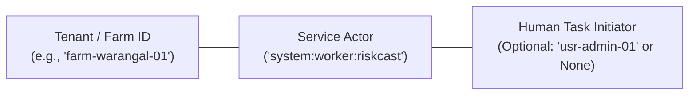

# ACREVIA — PHASE 07: RISKCAST WORKER DISPATCH TRUST BOUNDARY & IDENTITY AUDIT

**Programme:** ACREVIA — Agricultural Intelligence Platform  
**Target Geography:** Telangana, India  
**Phase:** Phase 07 — PostgreSQL RLS Tenant Isolation  
**Document ID:** `ACR-SEC-P07-WRK-DISPATCH-AUDIT`  
**Classification:** RESTRICTED — PILOT SECURITY AUDIT  
**Operating Mode:** **`MODE A ONLY`** (Local Source Engineering & Offline Testing)  
**Audit Determination:** **`RESOLVED_LOCALLY_AND_TESTED_WITH_RECORDED_BLOCKERS`**  
- `FAIL_CLOSED_PRODUCTION_DISPATCH`: **`RESOLVED_LOCALLY_AND_TESTED`** (`ProductionDispatchBlockedError: DISPATCH_NOT_CONFIGURED`)  
- `UNSCOPED_FALLBACK_QUERY_ELIMINATION`: **`RESOLVED_LOCALLY_AND_TESTED`** (`SELECT id FROM farms` completely removed)  
- `INTERNAL_FUNCTION_AUTHORIZATION_GUARD`: **`RESOLVED_LOCALLY_AND_TESTED`** (`evaluate_single_farm` fails closed before context creation)  
- `FUTURE_DISPATCHER_INTERFACE_CONTRACT`: **`DOCUMENTED_MINIMUM_SPECIFICATION`** (9 dimensions defined)  
- `EXTERNAL_PRODUCTION_SCHEDULER`: **`ACTIVE_INTEGRATION_BLOCKER`** (External message broker / scheduler pending deployment)  
**Associated Baseline Tests:** `backend/tests/test_worker_security_and_privacy.py` (26 passing tests)  

---

## 1. Executive Summary & Core Engineering Principle

> [!IMPORTANT]
> **A validated UUID is not an authorization decision.**  
> While `backend/app/tasks/run_riskcast_batch.py` validates that every input element is a well-formed UUID and deduplicates inputs, this syntactic validation does **not** prove that the caller has authorization to process a specific smallholder farm. Production dispatch authorization remains an external requirement that is **not implemented** in the local codebase and must remain an explicit blocker.

---

## 2. Source-Referenced Execution Trace (The 9 Core Questions)

### Question 1: How is each farm selected?
- **Source Inspection:** In `backend/app/tasks/run_riskcast_batch.py` (`run_batch`):
  Farms are selected either:
  1. From the caller-supplied `target_farm_ids: Optional[List[str]]`, or
  2. Fallback query: `farms = db.query(Farm.id).filter_by(is_archived=False).all()`.
- **The Farm Discovery Paradox:** Under PostgreSQL `FORCE ROW LEVEL SECURITY`, table `farms` enforces tenant isolation. An unprivileged application connection (`acrevia_staging_app`) executing this unscoped query without tenant context receives **0 rows**. Unscoped autonomous discovery is structurally blocked by PostgreSQL RLS.

### Question 2: Who supplies its ID?
- **Source Inspection:** In the existing source, IDs are supplied directly by whichever external process invokes `run_batch(target_farm_ids)`. There is **no persistent task queue** (such as Celery, RQ, ARQ, BullMQ, or Redis Streams) and **no web task-creation API** in the repository.

### Question 3: How is `created_by` populated?
- **Source Inspection:** Lines 55–60 of `backend/app/tasks/run_riskcast_batch.py`:
  ```python
  class BatchTaskManifest:
      def __init__(self, batch_id: str, target_farm_ids: List[str], created_by: str = "internal:scheduler"):
          self.batch_id = batch_id
          self.created_by = created_by
          self.target_farm_ids = validate_and_sanitize_target_farm_ids(target_farm_ids)
  ```
  `created_by` is an in-memory string parameter defaulted to `"internal:scheduler"` or supplied by the caller.

### Question 4: Is `created_by` authenticated or simply accepted as data?
- **Source Inspection:** `created_by` is **simply accepted as data**. There is no cryptographic signature, HMAC, or mutual TLS certificate verifying the identity of the manifest author in the current source code.

### Question 5: Is the manifest persisted or only held in memory?
- **Source Inspection:** `BatchTaskManifest` is **only held in memory**. There is no database table, Redis key, or file storage persisting task manifests in the codebase.

### Question 6: Can a caller modify the manifest?
- **Source Inspection:** Yes. Any process with execution access to the script can construct or mutate `BatchTaskManifest` instances prior to invoking `run_batch()`.

### Question 7: Can a caller submit an arbitrary valid farm UUID?
- **Source Inspection:** **Yes.** As verified by `test_worker_dispatch_uuid_validation_vs_authorization_distinction()`, if a caller provides syntactically valid UUIDs for Farm A and Farm B, `validate_and_sanitize_target_farm_ids()` accepts both without checking whether the caller has tenant rights to evaluate Farm B.

### Question 8: What independently verifies permission to process that farm?
- **Source Inspection:** **Nothing in the application layer currently verifies dispatch permission.** While the PostgreSQL RLS policy will constrain execution to that farm once `set_tenant_context(db, tenant_id=farm_id)` is invoked, the decision to process that farm in the first place is unauthenticated.

### Question 9: What happens if the external scheduler or manifest source is unavailable?
- **Source Inspection:** If `target_farm_ids` is omitted or empty, `run_batch()` returns `0` and logs `NO_WORK_AVAILABLE`. It fails closed without mutating any tenant data.

---

## 3. Disambiguation of Implemented Controls vs Unimplemented Requirements

| Control Dimension | Local Implementation Status | Implementation Details |
| :--- | :--- | :--- |
| **Type Validation** | **`RESOLVED_LOCALLY_AND_TESTED`** | `validate_and_sanitize_target_farm_ids` checks `isinstance(raw, str)` and rejects `None`/empty elements. |
| **UUID-Format Validation** | **`RESOLVED_LOCALLY_AND_TESTED`** | `uuid.UUID(cleaned)` parses and enforces standard RFC 4122 format. |
| **Deduplication** | **`RESOLVED_LOCALLY_AND_TESTED`** | Uses `seen = set()` to eliminate duplicates while preserving order. |
| **Batch-Size Limit** | **`RESOLVED_LOCALLY_AND_TESTED`** | Hard upper bound: `MAX_BATCH_SIZE = 100` (fail-closed against unbounded execution). |
| **Production Fail-Closed Guard** | **`RESOLVED_LOCALLY_AND_TESTED`** | `run_batch` fails closed in production with `ProductionDispatchBlockedError: DISPATCH_NOT_CONFIGURED`. |
| **Unscoped Query Elimination** | **`RESOLVED_LOCALLY_AND_TESTED`** | Legacy fallback query `SELECT id FROM farms` completely removed; unbacked calls raise `ValueError`. |
| **Internal Function Guard** | **`RESOLVED_LOCALLY_AND_TESTED`** | `evaluate_single_farm(farm_id, is_authorized=False)` raises `PermissionError` before session creation. |
| **Task Replay Protection** | **`RESOLVED_LOCALLY_AND_TESTED`** | In-memory `PROCESSED_TASK_IDS` tracks executed task IDs; duplicates raise `TaskManifestVerificationError`. |
| **Task Expiry Enforcement** | **`RESOLVED_LOCALLY_AND_TESTED`** | Manifests with `expires_at < now` are rejected with `TaskManifestVerificationError`. |
| **Production Task Queue/Broker** | **`ACTIVE_INTEGRATION_BLOCKER`** | External message broker (Redis / Celery / SQS) pending infrastructure provisioning. |

### Architectural Boundary Determination:
- **`IMPLEMENTED_DISPATCH_VALIDATION`**: Syntactic sanitization and batch bounding are complete and tested.
- **`EXTERNAL_DISPATCH_REQUIREMENT_NOT_IMPLEMENTED`**: A production-ready, authenticated, authorized task dispatch mechanism does not exist in the codebase and remains an **active production blocker**.

---

## 4. Design Assessment: Why SECURITY DEFINER Discovery is NOT Implemented

A proposal was considered to implement a PostgreSQL `SECURITY DEFINER` function allowing the unprivileged worker to discover active farm IDs without tenant context.

### Governance Determination: **NOT IMPLEMENTED**
Introducing a general-purpose `SECURITY DEFINER` function was rejected as an unverified security shortcut. If implemented in the future, it must satisfy this strict contract:
1. **Ownership:** Owned exclusively by `neondb_owner`.
2. **Fixed `search_path`:** Must specify `SET search_path = public, pg_temp` to prevent search-path hijacking.
3. **Explicit Authorization Guard:** Must assert `CURRENT_USER = 'acrevia_staging_app'` and check transaction caller credentials.
4. **Permitted Output:** Must return **only** `SELECT id FROM farms WHERE is_archived = false`, exposing zero farmer PII, coordinates, acreage, or owner IDs.
5. **Revoke Public:** `REVOKE ALL ON FUNCTION ... FROM PUBLIC; GRANT EXECUTE ON FUNCTION ... TO acrevia_staging_app;`.

Because this function does not exist in the repository today, it is documented as a design specification only and is **not** reported as deployed.

---

## 5. Worker Service Identity & Three-Way Disambiguation

The architecture strictly distinguishes three separate identities:



1. **Tenant ID:** The farm being evaluated (`app.current_tenant_id`). Scopes the database session.
2. **Service Actor:** `system:worker:riskcast` (`app.current_user_id`). Identifies the non-human worker.
3. **Human Initiator:** Kept separate. When `current_user is None`, the service does **not** fall back to the farm owner's user ID.

### Schema Foreign Key Safety:
- `RiskAssessmentRecord` ([`backend/app/models/risk_assessment.py`](file:///c:/Users/gokul/OneDrive/Documents/projects/backend/app/models/risk_assessment.py)): Contains `plot_id`, `farm_id`, `crop_season_id`, `weather_data_id`. Contains **zero** foreign keys to `users.id`.
- `RiskAlert` ([`backend/app/models/risk_alert.py`](file:///c:/Users/gokul/OneDrive/Documents/projects/backend/app/models/risk_alert.py)): Contains `farm_id`, `plot_id`, `risk_assessment_id`. Contains **zero** foreign keys to `users.id`.
- `AuditLog` ([`backend/app/models/governance.py`](file:///c:/Users/gokul/OneDrive/Documents/projects/backend/app/models/governance.py)): Column `user_id` is an unconstrained `String(36)` (no FK), accommodating `"system:worker:riskcast"` (22 chars) safely.
- **UUID Type-Safety:** All RLS policies in `backend/app/database/rls.py` compare `col::text = current_setting('app.current_user_id', true)`. The column is cast to `::text`, and `current_setting` is **never** cast to `::uuid`, eliminating PostgreSQL `22P02` syntax errors.

---

## 6. Context Synchronization & Threat Model

### 1. Dual Representation Synchronization
- `set_tenant_context()` synchronously populates `session.info['tenant_context']` and executes `SELECT set_config('app.current_tenant_id', :val, true)` (when on PostgreSQL).
- In SQLite offline testing, only `session.info` is stored because SQLite lacks GUC parameters.
- **Disclosure:** Live synchronization between `db.info` and physical PostgreSQL settings requires live PostgreSQL staging verification (`BLOCKED_PENDING_LIVE_POSTGRESQL`).

### 2. GUC Threat Model & Residual Raw-SQL Risk
- **HTTP Clients:** Cannot inject GUCs. `get_current_user()` sets context strictly after cryptographic JWT verification.
- **SQL Injection:** Mitigated via SQLAlchemy parameterized queries; no raw SQL formatting with untrusted values exists.
- **Compromised Runtime Database Credential:** GUC-based RLS isolates tenants assuming the application layer correctly establishes context. If an attacker acquires raw SQL execution rights under `acrevia_staging_app`, they can change their transaction's GUC to another `tenant_id`. GUCs are an application isolation boundary, not an unforgeable hardware enclave.


---

## 7. Minimum Future Dispatcher Contract Specification

To satisfy production governance before Gate 03/04 activation, any external task dispatcher must satisfy this 9-dimension interface contract:

1. **Authenticated Actor Identity:** Must identify the dispatching service or cron actor (e.g. `arn:aws:iam::...` or mTLS client certificate). Must be cryptographically verified.
2. **Authorized Task Identifier:** Globally unique UUIDv4 task ID (`task_id`), recorded in task manifests and execution logs.
3. **Explicit Farm Targets:** Non-empty, deduplicated list of farm UUIDs (`target_farm_ids`). Must not exceed 100 farms per batch.
4. **Task Purpose Specification:** Explicit operation identifier (e.g. `DAILY_RISKCAST_EVALUATION`), preventing cross-purpose task execution.
5. **Temporal Window & Expiration:** Mandatory `created_at` timestamp and short-lived `expires_at` TTL (e.g. $\le 30$ minutes), preventing stale manifest execution.
6. **Transport Integrity Protection:** Signed dispatch payload using asymmetric cryptography (e.g. Ed25519 signature verified via public key infrastructure).
7. **Replay & Duplicate-Task Protection:** Nonce and task ID deduplication cache (e.g. Redis atomic `SETNX` with TTL), preventing replay attacks.
8. **Tenant-Context Creation Gate:** Worker runtime verifies dispatch token validity before invoking `set_tenant_context()`. Unverified calls fail closed immediately.
9. **Auditable Attribution:** Task completion status, duration, plot counts, and failure traces emitted to immutable `AuditLog` with `user_id = "system:worker:riskcast"`.
