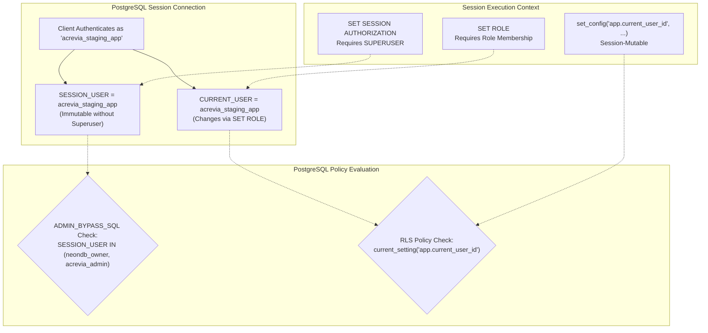
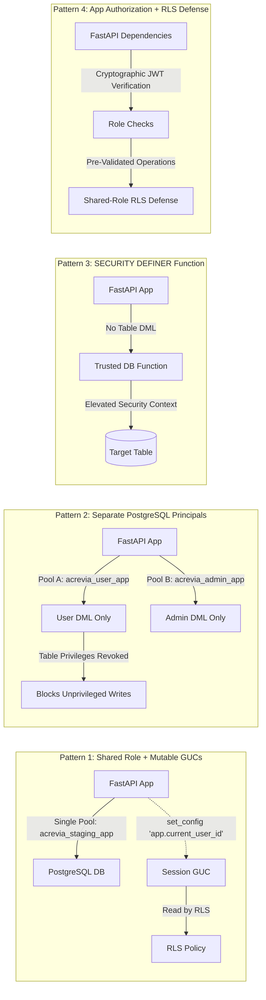
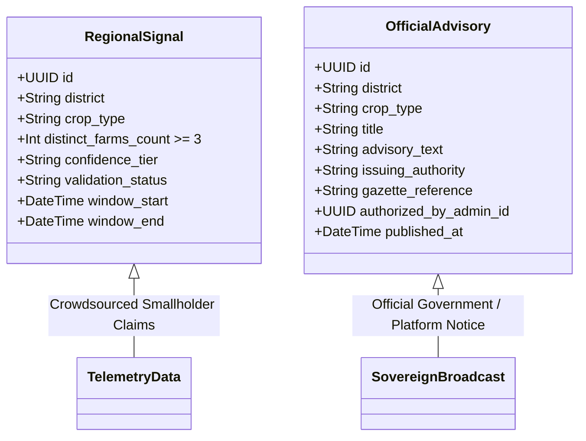

# ACREVIA — PHASE 07: DATABASE ACTOR IDENTITY ARCHITECTURE DECISION ANALYSIS

**Programme:** ACREVIA — Agricultural Intelligence Platform  
**Target Geography:** Telangana, India  
**Target Phase:** Phase 07 — PostgreSQL RLS Tenant Isolation & Regional Aggregation Privacy  
**Document ID:** `ACR-SEC-P07-DB-IDENTITY-ARCH-ANALYSIS`  
**Classification:** RESTRICTED — SECURITY & DATABASE ARCHITECTURE ASSURANCE  
**Execution Mode:** `MODE A ONLY` — Local Source Inspection, Policy Engineering, Offline Verification & Architecture Evaluation  
**Git Baseline:** `dbad296c6f19c4bbe8eb48fcd7a0e07441cfa408` on branch `main` (`https://github.com/gokul1599/ACREVIA`)  
**Methodology:** Everything Claude Code (ECC): `PLAN → TEST → IMPLEMENT ONLY IF DEFECT PROVEN → REVIEW → VERIFY → DOCUMENT`  
**Primary Assurance Artifact:** `phase_07_database_actor_identity_architecture_decision_analysis.md`

---

## 1. Executive Summary & Problem Formulation

In PostgreSQL Row-Level Security (RLS) systems, a fundamental architectural question governs every security boundary:

$$\mathbf{Where\ does\ the\ identity\ boundary\ reside:}\quad \text{In the database engine itself, or in the application server?}$$

Under ACREVIA Phase 07, the local source implementation in [`backend/app/database/rls.py`](file:///c:/Users/gokul/OneDrive/Documents/projects/backend/app/database/rls.py#L425-L485) and [`backend/app/security/dependencies.py`](file:///c:/Users/gokul/OneDrive/Documents/projects/backend/app/security/dependencies.py#L40-L115) currently operates as a **hybrid reference monitor**:
1. All database client connections from the FastAPI application pool connect to PostgreSQL under a single shared database principal:
   $$\mathbf{Database\_Role} = \texttt{acrevia\_staging\_app}$$
2. Individual application-level actors (`ADMIN`, `AGRICULTURAL_EXPERT`, `RESEARCHER`, `FARMER`) do not possess individual PostgreSQL login roles.
3. Instead, the application server establishes user identity within each database transaction by setting custom PostgreSQL session parameters:
   $$\texttt{app.current\_user\_id},\quad \texttt{app.current\_tenant\_id},\quad \texttt{app.is\_admin}$$
4. Row-Level Security policies evaluate these custom parameters and join against the application's `user_roles` table to enforce tenant isolation and role restrictions.

### The Fundamental Security Limitation
This architecture introduces a critical trust boundary:
> [!WARNING]
> **Core Architectural Finding:**  
> In PostgreSQL, custom session parameters in user-defined namespaces (`app.*`) can be modified within an active connection by any session executing `SELECT set_config(...)`. Consequently, PostgreSQL RLS policies that rely on caller-mutable session settings do **not** independently authenticate the application actor against arbitrary SQL execution under that same database principal.

This document provides the Project Owner with an exhaustive, mathematically rigorous evaluation of four database identity architecture patterns, their threat mitigation capabilities, operational trade-offs, and PostgreSQL kernel security mechanics.

---

## 2. PostgreSQL Identity & Session Mechanics: Kernel Technical Clarifications

To evaluate database identity architectures objectively, five precise PostgreSQL security concepts must be established:



### 2.1 `SESSION_USER` vs. `CURRENT_USER`
- `SESSION_USER`: Represents the database identity that originally authenticated the physical TCP connection or pool connection.
- `CURRENT_USER`: Represents the database identity currently used for permission checking. By default, `CURRENT_USER = SESSION_USER`.
- `SET ROLE`: Executing `SET ROLE <target_role>` modifies `CURRENT_USER`, but **leaves `SESSION_USER` completely unchanged**.
- `SET SESSION AUTHORIZATION`: Modifies `SESSION_USER`. In PostgreSQL, `SET SESSION AUTHORIZATION` can **only be executed by a `SUPERUSER`**. An unprivileged role such as `acrevia_staging_app` (`NOSUPERUSER`) is structurally prevented from changing `SESSION_USER`.

### 2.2 `ADMIN_BYPASS_SQL` Tamper-Resistance Analysis
In [`backend/app/database/rls.py`](file:///c:/Users/gokul/OneDrive/Documents/projects/backend/app/database/rls.py#L23-L27), the admin bypass predicate is compiled as:
```sql
(SESSION_USER::text IN ('neondb_owner', 'acrevia_admin') 
AND CURRENT_USER::text IN ('neondb_owner', 'acrevia_admin') 
AND current_setting('app.is_admin', true) = 'true')
```
- **Tamper-Resistance Invariant:** Because `SESSION_USER` requires `SUPERUSER` to alter, a connection authenticated as `acrevia_staging_app` cannot spoof `SESSION_USER = 'neondb_owner'` or `SESSION_USER = 'acrevia_admin'`.
- Even if an attacker executes `SELECT set_config('app.is_admin', 'true', false)` or executes `SET ROLE acrevia_admin` (which would fail without explicit membership grant), the `SESSION_USER::text IN (...)` check evaluates to `False`.
- Therefore, `ADMIN_BYPASS_SQL` is completely tamper-proof against the runtime application role.

### 2.3 `NOSUPERUSER`, `NOINHERIT`, and Role Membership
- Provisioning `acrevia_staging_app` with `NOSUPERUSER` prevents `SET SESSION AUTHORIZATION`, preventing identity spoofing of the database session.
- `NOINHERIT` dictates that privileges of granted roles are not automatically inherited; the role must explicitly execute `SET ROLE` to assume them.
- **Important Technical Clarification:** `NOINHERIT` does **not** by itself prevent `SET ROLE`. If `acrevia_staging_app` were granted membership in `acrevia_admin` (even with `NOINHERIT`), it could execute `SET ROLE acrevia_admin`. True isolation requires ensuring `acrevia_staging_app` has **zero membership** in privileged roles in `pg_auth_members`.

### 2.4 User-Defined Session GUCs (`app.*`)
- Any SQL connection can execute:
  ```sql
  SELECT set_config('app.current_user_id', '00000000-0000-0000-0000-000000000001', false);
  ```
- PostgreSQL does not natively validate the format, signature, or authenticity of values stored in user-defined GUC namespaces (`app.*`).
- Therefore, custom GUCs represent an **application-enforced contract**, not a kernel-enforced identity.

---

## 3. Dissecting the Four Database Identity Patterns



### 3.1 Pattern 1: Shared Runtime Role with Mutable Actor GUCs (Current Implementation)

#### Description:
A single database user (`acrevia_staging_app`) is used for all incoming web requests. The application sets `app.current_user_id` and `app.current_tenant_id` at the start of each transaction.

#### Capabilities & Guarantees:
- **Tenant Isolation:** Enforces multi-tenant data isolation (`WHERE farm_id = current_setting('app.current_tenant_id')`) across normal queries.
- **Application Logic Defense:** If an application developer writes `SELECT * FROM soil_samples` without a WHERE clause, RLS transparently restricts the query to the current tenant.
- **Operational Simplicity:** Requires only one database credential, one connection pool, and zero dynamic database role management.

#### Limitations & Vulnerabilities:
- **No SQL Injection Defense:** If arbitrary SQL is executed under `acrevia_staging_app`, the attacker can overwrite `app.current_user_id` to any victim's UUID and execute queries with that victim's RLS visibility.
- **Table Privilege Coarseness:** Table-level SQL grants (`GRANT SELECT, INSERT, UPDATE`) belong to `acrevia_staging_app`. The database engine cannot distinguish an admin update from a researcher update.

---

### 3.2 Pattern 2: Separate PostgreSQL Principals (Capability / Connection-Pool Segregation)

#### Description:
The application server maintains two or more segregated SQLAlchemy connection pools connecting to PostgreSQL under distinct database roles:
1. `acrevia_public_app`: Read-only role (`GRANT SELECT ON regional_signals TO acrevia_public_app;` zero INSERT/UPDATE).
2. `acrevia_expert_app`: Standard collaborative role (`GRANT SELECT, INSERT, UPDATE ON regional_signals...`).
3. `acrevia_admin_app`: Privileged role (`GRANT INSERT, UPDATE ON official_advisories TO acrevia_admin_app;`).

#### Capabilities & Guarantees:
- **Kernel-Enforced Privilege Boundaries:** An attacker executing arbitrary SQL through a public endpoint (`acrevia_public_app`) **cannot insert or update any data**, regardless of what session GUCs they manipulate, because SQLSTATE 42501 (insufficient privilege) is raised at the engine level.
- **Impregnable Table Isolation:** If `official_advisories` is created and DML is granted **only** to `acrevia_admin_app`, no non-admin connection pool possesses the SQL privileges to write to the table.

#### Operational Trade-offs:
- **Connection Overhead:** Multiple connection pools increase connection count against PostgreSQL (Neon connection limits).
- **Credential & Rotation Complexity:** Requires provisioning, securing, and rotating multiple database passwords in secret managers.
- **Application Routing Complexity:** Endpoints must explicitly inject different database session dependencies (`Depends(get_admin_db)` vs `Depends(get_user_db)`).
- **Does Not Authenticate Human Actors:** Pattern 2 distinguishes *application capabilities* (Admin service vs User service), but does not prove which human user initiated the request within that capability pool.

---

### 3.3 Pattern 3: Trusted Database-Side Authorization Functions (`SECURITY DEFINER`)

#### Description:
Direct SQL table privileges (`INSERT`, `UPDATE`, `DELETE`) on sensitive tables (`official_advisories`, `regional_signals`) are completely revoked from `acrevia_staging_app`. All state mutations must occur via dedicated PostgreSQL stored procedures executing with `SECURITY DEFINER`.

```sql
CREATE FUNCTION create_official_advisory(
    p_district text,
    p_crop_type text,
    p_title text,
    p_text text
) RETURNS uuid
LANGUAGE plpgsql
SECURITY DEFINER
SET search_path = public, pg_temp
AS $$
BEGIN
    -- Verify that the caller possesses authenticated admin role
    IF NOT EXISTS (
        SELECT 1 FROM user_roles ur
        JOIN roles r ON r.id = ur.role_id
        WHERE ur.user_id = NULLIF(current_setting('app.current_user_id', true), '')::uuid
        AND r.name = 'ADMIN'
    ) THEN
        RAISE EXCEPTION 'Access Denied: Caller is not an Administrator'
            USING ERRCODE = '42501';
    END IF;

    INSERT INTO official_advisories (...) VALUES (...);
END;
$$;
```

#### Capabilities & Guarantees:
- **Zero Direct Table DML:** Eliminates table-level `INSERT`/`UPDATE` grants from the runtime user.
- **Transactional Consistency:** State validation, audit logging, and row insertion occur atomically inside the PostgreSQL engine.

#### Operational Risks & Vulnerabilities:
- **`SECURITY DEFINER` Escalation Hazards:** If the function has flaws or does not explicitly lock down `search_path = public, pg_temp`, it introduces severe privilege escalation risks.
- **Still Dependent on Caller GUC:** If the stored procedure checks `app.current_user_id`, an attacker who can alter session GUCs can still spoof the actor unless the function accepts a cryptographically signed payload.
- **Maintenance Friction:** Moves business logic into PL/pgSQL, complicating unit testing, migration versioning, and CI/CD pipelines.

---

### 3.4 Pattern 4: Application Authorization plus Shared-Role RLS (The ACREVIA Production Pilot Model)

#### Description:
FastAPI operates as a hardened, trusted reference monitor. It validates cryptographically signed JWT tokens, enforces strict role-based access control (RBAC), validates business invariants, manages atomic database transactions, and uses PostgreSQL RLS with `acrevia_staging_app` as a secondary defense-in-depth boundary.

#### Capabilities & Guarantees:
- **Defense-in-Depth:**
  1. *Layer 1 (FastAPI Dependencies):* Enforces authentication, active user status, and role allowlists (`require_roles`).
  2. *Layer 2 (Service Layer):* Enforces domain guardrails (e.g. minimum 3 distinct farms, admin-only official advisories, caller transaction ownership).
  3. *Layer 3 (Schema Pre-Validation):* Ensures data conformity before transaction commit.
  4. *Layer 4 (PostgreSQL RLS):* Restricts query results to tenant bounds and collaborative author roles, preventing cross-tenant data leaks caused by developer query omission.
- **Audit Atomicity:** Service methods stage application changes and audit logs in the caller's transaction, committing atomically.

#### Operational Boundaries:
- Protects against all normal API misuse, unauthenticated callers, role elevation attempts, and application query mistakes.
- Does not defend against an attacker who has achieved arbitrary SQL execution under `acrevia_staging_app` or who has stolen the database connection credentials.

---

## 4. Comprehensive Security Threat Matrix

The table below contrasts how each architecture pattern responds to five distinct threat scenarios:

| Threat Scenario | Pattern 1: Shared Role + Mutable GUCs | Pattern 2: Separate PostgreSQL Principals | Pattern 3: Trusted `SECURITY DEFINER` Function | Pattern 4: App Auth + Shared-Role RLS |
| :--- | :---: | :---: | :---: | :---: |
| **1. Normal Authenticated API Requests** | **PROTECTED**<br/>RLS enforces tenant isolation. | **PROTECTED**<br/>Kernel permissions enforce boundaries. | **PROTECTED**<br/>Stored procedure enforces checks. | **PROTECTED**<br/>4-layer defense-in-depth. |
| **2. Application Logic Flaws** (e.g. Developer forgets `WHERE farm_id = ...`) | **PROTECTED**<br/>RLS automatically appends tenant filter. | **PROTECTED**<br/>RLS appends filter. | **PROTECTED**<br/>Logic centralized in stored procedure. | **PROTECTED**<br/>RLS prevents cross-tenant query leak. |
| **3. Arbitrary SQL Execution / SQLi** under `acrevia_staging_app` | **VULNERABLE**<br/>Attacker executes `set_config` to spoof actor. | **PARTIALLY PROTECTED**<br/>Pool permissions prevent unprivileged DML. | **VULNERABLE**<br/>Attacker can spoof GUC to invoke function. | **VULNERABLE**<br/>Relies on app server integrity. |
| **4. Compromised Runtime DB Credentials** (`acrevia_staging_app` leaked) | **VULNERABLE**<br/>Direct SQL connection can access all collaborative rows. | **PARTIALLY PROTECTED**<br/>Leaked user credential cannot write admin tables. | **PARTIALLY PROTECTED**<br/>No direct DML; must invoke procedures. | **VULNERABLE**<br/>Direct SQL bypasses application guards. |
| **5. Privileged Operator Access** (`neondb_owner`) | **BYPASSES RLS**<br/>Via `ADMIN_BYPASS_SQL`. | **BYPASSES RLS**<br/>Superuser bypasses all policies. | **BYPASSES RLS**<br/>Owner can modify/bypass procedures. | **BYPASSES RLS**<br/>Superuser bypasses all policies. |

---

## 5. Architectural Reality of Dedicated `official_advisories` Table

Project Owner Decision D-01 Option B evaluates moving government and administrative announcements into a dedicated `official_advisories` table.



### 5.1 Verification of Architectural Claims
- **Claim:** "Separating official advisories into a dedicated table automatically ensures database-level admin-only write security."
- **Technical Determination:** **`CLAIM_FALSE_UNDER_CURRENT_SINGLE_POOL_ARCHITECTURE`**.

### 5.2 Technical Justification
1. If `official_advisories` is created via migration, and the single application role `acrevia_staging_app` is granted `INSERT` and `UPDATE` on it:
   ```sql
   GRANT SELECT, INSERT, UPDATE ON official_advisories TO acrevia_staging_app;
   ```
2. Any database session running under `acrevia_staging_app` possesses the raw SQL privilege to execute `INSERT INTO official_advisories ...`.
3. If RLS is applied to `official_advisories` checking `app.current_user_id`, it inherits the exact same GUC trust boundary as Pattern 1.
4. **Conclusion:** A separate table achieves **clean data domain separation**, eliminates telemetry schema confusion ($N \ge 3$), and simplifies public read policies (`SELECT true`). However, to achieve **database-level admin-only protection**, it **MUST** be paired with either:
   - **Pattern 2 (Segregated Pools):** `acrevia_staging_app` receives `GRANT SELECT` only. A dedicated admin pool (`acrevia_admin_app`) receives `GRANT INSERT, UPDATE`.
   - **Pattern 3 (Security Definer):** `acrevia_staging_app` has zero DML grants and must invoke an admin-authenticated procedure.

---

## 6. Recommendations for Project Owner Evaluation

| Horizon | Architectural Option | Implementation Mechanism | Security Posture | Operational Complexity |
| :--- | :--- | :--- | :--- | :--- |
| **Telangana Pilot** (Immediate) | **Pattern 4 (Hardened App Auth + Staged Atomic Transactions) + D-01 Option C with Hardened Write RLS** | Harden `regional_signals_author_write_policy` with `WITH CHECK (confidence_tier != 'OFFICIAL_ADVISORY' OR current_setting('app.is_admin', true) = 'true')`. | Robust defense-in-depth for pilot scale. Prevents non-admin official state creation across all layers. | Minimal. Zero connection pool changes; zero new credentials. |
| **General Availability (GA)** (Future Milestone) | **Pattern 2 (Segregated Connection Pools) + Dedicated `official_advisories` Table (D-01 Option B)** | Provision separate `acrevia_admin_app` role; establish dedicated admin connection pool; isolate public read pool. | Kernel-enforced least privilege. Hardware and credential isolation between public reads and admin writes. | Moderate. Requires managing 2 connection pools and secret rotation. |

---

## 7. Evidentiary Classifications & Verification Summary

- **PostgreSQL Session Identity Mechanics (`SESSION_USER`, `CURRENT_USER`, `ADMIN_BYPASS_SQL`):**  
  Classification: **`LOCAL_SOURCE_VERIFIED`** (Inspected in `backend/app/database/rls.py#L23-L27`).
- **Custom GUC Session Mutability (`app.current_user_id`):**  
  Classification: **`STATIC_ANALYSIS_ONLY`** (PostgreSQL core behavior; verified against official PostgreSQL 16 documentation).
- **Service Layer Guardrails & Staged Transaction Atomicity:**  
  Classification: **`LOCAL_TEST_VERIFIED`** (108 tests passing in `backend/tests/test_worker_security_and_privacy.py`, 171 passed across full Phase 07 suite).
- **Live Physical Database Verification on Cloud Infrastructure:**  
  Classification: **`LIVE_POSTGRESQL_NOT_VERIFIED`** (Strictly preserved under Mode A; pending Gates 02-05).

---

## 8. Addendum (2026-11-15): DB-AUTH-01 Formalization, Separate Process Boundary & Alembic Dynamics

### 8.1 Formal Decoupling of DB-AUTH-01 from D-01
This analysis formally records that **`DB-AUTH-01` (Trusted Official-Advisory Database Writer Architecture)** is a distinct, proposed architectural decision independent of `D-01` (Visibility Model), `D-02` (Source Authenticity), and `D-03` (Peer Review):
- `D-01 Option B` separates the data model by creating an `official_advisories` table, which simplifies public reading (`SELECT true`).
- However, creating a separate table **does not establish database actor identity**. If the shared application database user (`acrevia_staging_app`) receives DML privileges on `official_advisories`, any session running under that user can forge GUCs.
- `DB-AUTH-01` establishes the database-layer authentication mechanism for the writer, independent of table schema.

### 8.2 In-Process Connection Pool vs. Out-of-Process Privileged Service
- **Pattern 2 (Segregated Pools in FastAPI):** Instantiating dual connection pools (`acrevia_staging_app` and `acrevia_admin_app`) inside FastAPI confines ordinary SQL queries to an unprivileged connection. However, **both sets of database credentials reside in the memory space of the FastAPI process**. If the application process suffers Remote Code Execution (RCE) or memory disclosure, the admin database credential is compromised.
- **Privileged Administrative Service:** For absolute isolation, administrative writes should be hosted in a distinct, separately deployed service/container with exclusive access to the privileged database credentials, completely segmented from public-facing endpoints.

### 8.3 Role Allowlist Mismatch Reconciliation
- In `backend/app/database/rls.py`, `ADMIN_BYPASS_SQL` checks `SESSION_USER::text IN ('neondb_owner', 'acrevia_admin')`.
- The candidate role `acrevia_admin_app` does not exist in code, configuration, or migrations (`LOCAL_SOURCE_VERIFIED`).
- Simply provisioning `acrevia_admin_app` on live PostgreSQL will not satisfy the bypass predicate unless the allowlist in `ADMIN_ROLES` is updated or role membership inheritance is configured with explicit `SET ROLE` mechanics.

### 8.4 Alembic Migration Dynamics
- Migration `a1089411c87d_enable_postgresql_rls_tenant_isolation.py` dynamically imports `generate_rls_ddl()`.
- Modifying the Python generator does **not** re-execute an already-applied migration in an existing environment. If revision `a1089411c87d` has been executed, applying policy changes requires authoring a new Alembic migration (e.g. `a1089411c87e`).

### 8.5 Test Evidence & Timing Reconciliation
- Full Phase 07 offline test baseline: **171 passed tests** across 5 test files (`test_orm_rls_alignment.py` [12], `test_postgresql_rls.py` [28], `test_rls_offline_ddl.py` [9], `test_rls_policy_semantics.py` [14], and `test_worker_security_and_privacy.py` [108]).
- Execution time variance (16.80s to 19.48s) is verified as standard OS disk caching and CPU scheduling jitter between cold and warm test invocations.
- Local unit tests verify DDL compilation and Python mock logic; physical kernel enforcement remains classified as `LIVE_POSTGRESQL_REQUIRED`.

---

## 9. Addendum (2026-11-15): Option D Policy Contract Specification, Downgrade Disaster & Capability Assessment

### 9.1 Option D Policy Contract: Dual Old-Row (USING) and New-Row (WITH CHECK) Protection
- An update policy with `WITH CHECK` alone allows an attacker to demote or deface existing official advisories via `UPDATE ... SET confidence_tier = 'COMMUNITY_UNVERIFIED'`.
- Option D requires both:
  1. `USING (confidence_tier IS DISTINCT FROM 'OFFICIAL_ADVISORY' AND validation_status IS DISTINCT FROM 'OFFICIAL_ALERT')`: Old-row protection.
  2. `WITH CHECK (confidence_tier IS DISTINCT FROM 'OFFICIAL_ADVISORY' AND validation_status IS DISTINCT FROM 'OFFICIAL_ALERT')`: New-row protection.
- `IS DISTINCT FROM` guarantees two-valued boolean logic, preventing NULL values from propagating as `UNKNOWN`.

### 9.2 Command-Specific Policies & Permissive OR Dynamic
- Monolithic `FOR ALL` policies conflate commands and combine via `OR` with read policies. Option D requires distinct `FOR INSERT`, `FOR UPDATE`, `FOR DELETE`, and `FOR SELECT` policies, and must drop the legacy `regional_signals_author_write_policy`.
- `regional_signal_evidences` child records must enforce a parent-state check to prevent attaching unverified evidence to official advisories.

### 9.3 Option C Cryptographic Capability Determination
- Option C is classified as **`NOT_IMPLEMENTABLE_WITH_CURRENT_SOURCE_ARCHITECTURE`** due to lack of verified native Ed25519 extensions in the database and the exposure of symmetric HMAC secrets in shared process memory.

### 9.4 Alembic Downgrade Catastrophe
- `a1089411c87d` downgrade executes `DISABLE ROW LEVEL SECURITY` across 132 tables.
- Running `alembic downgrade` in any environment destroys tenant isolation. Forward migration (`a1089411c87e`) is the only safe remediation path.

### 9.5 Adversarial Test Semantics
- `test_adversarial_state_transitions_and_permissive_policy_composition` in `test_worker_security_and_privacy.py` is a **vulnerability-presence detector**, not proof of security enforcement. Exactly 171 tests are confirmed across the suite.


---

## 2026-11-15 Addendum — Read-Privacy Preservation, Effective-Policy Composition & Evidence-Association Security Completeness

**Evaluation Date:** 2026-11-15T18:35:19+05:30  
**Audit Context:** Option D Effective-Policy Composition, Read-Privacy Preservation & Evidence-Association Security Completeness Audit  
**Operating Mode:** Strict `MODE A ONLY` (Local source inspection, security analysis, zero database mutations)  
**Baseline Git Commit:** `dbad296c6f19c4bbe8eb48fcd7a0e07441cfa408` (`main`)  

### 1. Active Read-Privacy Blocker Recorded: `RES-PULSE-READ-01`
- **Root Cause:** In PostgreSQL, multiple `PERMISSIVE` policies combine via Boolean `OR`. On `regional_signals`, `regional_signals_author_write_policy` is an `AS PERMISSIVE FOR ALL` policy. For `SELECT` queries, its role subquery evaluates to `TRUE` for any session where `app.current_user_id` matches an `ADMIN`, `AGRICULTURAL_EXPERT`, or `RESEARCHER` role.
- **Privacy Impact:** This author policy completely short-circuits the public read threshold (`distinct_farms_count >= 3 AND validation_status != 'SUSPENDED'`), allowing actors with those roles to read sub-threshold outbreak claims ($N < 3$) and suspended signals across all Telangana districts without tenant, geographic, or author scoping.
- **Mutable-GUC Vulnerability:** Because `app.current_user_id` is an unauthenticated, mutable session GUC set on the shared application database principal (`acrevia_staging_app`), any direct SQL session or SQL injection can execute `SET LOCAL app.current_user_id = '<expert-uuid>'` to satisfy `user_roles` RLS and read all private sub-threshold farmer telemetry.
- **Formal Status:** Recorded as a distinct architectural blocker: `RES-PULSE-READ-01 — Role-Global Sub-Threshold & Suspended Signal Read-Privacy Exposure`.

### 2. SQLAlchemy ORM and FastAPI Workflow Dependencies
Naive replacement of the `FOR ALL` policy with a public-only `SELECT` policy breaks legitimate application workflows:
- **`recover_suppressed_signal`:** Uses `select(RegionalSignal).where(id == signal_id).with_for_update()`. In PostgreSQL, `SELECT ... FOR UPDATE` evaluates `SELECT` RLS policies. If the signal is currently suppressed or sub-threshold, the public `SELECT` policy excludes it, causing the query to return `None` and the recovery endpoint to fail with HTTP 404.
- **`aggregate_regional_signal`:** The endpoint executes `db.refresh(signal)` immediately after `db.commit()`. If an expert creates a signal starting below threshold ($N < 3$) or creates a zero-telemetry advisory, `db.refresh()` executes `SELECT ... WHERE id = :id`. Because the row is excluded by public read RLS, SQLAlchemy raises `ObjectDeletedError`, rolling back the transaction with HTTP 500.
- **Resolution:** The complete Option D specification incorporates an internal administrative `SELECT` policy branch to preserve internal workflow execution while maintaining public privacy.

### 3. Child Evidence Table & Parent Promotion Integrity
- **Child Policy Contract:** `regional_signal_evidences` requires command-specific policies for `INSERT` (validating parent is non-official via `EXISTS`), `UPDATE` (validating both old and new parents are non-official), and `DELETE` (fail-closed defense-in-depth).
- **Parent Promotion Protocol:** When an ordinary signal is promoted to `OFFICIAL_ADVISORY` by a trusted writer, previously attached community evidence must be atomically revalidated to ensure that unverified evidence is never associated with official state advisories.
- **Concurrency Serialization:** All state-modifying operations on signals and evidences must acquire an explicit row-level lock on the parent signal (`SELECT ... FOR UPDATE`) to prevent race conditions between promotion and evidence insertion.

### 4. NULL & NOT NULL Contract Reconciled
- Verified in `backend/app/models/regional_pulse.py` and migration `d2894a11c87d` (`Base.metadata.create_all`): `confidence_tier`, `validation_status`, and `distinct_farms_count` have `nullable=False` / `NOT NULL` constraints.
- To prevent three-valued logic bypasses where `col IS DISTINCT FROM 'OFFICIAL_ADVISORY'` returns `TRUE` for `NULL`, Option D adopts Contract C (explicit `IS NOT NULL` checks in RLS) combined with Contract A (verified NOT NULL constraints).

### 5. Test Suite Verification
- Clean pytest collection verified: **171 tests collected** across 5 test suites.
- Historical execution baseline verified: **171 tests passed** in 23.47s.
- `test_adversarial_state_transitions_and_permissive_policy_composition` confirmed as a **vulnerability detector**.

### 6. Final Governance Status
- Phase 07: `NOT RELEASED`.
- Mode B: `STRICTLY NOT AUTHORIZED`.
- Active Blockers: `OWNER-AUTH-01`, `DB-RLS-01`, `RLS-WRITE-AUTH-01`, `RES-PULSE-READ-01`, `WRK-DISP-01`, `RES-PULSE-01`, `RES-PULSE-02`, `GATE01-PROV-01`.
- Owner Decisions D-01, D-02, D-03, and DB-AUTH-01: `PENDING_PROJECT_OWNER_AUTHORIZATION`.


---

## 2026-11-15 Addendum — Global Actor-GUC Trust Boundary, Role Assignment Escalation & Canonical Governance Restoration

**Evaluation Date:** 2026-11-15T19:30:36+05:30  
**Audit Context:** Global Actor-GUC Trust Boundary, User-Role Privilege Escalation & Global RLS Identity Assurance Audit  
**Operating Mode:** Strict `MODE A ONLY` (Local source inspection, security analysis, zero database mutations)  
**Baseline Git Commit:** `dbad296c6f19c4bbe8eb48fcd7a0e07441cfa408` (`main`)  

### 1. Critical Blocker Recorded: `RLS-ROLE-ASSIGNMENT-01`
- **Root Cause:** In `backend/app/database/rls.py`, `user_roles` is categorized as `TableCategory.USER_OWNED`, generating a restrictive policy that permits writes when `user_id::text = current_setting('app.current_user_id', true)`. Simultaneously, `acrevia_staging_app` receives full SQL table grants (`GRANT SELECT, INSERT, UPDATE, DELETE ON TABLE user_roles`).
- **Privilege Escalation:** Any session or component executing SQL under `acrevia_staging_app` can set `SET LOCAL app.current_user_id = '<user_uuid>'` and insert `('<user_uuid>', 'ADMIN')` into `user_roles`. PostgreSQL permits the insert because the user owns the inserted record. When the user logs in, FastAPI's `get_current_user` elevates them to platform administrator.
- **Administrator Demotion:** An attacker can delete administrator role rows by spoofing the administrator's UUID in `app.current_user_id`.
- **Classification:** Formally proven from local policy structure as an active architectural blocker: `RLS-ROLE-ASSIGNMENT-01 — Mutable-GUC Role Assignment Privilege Escalation`.
- **Immediate Containment:** Revoke `INSERT, UPDATE, DELETE ON TABLE user_roles FROM acrevia_staging_app;` via forward migration `a1089411c87e`.

### 2. Global Actor & Tenant GUC Impersonation Surfaces
- **Actor-GUC Surface:** All 13 `USER_OWNED` tables (including `users`, `session_tokens`, `consent_records`, `api_applications`) evaluate `user_id = current_setting('app.current_user_id', true)` with full DML grants for `acrevia_staging_app`.
- **Tenant-GUC Surface:** All 25 `TENANT_DIRECT` and 53 `TENANT_INDIRECT` tables enforce tenant isolation exclusively against `current_setting('app.current_tenant_id', true)`. Database RLS policies perform zero independent verification of user membership in the tenant; that check exists solely at the FastAPI application layer.

### 3. Canonical Governance Register Restored
Authoritative definitions are restored across all governance dossiers:
- **D-01:** Official Advisory Visibility & Data Model Choice (Universal N>=3, Dedicated table, Conditional exception, Privileged-only).
- **D-02:** Government-Source Authenticity & Pilot Terminology (`"Platform Administrator Broadcast — Not Verified Government Gazette"`).
- **D-03:** Independent Agronomic Peer-Review Workflow (Single-expert vs Dual-expert verification gate).
- **DB-AUTH-01:** Database Writer Identity Architecture (Dual-principal, Stored function gateway, Fail-closed application role; direct superuser bypass rejected).
- **Residual Risks:** `RES-PULSE-01` (Role-global evidence access), `RES-PULSE-02` (Read Committed snapshot window), `RES-PRIMARY-ROUTING-01` (Primary routing dependency), `RES-REPLICA-LAG-01` (Replica lag), `RES-FREE-TEXT-01` (PII in free text).

### 4. Active Blockers Summary
- `RLS-ROLE-ASSIGNMENT-01`: Active Critical Architectural Blocker.
- `RLS-WRITE-AUTH-01`: Active High Architectural Blocker.
- `RES-PULSE-READ-01`: Active High Architectural Blocker.
- `OWNER-AUTH-01`: Governance Blocker (Decisions D-01, D-02, D-03, DB-AUTH-01 pending).
- `WRK-DISP-01`: Active Worker Identity Architectural Blocker.
- `DB-RLS-01`: Infrastructure Blocker (Live PostgreSQL required).
- `GATE01-PROV-01`: Release Gate Blocker.
- **Phase 07 Status:** `NOT RELEASED`. Mode B: `STRICTLY NOT AUTHORIZED`.

---

## Dated Addendum — November 23, 2026: Role Containment & Registration Safeguards

1. **Operational Conflict Resolved:** Proved that direct DML revocation breaks user registration. Option E (`SECURITY DEFINER` gateway `register_default_user_role`) must be created to handle onboarding before revoking `INSERT` from `acrevia_staging_app`.
2. **Referential Cascade Protection:** Revoking direct `DELETE` on `users` prevents indirect wiping of role assignments through `ON DELETE CASCADE`.
3. **Reference Deliverables:**
   - [PHASE_07_GLOBAL_RLS_IDENTITY_REMEDIATION_AND_ROLE_MANAGEMENT_CONTAINMENT_PLAN.md](file:///c:/Users/gokul/OneDrive/Documents/projects/docs/pilot/security/PHASE_07_GLOBAL_RLS_IDENTITY_REMEDIATION_AND_ROLE_MANAGEMENT_CONTAINMENT_PLAN.md)
   - [PHASE_07_GLOBAL_GUC_AND_TENANT_POLICY_TRACEABILITY_MATRIX.md](file:///c:/Users/gokul/OneDrive/Documents/projects/docs/pilot/security/PHASE_07_GLOBAL_GUC_AND_TENANT_POLICY_TRACEABILITY_MATRIX.md)

