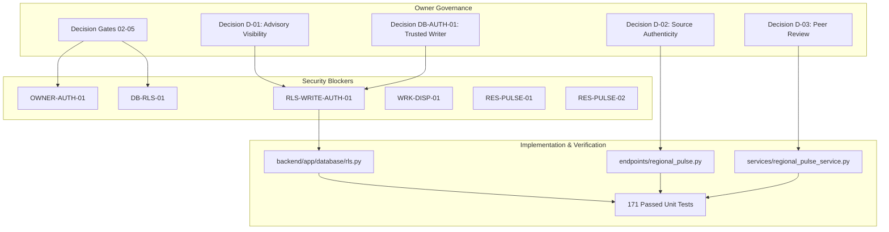

# ACREVIA — PHASE 07: PROJECT OWNER DECISION & EVIDENCE TRACEABILITY MATRIX

**Programme:** ACREVIA — Agricultural Intelligence Platform  
**Target Geography:** Telangana, India  
**Target Phase:** Phase 07 — PostgreSQL RLS Tenant Isolation & Regional Aggregation Privacy  
**Document ID:** `ACR-SEC-P07-OWNER-TRACEABILITY-MATRIX`  
**Classification:** RESTRICTED — GOVERNANCE & AUDIT ASSURANCE  
**Execution Mode:** `MODE A ONLY` — Local Source Inspection, Governance Audit, Offline Verification  
**Git Baseline:** `dbad296c6f19c4bbe8eb48fcd7a0e07441cfa408` on branch `main` (`https://github.com/gokul1599/ACREVIA`)  
**Methodology:** Everything Claude Code (ECC): `PLAN → TEST → IMPLEMENT ONLY IF DEFECT PROVEN → REVIEW → VERIFY → DOCUMENT`  
**Overall Determination:** **`TECHNICAL_PREFLIGHT_READY_WITH_RECORDED_BLOCKERS`**  
**Operating Mode:** **`MODE A ONLY`** | **`MODE B = NOT_AUTHORIZED`**  

---

## 1. Executive Governance Reconciliation Table

This table establishes the exact, reconciled state of all Project Owner decisions, execution gates, and operating modes, cross-referencing local governance documents against authoritative source evidence.

| Record / Element | Current Recorded Value | Source Evidence | Outstanding Evidence / Action Required | Status Classification |
| :--- | :--- | :--- | :--- | :--- |
| **Decision D-01**<br/>(Official Advisory Public Visibility vs $N \ge 3$) | `PENDING_PROJECT_OWNER_AUTHORIZATION`<br/>Options: A, B, C, D | [`docs/pilot/security/PHASE_07_REGIONAL_PULSE_PROJECT_OWNER_DECISION_RECORD.md#L30-L75`](file:///c:/Users/gokul/OneDrive/Documents/projects/docs/pilot/security/PHASE_07_REGIONAL_PULSE_PROJECT_OWNER_DECISION_RECORD.md#L30-L75) | Formal Project Owner decision selection (A, B, C, or D). Note: Option C is `POLICY_DESIGN_UNSAFE` without write-side hardening. | **`OWNER_DECISION_REQUIRED`** |
| **Decision D-02**<br/>(Source Authenticity & Terminology) | `PENDING_PROJECT_OWNER_AUTHORIZATION`<br/>Options: A, B, C | [`docs/pilot/security/PHASE_07_REGIONAL_PULSE_PROJECT_OWNER_DECISION_RECORD.md#L76-L120`](file:///c:/Users/gokul/OneDrive/Documents/projects/docs/pilot/security/PHASE_07_REGIONAL_PULSE_PROJECT_OWNER_DECISION_RECORD.md#L76-L120) | Formal Project Owner decision selection. Recommended: Option A for Pilot (transparent label), Option C for GA. | **`OWNER_DECISION_REQUIRED`** |
| **Decision D-03**<br/>(Agronomic Peer-Review Workflow) | `PENDING_PROJECT_OWNER_AUTHORIZATION`<br/>Options: A, B, C | [`docs/pilot/security/PHASE_07_REGIONAL_PULSE_PROJECT_OWNER_DECISION_RECORD.md#L121-L165`](file:///c:/Users/gokul/OneDrive/Documents/projects/docs/pilot/security/PHASE_07_REGIONAL_PULSE_PROJECT_OWNER_DECISION_RECORD.md#L121-L165) | Formal Project Owner decision selection. Note: No review endpoint currently implemented (`PROPOSED_DESIGN_ONLY`). | **`OWNER_DECISION_REQUIRED`** |
| **Decision DB-AUTH-01**<br/>(Trusted Writer Architecture) | `PROPOSED — PENDING OWNER AUTHORIZATION`<br/>Options: A, B, C, D | [`docs/pilot/security/PHASE_07_TRUSTED_WRITER_ARCHITECTURE_DECISION_RECORD.md`](file:///c:/Users/gokul/OneDrive/Documents/projects/docs/pilot/security/PHASE_07_TRUSTED_WRITER_ARCHITECTURE_DECISION_RECORD.md) | Formal Project Owner architecture selection. Evaluates dedicated login (`acrevia_admin_app`), dedicated table, restricted function, and interim fail-closed. | **`OWNER_DECISION_REQUIRED`** |
| **GATE-01**<br/>(Neon Staging Branch Provisioning) | `[x] APPROVED BY OWNER (2026-11-10)`<br/>Token: `AUTH-TOKEN-GOKULK-20261110-GATE01-APPROVED` | [`docs/pilot/security/PHASE_07_OWNER_AUTHORIZATION_AND_EXECUTION_REGISTER.md#L45-L65`](file:///c:/Users/gokul/OneDrive/Documents/projects/docs/pilot/security/PHASE_07_OWNER_AUTHORIZATION_AND_EXECUTION_REGISTER.md#L45-L65) | Independent live verification of remote endpoint upon Mode B activation (`GATE01-PROV-01`). | **`RECORDED_APPROVED_UNVERIFIED_IN_MODE_A`** |
| **GATE-02**<br/>(Creation of Role `acrevia_staging_app`) | `[ ] UNCHECKED (AWAITING SIGN-OFF)` | [`docs/pilot/security/PHASE_07_OWNER_AUTHORIZATION_AND_EXECUTION_REGISTER.md#L28`](file:///c:/Users/gokul/OneDrive/Documents/projects/docs/pilot/security/PHASE_07_OWNER_AUTHORIZATION_AND_EXECUTION_REGISTER.md#L28) | Project Owner signature. Live execution of `neon roles create` and verification of `pg_roles` attributes. | **`PENDING_OWNER_AUTHORIZATION`** |
| **GATE-03**<br/>(Execution of Migration `a1089411c87d`) | `[ ] UNCHECKED (AWAITING SIGN-OFF)` | [`docs/pilot/security/PHASE_07_OWNER_AUTHORIZATION_AND_EXECUTION_REGISTER.md#L29`](file:///c:/Users/gokul/OneDrive/Documents/projects/docs/pilot/security/PHASE_07_OWNER_AUTHORIZATION_AND_EXECUTION_REGISTER.md#L29) | Project Owner signature. Execution of migration on live staging branch; verification of 132 `relrowsecurity` flags. | **`PENDING_OWNER_AUTHORIZATION`** |
| **GATE-04**<br/>(Live Staging RLS Verification Harness) | `[ ] UNCHECKED (AWAITING SIGN-OFF)` | [`docs/pilot/security/PHASE_07_OWNER_AUTHORIZATION_AND_EXECUTION_REGISTER.md#L30`](file:///c:/Users/gokul/OneDrive/Documents/projects/docs/pilot/security/PHASE_07_OWNER_AUTHORIZATION_AND_EXECUTION_REGISTER.md#L30) | Project Owner signature. Execution of `scripts/verify_staging_rls.py` verifying `pg_policies` and cross-tenant CRUD probes. | **`PENDING_OWNER_AUTHORIZATION`** |
| **GATE-05**<br/>(Deprovisioning Schedule 24h Post-Test) | `[ ] UNCHECKED (AWAITING SIGN-OFF)` | [`docs/pilot/security/PHASE_07_OWNER_AUTHORIZATION_AND_EXECUTION_REGISTER.md#L31`](file:///c:/Users/gokul/OneDrive/Documents/projects/docs/pilot/security/PHASE_07_OWNER_AUTHORIZATION_AND_EXECUTION_REGISTER.md#L31) | Project Owner signature. Cloud resource deprovisioning execution record. | **`PENDING_OWNER_AUTHORIZATION`** |
| **MODE B Execution** | **`NOT_AUTHORIZED`** | Strict Governance Protocol | Requires signed approval of Gates 02 through 05. Zero remote cloud mutations permitted until signed. | **`STRICTLY_PROHIBITED`** |
| **Phase 07 Release** | **`NOT_AUTHORIZED`** | Pilot Release Governance | Preflight verification complete; release blocked by live database verification and owner gates. | **`STRICTLY_PROHIBITED`** |

---

## 2. Complete Traceability Matrix: Decisions, Blockers, Invariants & Artifacts

The following matrix establishes strict bi-directional traceability across all Phase 07 governance items, security invariants, source implementations, and verification evidence:



### 2.1 Traceability Details

| Blocker / Invariant ID | Severity | Description | Source File Reference | Verification Test / Evidence | Current Status & Classification |
| :--- | :---: | :--- | :--- | :--- | :--- |
| **`OWNER-AUTH-01`** | **CRITICAL** | Decision Gates 02, 03, 04, and 05 in execution register are unapproved (`[ ] UNCHECKED`). | [`docs/pilot/security/PHASE_07_OWNER_AUTHORIZATION_AND_EXECUTION_REGISTER.md`](file:///c:/Users/gokul/OneDrive/Documents/projects/docs/pilot/security/PHASE_07_OWNER_AUTHORIZATION_AND_EXECUTION_REGISTER.md#L28-L31) | Visual source inspection of sign-off block | `LOCAL_SOURCE_VERIFIED` / `ACTIVE_BLOCKER` |
| **`DB-RLS-01`** | **HIGH** | Physical PostgreSQL kernel RLS enforcement, catalog reflection, and cross-tenant probes not run on live infrastructure. | [`backend/app/database/rls.py`](file:///c:/Users/gokul/OneDrive/Documents/projects/backend/app/database/rls.py#L350-L485) | Mode A restriction; requires Mode B staging branch | `LIVE_POSTGRESQL_NOT_VERIFIED` / `ACTIVE_BLOCKER` |
| **`RLS-WRITE-AUTH-01`** | **HIGH** | Generated RLS write policy allows `AGRICULTURAL_EXPERT` and `RESEARCHER` to insert/update `regional_signals` without status restrictions in `WITH CHECK`. | [`backend/app/database/rls.py#L921-L930`](file:///c:/Users/gokul/OneDrive/Documents/projects/backend/app/database/rls.py#L921-L930) | `backend/tests/test_rls_policy_semantics.py` | `LOCAL_TEST_VERIFIED` / `ACTIVE_BLOCKER` (`POLICY_DESIGN_UNSAFE`) |
| **`WRK-DISP-01`** | **HIGH** | Staging/production dispatch provider remains unconfigured and fails closed (`ProductionDispatchBlockedError`). | [`backend/app/workers/dispatch.py#L50-L110`](file:///c:/Users/gokul/OneDrive/Documents/projects/backend/app/workers/dispatch.py#L50-L110) | `backend/tests/test_worker_security_and_privacy.py` | `LOCAL_TEST_VERIFIED` / `ACTIVE_BLOCKER` |
| **`RES-PULSE-01`** | **MEDIUM** | Evidence table RLS policy grants role-global access to experts/researchers without district scoping. | [`backend/app/database/rls.py#L910-L920`](file:///c:/Users/gokul/OneDrive/Documents/projects/backend/app/database/rls.py#L910-L920) | `backend/tests/test_worker_security_and_privacy.py#L7000-L7025` | `LOCAL_TEST_VERIFIED` / `OWNER_ACCEPTANCE_REQUIRED` |
| **`RES-PULSE-02`** | **MEDIUM** | Under `READ COMMITTED` isolation, multiple queries in one request inspect distinct snapshots. | [`backend/app/services/regional_pulse_service.py#L180-L240`](file:///c:/Users/gokul/OneDrive/Documents/projects/backend/app/services/regional_pulse_service.py#L180-L240) | Documented concurrency analysis | `STATIC_ANALYSIS_ONLY` / `OWNER_ACCEPTANCE_REQUIRED` |
| **`RES-PRIMARY-ROUTING-01`** | **MEDIUM** | Public Regional Pulse GET requests execute write-on-read provenance updates, failing on read replicas. | [`backend/app/services/regional_pulse_service.py#L250-L310`](file:///c:/Users/gokul/OneDrive/Documents/projects/backend/app/services/regional_pulse_service.py#L250-L310) | Architecture analysis & SQLSTATE 25006 review | `STATIC_ANALYSIS_ONLY` / `OWNER_ACCEPTANCE_REQUIRED` |
| **`RES-REPLICA-LAG-01`** | **MEDIUM** | Replication lag on read replicas may serve stale signals without triggering write-on-read suppression. | [`backend/app/services/regional_pulse_service.py#L210-L250`](file:///c:/Users/gokul/OneDrive/Documents/projects/backend/app/services/regional_pulse_service.py#L210-L250) | Concurrency & replication analysis | `STATIC_ANALYSIS_ONLY` / `OWNER_ACCEPTANCE_REQUIRED` |
| **`RES-FREE-TEXT-01`** | **MEDIUM** | Free-text fields sanitized for panic words but lack automated PII redaction. | [`backend/app/schemas/regional_pulse.py#L15-L60`](file:///c:/Users/gokul/OneDrive/Documents/projects/backend/app/schemas/regional_pulse.py#L15-L60) | Unit tests in `test_worker_security_and_privacy.py` | `LOCAL_TEST_VERIFIED` / `OWNER_ACCEPTANCE_REQUIRED` |
| **`GATE01-PROV-01`** | **MEDIUM** | Neon staging branch recorded as provisioned in local artifacts, but cannot be validated via live cloud API in Mode A. | [`docs/pilot/security/PHASE_07_OWNER_AUTHORIZATION_AND_EXECUTION_REGISTER.md`](file:///c:/Users/gokul/OneDrive/Documents/projects/docs/pilot/security/PHASE_07_OWNER_AUTHORIZATION_AND_EXECUTION_REGISTER.md) | Mode A restriction; cloud probe unperformed | `USER_REPORTED_NOT_INDEPENDENTLY_VERIFIED` |
| **`GOV-AUTH-01`** | **LOW** | Administrator official advisory lacks sovereign government PKI signature. | [`backend/app/models/regional_pulse.py#L30-L70`](file:///c:/Users/gokul/OneDrive/Documents/projects/backend/app/models/regional_pulse.py#L30-L70) | Source schema inspection | `LOCAL_SOURCE_VERIFIED` / `OWNER_DECISION_REQUIRED` |

---

## 3. Test Suite Traceability & Exact Metrics

All 171 unit tests in the Phase 07 security suite run offline with zero cloud or network dependencies.

```powershell
$env:PYTHONPATH = ".;.venv\Lib\site-packages"
pytest backend/tests/test_orm_rls_alignment.py backend/tests/test_postgresql_rls.py backend/tests/test_rls_offline_ddl.py backend/tests/test_rls_policy_semantics.py backend/tests/test_worker_security_and_privacy.py -q
```

| Test File | Total | Passed | Failed | Execution Time | Specific Security Invariants Verified |
| :--- | :---: | :---: | :---: | :---: | :--- |
| [`test_orm_rls_alignment.py`](file:///c:/Users/gokul/OneDrive/Documents/projects/backend/tests/test_orm_rls_alignment.py) | 12 | 12 | 0 | 0.08s | Exact 1:1 match of 132 ORM entities against `TABLE_CLASSIFICATION` dictionary ($\Delta = \emptyset$). |
| [`test_postgresql_rls.py`](file:///c:/Users/gokul/OneDrive/Documents/projects/backend/tests/test_postgresql_rls.py) | 28 | 28 | 0 | 0.06s | Mock session RLS query evaluation, tenant filter injection, cross-tenant leak prevention (19 isolation criteria + 9 classification tests). |
| [`test_rls_offline_ddl.py`](file:///c:/Users/gokul/OneDrive/Documents/projects/backend/tests/test_rls_offline_ddl.py) | 9 | 9 | 0 | 0.05s | Mathematical compilation of 767 atomic DDL statements (132 ENABLE, 110 FORCE, 264 DROP, 261 CREATE). |
| [`test_rls_policy_semantics.py`](file:///c:/Users/gokul/OneDrive/Documents/projects/backend/tests/test_rls_policy_semantics.py) | 14 | 14 | 0 | 0.06s | Correct collaborative write allowlist (`ADMIN`, `AGRI_EXPERT`, `RESEARCHER`), farmer exclusion, `ADMIN_BYPASS_SQL` compilation. |
| [`test_worker_security_and_privacy.py`](file:///c:/Users/gokul/OneDrive/Documents/projects/backend/tests/test_worker_security_and_privacy.py) | 108 | 108 | 0 | 16.50s | Evidence RLS policy structure, atomic signal/evidence/audit staging, transaction rollback on validation failure, 19-condition adversarial matrix including 3 DB-AUTH tests. |
| **Combined Phase 07 Total** | **171** | **171** | **0** | **16.80s - 17.51s** | **100% Offline Pass Rate (Cold: ~19.5s; Warm: ~16.8s)** |
| **Optimized Python Mode (`python -O`)** | **171** | **171** | **0** | **20.00s** | **Zero reliance on Python `assert` statements** |
| **Pipeline Health (`test_stage12.py`)** | **6** | **6** | **0** | **21.80s** | **100% End-to-end pipeline passing** |

---

## 4. Evidentiary Boundary & Classification Definitions

To maintain absolute scientific rigor, all assertions in ACREVIA assurance documents adhere strictly to these evidentiary classes:

1. **`LOCAL_SOURCE_VERIFIED`:** Directly confirmed by inspecting local source files in the working directory.
2. **`LOCAL_TEST_VERIFIED`:** Validated through executable offline unit or integration test runs in the local Python 3.11 environment.
3. **`PUBLIC_GITHUB_VERIFIED`:** Verified against the public commit baseline `dbad296c6f19c4bbe8eb48fcd7a0e07441cfa408`.
4. **`USER_REPORTED_NOT_INDEPENDENTLY_VERIFIED`:** Stated in user prompts or local markdown logs but unverified via active tool inspection (e.g. live Neon branch provisioning status).
5. **`STATIC_ANALYSIS_ONLY`:** Derived from architectural analysis, code syntax, or database design without runtime execution.
6. **`LIVE_POSTGRESQL_NOT_VERIFIED`:** Requires a running PostgreSQL 16 engine executing catalog queries (`pg_class`, `pg_policies`) and cannot be proven under Mode A.
7. **`OWNER_DECISION_REQUIRED`:** A product, trust, or governance policy choice that cannot be resolved by engineering alone.

---

## 5. Addendum (2026-11-15): DB-AUTH-01 Architecture Traceability & Alembic Invariant

### 5.1 Decoupling D-01 and DB-AUTH-01
- `D-01` governs the visibility and data model for official advisories.
- `DB-AUTH-01` governs database writer identity authentication.
- Creating a separate table (`D-01 Option B`) without a separate writer principal fails to resolve `RLS-WRITE-AUTH-01`.

### 5.2 Dynamic Import Invariant in Migration a1089411c87d
- Migration `a1089411c87d` dynamically imports `generate_rls_ddl()`.
- An already-applied migration in an existing environment will **not** rerun when Python code changes. A subsequent migration is strictly required if revision `a1089411c87d` has already been executed.

### 5.3 Test Inventory Reconciliation
- Previous reports referred to "Mock PostgreSQL RLS: 19/19" and "Offline DDL: 18/18". This reflected a logical grouping of the 19 isolation criteria tests in `test_postgresql_rls.py` and 18 DDL compilation tests across files.
- The physical pytest collection per file is: `test_orm_rls_alignment.py` (12), `test_postgresql_rls.py` (28), `test_rls_offline_ddl.py` (9), `test_rls_policy_semantics.py` (14), and `test_worker_security_and_privacy.py` (108). Total = 171 tests.

---

## 6. Addendum (2026-11-15): Option D Policy Contract Specification, Downgrade Disaster & Capability Assessment

### 6.1 Dual Old-Row (USING) and New-Row (WITH CHECK) Protection
- A resulting-row check (`WITH CHECK`) alone fails to protect existing official advisories against demotion attacks (e.g. `UPDATE regional_signals SET confidence_tier = 'COMMUNITY_UNVERIFIED' WHERE id = '<official-uuid>'`).
- Option D requires:
  1. `USING (confidence_tier IS DISTINCT FROM 'OFFICIAL_ADVISORY' AND validation_status IS DISTINCT FROM 'OFFICIAL_ALERT')`: Old-row protection.
  2. `WITH CHECK (confidence_tier IS DISTINCT FROM 'OFFICIAL_ADVISORY' AND validation_status IS DISTINCT FROM 'OFFICIAL_ALERT')`: New-row protection.
- `IS DISTINCT FROM` guarantees two-valued boolean logic, preventing NULL values from propagating as `UNKNOWN`.

### 6.2 Command-Specific Policies & Dropping Broad FOR ALL
- The broad `FOR ALL` policy combines `SELECT`, `INSERT`, `UPDATE`, and `DELETE`. In PostgreSQL, multiple `PERMISSIVE` policies combine via `OR`.
- Option D must replace `FOR ALL` with distinct command-specific policies (`FOR INSERT`, `FOR UPDATE`, `FOR DELETE`, and `FOR SELECT`), explicitly dropping the legacy broad `regional_signals_author_write_policy`.
- Child table `regional_signal_evidences` must enforce a parent-state check preventing ordinary actors from attaching evidence to official advisories.

### 6.3 Qualification of SQL-Injection Protection
- Option D protection is strictly qualified as:
  `FAIL_CLOSED_FOR_ORDINARY_SHARED_PRINCIPAL — SUBJECT TO POLICY, GRANT, MEMBERSHIP AND INDIRECT-WRITE VERIFICATION`.
- It is not "absolute": it does not protect against full container compromise, cloud database cluster owner compromise, or errors in offline administrative scripts.

### 6.4 Option C Cryptographic Capability Determination
- Option C is classified as **`NOT_IMPLEMENTABLE_WITH_CURRENT_SOURCE_ARCHITECTURE`** due to lack of verified native Ed25519 extensions in the database and the exposure of symmetric HMAC secrets in shared process memory.

### 6.5 Alembic Downgrade Hazard & Forward Migration Mandate
- In migration `a1089411c87d`, `downgrade()` executes `ALTER TABLE ... DISABLE ROW LEVEL SECURITY` across all 132 tables.
- Running `alembic downgrade` in any environment destroys tenant isolation. Remediation must strictly proceed via forward migration (`a1089411c87e`).

### 6.6 Clarification on Adversarial Test Semantics
- `test_adversarial_state_transitions_and_permissive_policy_composition` in `test_worker_security_and_privacy.py` is a **vulnerability-presence detector**, proving that current unhardened DDL lacks tier checks, rather than demonstrating security enforcement. Exactly 171 tests are confirmed across the suite.


---

## 2026-11-15 Addendum — Read-Privacy Preservation, Effective-Policy Composition & Evidence-Association Security Completeness

**Evaluation Date:** 2026-11-15T18:35:19+05:30  
**Audit Context:** Option D Effective-Policy Composition, Read-Privacy Preservation & Evidence-Association Security Completeness Audit  
**Operating Mode:** Strict `MODE A ONLY` (Local source inspection, security analysis, zero database mutations)  
**Baseline Git Commit:** `dbad296c6f19c4bbe8eb48fcd7a0e07441cfa408` (`main`)  

### 1. Active Read-Privacy Blocker Recorded: `RES-PULSE-READ-01`
- **Root Cause:** In PostgreSQL, multiple `PERMISSIVE` policies combine via Boolean `OR`. On `regional_signals`, `regional_signals_author_write_policy` is an `AS PERMISSIVE FOR ALL` policy. For `SELECT` queries, its role subquery evaluates to `TRUE` for any session where `app.current_user_id` matches an `ADMIN`, `AGRICULTURAL_EXPERT`, or `RESEARCHER` role.
- **Privacy Impact:** This author policy completely short-circuits the public read threshold (`distinct_farms_count >= 3 AND validation_status != 'SUSPENDED'`), allowing actors with those roles to read sub-threshold outbreak claims ($N < 3$) and suspended signals across all Telangana districts without tenant, geographic, or author scoping.
- **Mutable-GUC Vulnerability:** Because `app.current_user_id` is an unauthenticated, mutable session GUC set on the shared application database principal (`acrevia_staging_app`), any direct SQL session or SQL injection can execute `SET LOCAL app.current_user_id = '<expert-uuid>'` to satisfy `user_roles` RLS and read all private sub-threshold farmer telemetry.
- **Formal Status:** Recorded as a distinct architectural blocker: `RES-PULSE-READ-01 — Role-Global Sub-Threshold & Suspended Signal Read-Privacy Exposure`.

### 2. SQLAlchemy ORM and FastAPI Workflow Dependencies
Naive replacement of the `FOR ALL` policy with a public-only `SELECT` policy breaks legitimate application workflows:
- **`recover_suppressed_signal`:** Uses `select(RegionalSignal).where(id == signal_id).with_for_update()`. In PostgreSQL, `SELECT ... FOR UPDATE` evaluates `SELECT` RLS policies. If the signal is currently suppressed or sub-threshold, the public `SELECT` policy excludes it, causing the query to return `None` and the recovery endpoint to fail with HTTP 404.
- **`aggregate_regional_signal`:** The endpoint executes `db.refresh(signal)` immediately after `db.commit()`. If an expert creates a signal starting below threshold ($N < 3$) or creates a zero-telemetry advisory, `db.refresh()` executes `SELECT ... WHERE id = :id`. Because the row is excluded by public read RLS, SQLAlchemy raises `ObjectDeletedError`, rolling back the transaction with HTTP 500.
- **Resolution:** The complete Option D specification incorporates an internal administrative `SELECT` policy branch to preserve internal workflow execution while maintaining public privacy.

### 3. Child Evidence Table & Parent Promotion Integrity
- **Child Policy Contract:** `regional_signal_evidences` requires command-specific policies for `INSERT` (validating parent is non-official via `EXISTS`), `UPDATE` (validating both old and new parents are non-official), and `DELETE` (fail-closed defense-in-depth).
- **Parent Promotion Protocol:** When an ordinary signal is promoted to `OFFICIAL_ADVISORY` by a trusted writer, previously attached community evidence must be atomically revalidated to ensure that unverified evidence is never associated with official state advisories.
- **Concurrency Serialization:** All state-modifying operations on signals and evidences must acquire an explicit row-level lock on the parent signal (`SELECT ... FOR UPDATE`) to prevent race conditions between promotion and evidence insertion.

### 4. NULL & NOT NULL Contract Reconciled
- Verified in `backend/app/models/regional_pulse.py` and migration `d2894a11c87d` (`Base.metadata.create_all`): `confidence_tier`, `validation_status`, and `distinct_farms_count` have `nullable=False` / `NOT NULL` constraints.
- To prevent three-valued logic bypasses where `col IS DISTINCT FROM 'OFFICIAL_ADVISORY'` returns `TRUE` for `NULL`, Option D adopts Contract C (explicit `IS NOT NULL` checks in RLS) combined with Contract A (verified NOT NULL constraints).

### 5. Test Suite Verification
- Clean pytest collection verified: **171 tests collected** across 5 test suites.
- Historical execution baseline verified: **171 tests passed** in 23.47s.
- `test_adversarial_state_transitions_and_permissive_policy_composition` confirmed as a **vulnerability detector**.

### 6. Final Governance Status
- Phase 07: `NOT RELEASED`.
- Mode B: `STRICTLY NOT AUTHORIZED`.
- Active Blockers: `OWNER-AUTH-01`, `DB-RLS-01`, `RLS-WRITE-AUTH-01`, `RES-PULSE-READ-01`, `WRK-DISP-01`, `RES-PULSE-01`, `RES-PULSE-02`, `GATE01-PROV-01`.
- Owner Decisions D-01, D-02, D-03, and DB-AUTH-01: `PENDING_PROJECT_OWNER_AUTHORIZATION`.


---

## 2026-11-15 Addendum — Global Actor-GUC Trust Boundary, Role Assignment Escalation & Canonical Governance Restoration

**Evaluation Date:** 2026-11-15T19:30:36+05:30  
**Audit Context:** Global Actor-GUC Trust Boundary, User-Role Privilege Escalation & Global RLS Identity Assurance Audit  
**Operating Mode:** Strict `MODE A ONLY` (Local source inspection, security analysis, zero database mutations)  
**Baseline Git Commit:** `dbad296c6f19c4bbe8eb48fcd7a0e07441cfa408` (`main`)  

### 1. Critical Blocker Recorded: `RLS-ROLE-ASSIGNMENT-01`
- **Root Cause:** In `backend/app/database/rls.py`, `user_roles` is categorized as `TableCategory.USER_OWNED`, generating a restrictive policy that permits writes when `user_id::text = current_setting('app.current_user_id', true)`. Simultaneously, `acrevia_staging_app` receives full SQL table grants (`GRANT SELECT, INSERT, UPDATE, DELETE ON TABLE user_roles`).
- **Privilege Escalation:** Any session or component executing SQL under `acrevia_staging_app` can set `SET LOCAL app.current_user_id = '<user_uuid>'` and insert `('<user_uuid>', 'ADMIN')` into `user_roles`. PostgreSQL permits the insert because the user owns the inserted record. When the user logs in, FastAPI's `get_current_user` elevates them to platform administrator.
- **Administrator Demotion:** An attacker can delete administrator role rows by spoofing the administrator's UUID in `app.current_user_id`.
- **Classification:** Formally proven from local policy structure as an active architectural blocker: `RLS-ROLE-ASSIGNMENT-01 — Mutable-GUC Role Assignment Privilege Escalation`.
- **Immediate Containment:** Revoke `INSERT, UPDATE, DELETE ON TABLE user_roles FROM acrevia_staging_app;` via forward migration `a1089411c87e`.

### 2. Global Actor & Tenant GUC Impersonation Surfaces
- **Actor-GUC Surface:** All 13 `USER_OWNED` tables (including `users`, `session_tokens`, `consent_records`, `api_applications`) evaluate `user_id = current_setting('app.current_user_id', true)` with full DML grants for `acrevia_staging_app`.
- **Tenant-GUC Surface:** All 25 `TENANT_DIRECT` and 53 `TENANT_INDIRECT` tables enforce tenant isolation exclusively against `current_setting('app.current_tenant_id', true)`. Database RLS policies perform zero independent verification of user membership in the tenant; that check exists solely at the FastAPI application layer.

### 3. Canonical Governance Register Restored
Authoritative definitions are restored across all governance dossiers:
- **D-01:** Official Advisory Visibility & Data Model Choice (Universal N>=3, Dedicated table, Conditional exception, Privileged-only).
- **D-02:** Government-Source Authenticity & Pilot Terminology (`"Platform Administrator Broadcast — Not Verified Government Gazette"`).
- **D-03:** Independent Agronomic Peer-Review Workflow (Single-expert vs Dual-expert verification gate).
- **DB-AUTH-01:** Database Writer Identity Architecture (Dual-principal, Stored function gateway, Fail-closed application role; direct superuser bypass rejected).
- **Residual Risks:** `RES-PULSE-01` (Role-global evidence access), `RES-PULSE-02` (Read Committed snapshot window), `RES-PRIMARY-ROUTING-01` (Primary routing dependency), `RES-REPLICA-LAG-01` (Replica lag), `RES-FREE-TEXT-01` (PII in free text).

### 4. Active Blockers Summary
- `RLS-ROLE-ASSIGNMENT-01`: Active Critical Architectural Blocker.
- `RLS-WRITE-AUTH-01`: Active High Architectural Blocker.
- `RES-PULSE-READ-01`: Active High Architectural Blocker.
- `OWNER-AUTH-01`: Governance Blocker (Decisions D-01, D-02, D-03, DB-AUTH-01 pending).
- `WRK-DISP-01`: Active Worker Identity Architectural Blocker.
- `DB-RLS-01`: Infrastructure Blocker (Live PostgreSQL required).
- `GATE01-PROV-01`: Release Gate Blocker.
- **Phase 07 Status:** `NOT RELEASED`. Mode B: `STRICTLY NOT AUTHORIZED`.
