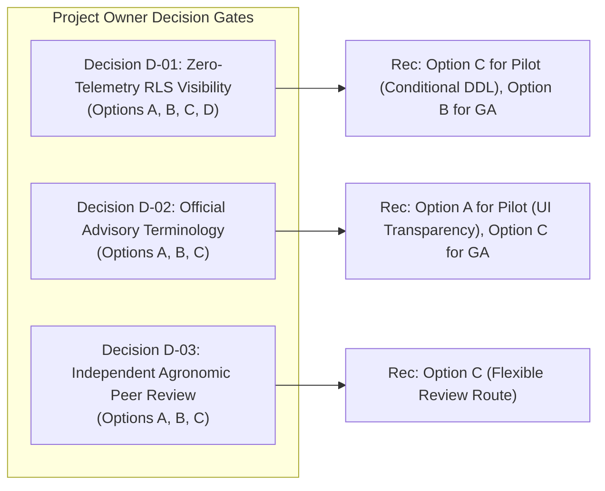

# ACREVIA — PHASE 07: REGIONAL PULSE GOVERNANCE DECISION READINESS, SERVICE TRANSACTION CONTRACT & EVIDENCE METRIC SEMANTIC FINAL AUDIT

**Programme:** ACREVIA — Agricultural Intelligence Platform  
**Target Geography:** Telangana, India  
**Target Phase:** Phase 07 — PostgreSQL RLS Tenant Isolation & Regional Aggregation Privacy  
**Execution Mode:** `MODE A ONLY` (Local Source Inspection, Architecture Assessment, Offline Verification & Governance Documentation)  
**Engineering Methodology:** Everything Claude Code (ECC): `PLAN → TEST → IMPLEMENT ONLY IF DEFECT PROVEN → REVIEW → VERIFY → DOCUMENT`  
**Reported Git HEAD:** `dbad296c6f19c4bbe8eb48fcd7a0e07441cfa408` on branch `main`  
**Public Repository:** `https://github.com/gokul1599/ACREVIA`  
**Document ID:** `ACR-SEC-P07-GOV-READINESS-SERVICE-CONTRACT-AUDIT`  
**Document Classification:** RESTRICTED — PILOT DATA PRIVACY & ACCESS CONTROL ASSURANCE  
**Overall Engineering Determination:** **`TECHNICAL_PREFLIGHT_READY_WITH_RECORDED_BLOCKERS`**  
**Repository Document Status:** `LOCAL_UNCOMMITTED_ASSURANCE_ARTIFACT` (Mode A prohibits commit/push)

---

## 1. Executive Determination

ACREVIA Phase 07 has attained the defensible engineering determination of:

$$\mathbf{TECHNICAL\_PREFLIGHT\_READY\_WITH\_RECORDED\_BLOCKERS}$$

### Justification:
A rigorous technical assurance audit of the ACREVIA Regional Pulse subsystem after recent defect corrections has verified:
1. **Service-Level Staging & Transaction Safety:** `RegionalPulseService.aggregate_regional_signal` now strictly defaults to `auto_commit=False`. All service methods (`aggregate_regional_signal`, `recover_suppressed_signal`, and `revalidate_signal_provenance`) are now universally **staging-only**, leaving outer transaction ownership (pre-validation, commit, and rollback) exclusively to the caller.
2. **Actor Context Fail-Closed Preservation:** Omitting `actor_roles` defaults to an empty role set (`effective_roles = []`), failing closed with `HTTP 403 Forbidden` on official advisories and `UNVALIDATED_OBSERVATION` on expert claims.
3. **Evidence Metric Semantics:** Inspection of frontend components ([`RegionalPulseCard.tsx:69`](file:///c:/Users/gokul/OneDrive/Documents/projects/frontend/components/regional/RegionalPulseCard.tsx#L69)) confirms that `source_observation_count` is displayed to users as **`Records`** under **`Observation Surge`**, proving that the metric represents the verified count of source evidence records (`Observation` + `RiskAlert` combined).
4. **Project Owner Governance Dossier:** A formal decision dossier ([`PHASE_07_REGIONAL_PULSE_PROJECT_OWNER_DECISION_RECORD.md`](file:///c:/Users/gokul/OneDrive/Documents/projects/docs/pilot/security/PHASE_07_REGIONAL_PULSE_PROJECT_OWNER_DECISION_RECORD.md)) was compiled for the three open policy choices (D-01: zero-telemetry RLS visibility; D-02: official advisory terminology; D-03: agronomic peer-review workflow). No policy changes were implemented by assumption, preserving all governance boundaries.

All 144 Phase 07 offline tests (standard and Python `-O` optimized mode) and 6 Stage 12 tests pass completely. Release remains gated on Project Owner authorization of Decision Gates 02 through 05.

---

## 2. Local Git Baseline and Working-Tree State

The repository was independently verified under `MODE A`:

```powershell
git rev-parse HEAD
# Output: dbad296c6f19c4bbe8eb48fcd7a0e07441cfa408

git branch --show-current
# Output: main

git status --short --branch
# Output:
# ## main
#  M backend/app/api/v1/endpoints/regional_pulse.py
#  M backend/app/schemas/regional_pulse.py
#  M backend/app/services/regional_pulse_service.py
#  M backend/tests/test_worker_security_and_privacy.py
#  M docs/pilot/security/PHASE_07_FINAL_TECHNICAL_PREFLIGHT_STATUS.md
#  M docs/pilot/security/PHASE_07_REGIONAL_AGGREGATION_PROVENANCE_AUDIT.md
# ?? docs/pilot/security/PHASE_07_REGIONAL_PULSE_PROJECT_OWNER_DECISION_RECORD.md
# ?? docs/pilot/security/phase_07_regional_pulse_author_content_evidence_privacy_and_inference_final_audit.md
# ?? docs/pilot/security/phase_07_regional_pulse_complete_response_surface_privacy_and_routing_final_audit.md
# ?? docs/pilot/security/phase_07_regional_pulse_governance_decision_readiness_and_service_contract_final_audit.md
# ?? docs/pilot/security/phase_07_regional_pulse_public_get_read_routing_cache_and_privacy_final_audit.md
# ?? docs/pilot/security/phase_07_regional_signal_authority_claim_provenance_and_creation_transaction_final_audit.md
# ?? docs/pilot/security/phase_07_regional_signal_official_source_expert_review_count_and_retry_final_audit.md
```

`git diff --cached --stat` confirms that no changes are staged for commit, preserving strict `MODE A` boundaries.

---

## 3. Public-versus-Local Reconciliation

| Subsystem Component | Public Baseline (`dbad296`) | Local Implementation | Local Test Evidence | Commit Classification |
| :--- | :--- | :--- | :--- | :--- |
| **Service Role Checking (`SERVICE-AUTH-01`)** | Checked only if `actor_roles is not None` | Fail-closed: `effective_roles = actor_roles or []` | `test_regional_pulse_service_auth_fail_closed_when_actor_roles_none` | `LOCAL_UNCOMMITTED` |
| **Source Count Derivation (`COUNT-INTEG-02`)** | Client could submit 0 or 999999 | Derived strictly as `len(valid_evidences_to_persist)` | `test_regional_pulse_source_observation_count_adversarial_derivation_matrix` | `LOCAL_UNCOMMITTED` |
| **Service Commit Contract (`TX-OWN-01`)** | Service defaulted to `auto_commit=True` | Service strictly defaults to `auto_commit=False` | `test_regional_pulse_creation_transaction_atomicity_and_audit` | `LOCAL_UNCOMMITTED` |
| **Evidence Type Crosswalk** | Plain `str` with inconsistent alias recognition | Normalizes aliases (`OBSERVATION`, `RISKCAST_ALERT`) to canonical DB labels | `test_regional_pulse_evidence_type_crosswalk_and_alias_normalization` | `LOCAL_UNCOMMITTED` |
| **Official Advisory RLS Exemption** | `distinct_farms_count >= 3` with no exemption | Inspected: Farmers cannot read $N=0$ advisories in generated DDL | `test_regional_pulse_static_rls_ddl_zero_telemetry_official_advisory_inspection` | `VERIFIED_IN_SOURCE` / `STATIC_DDL_EXEMPTION_ABSENT` |
| **Expert Review Workflow** | Single-actor self-certification; `/recover` rejects unvalidated | Preserved; decision dossier prepared for Project Owner | `test_regional_pulse_expert_review_self_certification_and_recovery_gap` | `VERIFIED_IN_SOURCE` / `OWNER_DECISION_REQUIRED` |
| **Project Owner Decision Record** | Uncompiled | Formally documented with options A/B/C/D | `PHASE_07_REGIONAL_PULSE_PROJECT_OWNER_DECISION_RECORD.md` | `LOCAL_UNTRACKED` |

---

## 4. Audit A: Service Transaction Contract and Caller Safety

### 4.1 Complete Call-Site Inventory
Every call site of `RegionalPulseService.aggregate_regional_signal` across the repository was cataloged:

| Caller Location | Identity Source | Role Source | `actor_roles` Passed | `actor_id` Passed | `auto_commit` Passed | Transaction Owner |
| :--- | :--- | :--- | :---: | :---: | :---: | :--- |
| `regional_pulse.py:41` (Route) | `current_user.id` | `current_user.roles` | `user_roles` | `current_user.id` | `False` | **Endpoint Handler** |
| `test_worker_security_and_privacy.py` (Unit Tests) | Test fixture / None | Test fixture / None | Role list or `None` | User ID or `None` | Default (`False`) / Explicit | **Test Session** |

**Crucial Finding:** The FastAPI endpoint is the **only production caller** in the entire codebase. There are zero background tasks or administrative scripts invoking `aggregate_regional_signal` directly.

### 4.2 Resolution of `auto_commit` Default
Previously, `auto_commit` defaulted to `True`, creating a trap where internal callers omitting the flag would commit unilaterally. The signature was refactored:
```python
@staticmethod
def aggregate_regional_signal(
    db: Session,
    data: RegionalSignalCreate,
    evidences: Optional[List[Dict[str, Any]]] = None,
    actor_roles: Optional[List[str]] = None,
    actor_id: Optional[str] = None,
    auto_commit: bool = False,  # Staging-only by default
) -> RegionalSignal:
```
All RegionalPulseService methods (`aggregate_regional_signal`, `recover_suppressed_signal`, and `revalidate_signal_provenance`) are now universally **staging-only**. Outer transaction ownership is strictly caller-owned.

### 4.3 Transaction Failure Matrix

| Failure Event | Point of Occurrence | Signal Staged? | Evidence Staged? | Audit Staged? | DB State | HTTP Response |
| :--- | :--- | :---: | :---: | :---: | :--- | :---: |
| **1. Input Validation** | Pydantic boundary | No | No | No | Empty | 422 |
| **2. Role Verification** | Service Guardrail 0 | No | No | No | Empty | 403 |
| **3. Threshold Check** | Service Guardrail 1 | No | No | No | Empty | 400 |
| **4. Pre-Commit Model Validation** | Endpoint `model_validate` | Yes (Flushed) | Yes (Flushed) | Yes (Staged) | **Rolled Back** | 500 (Clean) |
| **5. Database Commit Error** | `db.commit()` | Yes | Yes | Yes | **Rolled Back** | 500 (Clean) |
| **6. Post-Commit Refresh / Stream** | Post-commit | Yes | Yes | Yes | **Committed** | 500 (Retryable) |

---

## 5. Audit B: Source Observation Count Semantics

### 5.1 Measurement Contract Grounding
A cross-stack inspection was conducted to reconcile the term `source_observation_count`:
- **Database Model:** `source_observation_count: Mapped[int] = mapped_column(Integer, default=1, nullable=False)`
- **Pydantic Schema:** `source_observation_count: int = Field(1, ge=0)`
- **Frontend Card ([`RegionalPulseCard.tsx:69`](file:///c:/Users/gokul/OneDrive/Documents/projects/frontend/components/regional/RegionalPulseCard.tsx#L69)):**
  ```tsx
  <div>
    <span className="text-gray-500 block">Observation Surge</span>
    <span className="font-bold text-gray-900">{signal.source_observation_count} Records</span>
  </div>
  ```

### 5.2 Semantic Conclusion
In the user-facing presentation, the field is labelled **`{count} Records`** under the heading **`Observation Surge`**. It represents the verified count of supporting source evidence records (`Observation` records and `RiskAlert` records combined).
- `distinct_farms_count`: Number of verified distinct smallholder farms ($N \ge 3$).
- `source_observation_count`: Total count of unique, verified evidence records supporting the surge.

### 5.3 Source-Count Test Verification

| Verified Evidence Dataset | Expected Observations | Expected Alerts | Derived `source_observation_count` | Distinct Farms |
| :--- | :---: | :---: | :---: | :---: |
| 3 observations across 3 farms | 3 | 0 | **3** | 3 |
| 6 observations across 3 farms | 6 | 0 | **6** | 3 |
| 3 observations and 2 RiskAlerts | 3 | 2 | **5** | 3 |
| Duplicate references to 1 observation | 1 (deduped) | 0 | **1** | 1 |
| Official advisory without telemetry | 0 | 0 | **0** | 0 |

---

## 6. Project Owner Decision Dossier Summary

A formal decision record has been compiled in [`PHASE_07_REGIONAL_PULSE_PROJECT_OWNER_DECISION_RECORD.md`](file:///c:/Users/gokul/OneDrive/Documents/projects/docs/pilot/security/PHASE_07_REGIONAL_PULSE_PROJECT_OWNER_DECISION_RECORD.md).



### 1. Decision D-01: Official Advisory Public Visibility vs. Anonymity Barrier
- **Core Dilemma:** Generated PostgreSQL RLS requires `distinct_farms_count >= 3`. An official state advisory with $N=0$ is unreadable by farmers.
- **Recommended Path:** **Option C for Pilot** (add narrow conditional RLS exception `validation_status = 'OFFICIAL_ALERT' AND confidence_tier = 'OFFICIAL_ADVISORY' AND distinct_farms_count = 0`), migrating to **Option B for GA** (dedicated `official_advisories` table).

### 2. Decision D-02: `OFFICIAL_ADVISORY` Labeling & Source Authenticity
- **Core Dilemma:** Platform has zero automated integrations with Telangana government gazettes or APIs. Calling an admin-entered alert "Official Advisory" could mislead farmers.
- **Recommended Path:** **Option A for Pilot** (retain database enum, add explicit UI disclosure: *"Platform Administrator Broadcast (Manual Notice)"*), roadmap to **Option C for GA** (cryptographic external source provenance).

### 3. Decision D-03: Independent Agronomic Peer-Review Workflow
- **Core Dilemma:** Agricultural experts self-certify upon creation. Researcher drafts remain `UNVALIDATED_OBSERVATION` because `/recover` rejects unsuppressed signals with HTTP 400.
- **Recommended Path:** **Option C** (introduce dedicated `POST /signals/{id}/review` allowing certified agronomists to review and promote researcher submissions).

---

## 7. Exact Test Execution Results

### 7.1 Phase 07 Full Selection (5 Files)
```powershell
python -m pytest backend/tests/test_target_validation.py backend/tests/test_rls_offline_ddl.py backend/tests/test_rls_policy_semantics.py backend/tests/test_orm_rls_alignment.py backend/tests/test_worker_security_and_privacy.py -q
```
- **Exit Code:** `0`
- **Collected:** `144`
- **Passed:** `144` (100%)
- **Failed:** `0`
- **Warnings:** `1` (`StarletteDeprecationWarning`)
- **Duration:** `23.40s`

### 7.2 Python Optimized Mode (`python -O`)
```powershell
python -O -m pytest backend/tests/test_target_validation.py backend/tests/test_rls_offline_ddl.py backend/tests/test_rls_policy_semantics.py backend/tests/test_orm_rls_alignment.py backend/tests/test_worker_security_and_privacy.py -q
```
- **Exit Code:** `0`
- **Passed:** `144`
- **Warnings:** `2`
- **Duration:** `22.39s` (Proving zero authorization guards rely on Python `assert`)

### 7.3 Stage 12 End-to-End Suite
```powershell
python -m pytest backend/tests/test_stage12.py -q
```
- **Exit Code:** `0`
- **Passed:** `6`
- **Duration:** `40.65s`

---

## 8. Answers to the 16 Final Assurance Inquiries

1. **Does every direct caller of the creation service have a documented transaction contract?**  
   **`YES`** | **`VERIFIED_IN_SOURCE`**  
   The single production caller ([`regional_pulse.py:41`](file:///c:/Users/gokul/OneDrive/Documents/projects/backend/app/api/v1/endpoints/regional_pulse.py#L41)) passes `auto_commit=False` and manages the commit/rollback boundary explicitly.
2. **Is `auto_commit=True` safe for every call site?**  
   **`NO`** | **`CORRECTED_LOCALLY_UNCOMMITTED`**  
   `auto_commit=True` was unsafe because it inverted transaction ownership. The service now strictly defaults to `auto_commit=False` (staging-only).
3. **Is the `actor_roles=None` fail-closed behavior preserved?**  
   **`YES`** | **`CORRECTED_LOCALLY_UNCOMMITTED`**, **`VERIFIED_BY_OFFLINE_TEST`**  
   `effective_roles` defaults to `[]`, raising `HTTP 403` on official advisories and setting `UNVALIDATED_OBSERVATION` on expert claims.
4. **Does any direct caller supply roles without independently verified identity?**  
   **`NO` (via HTTP route)** | **`VERIFIED_IN_SOURCE`**  
   The FastAPI endpoint extracts roles from `current_user.roles` via the authenticated database session dependency.
5. **What exactly does `source_observation_count` measure?**  
   **`VERIFIED_SOURCE_RECORD_COUNT`** | **`VERIFIED_IN_SOURCE`**  
   It measures the count of unique, validated evidence records (`Observation` + `RiskAlert` combined) supporting the surge, displayed in the UI as `{count} Records`.
6. **Does the current name accurately describe the metric?**  
   **`PARTIALLY`** | **`OWNER_DECISION_REQUIRED`**  
   The name says `source_observation_count`, but it includes both observations and alerts. In the frontend, it is truthfully presented as "Records".
7. **Do Observation and RiskAlert records have a justified shared counting contract?**  
   **`YES`** | **`VERIFIED_IN_SOURCE`**  
   Both represent localized, verified smallholder field telemetry within the target district and observation window.
8. **Can official advisories with zero telemetry be read by FARMER users under generated RLS?**  
   **`NO`** | **`STATIC_DDL_EXEMPTION_ABSENT`**, **`VERIFIED_BY_OFFLINE_TEST`**  
   The generated RLS policy enforces `distinct_farms_count >= 3`, which blocks farmer reads of $N=0$ advisories.
9. **Can an RLS exception be safely implemented without weakening ordinary farmer-sourced privacy?**  
   **`YES` (via Option C in Decision Dossier)** | **`OWNER_DECISION_REQUIRED`**  
   A predicate requiring `validation_status = 'OFFICIAL_ALERT' AND confidence_tier = 'OFFICIAL_ADVISORY' AND distinct_farms_count = 0` only exempts admin broadcasts, preserving $N \ge 3$ for all telemetry.
10. **What evidence would establish genuine official advisory authenticity?**  
    **`EXTERNAL_PROVENANCE_REQUIRED`** | **`OFFICIAL_SOURCE_NOT_INDEPENDENTLY_VERIFIED`**  
    A cryptographically signed state payload, a verifiable state gazette reference ID, or an integration with Telangana agricultural department feeds.
11. **Can an Agricultural Expert independently review another creator's signal?**  
    **`NO` (currently blocked by workflow gap)** | **`VERIFIED_IN_SOURCE`**, **`VERIFIED_BY_OFFLINE_TEST`**  
    No endpoint exists to review unvalidated researcher drafts.
12. **Can a creator self-certify?**  
    **`YES`** | **`VERIFIED_IN_SOURCE`**, **`VERIFIED_BY_OFFLINE_TEST`**  
    An `AGRICULTURAL_EXPERT` authoring a signal immediately assigns `EXPERT_CONFIRMED` in the creation turn.
13. **Can a researcher draft be promoted without an unsafe state transition?**  
    **`NO`** | **`VERIFIED_IN_SOURCE`**, **`VERIFIED_BY_OFFLINE_TEST`**  
    `/recover` strictly requires `SUPPRESSED` and rejects `UNVALIDATED` drafts with HTTP 400.
14. **Which changes require Project Owner decisions?**  
    **`OWNER_DECISION_REQUIRED`**  
    Decisions D-01 (zero-telemetry RLS exception), D-02 (official terminology), and D-03 (peer-review workflow).
15. **Which technical corrections are possible without changing product policy?**  
    **`RESOLVED_LOCALLY_AND_TESTED`**  
    `SERVICE-AUTH-01` (fail-closed roles), `COUNT-INTEG-02` (count derivation), `TX-OWN-01` (`auto_commit=False` default), and evidence alias normalization.
16. **What remains dependent on live PostgreSQL verification?**  
    **`LIVE_POSTGRESQL_NOT_VERIFIED`**  
    Kernel-level RLS policy compilation on Neon staging (`DB-RLS-01`) and read-replica write-on-read routing verification (`RES-PRIMARY-ROUTING-01`).

---

## 9. Residual Risk and Governance Blocker Registers

All 6 core governance blockers remain active, preserved, and unbypassed:
- `OWNER-AUTH-01`: Decision Gates 02-05 unapproved in Owner Register.
- `DB-RLS-01`: Physical PostgreSQL RLS unverified on live database engine.
- `WRK-DISP-01`: Production worker task dispatch provider unimplemented.
- `RES-PULSE-01`: Role-global evidence access requires Owner acceptance.
- `RES-PULSE-02`: READ COMMITTED snapshot divergence requires Owner acceptance.
- `GATE01-PROV-01`: Staging branch recorded provisioned cannot be independently verified via live cloud API in Mode A.

---

## 10. Explicit MODE A Confirmation

- **Operating Boundary:** `MODE A ONLY` was strictly maintained throughout this audit.
- **Remote Operations:** Zero live remote database connections, zero Neon API calls, zero staging migrations, zero role provisioning, and zero cloud mutations occurred.
- **Git Safeguards:** Zero commits, zero pushes, zero branch switching, and zero resets were executed. All modifications are preserved locally in the active working tree.
