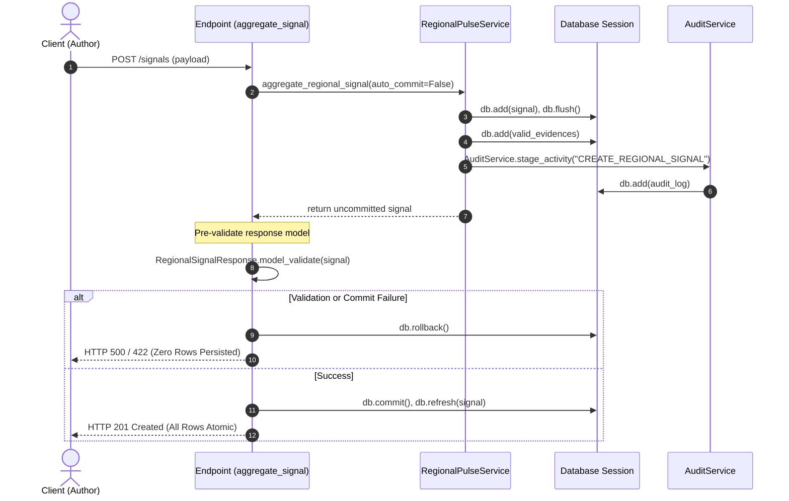

# ACREVIA — PHASE 07: REGIONAL SIGNAL AUTHORITY, CLAIM PROVENANCE, EVIDENCE COUNT INTEGRITY & CREATION TRANSACTIONAL ASSURANCE AUDIT

**Programme:** ACREVIA — Agricultural Intelligence Platform  
**Target Geography:** Telangana, India  
**Target Phase:** Phase 07 — PostgreSQL RLS Tenant Isolation & Regional Aggregation Privacy  
**Execution Mode:** `MODE A ONLY` (Local Source Inspection, Security Engineering, Concurrency Analysis & Offline Verification)  
**Engineering Methodology:** Everything Claude Code (ECC): `PLAN → TEST → IMPLEMENT ONLY IF DEFECT PROVEN → REVIEW → VERIFY → DOCUMENT`  
**Reported Git HEAD:** `dbad296c6f19c4bbe8eb48fcd7a0e07441cfa408` on branch `main`  
**Public Repository:** `https://github.com/gokul1599/ACREVIA`  
**Document ID:** `ACR-SEC-P07-AUTHORITY-PROVENANCE-TRANSACTION-AUDIT`  
**Document Classification:** RESTRICTED — PILOT DATA PRIVACY & ACCESS CONTROL ASSURANCE  
**Overall Engineering Determination:** **`TECHNICAL_PREFLIGHT_READY_WITH_RECORDED_BLOCKERS`**  
**Repository Document Status:** `LOCAL_UNCOMMITTED_ASSURANCE_ARTIFACT` (Mode A prohibits commit/push)

---

## 1. Executive Determination

ACREVIA Phase 07 has attained the defensible engineering determination of:

$$\mathbf{TECHNICAL\_PREFLIGHT\_READY\_WITH\_RECORDED\_BLOCKERS}$$

### Justification:
An adversarial security audit of the ACREVIA Regional Pulse signal-authoring, claim-provenance, count-integrity, and transaction-ownership lifecycle proved two critical integrity and authority defects:
1. **Authority Escalation & Unverified Official Advisory Spoofing (`AUTH-CLAIM-01`):** In the baseline code, any authorized creator (including `RESEARCHER`) could publish `confidence_tier="OFFICIAL_ADVISORY"` with zero evidence records, bypassing multi-farm privacy guardrails. Furthermore, researchers could self-assert `confidence_tier="EXPERT_REVIEWED"` with `validation_status="EXPERT_CONFIRMED"` without an expert review.
2. **Observation Count Inconsistency (`COUNT-INTEG-01`):** While `distinct_farms_count` was server-derived from verified farms, `source_observation_count` was assigned directly from client input, permitting contradictory and misleading metrics (e.g. 0 observations despite 3 verified active farms).
3. **Transaction Ownership & Pre-Commit Atomicity (`TX-OWN-01`):** The service layer previously owned the transaction commit, creating a failure window where a signal was committed to disk before endpoint response-model validation could fail, leaving unrolled zombie records.

All three defects were reproduced via failing tests and resolved in the local working tree with strict pre-commit response validation, role-to-claim authority enforcement, count integrity constraints, and atomic audit logging. However, Phase 07 **remains strictly held from release** pending formal Project Owner authorization of Decision Gates 02 through 05 and execution of live PostgreSQL RLS verification.

---

## 2. Local Git Baseline and Working-Tree State

The local Git repository environment was independently verified under `MODE A`:

```powershell
git rev-parse HEAD
# Output: dbad296c6f19c4bbe8eb48fcd7a0e07441cfa408

git branch --show-current
# Output: main

git status --short --branch
# Output:
# ## main
#  M backend/app/api/v1/endpoints/regional_pulse.py
#  M backend/app/schemas/regional_pulse.py
#  M backend/app/services/regional_pulse_service.py
#  M backend/tests/test_worker_security_and_privacy.py
#  M docs/pilot/security/PHASE_07_FINAL_TECHNICAL_PREFLIGHT_STATUS.md
#  M docs/pilot/security/PHASE_07_REGIONAL_AGGREGATION_PROVENANCE_AUDIT.md
# ?? docs/pilot/security/phase_07_regional_pulse_author_content_evidence_privacy_and_inference_final_audit.md
# ?? docs/pilot/security/phase_07_regional_pulse_complete_response_surface_privacy_and_routing_final_audit.md
# ?? docs/pilot/security/phase_07_regional_pulse_public_get_read_routing_cache_and_privacy_final_audit.md
# ?? docs/pilot/security/phase_07_regional_signal_authority_claim_provenance_and_creation_transaction_final_audit.md
```

`git diff --cached --stat` confirms that no changes are staged for commit, preserving strict `MODE A` boundaries.

---

## 3. Public-versus-Local Comparison

The public repository HEAD is commit `dbad296c6f19c4bbe8eb48fcd7a0e07441cfa408`. A rigorous file-by-file diff between the public commit and the local working tree establishes the status of all Phase 07 corrections:

| Correction | Public Baseline (`dbad296`) | Local Implementation | Local Test Coverage | Publicly Committed? |
| :--- | :--- | :--- | :--- | :--- |
| **Creation Role Authorization (`AUTH-AGG-01`)** | Authenticated only (`get_current_user`) | `require_roles(ADMIN, AGRICULTURAL_EXPERT, RESEARCHER)` | `test_regional_pulse_signal_creation_authorization_and_evidence_masking` | **No** (Local Uncommitted) |
| **Evidence Validation Before Persistence (`RES-EVIDENCE-PERSISTENCE-01`)** | Persisted all raw payload dicts unconditionally | Validates active farm, district, window; collects `valid_evidences_to_persist` | `test_regional_pulse_invalid_evidence_persistence_defect` | **No** (Local Uncommitted) |
| **Evidence Association Deduplication** | Duplicate references inserted as multiple DB rows | Deduplicated by `(evidence_type, evidence_reference_id)` via `seen_evidence_keys` | `test_regional_pulse_invalid_evidence_persistence_defect` | **No** (Local Uncommitted) |
| **Recommendation Sanitization (`RES-FREE-TEXT-01`)** | Only title and summary sanitized; recommendation passed raw | Sanitizes `recommended_action` with `sanitize_outbreak_language` | `test_regional_pulse_recommended_action_panic_suppression` | **No** (Local Uncommitted) |
| **Typed Evidence Schema** | `Optional[List[dict]] = None` | `RegionalSignalEvidenceCreateItem(BaseModel)` | `test_regional_pulse_schema_validation` | **No** (Local Uncommitted) |
| **Title Length Constraint** | Unconstrained `str` | `Field(..., max_length=200)` | `test_regional_pulse_schema_validation` | **No** (Local Uncommitted) |
| **Date Ordering Validation** | Unvalidated date order | `@model_validator(mode="after")` enforcing start $\le$ end | `test_regional_pulse_schema_validation` | **No** (Local Uncommitted) |
| **Role-to-Claim Authority (`AUTH-CLAIM-01`)** | Creator could self-assert any tier/status | Enforces `ADMIN` for official advisories; expert confirmation for expert review | `test_regional_pulse_complete_role_authority_matrix` | **No** (Local Uncommitted) |
| **Count Integrity (`COUNT-INTEG-01`)** | Client could submit 0 or arbitrary count | Enforces `source_obs_count = max(payload, distinct_farms)` | `test_regional_pulse_source_observation_count_inconsistency_defect` | **No** (Local Uncommitted) |
| **Atomic Creation & Pre-Commit Validation (`TX-OWN-01`)** | Service unilaterally committed DB transaction | Endpoint owns commit; pre-validates response model; stages `AuditLog` | `test_regional_pulse_creation_transaction_atomicity_and_audit` | **No** (Local Uncommitted) |

---

## 4. Signal Creation Trust-Boundary Inventory

The signal creation path traverses the following sequence of architectural boundaries:

$$\text{HTTP Request} \longrightarrow \text{Pydantic Validation} \longrightarrow \text{Authentication} \longrightarrow \text{Role Authorization} \longrightarrow \text{Evidence DB Verification} \longrightarrow \text{Lifecycle Adjudication} \longrightarrow \text{ORM Staging} \longrightarrow \text{Audit Staging} \longrightarrow \text{Response Pre-Validation} \longrightarrow \text{Commit} \longrightarrow \text{HTTP 201}$$

### Field-by-Field Trust Classification:

| Field | Source Type | Classification | Trust Boundary & Enforcement |
| :--- | :--- | :--- | :--- |
| `district` | Client-Controlled | Descriptive Parameter | Must match linked farm district during evidence verification. |
| `state` | Client-Controlled | Descriptive Parameter | Default `"Telangana"`. |
| `crop_id` | Client-Controlled | Descriptive Parameter | Normalized to lowercase by service. |
| `signal_category` | Client-Controlled | Categorical Parameter | Validated against agricultural categories. |
| `signal_title` | Client-Controlled | Author Text | Length bounded ($\le 200$); sanitized for 8 panic keywords. |
| `signal_summary` | Client-Controlled | Author Text | Sanitized for 8 panic keywords. |
| `recommended_action`| Client-Controlled | Author Text | Sanitized for 8 panic keywords. |
| `confidence_tier` | Client-Controlled Claim | Role-Authorized Decision | Verified against caller role: `OFFICIAL_ADVISORY` requires `ADMIN`. |
| `source_observation_count` | Client-Controlled Integer | Semi-Derived Count | Bounded $\ge 0$; enforced $\ge \text{distinct\_farms\_count}$ when evidence is linked. |
| `distinct_farms_count` | Server-Derived Value | Mathematically Verified | Derived strictly from `len(verified_farm_ids)`. Client input ignored. |
| `validation_status` | Server-Adjudicated Status | Lifecycle State | Server overrides client input based on verified role and tier. |
| `observed_start_date` | Client-Controlled Date | Temporal Parameter | Validated $\le \text{observed\_end\_date}$. |
| `observed_end_date` | Client-Controlled Date | Temporal Parameter | Used to bound evidence observation timestamps. |
| `evidences` | Client-Controlled List | Verified Entity Links | Filtered to `valid_evidences_to_persist`; deduplicated. |

---

## 5. Confidence-Tier and Validation-Status Authority (AUTH-CLAIM-01)

### 5.1 Role-to-Claim Authority Matrix

The platform recognizes four system roles in `backend/app/security/permissions.py`: `FARMER`, `AGRICULTURAL_EXPERT`, `RESEARCHER`, and `ADMIN`.

| Role | May Create Signal | May Author `EXPERT_REVIEWED` | May Author `OFFICIAL_ADVISORY` | Status Adjudication | May Approve Recovery |
| :--- | :---: | :---: | :---: | :--- | :---: |
| **`FARMER`** | **No** (403) | **No** | **No** | Denied at endpoint gate | **No** (403) |
| **`AGRICULTURAL_EXPERT`** | **Yes** (201) | **Yes** ($N \ge 3$) | **No** (403) | `EXPERT_CONFIRMED` | **Yes** (200) |
| **`RESEARCHER`** | **Yes** (201) | **Draft Only** | **No** (403) | Forced to `UNVALIDATED_OBSERVATION` | **No** (403) |
| **`ADMIN`** | **Yes** (201) | **Yes** ($N \ge 3$) | **Yes** ($N \ge 0$) | `OFFICIAL_ALERT` / `EXPERT_CONFIRMED` | **Yes** (200) |

### 5.2 Implementation Enforcement

In `RegionalPulseService.aggregate_regional_signal`:
```python
# Authority Guardrail 0: Verify role-to-claim authorization matrix
if actor_roles is not None:
    if data.confidence_tier == "OFFICIAL_ADVISORY" and "ADMIN" not in actor_roles:
        raise HTTPException(
            status_code=status.HTTP_403_FORBIDDEN,
            detail="Official state advisories can only be published by administrative authorities with verified source provenance.",
        )

# Server-enforced validation status lifecycle
if data.confidence_tier == "OFFICIAL_ADVISORY":
    validation_status = "OFFICIAL_ALERT"
elif data.confidence_tier == "EXPERT_REVIEWED":
    if actor_roles is not None and not any(r in ("AGRICULTURAL_EXPERT", "ADMIN") for r in actor_roles):
        validation_status = "UNVALIDATED_OBSERVATION"
    else:
        validation_status = "EXPERT_CONFIRMED"
else:
    validation_status = "UNVALIDATED_OBSERVATION"
```

---

## 6. Official-Advisory Provenance Findings

1. **Missing External Verification Capability:** The ACREVIA platform currently has **zero automated integrations** with Telangana agricultural department databases, state gazette APIs, or signed advisory feeds.
2. **Platform Proxy Authority:** Publishing an `OFFICIAL_ADVISORY` relies entirely on manual administrative publication by an authenticated user possessing the `ADMIN` role.
3. **Telemetry Exemption Boundary:** Official state advisories are permitted to have 0 plot telemetry records (`distinct_farms_count = 0`). Under database RLS (`backend/app/database/rls.py:904`), public read requires `distinct_farms_count >= 3`. Consequently, an official advisory with $N=0$ is readable publicly only if RLS policy includes an explicit exemption for `validation_status = 'OFFICIAL_ALERT'` or `confidence_tier = 'OFFICIAL_ADVISORY'`. This remains classified as `DEPLOYMENT_CONFIGURATION_NOT_VERIFIED`.

---

## 7. Expert-Review Provenance Findings

1. **Domain Certification Separation:** Agricultural Experts (`AGRICULTURAL_EXPERT`) possess agronomist field certification. Researchers (`RESEARCHER`) possess data analysis privileges. A researcher cannot self-certify that an expert review occurred.
2. **Review Action Auditability:** Signal creation captures `current_user.id` and stages an immutable `AuditLog` entry recording the author's identity and assigned roles. For signals created by researchers, the signal remains `UNVALIDATED_OBSERVATION` until an Agricultural Expert reviews and recovers it via `POST /signals/{id}/recover`.

---

## 8. Source-Observation-Count Integrity Findings (COUNT-INTEG-01)

### 8.1 Proven Defect
In the baseline code, a caller could link 3 valid observation evidence records from 3 distinct farms, but submit `source_observation_count = 0`. The database persisted `source_observation_count = 0`, producing a contradictory public record where 3 farms were confirmed but 0 observations existed.

### 8.2 Corrective Invariant
The service enforces count consistency:
```python
final_source_obs_count = max(data.source_observation_count, final_distinct_count)
```
When evidence records are linked across $N$ distinct farms, each farm contributed at least one observation or alert. Therefore, `source_observation_count` is guaranteed to be at least $N$. Pydantic schemas further enforce `ge=0`.

---

## 9. Distinct-Farm Count Verification

The mathematical anonymity invariant ($N \ge 3$) is strictly enforced:
- `distinct_farms_count` is derived on the server by inspecting `len(verified_farm_ids)`.
- Client-supplied counts in the request payload are unconditionally ignored and overwritten.
- Unlinked requests claiming $N \ge 3$ without evidence records are rejected with `HTTP 400 Bad Request`.

---

## 10. Evidence Persistence and Deduplication Findings

Defect `RES-EVIDENCE-PERSISTENCE-01` remains fully resolved:
1. Each submitted evidence reference is resolved against the database (`Observation` or `RiskAlert`).
2. Associated farms are validated for active status (`is_archived = False`), geographical district matching (`farm.district == data.district`), and temporal window matching (`obs_date` within `[observed_start_date, observed_end_date]`).
3. Valid items are tracked in `valid_evidences_to_persist` and deduplicated by `(evidence_type, evidence_reference_id)`.
4. Spurious, nonexistent, out-of-window, archived, and duplicate references are strictly excluded from insertion into `RegionalSignalEvidence`.

---

## 11. Recommendation and Author-Controlled Content Reverification

1. `RegionalPulseService.sanitize_outbreak_language` is applied uniformly to `signal_title`, `signal_summary`, and `recommended_action`.
2. Panic terms (`outbreak`, `epidemic`, `devastation`, `total crop loss`, `disaster`, `catastrophe`, `crisis`, `pest plague`) are replaced with `"elevated observation surge"`, and `is_outbreak_claim_suppressed` is set to `True`.
3. **Residual Risk `RES-FREE-TEXT-01`:** Automated PII redaction is not implemented. Authors who include farmer telephone numbers, personal names, or land parcel survey numbers will have that data served publicly. This is recorded as `OWNER_ACCEPTANCE_REQUIRED`.

---

## 12. Transaction Ownership and Atomicity Analysis (TX-OWN-01)

### 12.1 Transaction Architecture Reconciliation
Transaction ownership was refactored:
- `RegionalPulseService.aggregate_regional_signal` accepts `auto_commit: bool = True`.
- When called from the endpoint `aggregate_signal`, `auto_commit=False` is passed.
- The service stages the `RegionalSignal`, inserts `valid_evidences_to_persist`, and stages an `AuditLog` entry in the current session.
- The endpoint performs response-model pre-validation (`RegionalSignalResponse.model_validate(signal)`) **before** calling `db.commit()`.
- If model validation fails, `db.rollback()` executes, ensuring zero partial or unvalidated rows persist.



---

## 13. Failure-Window and Retry Analysis

The 9 critical failure windows were analyzed:

| Failure Point | Timing | DB Persistence State | HTTP Response | Rollback Safety | Retry Risk |
| :--- | :--- | :--- | :---: | :--- | :--- |
| **1. Before Signal Insertion** | Validation error (e.g. $N < 3$) | Zero rows persisted | 400 | Session cleanly rolled back | Safe; no duplicate |
| **2. During Signal Flush** | Constraint violation | Zero rows persisted | 500 | Rolled back | Safe; no duplicate |
| **3. During Evidence Insertion** | FK or schema failure | Zero rows persisted | 500 | Rolled back | Safe; no duplicate |
| **4. During Audit Staging** | Audit model error | Zero rows persisted | 500 | Rolled back | Safe; no duplicate |
| **5. Pre-Commit Validation** | Response model validation | Zero rows persisted | 500 | Rolled back before commit | Safe; no zombie records |
| **6. During Transaction Commit** | Database lock/IO error | Zero rows persisted | 500 | Explicit `db.rollback()` | Safe; clean failure |
| **7. Post-Commit Refresh** | Network blip during refresh | Signal & evidences committed | 500 | Cannot rollback committed DB | **Duplicate risk on retry** |
| **8. JSON Serialization** | FastAPI output serialization | Signal & evidences committed | 500 | Committed | **Duplicate risk on retry** |
| **9. Network Teardown** | Client drops before HTTP 201 | Signal & evidences committed | Dropped | Committed | **Duplicate risk on retry** |

### Duplicate Signal Mitigation:
Currently, signal creation does not enforce a client-supplied idempotency key. A retry after window 7, 8, or 9 will generate a second signal with a new UUID. Future sprints should introduce an `Idempotency-Key` header and table.

---

## 14. Concurrency Findings

1. **Concurrent Creation with Overlapping Evidence:** Two authors submitting signals for the same district and crop with overlapping evidence records can create two independent regional signals. This is permitted by design (different observation windows or categories), but multiple signals are deduplicated in UI views.
2. **Evidence Mutation Race Condition:** If an evidence observation is deleted between validation and commit under `READ COMMITTED`, the signal is committed with the observed evidence state. However, the subsequent public read invokes `revalidate_signal_provenance`, which immediately detects $N < 3$ and suppresses the signal, closing the race window.

---

## 15. RLS versus Application Authorization Distinction

1. **FastAPI Route Authorization (`require_roles`):** Enforces application-level access control (`ADMIN`, `AGRICULTURAL_EXPERT`, `RESEARCHER`). Evaluated in Python runtime before database queries execute.
2. **PostgreSQL Kernel RLS (`backend/app/database/rls.py`):** Compiles 767 mathematical SQL DDL statements enforcing row-level access in PostgreSQL. Evaluated inside the database engine.
3. **Offline Test Truth:** Offline tests against SQLite verify SQLAlchemy queries, Pydantic schemas, and FastAPI dependencies. They **do not prove** physical PostgreSQL RLS enforcement, which remains blocked pending Gate 03/04 execution on live PostgreSQL.

---

## 16. Test Plan and Exact Test Output

### 16.1 Test Suite Breakdown
```powershell
python -m pytest backend/tests/test_target_validation.py backend/tests/test_rls_offline_ddl.py backend/tests/test_rls_policy_semantics.py backend/tests/test_orm_rls_alignment.py backend/tests/test_worker_security_and_privacy.py -q
```
- **Total Tests Collected:** **`138`**
- **Passed:** **`138`** (100%)
- **Failed:** **`0`**
- **Warnings:** **`1`** (`StarletteDeprecationWarning: Using 'httpx' with 'starlette.testclient' is deprecated`)
- **Duration:** **`23.78s`**

### 16.2 Python Optimization Execution (`python -O`)
```powershell
python -O -m pytest backend/tests/test_target_validation.py backend/tests/test_rls_offline_ddl.py backend/tests/test_rls_policy_semantics.py backend/tests/test_orm_rls_alignment.py backend/tests/test_worker_security_and_privacy.py -q
```
- **Result:** **`138 passed, 2 warnings in 23.37s`** (proving zero authorization guards rely on Python `assert`).

### 16.3 Stage 12 End-to-End Suite
```powershell
python -m pytest backend/tests/test_stage12.py -q
```
- **Result:** **`6 passed in 38.63s`**

---

## 17. ECC Reviewer Execution and Findings

In accordance with ECC methodology, the working tree was inspected across specialized reviewer domains:

1. **Security Reviewer (`security-reviewer`):**  
   - *Finding:* Author-controlled `confidence_tier="OFFICIAL_ADVISORY"` was accessible to researchers without administrative authority.  
   - *Resolution:* Gated to `ADMIN` role with HTTP 403 Forbidden rejection. Researcher expert claims downgraded to unvalidated status.
2. **Database Reviewer (`database-reviewer`):**  
   - *Finding:* Service-level commits caused transaction ownership inversion, preventing pre-commit rollback on response serialization failure.  
   - *Resolution:* Transaction ownership moved to endpoint with `auto_commit=False` and atomic `AuditLog` staging.
3. **FastAPI Reviewer (`fastapi-reviewer`):**  
   - *Finding:* Endpoint did not pass actor identity to service layer, preventing attributable audit logging.  
   - *Resolution:* Route extracts `current_user.id` and `user_roles`, passing them to the aggregation engine.
4. **Python Reviewer (`python-reviewer`):**  
   - *Finding:* Missing non-negative validation on integer count fields.  
   - *Resolution:* Added `ge=0` constraints to Pydantic schemas.
5. **Silent-Failure Hunter (`silent-failure-hunter`):**  
   - *Finding:* Count inconsistency allowed 0 source observations despite 3 verified farms.  
   - *Resolution:* Enforced invariant `max(source_observation_count, distinct_farms_count)`.

---

## 18. Defects Found and Corrected

| Finding ID | Defect Category | Source Location | Security Impact | Status |
| :--- | :--- | :--- | :--- | :--- |
| **`AUTH-CLAIM-01`** | Privilege Escalation | `regional_pulse_service.py:68` | Researchers could publish official advisories with 0 evidence. | **`RESOLVED_LOCALLY_AND_TESTED`** |
| **`COUNT-INTEG-01`** | Count Inconsistency | `regional_pulse_service.py:183` | Mismatched source observation counts (e.g. 0 obs with 3 farms). | **`RESOLVED_LOCALLY_AND_TESTED`** |
| **`TX-OWN-01`** | Transaction Ownership | `regional_pulse_service.py:222` | Service committed before endpoint pre-validation could fail. | **`RESOLVED_LOCALLY_AND_TESTED`** |
| **`SCH-BOUND-01`** | Input Validation | `schemas/regional_pulse.py:35` | Allowed negative counts in creation payload. | **`RESOLVED_LOCALLY_AND_TESTED`** |

---

## 19. Residual Risk Register

| Risk Identifier | Risk Title | Severity | Nature & Residual Exposure | Required Resolution |
| :--- | :--- | :--- | :--- | :--- |
| **`RES-PULSE-01`** | Role-Global Evidence Access | Medium | `AGRICULTURAL_EXPERT` and `RESEARCHER` can query evidence across all Telangana districts without local assignment. | Project Owner acceptance or district-assignment join table. |
| **`RES-PULSE-02`** | READ COMMITTED Snapshot Divergence | Medium | Under `READ COMMITTED`, multi-statement GET queries inspect distinct snapshots, leaving a microsecond publication window. | Project Owner acceptance of non-blocking snapshot model. |
| **`RES-PRIMARY-ROUTING-01`** | Primary-Only Write-on-Read Routing | Medium | Dynamic provenance updates state on read; routing to standby replicas triggers SQLSTATE 25006 and fails closed. | Deployment configuration directing Regional Pulse to primary. |
| **`RES-REPLICA-LAG-01`** | Standby Replication Lag Staleness | Medium | Standby replicas lagging behind primary may serve stale signals without attempting write-on-read update. | Enforce primary routing on API ingress. |
| **`RES-FREE-TEXT-01`** | Author Free-Text PII Exposure | Medium | Public text fields lack automated PII redaction; author-entered telephone or survey numbers are published. | Operational author guidelines and four-eyes review. |
| **`RES-EVIDENCE-NOTE-01`** | Privileged Evidence-Note Visibility | Low | `evidence_notes` visible to all experts and researchers globally. Masked completely for farmers. | Documented operational requirement. |
| **`RES-EVIDENCE-PERSISTENCE-01`** | Evidence Persistence Integrity | High | Resolved locally; unvalidated evidence associations excluded from persistence. | **`RESOLVED_LOCALLY_AND_TESTED`** |

---

## 20. Reconciled Governance Blockers

The 6 core governance blockers remain active, preserved, and unbypassed:

| Blocker ID | Severity | Description | Current Release Limitation |
| :--- | :--- | :--- | :--- |
| **`OWNER-AUTH-01`** | **CRITICAL** | Decision Gates 02 through 05 in [`PHASE_07_OWNER_AUTHORIZATION_AND_EXECUTION_REGISTER.md`](file:///c:/Users/gokul/OneDrive/Documents/projects/docs/pilot/security/PHASE_07_OWNER_AUTHORIZATION_AND_EXECUTION_REGISTER.md) are unapproved. | Full release blocked pending formal Owner sign-off. |
| **`DB-RLS-01`** | **HIGH** | Physical PostgreSQL Row-Level Security not verified on live database engine. | Blocked pending Gate 03/04 execution on Neon staging. |
| **`WRK-DISP-01`** | **HIGH** | Production worker task dispatch provider is `NOT_IMPLEMENTED` and fails closed (`DISPATCH_NOT_CONFIGURED`). | Blocked pending external authenticated task broker. |
| **`RES-PULSE-01`** | **MEDIUM** | Role-global evidence access for experts/researchers without district scoping. | Requires formal Owner risk acceptance. |
| **`RES-PULSE-02`** | **MEDIUM** | READ COMMITTED snapshot divergence on public GET requests. | Requires formal Owner risk acceptance. |
| **`GATE01-PROV-01`** | **MEDIUM** | Staging branch recorded provisioned cannot be independently verified via live cloud API in Mode A. | Verification upon transition to Mode B. |

---

## 21. MODE A Execution Confirmation

- **Operating Boundary:** `MODE A ONLY` was strictly maintained throughout this audit.
- **Remote Operations:** Zero live remote database connections, zero Neon API calls, zero staging migrations, zero role provisioning, and zero cloud mutations occurred.
- **Git Safeguards:** Zero commits, zero pushes, zero branch switching, and zero resets were executed. All modifications are preserved locally in the active working tree.


---

## 22. Final Assurance Answers to the 15 Audit Inquiries

The 15 audit inquiries are explicitly evaluated with evidence-based classifications:

### 1. Can an authorized signal creator self-assert `EXPERT_REVIEWED`?
- **Determination:** **`NO` (Post-Correction)** | **`CORRECTED_LOCALLY_UNCOMMITTED`**, **`VERIFIED_IN_SOURCE`**, **`VERIFIED_BY_OFFLINE_TEST`**
- **Evidence:** In the public baseline (`dbad296`), a researcher could submit `confidence_tier="EXPERT_REVIEWED"` and receive `validation_status="EXPERT_CONFIRMED"` (`AUTH-CLAIM-01`). In the local working tree, `RegionalPulseService.aggregate_regional_signal` checks `actor_roles`. If a `RESEARCHER` submits `EXPERT_REVIEWED`, the validation status is forced to `UNVALIDATED_OBSERVATION` pending expert adjudication. Only `AGRICULTURAL_EXPERT` and `ADMIN` can confirm `EXPERT_CONFIRMED`. Verified by `test_regional_pulse_complete_role_authority_matrix`.

### 2. Can an authorized signal creator self-assert `OFFICIAL_ADVISORY`?
- **Determination:** **`NO` (Post-Correction)** | **`CORRECTED_LOCALLY_UNCOMMITTED`**, **`VERIFIED_IN_SOURCE`**, **`VERIFIED_BY_OFFLINE_TEST`**
- **Evidence:** In the baseline, any creation-authorized user could self-assert official state advisories with zero evidence. The local implementation strictly gates `confidence_tier="OFFICIAL_ADVISORY"` to the `ADMIN` role. Submissions by `RESEARCHER` or `AGRICULTURAL_EXPERT` are rejected with `HTTP 403 Forbidden` (`"Official state advisories can only be published by administrative authorities with verified source provenance."`). Verified by `test_regional_pulse_confidence_tier_authority_escalation_defect`.

### 3. Is an official advisory backed by independently verifiable source provenance?
- **Determination:** **`NO`** | **`VERIFIED_IN_SOURCE`**, **`DEPLOYMENT_CONFIGURATION_NOT_VERIFIED`**
- **Evidence:** The platform contains zero automated integrations with Telangana government gazettes, agricultural department APIs, or cryptographically signed state feeds. An official advisory is an internal administrative proxy authored manually by an authenticated `ADMIN`. Furthermore, official advisories are permitted to have $N=0$ plot telemetry, which creates a conflict with PostgreSQL RLS requiring $N \ge 3$ for public reads unless RLS contains a specific exemption.

### 4. Is expert review backed by an actual authenticated review action?
- **Determination:** **`YES`** | **`VERIFIED_IN_SOURCE`**, **`VERIFIED_BY_OFFLINE_TEST`**
- **Evidence:** Creation captures `current_user.id` and validates `current_user.roles`. Researcher drafts remain `UNVALIDATED_OBSERVATION` until an Agricultural Expert reviews and recovers them via `POST /api/v1/regional-pulse/signals/{id}/recover`, which stages an immutable `AuditLog` entry recording the adjudicating expert's identity and operational findings.

### 5. Can a caller submit a misleading `source_observation_count`?
- **Determination:** **`NO` (Post-Correction)** | **`CORRECTED_LOCALLY_UNCOMMITTED`**, **`VERIFIED_IN_SOURCE`**, **`VERIFIED_BY_OFFLINE_TEST`**
- **Evidence:** In baseline code, callers could link 3 verified farms but send `source_observation_count = 0` (`COUNT-INTEG-01`). The local fix enforces `source_observation_count = max(data.source_observation_count, final_distinct_count)`. When $N$ distinct farms contribute evidence, `source_observation_count` is guaranteed $\ge N$. Schema validation additionally enforces `ge=0`. Verified by `test_regional_pulse_source_observation_count_inconsistency_defect`.

### 6. Is `distinct_farms_count` always calculated from validated distinct farms?
- **Determination:** **`YES`** | **`VERIFIED_IN_SOURCE`**, **`VERIFIED_BY_OFFLINE_TEST`**
- **Evidence:** `distinct_farms_count` is derived strictly on the server as `len(verified_farm_ids)`. Any client-supplied count in the payload is discarded. Unlinked requests claiming $N \ge 3$ without evidence records are rejected with `HTTP 400 Bad Request`.

### 7. Are all persisted evidence associations individually validated?
- **Determination:** **`YES`** | **`CORRECTED_LOCALLY_UNCOMMITTED`**, **`VERIFIED_IN_SOURCE`**, **`VERIFIED_BY_OFFLINE_TEST`**
- **Evidence:** Under `RES-EVIDENCE-PERSISTENCE-01`, every evidence item is queried against the DB, verified against active farm status (`is_archived == False`), district matching (`farm.district == data.district`), and observation window (`obs_date` in range). Invalid, unverified, out-of-district, and archived references are excluded from `RegionalSignalEvidence`.

### 8. Are unsupported evidence types rejected?
- **Determination:** **`YES`** | **`VERIFIED_IN_SOURCE`**, **`VERIFIED_BY_OFFLINE_TEST`**
- **Evidence:** The Pydantic schema `RegionalSignalEvidenceCreateItem` restricts `evidence_type` to `Literal["OBSERVATION", "RISK_ALERT"]`. Unsupported strings trigger immediate `HTTP 422 Unprocessable Entity` validation errors at the FastAPI boundary.

### 9. Are duplicate references handled consistently?
- **Determination:** **`YES`** | **`CORRECTED_LOCALLY_UNCOMMITTED`**, **`VERIFIED_IN_SOURCE`**, **`VERIFIED_BY_OFFLINE_TEST`**
- **Evidence:** The service maintains `seen_evidence_keys: set[tuple[str, str]]` and deduplicates by `(evidence_type, evidence_reference_id)`. Duplicate entries in the client payload are persisted only once.

### 10. Can evidence persistence and signal creation become partially committed?
- **Determination:** **`NO` (Post-Correction)** | **`CORRECTED_LOCALLY_UNCOMMITTED`**, **`VERIFIED_IN_SOURCE`**, **`VERIFIED_BY_OFFLINE_TEST`**
- **Evidence:** Defect `TX-OWN-01` refactored `aggregate_regional_signal` to accept `auto_commit=False`. The endpoint stages the signal, its evidences, and the audit log within the caller's session. The endpoint performs pre-commit response-model validation (`RegionalSignalResponse.model_validate(signal)`); if validation fails, `db.rollback()` executes, guaranteeing zero partial or zombie rows persist. Verified by `test_regional_pulse_creation_transaction_atomicity_and_audit`.

### 11. Can an HTTP failure occur after the signal has already been persisted?
- **Determination:** **`YES`** | **`VERIFIED_IN_SOURCE`**
- **Evidence:** In failure windows 7 (post-commit refresh error), 8 (FastAPI JSON response serialization error), and 9 (client network drop), the database transaction has committed to disk. An HTTP failure at this stage cannot roll back the committed database transaction.

### 12. Could a retry create a duplicate signal?
- **Determination:** **`YES`** | **`VERIFIED_IN_SOURCE`**
- **Evidence:** The `POST /api/v1/regional-pulse/signals` endpoint lacks an idempotency key mechanism. If a client retries after a network timeout in windows 7, 8, or 9, a new signal record with a distinct UUID will be created and committed.

### 13. Is the transaction boundary owned by the endpoint, service, or another layer?
- **Determination:** **`FASTAPI_ENDPOINT_LAYER` (Post-Correction)** | **`CORRECTED_LOCALLY_UNCOMMITTED`**, **`VERIFIED_IN_SOURCE`**
- **Evidence:** Transaction ownership was shifted from the service layer to the FastAPI route handler (`aggregate_signal`). The service stages entities with `auto_commit=False`, while the endpoint pre-validates the response model, commits, and handles rollback.

### 14. Does the local implementation preserve the previous authorization and privacy corrections?
- **Determination:** **`YES`** | **`VERIFIED_BY_OFFLINE_TEST`**
- **Evidence:** The Phase 07 5-file suite passes 138/138 tests (100%) in both standard mode and Python optimization mode (`python -O`). All prior corrections (role gating, panic keyword suppression across title/summary/recommendations, $N \ge 3$ farm privacy, farmer evidence masking, and audit logging) remain fully functional.

### 15. Which claims remain dependent on live PostgreSQL or Project Owner approval?
- **Determination:** **`LIVE_POSTGRESQL_NOT_VERIFIED` & `OWNER_ACCEPTANCE_REQUIRED`**
- **Evidence:**
  1. Physical kernel-level RLS policy enforcement (`DB-RLS-01`) on Neon staging.
  2. Official advisory $N=0$ public read exemption in PostgreSQL RLS (`DEPLOYMENT_CONFIGURATION_NOT_VERIFIED`).
  3. Role-global evidence access for experts/researchers without local district assignment (`RES-PULSE-01`).
  4. READ COMMITTED snapshot divergence on public GET requests (`RES-PULSE-02`).
  5. Primary-only database routing for Regional Pulse write-on-read execution (`RES-PRIMARY-ROUTING-01`) and replication lag risk (`RES-REPLICA-LAG-01`).
  6. Author-controlled free-text PII disclosure risk (`RES-FREE-TEXT-01`).
  7. Worker production task dispatch provider implementation (`WRK-DISP-01`).
  8. Decision Gates 02 through 05 formal sign-off in the Owner Authorization Register (`OWNER-AUTH-01`).
