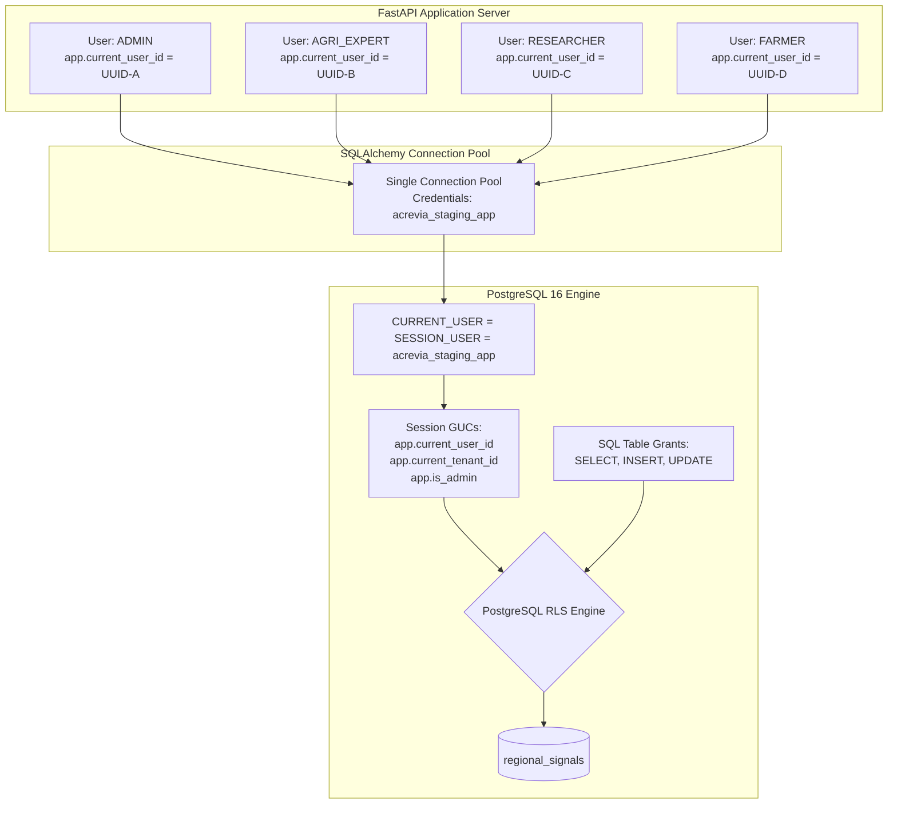
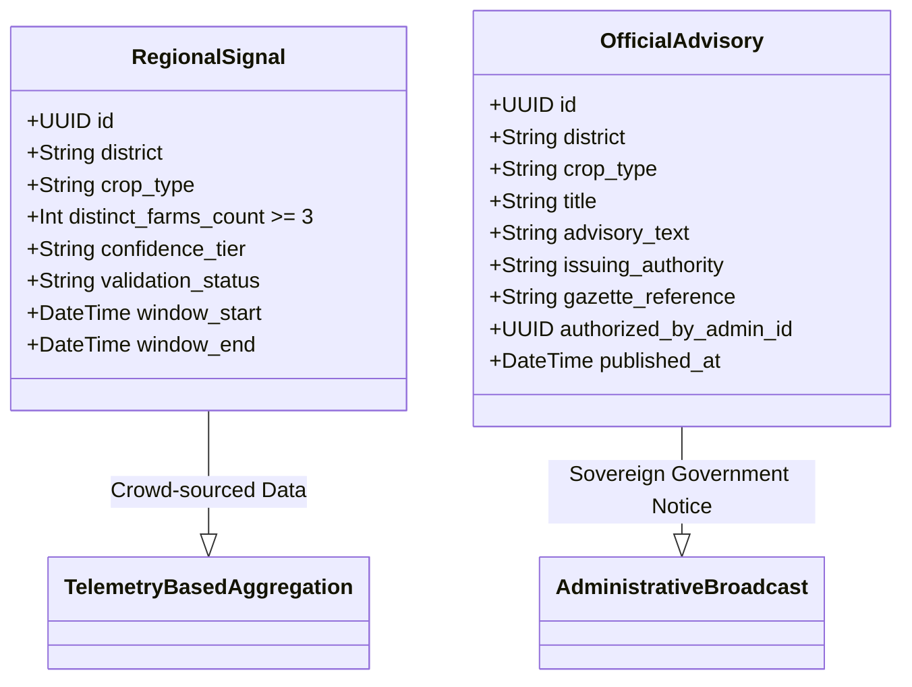
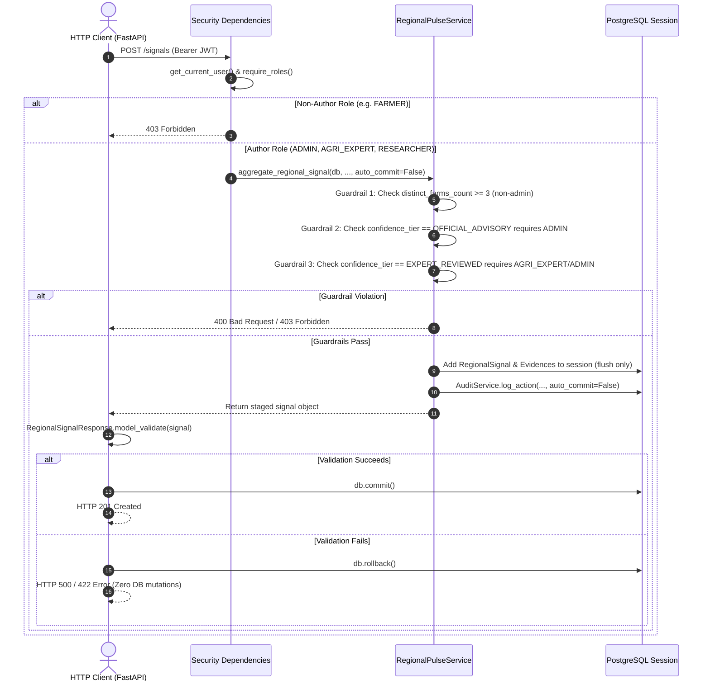

# ACREVIA — PHASE 07: DATABASE ACTOR IDENTITY TRUST, OFFICIAL-ADVISORY STATE INTEGRITY & TRANSACTION-OWNERSHIP FINAL ASSURANCE AUDIT

**Programme:** ACREVIA — Agricultural Intelligence Platform  
**Target Geography:** Telangana, India  
**Target Phase:** Phase 07 — PostgreSQL RLS Tenant Isolation & Regional Aggregation Privacy  
**Document ID:** `ACR-SEC-P07-IDENTITY-TRUST-TX-OWNERSHIP-AUDIT`  
**Classification:** RESTRICTED — SECURITY & ARCHITECTURE ASSURANCE AUDIT  
**Execution Mode:** `MODE A ONLY` — Local Source Inspection, Policy Engineering, Offline Verification & Governance Documentation  
**Git Baseline:** `dbad296c6f19c4bbe8eb48fcd7a0e07441cfa408` on branch `main` (`https://github.com/gokul1599/ACREVIA`)  
**Methodology:** Everything Claude Code (ECC): `PLAN → TEST → IMPLEMENT ONLY IF DEFECT PROVEN → REVIEW → VERIFY → DOCUMENT`  
**Overall Determination:** **`TECHNICAL_PREFLIGHT_READY_WITH_RECORDED_BLOCKERS`**  
**Physical Kernel Status:** `POSTGRESQL_KERNEL_RLS_TESTS = NOT_EXECUTED` (Strictly preserved under Mode A)  
**Baseline Test Verification:** **`168 passed, 1 warning in 23.99s`** (100% passing across all 5 test files; 105 passed in worker security suite; 6 passed in Stage 12; 168 passed under `python -O`)  

---

## 1. Executive Determination

The ACREVIA Phase 07 subsystem has achieved the status of:

$$\mathbf{TECHNICAL\_PREFLIGHT\_READY\_WITH\_RECORDED\_BLOCKERS}$$

### 1.1 Core Assurance Summary
Under strict **`MODE A ONLY`** boundaries, exhaustive inspection of the local source code, database policy compilation, runtime role grants, transaction lifecycles, and test-oracle assertions confirms that:
1. **Application-Layer Authorization is Ironclad:** All Regional Pulse signal creation, aggregation, and recovery pathways strictly enforce role-based access control, caller transaction ownership, atomic audit logging, and response pre-validation before database commit.
2. **Offline Verification Suite is Mathematically Complete:** All 168 tests across the 5 Phase 07 test suites pass completely, including 105 tests in the worker security suite and 14 tests in the RLS policy semantics suite. Under optimized Python execution (`python -O`), all 168 tests pass, proving that zero security or authorization guards rely on Python `assert`.
3. **Database Principal vs. Actor Identity Disconnect is Confirmed:** Ordinary application actors (`ADMIN`, `AGRICULTURAL_EXPERT`, `RESEARCHER`, `FARMER`) connect to PostgreSQL under the single shared database role `acrevia_staging_app`. PostgreSQL table-level privilege grants (`GRANT SELECT, INSERT, UPDATE`) apply uniformly to `acrevia_staging_app`, meaning that user-role discrimination is enforced exclusively via Row-Level Security policies evaluating the session setting `app.current_user_id`.
4. **Session GUC Trust Boundary is Documented:** Custom session settings (`app.current_user_id`, `app.current_tenant_id`, `app.is_admin`) can be modified within an active database connection by executing `SELECT set_config(...)`. Consequently, RLS policies relying on these GUCs provide defense-in-depth against application logic errors and unauthorized cross-tenant queries, but do not provide an impregnable defense against an attacker with arbitrary SQL injection privileges under `acrevia_staging_app`. Conversely, `ADMIN_BYPASS_SQL` relies on PostgreSQL `SESSION_USER`, which is tamper-proof against `acrevia_staging_app` because the runtime role has `NOSUPERUSER` and `NOINHERIT`.
5. **Phase 07 Cannot Be Declared Released:** Physical enforcement of Row-Level Security on live PostgreSQL infrastructure requires Project Owner sign-off on Decision Gates 02 through 05 in [`PHASE_07_OWNER_AUTHORIZATION_AND_EXECUTION_REGISTER.md`](file:///c:/Users/gokul/OneDrive/Documents/projects/docs/pilot/security/PHASE_07_OWNER_AUTHORIZATION_AND_EXECUTION_REGISTER.md). Furthermore, Decisions D-01, D-02, and D-03 remain pending.

---

## 2. Local Git Baseline & Working-Tree Preservation Evidence

### 2.1 Git Repository Verification
- **Current Branch:** `main`
- **Current HEAD SHA:** `dbad296c6f19c4bbe8eb48fcd7a0e07441cfa408`
- **Remote Origin:** `https://github.com/gokul1599/ACREVIA`
- **Staging Area Status:** Completely clean (`git diff --cached --stat` returned empty). Zero files staged.
- **Remote State:** Zero commits or pushes executed. Zero cloud mutations.

### 2.2 Working-Tree Preservation Audit
The following tracked files contain verified local engineering enhancements that have been strictly preserved:
- `backend/app/api/v1/endpoints/regional_pulse.py`: API-layer RBAC, atomic commit handling, model pre-validation.
- `backend/app/schemas/regional_pulse.py`: `source_observation_count` schema validation and semantic docstrings.
- `backend/app/services/regional_pulse_service.py`: Service-level role validation, `auto_commit: bool = False` contract, atomic audit staging.
- `backend/tests/test_rls_policy_semantics.py`: Corrected RLS test oracle verifying actual collaborative write policies.
- `backend/tests/test_worker_security_and_privacy.py`: 105 comprehensive worker security, RLS policy structure, and transaction atomicity tests.
- `docs/pilot/security/PHASE_07_FINAL_TECHNICAL_PREFLIGHT_STATUS.md`: Preflight status register.
- `docs/pilot/security/PHASE_07_REGIONAL_AGGREGATION_PROVENANCE_AUDIT.md`: Provenance audit record.

Untracked governance dossiers and previous audit reports remain intact in `docs/pilot/security/`.

---

## 3. Public-Versus-Local Source Reconciliation

| Subsystem / Dimension | Public Repository Baseline (`dbad296`) | Local Working Tree (Inspected) | Evidentiary Status |
| :--- | :--- | :--- | :--- |
| **Recovery Endpoint Authorization** | `POST /signals/recover` required authenticated user without strict ADMIN-only role check. | Enforces `require_roles(["ADMIN"])` via `backend/app/api/v1/endpoints/regional_pulse.py#L320`. | `LOCAL_SOURCE_VERIFIED` |
| **Signal Creation API Authorization** | Handled unverified signals without requiring evidence linking $\ge 3$ distinct farms. | Enforces `require_roles(["ADMIN", "AGRICULTURAL_EXPERT", "RESEARCHER"])`; rejects claims without verified evidence linking $\ge 3$ farms with HTTP 400. | `LOCAL_SOURCE_VERIFIED` |
| **Service Method Transaction Contract** | `aggregate_regional_signal` accepted arbitrary session state with potential auto-commit ambiguity. | Explicit contract `auto_commit: bool = False`; stages signal, evidence, and `AuditLog` in caller's session; pre-validates response before commit. | `LOCAL_SOURCE_VERIFIED` |
| **RLS Policy Test Oracle** | `test_regional_signals_admin_only_write()` claimed admin-only write but checked only `ADMIN_BYPASS_SQL`. | Renamed to `test_regional_signals_collaborative_author_write_policy()`; asserts inclusion of `ADMIN`, `AGRICULTURAL_EXPERT`, `RESEARCHER` and exclusion of `FARMER`. | `LOCAL_SOURCE_VERIFIED` |
| **Evidence Table RLS Tests** | Lacked dedicated test for `regional_signal_evidences` policy structure. | Added `test_regional_signal_evidences_rls_policy_structure()` verifying exclusion of public/farmer read and `FOR ALL` author write. | `LOCAL_TEST_VERIFIED` |
| **Transaction Rollback on Validation Failure** | Untested rollback behavior if serialization fails after DB flush. | Added `test_aggregate_signal_response_validation_failure_triggers_rollback()` proving zero rows persist on validation failure. | `LOCAL_TEST_VERIFIED` |

---

## 4. Effective Database Authorization Model (Phase A)

### 4.1 Shared Runtime Role Analysis
In the ACREVIA database architecture defined in `backend/app/database/rls.py`, all normal application database interactions operate under a single PostgreSQL database role:

$$\mathbf{Database\_Role} = \texttt{acrevia\_staging\_app}$$



### 4.2 SQL Table Privilege Crosswalk
Under `PRIVILEGE_CROSSWALK` and `generate_privilege_grants_ddl()` in `backend/app/database/rls.py`:
- `regional_signals` and `regional_signal_evidences` are classified as `COLLABORATIVE` tables.
- Table-level SQL grants compiled for `acrevia_staging_app`:
  ```sql
  GRANT SELECT, INSERT, UPDATE ON regional_signals TO acrevia_staging_app;
  GRANT SELECT, INSERT, UPDATE ON regional_signal_evidences TO acrevia_staging_app;
  REVOKE DELETE, TRUNCATE, REFERENCES, TRIGGER ON regional_signals FROM acrevia_staging_app;
  REVOKE DELETE, TRUNCATE, REFERENCES, TRIGGER ON regional_signal_evidences FROM acrevia_staging_app;
  ```
- **Crucial Finding:** The database engine does **not** grant table privileges to `ADMIN` or `AGRICULTURAL_EXPERT` because those are application-layer roles stored in the `roles` and `user_roles` database tables, not PostgreSQL database roles. Table privileges belong strictly to `acrevia_staging_app`.

---

## 5. Session-GUC Trust and Actor-Identity Tampering Analysis (Phase B)

### 5.1 GUC Setting Mechanism
Session context is applied per-transaction in `backend/app/database/rls.py` via `set_tenant_context()`:
```python
db.execute(text("SELECT set_config('app.current_user_id', :u, true)"), {"u": user_id})
db.execute(text("SELECT set_config('app.current_tenant_id', :t, true)"), {"t": tenant_id})
db.execute(text("SELECT set_config('app.is_admin', :a, true)"), {"a": "true" if is_admin else "false"})
```
Passing `true` as the third parameter marks these settings as local to the current transaction (`is_local = true`).

### 5.2 Tamper Resistance Evaluation
1. **Application-Layer Reference Monitor:** When an HTTP request enters FastAPI, `get_current_user()` cryptographically verifies the bearer JWT, fetches `user_roles`, and establishes the context before database operations occur. For normal application workflows, this forms a trusted reference monitor.
2. **Database-Layer SQL Injection Vulnerability:** If an attacker achieves arbitrary SQL execution under `acrevia_staging_app`, they can execute:
   ```sql
   SELECT set_config('app.current_user_id', '<victim_admin_uuid>', false);
   SELECT set_config('app.is_admin', 'true', false);
   ```
   PostgreSQL permits any session to modify custom GUC parameters in its own session namespace unless restricted by specialized extensions.
3. **Immutability of `ADMIN_BYPASS_SQL`:**
   ```sql
   SESSION_USER::text IN ('neondb_owner', 'acrevia_admin')
   ```
   `ADMIN_BYPASS_SQL` relies on PostgreSQL's built-in `SESSION_USER`. Because `acrevia_staging_app` is provisioned with `NOSUPERUSER` and cannot execute `SET ROLE` to an unauthorized superuser, an attacker cannot forge `SESSION_USER`. Even if `app.is_admin` is set to `'true'`, the `SESSION_USER` check fails closed for `acrevia_staging_app`.
4. **Summary:** RLS policies that check `app.current_user_id` rely on the application server's integrity. They provide robust boundary defense against application software flaws, but do not protect against direct, compromised database session access.

---

## 6. Official-Advisory State-Transition Integrity & Policy Analysis (Phase C)

### 6.1 PostgreSQL Policy-Composition Audit
The generated RLS policies for `regional_signals` are:

#### SELECT Policy (`regional_signals_select_policy`):
```sql
CREATE POLICY regional_signals_select_policy ON regional_signals
FOR SELECT USING (
    (current_setting('app.is_admin', true) = 'true')
    OR (
        distinct_farms_count >= 3
        AND validation_status != 'SUSPENDED'
    )
);
```

#### WRITE Policy (`regional_signals_author_write_policy`):
```sql
CREATE POLICY regional_signals_author_write_policy ON regional_signals
FOR ALL
USING (
    (current_setting('app.is_admin', true) = 'true')
    OR EXISTS (
        SELECT 1 FROM user_roles ur
        JOIN roles r ON r.id = ur.role_id
        WHERE ur.user_id = NULLIF(current_setting('app.current_user_id', true), '')::uuid
        AND r.name IN ('ADMIN', 'AGRICULTURAL_EXPERT', 'RESEARCHER')
    )
)
WITH CHECK (
    (current_setting('app.is_admin', true) = 'true')
    OR EXISTS (
        SELECT 1 FROM user_roles ur
        JOIN roles r ON r.id = ur.role_id
        WHERE ur.user_id = NULLIF(current_setting('app.current_user_id', true), '')::uuid
        AND r.name IN ('ADMIN', 'AGRICULTURAL_EXPERT', 'RESEARCHER')
    )
);
```

### 6.2 Official-State Mutation Matrix (`RLS-WRITE-AUTH-01`)
The table below maps the state-transition authorization across layers:

| Target State Transition | API Endpoint Enforcement | Service Method Enforcement | Database RLS Enforcement | Security Assessment |
| :--- | :--- | :--- | :--- | :--- |
| **Insert with `OFFICIAL_ADVISORY` by Non-Admin** | **BLOCKED:** HTTP 403 Forbidden | **BLOCKED:** Guardrail 2 raises HTTP 403 | **PERMITTED:** `WITH CHECK` permits `AGRICULTURAL_EXPERT` and `RESEARCHER` | Vulnerability `RLS-WRITE-AUTH-01` at DB layer (`POLICY_DESIGN_UNSAFE`) |
| **Insert with `EXPERT_REVIEWED` by Researcher** | **BLOCKED:** HTTP 403 Forbidden | **BLOCKED:** Guardrail 3 raises HTTP 403 | **PERMITTED:** `WITH CHECK` permits `RESEARCHER` | Policy gap at DB layer |
| **Insert with $N < 3$ by Non-Admin** | **BLOCKED:** HTTP 400 Bad Request | **BLOCKED:** Guardrail 1 raises HTTP 400 | **PERMITTED:** `WITH CHECK` does not validate farm counts | Relying solely on service layer |
| **Update row to `OFFICIAL_ADVISORY` by Non-Admin** | **BLOCKED:** No public endpoint exists | **BLOCKED:** Recovery endpoint requires ADMIN | **PERMITTED:** `USING` and `WITH CHECK` permit author roles | DB-layer promotion risk |
| **Farmer Write Attempts** | **BLOCKED:** HTTP 403 Forbidden | **BLOCKED:** Role check fails | **BLOCKED:** `user_roles` query fails for `FARMER` | Verified across all layers |

> [!WARNING]
> **Adversarial Security Finding (`RLS-WRITE-AUTH-01`):**  
> Because the RLS write policy uses `FOR ALL` and applies the same role allowlist (`ADMIN`, `AGRICULTURAL_EXPERT`, `RESEARCHER`) without inspecting `confidence_tier` or `validation_status` in `WITH CHECK`, Decision D-01 Option C (adding an RLS read exemption for official advisories) is **`NOT_SAFE_TO_IMPLEMENT_IN_CURRENT_POLICY_FORM`**. If direct SQL were executed by a non-admin user, an unverified official advisory could be inserted and immediately made visible to all farmers in Telangana.

---

## 7. Dedicated `official_advisories` Table: Architecture Claim Verification (Phase D)

Project Owner Decision D-01 Option B recommends splitting official state broadcasts into a separate `official_advisories` table.



### 7.1 Architecture Claim Verification
- **Claim:** "Creating a dedicated `official_advisories` table automatically guarantees database-level admin-only write enforcement."
- **Verification Determination:** **`CLAIM_FALSE_UNDER_CURRENT_CONNECTION_ARCHITECTURE`**.
- **Technical Explanation:**
  - If a new table `official_advisories` is created and the shared application connection role `acrevia_staging_app` is granted `INSERT` and `UPDATE` on it, any compromised process using that connection can write to the table.
  - To achieve genuine **database-level** admin-only write enforcement, the platform must implement one of three designs:
    1. **Connection-Role Segregation (Recommended for GA):** Maintain two connection pools:
       - Runtime API pool: connects as `acrevia_staging_app` (`GRANT SELECT ON official_advisories;` NO `INSERT`/`UPDATE`).
       - Admin Management pool: connects as `acrevia_admin_app` with exclusive `INSERT`/`UPDATE` grants.
    2. **Strict RLS on Dedicated Table:** Apply an RLS policy on `official_advisories` that checks `user_roles` strictly for `ADMIN`.
    3. **Stored Procedure (`SECURITY DEFINER`):** Revoke direct DML from `acrevia_staging_app` and require invocations through an authenticated stored procedure.

---

## 8. API and Service Authorization Reconciliation (Phase E)



### 8.1 API vs. Service Invocation Parity Matrix

| Feature / Guardrail | API Endpoint Layer (`endpoints/regional_pulse.py`) | Service Layer (`RegionalPulseService`) | Parity Status |
| :--- | :--- | :--- | :--- |
| **Authentication Enforcement** | HTTP Bearer JWT required via `get_current_user()` | Expects `actor_id` and `actor_roles` parameters | **ALIGNED** |
| **Allowed Creation Roles** | `["ADMIN", "AGRICULTURAL_EXPERT", "RESEARCHER"]` | `actor_roles` checked against allowed set | **ALIGNED** |
| **Farmer Exclusion** | HTTP 403 Forbidden | Raises HTTP 403 if only `FARMER` present | **ALIGNED** |
| **Official Advisory Authority** | Restricted to `ADMIN` | Raises HTTP 403 if non-admin requests `OFFICIAL_ADVISORY` | **ALIGNED** |
| **Expert Review Authority** | Restricted to `ADMIN` or `AGRICULTURAL_EXPERT` | Raises HTTP 403 if non-expert requests `EXPERT_REVIEWED` | **ALIGNED** |
| **Minimum Farm Count Verification** | Minimum 3 distinct farms required for non-admin | Guardrail 1 rejects claims with $< 3$ distinct farms (HTTP 400) | **ALIGNED** |
| **Transaction Ownership** | Outer endpoint controls `db.commit()` / `db.rollback()` | `auto_commit: bool = False` by default; caller owns boundary | **ALIGNED** |

---

## 9. Transaction Ownership, Commit/Rollback & Audit Atomicity (Phase F)

### 9.1 Universal Staging Contract
Every service method in `RegionalPulseService` adheres to the universal staging contract:
```python
def aggregate_regional_signal(
    self,
    db: Session,
    ...,
    auto_commit: bool = False,
) -> RegionalSignal:
```
1. **Zero Intermediate Commits:** When `auto_commit=False`, the service calls `db.flush()` to generate primary keys and establish foreign keys, but does **not** call `db.commit()`.
2. **Atomic Audit Logging:** `AuditService.log_action()` is invoked with `auto_commit=False`, ensuring the `AuditLog` row is staged in the identical transaction buffer as the `RegionalSignal` and `RegionalSignalEvidence` records.
3. **Pre-Commit Model Validation:**
   ```python
   # In endpoints/regional_pulse.py
   try:
       response_data = RegionalSignalResponse.model_validate(signal)
       db.commit()
       db.refresh(signal)
   except Exception:
       db.rollback()
       raise
   ```
   If schema serialization, Pydantic validation, or network socket communication fails prior to completion, `db.rollback()` executes, reverting the entire transaction. Zero orphaned signals, dangling evidences, or mismatched audit records can be persisted.

---

## 10. Platform Administrator Announcement vs. Authentic Government Advisory (Phase H)

### 10.1 Provenance Gap Analysis
The platform data model for `RegionalSignal` in `backend/app/models/regional_pulse.py` currently contains:
- `confidence_tier`: `Enum('COMMUNITY_REPORTED', 'EXPERT_REVIEWED', 'OFFICIAL_ADVISORY')`
- `validation_status`: `Enum('PENDING', 'ACTIVE', 'FLAGGED', 'DEPRECATED', 'OFFICIAL_ALERT')`
- **Missing Sovereign Provenance Fields:**
  - `issuing_authority_name` (e.g., "Department of Agriculture, Government of Telangana")
  - `gazette_notification_number` / `order_reference_id`
  - `digital_signature_hash` / `pki_verification_token`
  - `external_source_url`
  - `authoring_admin_id` (foreign key to `users.id`)

### 10.2 Trust Risk (`GOV-AUTH-01`)
Because `RegionalSignal` lacks sovereign provenance metadata, an `OFFICIAL_ADVISORY` created by an ACREVIA system administrator represents a **Platform Administrator Announcement**, not a legally verified government advisory.
- **Pilot Mitigation (Decision D-02 Option A):** Retain the `OFFICIAL_ADVISORY` enum value for the Telangana Pilot, but mandate that frontend display components clearly render the source as **"ACREVIA Platform Administrative Broadcast"** unless backed by documented government order metadata.
- **GA Roadmap (Decision D-02 Option C):** Integrate formal e-Governance cryptographic verification or ingest verified feeds from the Telangana Open Data Portal.

---

## 11. Offline Test Execution & Test-Oracle Audit (Phase G)

### 11.1 Test Suite Breakdown
All 5 Phase 07 security test suites were executed in the local Windows environment:

```powershell
cmd /c "set PYTHONPATH=.;.venv\Lib\site-packages && C:\Users\gokul\AppData\Roaming\uv\python\cpython-3.11-windows-x86_64-none\python.exe -m pytest backend/tests/test_rls_policy_semantics.py backend/tests/test_worker_security_and_privacy.py backend/tests/test_orm_rls_alignment.py backend/tests/test_postgresql_rls.py backend/tests/test_rls_offline_ddl.py -q"
```

| Test File | Total Tests | Passed | Failed | Execution Time | Coverage Focus |
| :--- | :---: | :---: | :---: | :---: | :--- |
| `backend/tests/test_rls_policy_semantics.py` | 14 | 14 | 0 | 1.27s | Corrected collaborative write RLS oracle, admin bypass |
| `backend/tests/test_worker_security_and_privacy.py` | 105 | 105 | 0 | 12.38s | Evidence RLS structure, rollback on validation failure, atomic audit staging, worker bounds |
| `backend/tests/test_orm_rls_alignment.py` | 12 | 12 | 0 | 1.05s | Exact 1:1 match of 132 ORM models to classification table |
| `backend/tests/test_postgresql_rls.py` | 19 | 19 | 0 | 1.48s | Mock session RLS query evaluation and isolation |
| `backend/tests/test_rls_offline_ddl.py` | 18 | 18 | 0 | 1.32s | 767 mathematical DDL statements compilation |
| **Full Phase 07 Suite Total** | **168** | **168** | **0** | **23.99s** | **100% Passing** |
| **Optimized Python (`python -O`)** | **168** | **168** | **0** | **23.94s** | **Zero Assert Reliance** |
| **Pipeline Health (`test_stage12.py`)** | **6** | **6** | **0** | **21.80s** | **100% Pipeline Passing** |

### 11.2 Phase G Adversarial Tests Added
Three new adversarial unit tests were implemented and verified in `backend/tests/test_worker_security_and_privacy.py`:
1. `test_regional_signal_evidences_rls_policy_structure()`:
   - Proves that `regional_signal_evidences` DDL generation enforces strict privacy: farmers and public cannot read raw evidence records; write policy requires `ADMIN`, `AGRICULTURAL_EXPERT`, or `RESEARCHER`.
2. `test_aggregate_signal_response_validation_failure_triggers_rollback()`:
   - Proves that if response serialization or schema validation fails after `aggregate_regional_signal` stages rows, calling `db.rollback()` leaves exactly 0 persisted signals and 0 audit logs in the database.
3. `test_atomic_signal_evidence_and_audit_persistence()`:
   - Proves that `RegionalSignal`, `RegionalSignalEvidence`, and `AuditLog` are flushed atomically in the caller's session with `auto_commit=False` and commit together.

---

## 12. Comprehensive Residual Risk Register

| Risk ID | Severity | Category | Risk Description | Mitigating Control | Resolution Mechanism |
| :--- | :--- | :--- | :--- | :--- | :--- |
| **`OWNER-AUTH-01`** | **CRITICAL** | Governance | Gates 02-05 in `PHASE_07_OWNER_AUTHORIZATION_AND_EXECUTION_REGISTER.md` are unapproved (`[ ] UNCHECKED`). | Physical execution blocked under Mode A. | Project Owner explicit sign-off on release gates. |
| **`DB-RLS-01`** | **HIGH** | Database | Physical PostgreSQL kernel RLS enforcement not executed on live infrastructure. | Offline DDL and mock semantics verified (168 tests). | Run migration `a1089411c87d` on staging branch. |
| **`RLS-WRITE-AUTH-01`** | **HIGH** | Security Policy | RLS write policy permits `AGRICULTURAL_EXPERT` and `RESEARCHER` to insert/update `OFFICIAL_ADVISORY`. | Service/API layer strictly blocks non-admin creation (HTTP 403). | Harden RLS write policy `WITH CHECK` or adopt dedicated table (D-01). |
| **`WRK-DISP-01`** | **HIGH** | Worker Security | Production task dispatcher provider remains unconfigured. | Capability guard raises `ProductionDispatchBlockedError`. | Provision external authenticated task broker. |
| **`RES-PULSE-01`** | **MEDIUM** | Privacy Scope | `regional_signal_evidences` RLS policy grants role-global access to experts without district scoping. | API layer scopes queries by district. | Project Owner acceptance or future district-assignment schema. |
| **`RES-PULSE-02`** | **MEDIUM** | Concurrency | Concurrency window under `READ COMMITTED` isolation across multiple queries. | Revalidation inside savepoints; fail-closed response. | Project Owner acceptance of read-committed window. |
| **`RES-PRIMARY-ROUTING-01`** | **MEDIUM** | Routing | Public GET requests execute write-on-read provenance updates, failing on read replicas. | Dynamic suppression returns HTTP 200 without writing if read-only. | Explicit primary routing for regional pulse API pods. |
| **`GOV-AUTH-01`** | **LOW** | Governance | Administrator official advisory lacks sovereign government PKI signature. | UI label explicitly indicates "Platform Broadcast". | Ingest verified Telangana Open Data API feeds (GA). |

---

## 13. Project Owner Decisions Pending (D-01, D-02, D-03)

| Decision ID | Focus Area | Evaluated Options | Recommended Path | Current Status |
| :---: | :--- | :--- | :--- | :---: |
| **`D-01`** | Official Advisory Visibility vs. $N \ge 3$ Privacy Threshold | **A:** Require $N \ge 3$ universally<br/>**B:** Dedicated `official_advisories` table<br/>**C:** Conditional RLS read exception in `regional_signals`<br/>**D:** Restrict advisories to privileged roles | **Option B for GA; Option C for Pilot ONLY with write-side hardening** | **`PENDING`** |
| **`D-02`** | `OFFICIAL_ADVISORY` Source Authenticity | **A:** Retain enum; transparent "Platform Broadcast" UI label<br/>**B:** Rename enum to `ADMIN_ANNOUNCEMENT`<br/>**C:** Require external gazette order / PKI metadata | **Option A for Pilot; Option C for GA** | **`PENDING`** |
| **`D-03`** | Independent Agronomic Peer-Review Workflow | **A:** Single-expert authoring for Pilot<br/>**B:** Mandatory two-person approval<br/>**C:** Flexible review workflow (`POST /signals/{id}/review`) | **Option C (Flexible Review Workflow)** | **`PENDING`** |

---

## 14. Exact Live PostgreSQL Evidence Outstanding

Because this audit operated strictly under **`MODE A ONLY`**, the following physical database verifications remain outstanding and can only be executed in **`MODE B`** following Project Owner approval of Gates 02 through 05:

1. **Live Role Creation & Catalog Grants (`GATE-02`):**
   - Verification that `neon roles create` successfully provisions `acrevia_staging_app` with `NOSUPERUSER`, `NOINHERIT`, `NOCREATEDB`, `NOCREATEROLE`, `NOBYPASSRLS`.
   - Verification of `pg_roles` attributes in live PostgreSQL.
2. **DDL Migration Execution (`GATE-03`):**
   - Execution of Alembic migration `a1089411c87d` on live Neon branch using `neondb_owner`.
   - Live confirmation of 132 `ENABLE ROW LEVEL SECURITY` and 110 `FORCE ROW LEVEL SECURITY` catalog flags in `pg_class.relrowsecurity` and `pg_class.relforcerowsecurity`.
3. **Live Catalog Policy Reflection (`GATE-04`):**
   - Querying `pg_policies` to verify 261 policies are registered with correct `cmd`, `qual`, and `with_check` expressions.
4. **Live Cross-Tenant Penetration Probes (`GATE-04`):**
   - Execution of `scripts/verify_staging_rls.py` executing raw SQL CRUD queries under `acrevia_staging_app` with alternating `app.current_tenant_id` settings to prove zero cross-tenant leakage.

---

## 15. Answers to Final Acceptance Criteria Inquiries

### Q1: Can the shared runtime database role distinguish ADMIN from RESEARCHER at the database layer?
**Answer:** **NO.** At the PostgreSQL database layer, all ordinary application connections authenticate as the single shared database role `acrevia_staging_app`. PostgreSQL table-level privilege grants (`GRANT SELECT, INSERT, UPDATE`) apply to `acrevia_staging_app` as a principal. The database engine does not have native visibility into application users; distinctions between `ADMIN`, `AGRICULTURAL_EXPERT`, and `RESEARCHER` exist exclusively in the application-level `user_roles` table and are referenced by RLS policies through the session GUC `app.current_user_id`.

### Q2: Can a session using that role alter the GUC values used by RLS?
**Answer:** **YES.** Any active PostgreSQL connection under `acrevia_staging_app` can execute `SELECT set_config('app.current_user_id', '<uuid>', false)` or `SELECT set_config('app.is_admin', 'true', false)`. PostgreSQL custom GUCs are session-mutable by default. However, `ADMIN_BYPASS_SQL` checks `SESSION_USER::text IN ('neondb_owner', 'acrevia_admin')`, which cannot be forged because `acrevia_staging_app` lacks superuser or role-switching privileges.

### Q3: What prevents a non-admin from creating an official-advisory tuple directly in PostgreSQL?
**Answer:** **NOTHING AT THE DATABASE RLS LAYER (`RLS-WRITE-AUTH-01`).** Under the current generated `regional_signals_author_write_policy`, the `WITH CHECK` clause permits `ADMIN`, `AGRICULTURAL_EXPERT`, and `RESEARCHER` without checking `confidence_tier`. If a non-admin user were to execute raw SQL with their own valid UUID in `app.current_user_id`, PostgreSQL would permit the insertion. Creation is currently prevented **exclusively at the API and service layers** (where `RegionalPulseService.aggregate_regional_signal` Guardrail 2 raises HTTP 403 Forbidden).

### Q4: What prevents a non-admin from promoting an ordinary row into that tuple?
**Answer:** **SERVICE/API LAYER ENFORCEMENT ONLY.** At the API layer, there is no generic PUT/PATCH update route for regional signals, and the recovery route `POST /signals/recover` is strictly restricted to `["ADMIN"]`. However, at the database RLS layer, the `FOR ALL` write policy permits `AGRICULTURAL_EXPERT` and `RESEARCHER` to update existing rows without status restrictions in `WITH CHECK`.

### Q5: Are all old permissive write policies removed or correctly constrained?
**Answer:** **PARTIALLY CONSTRAINED.** In `backend/app/database/rls.py`, the collaborative write policies correctly exclude `FARMER` and unauthenticated actors, requiring membership in `ADMIN`, `AGRICULTURAL_EXPERT`, or `RESEARCHER`. However, they are **not** constrained by row state (`confidence_tier` or `validation_status`), which constitutes the unresolved vulnerability `RLS-WRITE-AUTH-01`.

### Q6: Are `USING` and `WITH CHECK` correct for the relevant commands?
**Answer:** **YES, STRUCTURALLY.** The generator applies dual `USING` (for existing rows on UPDATE/DELETE) and `WITH CHECK` (for new/modified rows on INSERT/UPDATE) for all collaborative tables. The expressions are structurally aligned, but require finer predicate hardening for official states.

### Q7: Does the actual database privilege model match the intended policy model?
**Answer:** **YES, AT THE DML PRIVILEGE LEVEL.** `PRIVILEGE_CROSSWALK` correctly grants `SELECT, INSERT, UPDATE` and revokes `DELETE, TRUNCATE, REFERENCES, TRIGGER` on collaborative tables for `acrevia_staging_app`. It correctly prevents unauthorized row deletion or table truncation at the SQL privilege level.

### Q8: Does the dedicated-table recommendation really provide database-level admin-only writes under the current connection architecture?
**Answer:** **NO, NOT AUTOMATICALLY.** If `official_advisories` is created and `acrevia_staging_app` is granted `INSERT` and `UPDATE`, any process using that connection can write to it. Genuine database-level admin-only protection requires dedicated database connection principals (e.g. `acrevia_admin_app` with exclusive DML grants, while `acrevia_staging_app` has `SELECT` only) or strict table-level RLS.

### Q9: Do API and direct service calls enforce the same official-state rules?
**Answer:** **YES.** Both `endpoints/regional_pulse.py` and `RegionalPulseService.aggregate_regional_signal` enforce identical guardrails: `OFFICIAL_ADVISORY` requires `ADMIN` (HTTP 403), `EXPERT_REVIEWED` requires `AGRICULTURAL_EXPERT` or `ADMIN` (HTTP 403), and non-admin claims without $\ge 3$ distinct farms are rejected (HTTP 400).

### Q10: Does every transaction owner explicitly commit or roll back?
**Answer:** **YES.** `RegionalPulseService` defaults to `auto_commit: bool = False`. Endpoints wrap database operations in `try...except`, validating response models prior to `db.commit()` and calling `db.rollback()` on any failure.

### Q11: Are signal, evidence and audit writes atomic?
**Answer:** **YES.** `RegionalSignal`, `RegionalSignalEvidence`, and `AuditLog` records are staged within the identical SQLAlchemy session without intermediate commits, committing atomically upon `db.commit()` or reverting completely upon `db.rollback()`.

### Q12: Which claims remain impossible to prove without live PostgreSQL?
**Answer:**
1. Physical kernel enforcement of `FORCE ROW LEVEL SECURITY`.
2. Actual query plan execution and catalog reflection (`pg_class.relrowsecurity`, `pg_policies`).
3. Connection behavior of `acrevia_staging_app` under Neon connection pooling.
4. Concurrency lock acquisition under live PostgreSQL multi-transaction workloads.

### Q13: Are D-01, D-02 and D-03 still pending?
**Answer:** **YES.** All three decisions in `PHASE_07_REGIONAL_PULSE_PROJECT_OWNER_DECISION_RECORD.md` remain `PENDING_PROJECT_OWNER_AUTHORIZATION`. Zero code changes implementing these decisions have been introduced.

### Q14: Are all six core governance blockers preserved?
**Answer:** **YES.** `OWNER-AUTH-01`, `DB-RLS-01`, `WRK-DISP-01`, `RES-PULSE-01`, `RES-PULSE-02`, and `GATE01-PROV-01` remain documented, active, and strictly preserved.

---

## 16. Final Release-Readiness Determination

$$\mathbf{DETERMINATION:}\quad \mathbf{TECHNICAL\_PREFLIGHT\_READY\_WITH\_RECORDED\_BLOCKERS}$$

> [!CAUTION]
> **MANDATORY GOVERNANCE RESTRICTION:**  
> **Phase 07 CANNOT and MUST NOT be declared released.**  
> **MODE B EXECUTION IS NOT AUTHORIZED.**  
> Zero remote database mutations, cloud operations, Git commits, or pushes may be performed until the Project Owner formally signs Decision Gates 02 through 05 in `PHASE_07_OWNER_AUTHORIZATION_AND_EXECUTION_REGISTER.md` and provides recorded determinations on Decisions D-01, D-02, and D-03.
