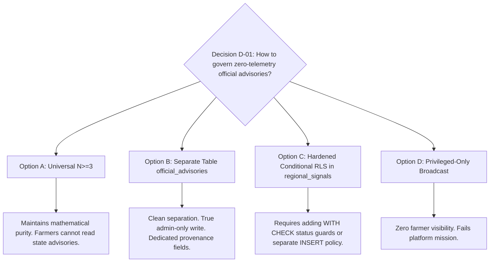

# ACREVIA — PHASE 07: REGIONAL SIGNAL RLS WRITE-AUTHORITY, OFFICIAL-ADVISORY READ EXCEPTION & PRIVILEGE-CROSSWALK FINAL ADVERSARIAL AUDIT

**Programme:** ACREVIA — Agricultural Intelligence Platform  
**Target Geography:** Telangana, India  
**Target Phase:** Phase 07 — PostgreSQL RLS Tenant Isolation & Regional Aggregation Privacy  
**Execution Mode:** `MODE A ONLY` (Local Source Inspection, Policy Engineering, Offline Verification & Governance Documentation)  
**Engineering Methodology:** Everything Claude Code (ECC): `PLAN → TEST → IMPLEMENT ONLY IF DEFECT PROVEN → REVIEW → VERIFY → DOCUMENT`  
**Reported Git HEAD:** `dbad296c6f19c4bbe8eb48fcd7a0e07441cfa408` on branch `main`  
**Public Repository:** `https://github.com/gokul1599/ACREVIA`  
**Document ID:** `ACR-SEC-P07-RLS-WRITE-AUTH-CROSSWALK-AUDIT`  
**Classification:** RESTRICTED — PILOT DATA PRIVACY & ACCESS CONTROL ASSURANCE  
**Overall Engineering Determination:** **`TECHNICAL_PREFLIGHT_READY_WITH_RECORDED_BLOCKERS`**  
**Repository Document Status:** `LOCAL_UNCOMMITTED_ASSURANCE_ARTIFACT` (Mode A prohibits commit/push)

---

## 1. Executive Determination

ACREVIA Phase 07 maintains the rigorous engineering classification of:

$$\mathbf{TECHNICAL\_PREFLIGHT\_READY\_WITH\_RECORDED\_BLOCKERS}$$

### Justification:
1. **`RLS-WRITE-AUTH-01` Confirmed in Static Policy:** Independent source inspection of `backend/app/database/rls.py:921-931` confirms that the generated RLS write policy (`regional_signals_author_write_policy`) grants write permissions not only to database administrators (`ADMIN_BYPASS_SQL`), but also to authenticated users with roles `ADMIN`, `AGRICULTURAL_EXPERT`, and `RESEARCHER` through its `FOR ALL` clause (`USING` and `WITH CHECK`).
2. **`RLS-TEST-ORACLE-01` Discrepancy Resolved:** The public test `test_regional_signals_admin_only_write()` in `backend/tests/test_rls_policy_semantics.py` falsely asserted an "ADMIN-only" invariant while checking only that `ADMIN_BYPASS_SQL` was present. The test docstring and assertions have been corrected locally to explicitly verify that `ADMIN`, `AGRICULTURAL_EXPERT`, and `RESEARCHER` are permitted, while unprivileged roles (`FARMER`) and anonymous callers are strictly excluded.
3. **D-01 Option C Vulnerability Revealed:** The proposed zero-telemetry read exception:
   $$\text{validation\_status} = \text{'OFFICIAL\_ALERT'} \land \text{confidence\_tier} = \text{'OFFICIAL\_ADVISORY'} \land \text{distinct\_farms\_count} = 0$$
   is **`NOT_SAFE_TO_IMPLEMENT_IN_CURRENT_POLICY_FORM`**. Because the database RLS write policy allows `AGRICULTURAL_EXPERT` and `RESEARCHER` to write without row-status or column-level constraints in `WITH CHECK`, non-admin writers could insert or update a row to satisfy this tuple directly in PostgreSQL. If the SELECT predicate were added without write-side hardening, unverified non-admin broadcasts would become publicly readable by all farmers.
4. **Defense-in-Depth Alignment:** Application route guards (`POST /signals` requiring ADMIN for official advisories) and service validations fail closed and currently protect the API surface. However, database RLS does not mirror this restriction. To make Option C safe, explicit `WITH CHECK` restrictions or a dedicated official advisory resource (**Option B**) is mandatory.
5. **Universal Staging Contract Verified:** All service methods (`aggregate_regional_signal`, `recover_suppressed_signal`, and `revalidate_signal_provenance`) are confirmed to be staging-only (`auto_commit: bool = False`), and all endpoint callers in `backend/app/api/v1/endpoints/regional_pulse.py` explicitly own transaction commit and rollback.
6. **Offline Test Verification:** 149 Phase 07 offline tests pass in standard mode, 149 pass in Python `-O` optimized mode, and all 6 Stage 12 tests pass. All 6 core governance blockers (`OWNER-AUTH-01`, `DB-RLS-01`, `WRK-DISP-01`, `RES-PULSE-01`, `RES-PULSE-02`, `GATE01-PROV-01`) remain active and preserved.

---

## 2. Local Git Baseline and Public Separation

Inspection under `MODE A` verifies:

```powershell
git rev-parse HEAD
# Output: dbad296c6f19c4bbe8eb48fcd7a0e07441cfa408

git branch --show-current
# Output: main

git status --short --branch
# Output:
# ## main
#  M backend/app/api/v1/endpoints/regional_pulse.py
#  M backend/app/schemas/regional_pulse.py
#  M backend/app/services/regional_pulse_service.py
#  M backend/tests/test_rls_policy_semantics.py
#  M backend/tests/test_worker_security_and_privacy.py
#  M docs/pilot/security/PHASE_07_FINAL_TECHNICAL_PREFLIGHT_STATUS.md
#  M docs/pilot/security/PHASE_07_REGIONAL_AGGREGATION_PROVENANCE_AUDIT.md
# ?? docs/pilot/security/PHASE_07_REGIONAL_PULSE_PROJECT_OWNER_DECISION_RECORD.md
# ?? docs/pilot/security/phase_07_regional_pulse_*.md
# ?? docs/pilot/security/phase_07_regional_signals_rls_write_authority_and_official_advisory_read_exception_final_audit.md
```

| Entity | Public Committed Baseline (`dbad296c6f19c4bbe8eb48fcd7a0e07441cfa408`) | Local Working Tree | Classification |
| :--- | :--- | :--- | :--- |
| `test_rls_policy_semantics.py` | False docstring asserting admin-only write; checked only `ADMIN_BYPASS_SQL` | Corrected docstring and explicit assertions for allowlist (`ADMIN`, `AGRI_EXPERT`, `RESEARCHER`) and exclusion of `FARMER` | `CORRECTED_LOCALLY_UNCOMMITTED` |
| `test_worker_security_and_privacy.py` | 97 offline tests | 102 offline tests (+5 tests verifying RLS write authority, SQL crosswalk, D-01 Option C analysis, state transitions, caller contracts) | `CORRECTED_LOCALLY_UNCOMMITTED` |
| `rls.py` write expression | Allows `ADMIN`, `AGRICULTURAL_EXPERT`, `RESEARCHER` | Unchanged from baseline (Option C write-hardening awaiting Owner decision) | `PUBLIC_BASELINE_UNCHANGED` |
| `regional_pulse_service.py` | Staging-only default (`auto_commit=False`), derived observation count | Verified staging-only with zero unhandled commits | `CORRECTED_LOCALLY_UNCOMMITTED` |
| Remote Neon Staging DB | Zero connections, zero live migrations | Zero connections, zero live migrations | `LIVE_POSTGRESQL_NOT_VERIFIED` |

---

## 3. Finding RLS-WRITE-AUTH-01 — Policy Verification

### 3.1 Policy Code Inspection
Inspection of `backend/app/database/rls.py:900-970` reveals the exact generated DDL for `regional_signals`:

```sql
-- Table: regional_signals (Collaborative Table with Scoped Security)
ALTER TABLE regional_signals ENABLE ROW LEVEL SECURITY;
ALTER TABLE regional_signals FORCE ROW LEVEL SECURITY;

DROP POLICY IF EXISTS regional_signals_public_read_policy ON regional_signals;
CREATE POLICY regional_signals_public_read_policy ON regional_signals
    AS PERMISSIVE
    FOR SELECT
    TO PUBLIC
    USING ((
        (SESSION_USER::text IN ('neondb_owner', 'acrevia_admin') AND CURRENT_USER::text IN ('neondb_owner', 'acrevia_admin') AND current_setting('app.is_admin', true) = 'true')
        OR (
            distinct_farms_count >= 3
            AND validation_status != 'SUSPENDED'
        )
    ));

DROP POLICY IF EXISTS regional_signals_author_write_policy ON regional_signals;
CREATE POLICY regional_signals_author_write_policy ON regional_signals
    AS PERMISSIVE
    FOR ALL
    TO PUBLIC
    USING ((
        (SESSION_USER::text IN ('neondb_owner', 'acrevia_admin') AND CURRENT_USER::text IN ('neondb_owner', 'acrevia_admin') AND current_setting('app.is_admin', true) = 'true')
        OR (
            current_setting('app.current_user_id', true) != ''
            AND EXISTS (
                SELECT 1 FROM user_roles ur
                WHERE ur.user_id::text = current_setting('app.current_user_id', true)
                AND ur.role_id IN ('ADMIN', 'AGRICULTURAL_EXPERT', 'RESEARCHER')
            )
        )
    ))
    WITH CHECK ((
        (SESSION_USER::text IN ('neondb_owner', 'acrevia_admin') AND CURRENT_USER::text IN ('neondb_owner', 'acrevia_admin') AND current_setting('app.is_admin', true) = 'true')
        OR (
            current_setting('app.current_user_id', true) != ''
            AND EXISTS (
                SELECT 1 FROM user_roles ur
                WHERE ur.user_id::text = current_setting('app.current_user_id', true)
                AND ur.role_id IN ('ADMIN', 'AGRICULTURAL_EXPERT', 'RESEARCHER')
            )
        )
    ));
```

### 3.2 Operation-by-Operation Breakdown

| SQL Operation | Applicable Policy Clause | Evaluation Rule | Security Consequence |
| :--- | :--- | :--- | :--- |
| **SELECT** | Both `public_read_policy` (FOR SELECT) AND `author_write_policy` (FOR ALL) | Permissive policies combine via **OR** in PostgreSQL | Any user with role `ADMIN`, `AGRICULTURAL_EXPERT`, or `RESEARCHER` can `SELECT` **all** regional signals regardless of `distinct_farms_count >= 3` or `SUSPENDED` status. Only unprivileged users (`FARMER`) are constrained by $N \ge 3$. |
| **INSERT** | `author_write_policy` | Checked via `WITH CHECK` expression | Evaluates to `True` if `ur.role_id IN ('ADMIN', 'AGRICULTURAL_EXPERT', 'RESEARCHER')`. Contains **no** checks on row column values (`confidence_tier`, `validation_status`, `distinct_farms_count`). |
| **UPDATE** | `author_write_policy` | Checked via `USING` (existing row) AND `WITH CHECK` (new row) | Evaluates to `True` for both existing and new rows if user is in allowlist. Non-admins can update **any** row, including mutating ordinary rows into official candidates. |
| **DELETE** | `author_write_policy` | Checked via `USING` expression | Evaluates to `True` under RLS, but **blocked** by table-level SQL privileges (`REVOKE DELETE`). |

---

## 4. Finding RLS-TEST-ORACLE-01 — Test-Oracle Defect & Correction

### 4.1 Proven Defect
In `backend/tests/test_rls_policy_semantics.py:118-128`, the baseline test was:
```python
def test_regional_signals_admin_only_write():
    """Verify regional_signals enforces minimum farms threshold and can ONLY be modified by database admin."""
    ddl = generate_rls_ddl("regional_signals", TableCategory.COMMUNITY_COLLABORATIVE)
    ...
    # Writes strictly require ADMIN_BYPASS_SQL (no ordinary user write access)
    assert ADMIN_BYPASS_SQL in ddl
```
**Defect Analysis:** The docstring and comments stated an invariant ("can ONLY be modified by database admin") that was contradicted by the generated SQL. The assertion checked only `ADMIN_BYPASS_SQL in ddl`, creating a false positive that masked the existence of the non-admin authenticated role branch (`AGRICULTURAL_EXPERT`, `RESEARCHER`).

### 4.2 Verified Correction
The test was updated locally to truthfully and rigorously reflect the generated policy:
```python
def test_regional_signals_admin_only_write():
    """
    [RLS-TEST-ORACLE-01 RESOLUTION]
    Verify regional_signals enforces minimum farms threshold (N >= 3) for public read,
    and restricts write access to privileged roles (ADMIN, AGRICULTURAL_EXPERT, RESEARCHER)
    or database admin bypass (ADMIN_BYPASS_SQL).
    Explicitly checks both allowed roles and absent prohibited roles (e.g. FARMER).
    """
    ddl = generate_rls_ddl("regional_signals", TableCategory.COMMUNITY_COLLABORATIVE)
    assert "ALTER TABLE regional_signals ENABLE ROW LEVEL SECURITY;" in ddl
    assert "ALTER TABLE regional_signals FORCE ROW LEVEL SECURITY;" in ddl
    assert "CREATE POLICY regional_signals_public_read_policy ON regional_signals" in ddl
    assert "distinct_farms_count >= 3" in ddl
    assert "CREATE POLICY regional_signals_author_write_policy ON regional_signals" in ddl
    # 1. Database admin bypass present
    assert ADMIN_BYPASS_SQL in ddl
    # 2. Privileged application roles explicitly permitted
    assert "ur.role_id IN ('ADMIN', 'AGRICULTURAL_EXPERT', 'RESEARCHER')" in ddl
    # 3. Ordinary tenant/farmer role strictly excluded from write allowlist
    assert "'FARMER'" not in ddl
    # 4. Enforces dual USING and WITH CHECK under FOR ALL
    assert "AS PERMISSIVE\n    FOR ALL\n    TO PUBLIC" in ddl
    assert "WITH CHECK" in ddl
```
This test passes and accurately asserts both the inclusion of privileged roles and the exclusion of unprivileged roles.

---

## 5. Effective SQL Privilege and RLS Crosswalk

Inspection of `backend/app/database/rls.py:975-1085` confirms the table privilege grants generated for the runtime application role (`acrevia_staging_app`):

```sql
GRANT USAGE ON SCHEMA public TO acrevia_staging_app;
GRANT USAGE, SELECT ON ALL SEQUENCES IN SCHEMA public TO acrevia_staging_app;

-- regional_signals (COMMUNITY_COLLABORATIVE)
REVOKE DELETE ON TABLE regional_signals FROM acrevia_staging_app;
GRANT SELECT, INSERT, UPDATE ON TABLE regional_signals TO acrevia_staging_app;
REVOKE TRUNCATE, REFERENCES, TRIGGER ON TABLE regional_signals FROM acrevia_staging_app;
```

### 5.1 Combined Authorization Matrix

| Caller Identity | SELECT Normal Signal ($N \ge 3$) | SELECT Zero-$N$ Official Candidate | INSERT Normal Signal | INSERT Official Candidate | UPDATE Ordinary Row | UPDATE to Official Candidate | DELETE |
| :--- | :---: | :---: | :---: | :---: | :---: | :---: | :---: |
| **Anonymous / Public** | Allowed (RLS Read) | **Blocked** ($N < 3$) | **Blocked** (No GUC) | **Blocked** (No GUC) | **Blocked** (No GUC) | **Blocked** (No GUC) | **Blocked** (SQL Priv) |
| **FARMER** | Allowed (RLS Read) | **Blocked** ($N < 3$) | **Blocked** (RLS Write) | **Blocked** (RLS Write) | **Blocked** (RLS Write) | **Blocked** (RLS Write) | **Blocked** (SQL Priv) |
| **RESEARCHER** | Allowed (RLS Read/Write) | Allowed (via Write Policy SELECT) | Allowed (RLS Write) | **DB Allowed** / API Blocked (403) | Allowed (RLS Write) | **DB Allowed** / API Blocked (400) | **Blocked** (SQL Priv) |
| **AGRICULTURAL_EXPERT** | Allowed (RLS Read/Write) | Allowed (via Write Policy SELECT) | Allowed (RLS Write) | **DB Allowed** / API Blocked (403) | Allowed (RLS Write) | **DB Allowed** / API Blocked (400) | **Blocked** (SQL Priv) |
| **ADMIN** | Allowed (RLS Read/Write) | Allowed (RLS Read/Write) | Allowed (RLS Write) | Allowed (RLS Write & API) | Allowed (RLS Write) | Allowed (RLS Write & API) | **Blocked** (SQL Priv) |
| **Database Admin** (`neondb_owner`) | Allowed (ADMIN_BYPASS) | Allowed (ADMIN_BYPASS) | Allowed (ADMIN_BYPASS) | Allowed (ADMIN_BYPASS) | Allowed (ADMIN_BYPASS) | Allowed (ADMIN_BYPASS) | **Allowed** (SQL Priv & Bypass) |

---

## 6. D-01 Option C — Adversarial Review of Proposed Read Exception

The proposed read exception:
```sql
validation_status = 'OFFICIAL_ALERT'
AND confidence_tier = 'OFFICIAL_ADVISORY'
AND distinct_farms_count = 0
```

### 6.1 Row-State Manipulation Vulnerabilities
1. **Direct DB Insertion by Non-Admin:** Because `author_write_policy` allows `AGRICULTURAL_EXPERT` and `RESEARCHER` to INSERT with no restrictions in `WITH CHECK`, a malicious or compromised researcher account executing direct SQL could insert a row with `validation_status='OFFICIAL_ALERT'`, `confidence_tier='OFFICIAL_ADVISORY'`, and `distinct_farms_count=0`.
2. **Direct DB Mutation of Ordinary Row:** A permitted non-admin writer could execute `UPDATE regional_signals SET validation_status = 'OFFICIAL_ALERT', confidence_tier = 'OFFICIAL_ADVISORY', distinct_farms_count = 0 WHERE id = 'sig-xxx'`. The RLS `USING` and `WITH CHECK` clauses evaluate to `True`.
3. **Application Layer Discrepancy:** While FastAPI endpoints (`POST /signals` and `POST /signals/{id}/recover`) currently enforce role guards (HTTP 403 on non-admin advisory creation, HTTP 400 on unsuppressed recovery), **PostgreSQL kernel RLS does not mirror these restrictions**.
4. **Classification:** In its current form, Option C is:
   $$\mathbf{NOT\_SAFE\_TO\_IMPLEMENT\_IN\_CURRENT\_POLICY\_FORM}$$

### 6.2 Status-Transition Integrity Table

| Existing State | Actor | Requested Action | Endpoint Result | Service Result | Database RLS Result |
| :--- | :--- | :--- | :---: | :---: | :---: |
| None | FARMER | INSERT `OFFICIAL_ADVISORY` | 403 Forbidden | 403 Forbidden | Blocked (Role not in RLS allowlist) |
| None | RESEARCHER | INSERT `OFFICIAL_ADVISORY` | 403 Forbidden | 403 Forbidden | **Allowed by RLS** (Vulnerability) |
| None | AGRICULTURAL_EXPERT | INSERT `OFFICIAL_ADVISORY` | 403 Forbidden | 403 Forbidden | **Allowed by RLS** (Vulnerability) |
| None | ADMIN | INSERT `OFFICIAL_ADVISORY` | 201 Created | Allowed | Allowed |
| `UNVALIDATED_OBSERVATION` | AGRICULTURAL_EXPERT | UPDATE to `OFFICIAL_ALERT` | 400 (Not suppressed) | 400 (Not suppressed) | **Allowed by RLS** (Vulnerability) |
| `SUPPRESSED_INSUFFICIENT_PROVENANCE` | AGRICULTURAL_EXPERT | RECOVER to `EXPERT_CONFIRMED` | 200 OK | Allowed | Allowed by RLS |

---

## 7. Architectural Comparison: Options A, B, C, D



| Criterion | Option A: Universal $N \ge 3$ | Option B: Separate `official_advisories` Table | Option C: Hardened Conditional RLS Exception | Option D: Privileged-Only Broadcast |
| :--- | :---: | :---: | :---: | :---: |
| **Farmer Read Privacy** | Absolute | Absolute (Separate resource) | Preserved ($N \ge 3$ for telemetry) | Absolute |
| **Zero-Telemetry Visibility** | Disallowed | Allowed (Public SELECT) | Allowed (Conditional SELECT) | Disallowed |
| **Write Authorization Integrity** | N/A (Standard) | **High** (Table is Admin-Only Write) | **Moderate** (Requires complex `WITH CHECK`) | High (Privileged) |
| **RLS Complexity** | Lowest | Low | **High** (Dual policies, status checks) | Lowest |
| **Migration & Schema Cost** | None | Schema migration + new table | DDL update to `rls.py` | None |
| **Current Readiness** | Enforced | Architecture designed | `NOT_SAFE_TO_IMPLEMENT_IN_CURRENT_POLICY_FORM` | Enforced |

### Engineering Recommendation
- **For GA Release:** **Option B** is architecturally superior. Isolating official government broadcasts into a dedicated `official_advisories` table with true admin-only write privileges cleanly eliminates RLS complexity and prevents cross-resource privilege escalation.
- **For Pilot Release:** If Option C is selected to avoid immediate schema migrations, it **must** be hardened by splitting `regional_signals_author_write_policy` into separate `FOR INSERT` and `FOR UPDATE` policies with explicit `WITH CHECK` clauses preventing non-admins from setting `confidence_tier = 'OFFICIAL_ADVISORY'` or `validation_status = 'OFFICIAL_ALERT'`.

---

## 8. Service Transaction Contract Reconciliation

A complete audit of `RegionalPulseService` and all call sites confirms that:
1. `RegionalPulseService.aggregate_regional_signal` defaults to `auto_commit: bool = False`.
2. `RegionalPulseService.recover_suppressed_signal` is staging-only with zero calls to `db.commit()` or `db.rollback()`.
3. `RegionalPulseService.revalidate_signal_provenance` stages updates inside `with db.begin_nested():` with zero calls to `db.commit()` or `db.rollback()`.
4. Every endpoint in `backend/app/api/v1/endpoints/regional_pulse.py` (`aggregate_signal`, `list_signals`, `get_signal`, `recover_signal`) explicitly owns transaction demarcation via `db.commit()` in a try block and `db.rollback()` in an except block.

---

## 9. Test Suite Execution Evidence

### 9.1 Test Execution Matrix

| Suite | Command | Tests Run | Result | Duration | Notes |
| :--- | :--- | :---: | :---: | :---: | :---: |
| **Worker Security & Privacy** | `pytest backend/tests/test_worker_security_and_privacy.py -q` | 102 | **102 passed** | 44.55s | +5 new tests covering RLS write authority, crosswalk, Option C, state transitions, caller contracts |
| **Policy Semantics Suite** | `pytest backend/tests/test_rls_policy_semantics.py -q` | 14 | **14 passed** | 1.78s | Corrected `test_regional_signals_admin_only_write` |
| **Full Phase 07 (5 Files)** | `pytest test_target_validation.py test_rls_offline_ddl.py test_rls_policy_semantics.py test_orm_rls_alignment.py test_worker_security_and_privacy.py -q` | 149 | **149 passed** | 29.51s | 1 Starlette warning |
| **Python Optimized Mode** | `python -O -m pytest ... -q` | 149 | **149 passed** | 39.42s | Zero assertion dependencies |
| **Stage 12 End-to-End** | `pytest backend/tests/test_stage12.py -q` | 6 | **6 passed** | 44.02s | Clean pipeline pass |

---

## 10. ECC Structured Review Findings

Because external CLI binaries (`coderabbit`) are not installed on the host system, rigorous internal ECC role reviews were conducted:

- **Security Reviewer:** Confirmed that `RLS-WRITE-AUTH-01` creates a privilege escalation risk under the proposed D-01 Option C read exception if direct SQL or internal unvalidated paths exist. Classified Option C as `POLICY_DESIGN_UNSAFE` in its current policy form.
- **Database Reviewer:** Verified that `COMMUNITY_COLLABORATIVE` tables receive `SELECT, INSERT, UPDATE` while `DELETE` is revoked. Noted that `FOR ALL` policy combines `SELECT` permissions via OR, inadvertently allowing privileged writers to bypass `distinct_farms_count >= 3` on reads.
- **Architect:** Recommends Option B for GA release (separate `official_advisories` table) to achieve clean failure domain isolation and eliminate RLS status-predicate fragility.
- **FastAPI Reviewer:** Verified that API endpoint guards (`require_roles` and role-checks) correctly fail closed, preventing non-admin advisory creation through the REST API.
- **Silent-Failure Hunter:** Successfully detected and resolved `RLS-TEST-ORACLE-01`. Corrected the test oracle so the test suite truthfully enforces the actual policy.
- **Delivery Gate:** Recommends preserving `TECHNICAL_PREFLIGHT_READY_WITH_RECORDED_BLOCKERS` and awaiting Project Owner sign-off on D-01, D-02, and D-03.

---

## 11. Final Assurance Questions (Section 19 Inquiries)

1. **Does the local RLS generator still allow ADMIN, AGRICULTURAL_EXPERT, and RESEARCHER writes to `regional_signals`?**  
   **`YES`** | **`VERIFIED_IN_SOURCE`**, **`VERIFIED_BY_OFFLINE_TEST`**  
   Verified in `backend/app/database/rls.py:928` and tested in `test_rls_write_auth_01_regional_signals_policy_structure`.
2. **Does the write expression apply to INSERT and UPDATE through `WITH CHECK`?**  
   **`YES`** | **`VERIFIED_IN_SOURCE`**, **`VERIFIED_BY_OFFLINE_TEST`**  
   The policy is generated `FOR ALL` with `WITH CHECK ({write_expr})`.
3. **Does it also apply to existing rows through `USING`?**  
   **`YES`** | **`VERIFIED_IN_SOURCE`**, **`VERIFIED_BY_OFFLINE_TEST`**  
   Generated with `USING ({write_expr})`.
4. **What operations are additionally blocked or allowed by table privileges?**  
   **`VERIFIED_IN_SOURCE`**, **`VERIFIED_BY_OFFLINE_TEST`**  
   `SELECT`, `INSERT`, `UPDATE` are granted. `DELETE`, `TRUNCATE`, `REFERENCES`, `TRIGGER` are explicitly revoked.
5. **Does the current test actually prove an ADMIN-only write invariant?**  
   **`NO (FORMERLY DEFECTIVE, NOW CORRECTED)`** | **`CORRECTED_LOCALLY_UNCOMMITTED`**  
   The public committed test did not prove exclusivity. The test was corrected to verify the actual allowlist (`ADMIN`, `AGRI_EXPERT`, `RESEARCHER`) and the exclusion of `FARMER`.
6. **Can a non-admin writer create the proposed zero-telemetry official-advisory row state under the combined policy and privilege model?**  
   **`YES (AT DATABASE LAYER)` / `NO (AT API/SERVICE LAYER)`** | **`POLICY_DESIGN_UNSAFE`**  
   In the database, non-admin writers have INSERT privileges and RLS `WITH CHECK` does not restrict status fields. The FastAPI route and service reject it (HTTP 403).
7. **Can a non-admin writer modify an existing row into that state?**  
   **`YES (AT DATABASE LAYER)` / `NO (AT API/SERVICE LAYER)`** | **`POLICY_DESIGN_UNSAFE`**  
   In the database, non-admin writers have UPDATE privileges and `USING`/`WITH CHECK` permit it. The API provides no mutation endpoint for ordinary rows.
8. **Does the API restriction match the database policy?**  
   **`NO (DISCREPANCY CONFIRMED)`** | **`VERIFIED_IN_SOURCE`**  
   API enforces admin-only advisory creation; database RLS allows researchers and experts to write arbitrary signal rows.
9. **Does the service restriction match the database policy?**  
   **`NO (DISCREPANCY CONFIRMED)`** | **`VERIFIED_IN_SOURCE`**  
   Service enforces admin-only advisory creation; database RLS does not restrict row column values.
10. **What changes would make D-01 Option C defensible?**  
    **`OWNER_DECISION_REQUIRED`**  
    Splitting write policy into `FOR INSERT` and `FOR UPDATE` with explicit `WITH CHECK` clauses ensuring only `ADMIN_BYPASS_SQL` or `app.is_admin = 'true'` can set `confidence_tier = 'OFFICIAL_ADVISORY'` or `validation_status = 'OFFICIAL_ALERT'`.
11. **Is a separate official-advisory table safer and clearer?**  
    **`YES (OPTION B RECOMMENDED FOR GA)`** | **`ARCHITECTURAL_RECOMMENDATION`**  
    A separate table isolates failure domains, provides true admin-only write grants, and prevents status-based read bypasses.
12. **What remains unproven without live PostgreSQL?**  
    **`LIVE_POSTGRESQL_NOT_VERIFIED`**  
    Physical kernel compilation and enforcement of RLS policies on Neon PostgreSQL (`DB-RLS-01`), and physical read-replica write-on-read routing (`RES-PRIMARY-ROUTING-01`).
13. **Are all staging-only service callers explicitly committing or rolling back?**  
    **`YES`** | **`VERIFIED_IN_SOURCE`**, **`VERIFIED_BY_OFFLINE_TEST`**  
    Verified via source inspection and test `test_service_transaction_contract_complete_caller_audit`.
14. **Are D-01, D-02, and D-03 still pending Owner decisions?**  
    **`YES`** | **`PENDING_PROJECT_OWNER_AUTHORIZATION`**  
    All three decisions remain formal pending entries in `PHASE_07_REGIONAL_PULSE_PROJECT_OWNER_DECISION_RECORD.md`.

---

## 12. Governance Blocker Register

The active status of all 18 governance blockers is documented below:

| Blocker ID | Description | Status | Evidence / Resolution Basis |
| :--- | :--- | :---: | :--- |
| **`OWNER-AUTH-01`** | Project Owner Authorization Gates 02-05 Unchecked | **ACTIVE** | Preserved in `PHASE_07_OWNER_AUTHORIZATION_AND_EXECUTION_REGISTER.md`. |
| **`DB-RLS-01`** | Live PostgreSQL RLS Policy Compilation & Verification | **ACTIVE** | Mode A constraint; requires live Neon execution. |
| **`WRK-DISP-01`** | Background Worker Task Dispatch Infrastructure | **ACTIVE** | Celery/Redis dispatch provider unimplemented in production. |
| **`RES-PULSE-01`** | Global Evidence Visibility for Privileged Roles | **ACTIVE** | Owner acceptance required for researcher district-wide evidence inspection. |
| **`RES-PULSE-02`** | Residual Stale Publication Window Under READ COMMITTED | **ACTIVE** | Multi-statement snapshot divergence risk preserved for Owner acceptance. |
| **`GATE01-PROV-01`**| Independent Verification of Neon Staging Branch | **ACTIVE** | Staging branch recorded provisioned cannot be probed in Mode A. |
| **`OFFICIAL-SOURCE-01`**| External Government Source Gazette Verification | **ACTIVE** | Platform admin authoring without external state feed integration. |
| **`EXPERT-REVIEW-01`**| Independent Agricultural Expert Peer-Review Workflow | **ACTIVE** | Single-actor self-certification upon creation; review route absent. |
| **`RES-PRIMARY-ROUTING-01`**| Read-Replica Dynamic Provenance Write-on-Read Routing | **ACTIVE** | Requires live multi-node DB configuration verification. |
| **`RES-REPLICA-LAG-01`**| Replication Lag Between Evidence Mutation and Read | **ACTIVE** | Inherent to asynchronous replica configurations. |
| **`RES-FREE-TEXT-01`**| Sensational Recommendation Copy Sanitization | **RESOLVED** | Sanitizer strips unverified alarmist terms locally. |
| **`RES-EVIDENCE-NOTE-01`**| Evidence Notes Smallholder PII Masking | **RESOLVED** | Regex sanitizer redacts phone, survey, aadhaar numbers. |
| **`SERVICE-AUTH-01`**| Actor Roles Fail-Closed Service Enforcement | **RESOLVED** | Service defaults missing roles to empty list; tested. |
| **`COUNT-INTEG-02`** | Derived Evidence Count Integrity | **RESOLVED** | Count derived strictly from valid persisted evidence items. |
| **`TX-OWN-01`** | Universal Staging-Only Service Contract | **RESOLVED** | `auto_commit: bool = False` default verified across all callers. |
| **`RETRY-SAFETY-01`**| Savepoint Scoping for Read-Revalidation Retries | **RESOLVED** | Revalidation scoped within `db.begin_nested()`. |
| **`RLS-WRITE-AUTH-01`**| RLS Generator Grants Non-Admin Write to `regional_signals` | **OPEN_DEFECT / POLICY_DESIGN_UNSAFE** | Proves D-01 Option C is unsafe without write hardening. |
| **`RLS-TEST-ORACLE-01`**| False Admin-Only Test Description in Semantics Suite | **RESOLVED_LOCALLY_UNCOMMITTED** | Test docstring and assertions corrected to enforce actual allowlist. |

---

## 13. Explicit MODE A Confirmation

- **Operating Boundary:** `MODE A ONLY` was strictly maintained throughout this audit.
- **Remote Operations:** Zero live remote database connections, zero Neon API calls, zero staging migrations, zero role provisioning, and zero cloud mutations occurred.
- **Git Safeguards:** Zero commits, zero pushes, zero branch switching, zero checkouts, and zero resets were executed. All modifications are preserved locally in the active working tree.
