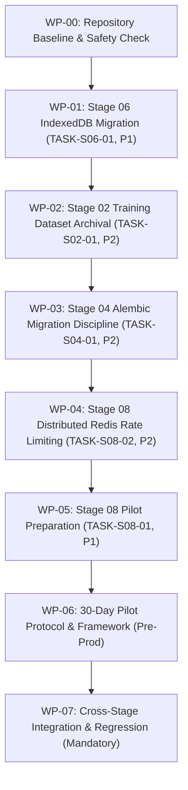

# ACREVIA — MASTER REMEDIATION PLAN (STAGES 02–10)
## ARCHITECTURAL WORK BREAKDOWN, REMEDIATION PHASING & ACCEPTANCE GATES
**Document:** `01_MASTER_REMEDIATION_PLAN.md`  
**Execution Sequence:** WP-00 through WP-07  
**Target Completion Standard:** Evidence-Backed Verification  
**Author:** Principal Software Architect & Engineering Lead  

---

## 1. REMEDIATION WORK BREAKDOWN STRUCTURE

---

## 2. WORK PACKAGE SPECIFICATIONS & ACCEPTANCE CRITERIA

### WP-01: Stage 06 IndexedDB Offline-First Storage Migration (`TASK-S06-01`, P1)
- **Goal:** Replace browser `localStorage` queue with a versioned IndexedDB persistence layer.
- **Components to Implement/Update:**
  - `frontend/lib/offline/db.ts`: Versioned IndexedDB schema (`offline_records`, `offline_attachments`, `sync_queue`, `sync_metadata`, `conflict_records`).
  - `frontend/lib/offline/queue.ts`: Queue state machine (`DRAFT`, `QUEUED`, `SYNCING`, `SYNCED`, `RETRY_PENDING`, `CONFLICT`, `FAILED`).
  - `frontend/lib/offline/migration.ts`: Idempotent migration from legacy `localStorage` into IndexedDB with data integrity validation.
  - Attachment persistence: Binary Blob storage with SHA-256 checksums, MIME validation, and quota-exceeded guards.
  - UI Indicators: Vernacular sync status component (`Saved on this device` vs `Successfully synchronized to ACREVIA`) in EN, TE, HI.
  - Unit & Integration Tests: In `frontend/tests/indexeddb_queue.test.js`.

### WP-02: Stage 02 Training Dataset Archival (`TASK-S02-01`, P2)
- **Goal:** Comprehensive inventory, private object-storage adapter, cryptographic manifests, and automated synchronization tool for the 28-class leaf image corpus.
- **Components to Implement/Update:**
  - `scripts/sync_training_corpus.py`: Production-grade CLI with dry-run, MD5/SHA-256 verification, chunked transfer, and manifest comparison.
  - `ml/data/archival_manager.py`: Python module managing dataset manifests and versioned layouts (`datasets/acrevia/{dataset_id}/{version}/`).
  - Documentation in `docs/remediation/stage-02/`: Inventory, architecture, reproducibility reports.
  - Tests: `tests/ml/test_dataset_archival.py`.

### WP-03: Stage 04 Alembic Migration Discipline (`TASK-S04-01`, P2)
- **Goal:** Eliminate runtime `Base.metadata.create_all()` in production startup; establish autogenerated DDL migration baseline with reversible upgrades and downgrades.
- **Components to Implement/Update:**
  - `backend/app/main.py`: Remove startup `create_all()`; replace with schema version readiness probe.
  - `backend/alembic/versions/`: Generate granular autogenerated DDL baseline migration with explicit `op.create_table()` and operational downgrade instructions.
  - Migration test suite: `backend/tests/test_alembic_migrations.py` validating upgrade, downgrade, foreign keys, and indexes on test database.
  - Documentation & Runbook in `docs/remediation/stage-04/`.

### WP-04: Stage 08 Distributed Redis Rate Limiting (`TASK-S08-02`, P2)
- **Goal:** Distributed rate limiting across multiple backend replicas with Redis backend and in-memory fallback for local development.
- **Components to Implement/Update:**
  - `backend/app/core/rate_limiter.py`: Token bucket / sliding window limiter with Redis connection pooling (`aioredis` / `redis-py`).
  - Tenant & User scoping: Safe key derivation (`rl:{tenant_id}:{user_id}:{endpoint_group}`).
  - Endpoint policy matrix: Strict limits for auth, AI inference, and uploads; standard limits for general API queries.
  - Fail-safe behavior: Fail-closed on auth/inference if configured; fail-open with logging on standard queries.
  - Multi-instance simulated tests in `backend/tests/test_distributed_rate_limiter.py`.
  - Documentation in `docs/remediation/stage-08/`.

### WP-05: Stage 08 Preparation for 50-Farmer Telangana Pilot (`TASK-S08-01`, P1)
- **Goal:** Complete technical onboarding and operational readiness framework for Warangal & Nalgonda pilot.
- **Deliverables in `docs/pilot/telangana-50-farmer/`:**
  - Pilot protocol, farmer recruitment criteria, KVK collaboration proposal, roles/responsibilities.
  - Trilingual farmer information sheets (TE, EN, HI).
  - Trilingual plain-language consent forms (TE, EN, HI).
  - Data protection, field training manuals, supervisor checklists, incident escalation protocols.

### WP-06: Thirty-Day Telangana Field Pilot Protocol & Evaluation Framework
- **Goal:** Rigorous scientific evaluation methodology, 30-day operational calendar, metric dictionary, and safety governance.
- **Deliverables in `docs/pilot/telangana-50-farmer/`:**
  - `PILOT_EVALUATION_FRAMEWORK.md`
  - `METRIC_DICTIONARY.md`
  - `30_DAY_OPERATIONAL_CALENDAR.md`
  - `DATA_COLLECTION_PLAN.md`
  - `ANALYSIS_PLAN.md`
  - `SAFETY_GOVERNANCE.md`
  - `PILOT_FINAL_REPORT_TEMPLATE.md`

### WP-07: Cross-Stage Integration & Regression Verification
- **Goal:** Full monorepo regression execution, security regression checks, data integrity audits, and master report authoring.
- **Deliverables in `docs/remediation/final/`:**
  - `CROSS_STAGE_REGRESSION_REPORT.md`
  - `SECURITY_REGRESSION_REPORT.md`
  - `FINAL_TEST_AND_BUILD_REPORT.md`
  - `FINAL_PENDING_WORK_REGISTER.md`
  - `MASTER_REMEDIATION_COMPLETION_REPORT.md`
