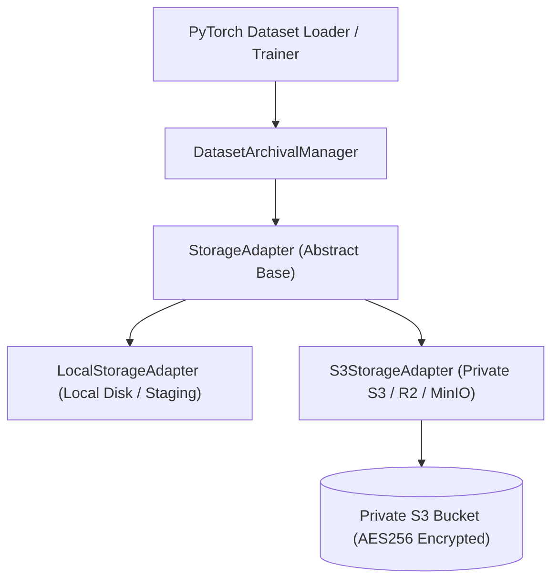

# ACREVIA — PRIVATE DATASET OBJECT STORAGE ARCHITECTURE
## HERMETIC ADAPTER DESIGN, SECURITY CONTROLS & ENVIRONMENT INTERACTION
**Document:** `OBJECT_STORAGE_ARCHITECTURE.md`  
**Classification:** Infrastructure Architecture  
**Date:** 2026-11-08  
**Component:** `ml/data/archival_manager.py`  
**Status:** `COMPLETE_VERIFIED`  

---

## 1. OBJECT STORAGE ABSTRACTION DESIGN

ACREVIA abstracts private dataset object storage through a decoupled interface (`StorageAdapter`), allowing transparent switching between local file-based staging, air-gapped test environments, and cloud S3-compatible private buckets without altering dataset ingestion or model training pipelines.

---

## 2. SECURITY CONTROLS & ENVIRONMENT GOVERNANCE

1. **Strictly Private Access:** Public bucket ACLs are strictly prohibited. All dataset blobs require signed S3v4 authorization or internal VPC IAM service credentials.
2. **Server-Side Encryption:** All uploaded objects enforce `ServerSideEncryption="AES256"` headers on S3-compatible endpoints.
3. **Path Traversal Protection:** All storage keys are sanitized to prevent directory traversal attacks:
   - Any key containing `..`, `\`, or resolving outside the designated dataset prefix raises a blocking `ValueError`.
4. **Environment Secrets Hygiene:**
   - AWS credentials (`AWS_ACCESS_KEY_ID`, `AWS_SECRET_ACCESS_KEY`) are read strictly from OS environment variables.
   - Zero credentials exist in Python code or committed manifests.
5. **Read-Only Invariant for Training Pipelines:** The training code is granted read-only access (`s3:GetObject`, `s3:ListBucket`) to prevent accidental deletion or modification of historical training datasets.
