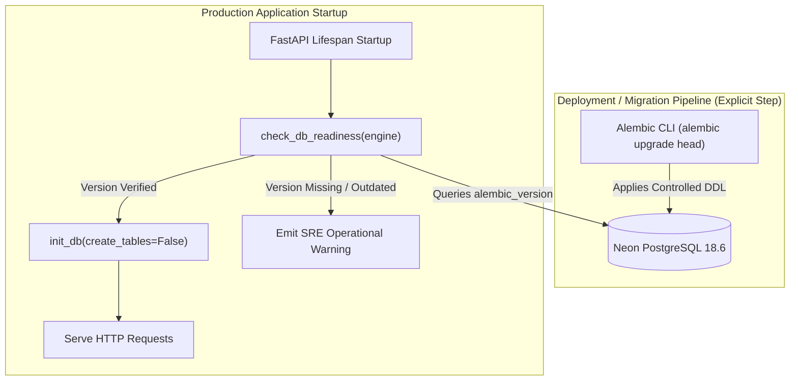

# ACREVIA — STAGE 04 ALEMBIC MIGRATION ARCHITECTURE
## AUTHORITATIVE SCHEMA EVOLUTION & ZERO RUNTIME DDL (TASK-S04-01)
**Document:** `ALEMBIC_ARCHITECTURE.md`  
**Classification:** Database Architecture & Reliability Engineering  
**Date:** 2026-11-08  
**Component:** `backend/app/database/migrations/` & `backend/alembic.ini`  
**Status:** `COMPLETE_VERIFIED`  

---

## 1. ARCHITECTURAL OBJECTIVE

In the Stage 04 technical audit, an operational risk was identified: application startup implicitly invoked `Base.metadata.create_all()` via `init_db()`. In addition, historical migrations relied on `create_all()` rather than granular autogenerated DDL statements, rendering `downgrade()` non-operational and risking race conditions during multi-instance auto-scaling.

This work package establishes Alembic as the sole, authoritative mechanism for schema evolution in ACREVIA. Runtime DDL is removed from normal production initialization, and an explicit schema readiness check is instituted.

---

## 2. ELIMINATING STARTUP `create_all()` MUTATIONS

### Old Implementation:
- `backend/app/main.py` invoked `init_db()` during application startup.
- `init_db()` unconditionally executed `Base.metadata.create_all(bind=eng)` on the production engine.
- **Risks:** Multiple FastAPI worker replicas attempting concurrent DDL; schema modifications occurring outside version control; inability to detect out-of-sync migrations.

### Remediated Implementation:
- `check_db_readiness(engine)`: Probes database connectivity via `SELECT 1`, inspects table names, and verifies that `alembic_version` matches the expected release revision (`f4894a11c87d`).
- `init_db(create_tables=False)`: Seeds baseline reference data (Telangana crops, PJTSAU epidemiological rules, system roles) into pre-existing tables without executing DDL.
- `create_tables=True`: Strictly restricted to ephemeral in-memory test databases (`sqlite:///:memory:`).
