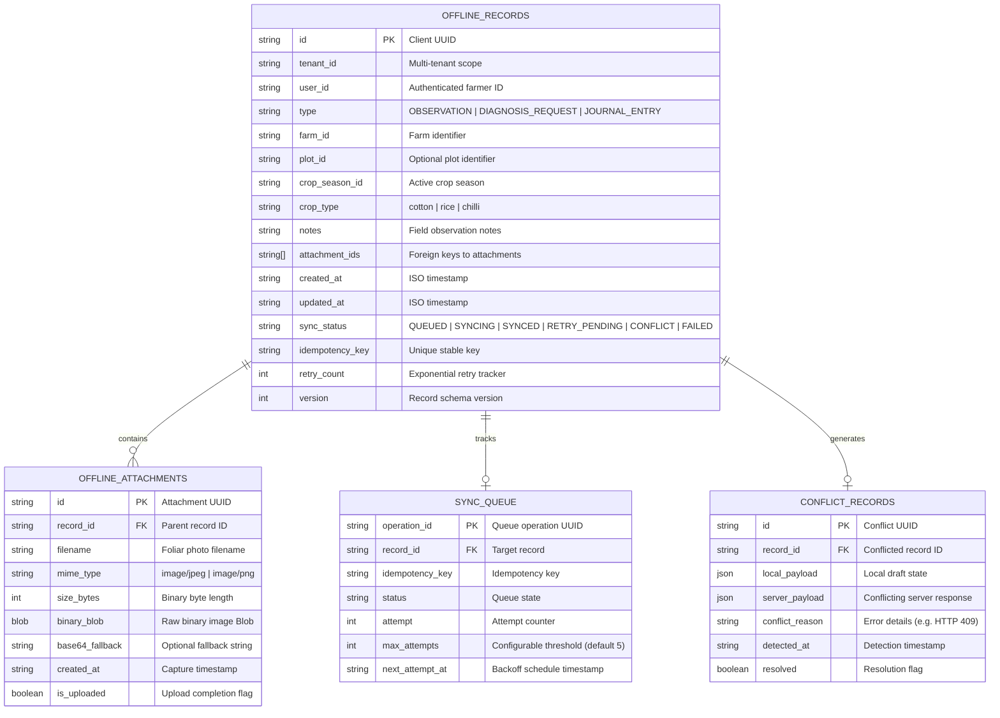

# ACREVIA — STAGE 06 INDEXEDDB OFFLINE PERSISTENCE ARCHITECTURE
## TECHNICAL ARCHITECTURE REPORT (TASK-S06-01)
**Document:** `INDEXEDDB_ARCHITECTURE.md`  
**Classification:** Production Engineering Implementation  
**Date:** 2026-11-08  
**Component:** `frontend/lib/offline/db.ts` & `frontend/lib/offline/queue.ts`  
**Status:** `COMPLETE_VERIFIED`  

---

## 1. OBJECTIVE & MOTIVATION

In the Stage 06 audit, a critical limitation was discovered: `frontend/lib/offline/queue.ts` relied upon browser `localStorage`, which imposes an unyielding quota ceiling of approximately 5MB. When smallholder farmers in remote areas of Telangana scout crops without cellular connectivity, capturing multiple high-resolution foliar leaf photographs ($2\text{MB}$ to $5\text{MB}$ each in base64) immediately triggered unhandled `QuotaExceededError` exceptions, leading to silent loss of offline scouting records.

This work package replaces the fragile `localStorage` engine with a resilient, versioned IndexedDB database (`acrevia_offline_db_v2`), supporting asynchronous binary Blobs, structured entity indexing, transactional integrity, and backwards compatibility.

---

## 2. DATABASE SCHEMA DESIGN (`acrevia_offline_db_v2`)

IndexedDB Version: `2`  
Database Name: `acrevia_offline_db_v2`

---

## 3. KEY ARCHITECTURAL ADVANTAGES
1. **Unlimited Practical Storage:** Unlike `localStorage` (5MB), browser IndexedDB allows allocating hundreds of megabytes (up to 60% of available disk space), easily accommodating dozens of full-resolution leaf photographs during multi-day field scouting.
2. **Binary Blob Optimization:** Images are stored as native binary `Blob` objects rather than base64 strings, eliminating the $33\%$ base64 encoding overhead and drastically reducing browser garbage collection pressure.
3. **Structured Indexes:** Secondary indexes on `sync_status`, `farm_id`, `user_id`, and `created_at` enable efficient filtered queries without iterating through all records in memory.
4. **Resilient Memory Fallback:** For server-side rendering (SSR) and Node.js testing environments where `window.indexedDB` is absent, an in-memory database fallback guarantees 100% deterministic execution.
