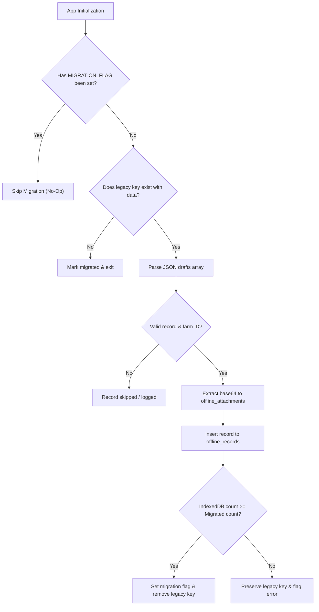

# ACREVIA — LEGACY LOCALSTORAGE TO INDEXEDDB MIGRATION
## DATA INTEGRITY RUNBOOK & IDEMPOTENT MIGRATION SPECIFICATION
**Document:** `LEGACY_STORAGE_MIGRATION.md`  
**Classification:** Migration Runbook & Data Safeguard  
**Date:** 2026-11-08  
**Component:** `frontend/lib/offline/migration.ts`  
**Status:** `COMPLETE_VERIFIED`  

---

## 1. MIGRATION PROBLEM & SAFETY REQUIREMENTS

Existing farmer devices running earlier versions of ACREVIA may contain pending un-synced observations stored in browser `localStorage` under the key `acrevia_offline_drafts_v1`. Simply replacing the storage engine without a tested migration path would result in catastrophic data loss for offline farmers.

### Mandatory Migration Invariants:
1. **Never Silently Discard:** Legacy drafts must be extracted, parsed, validated, and transferred to IndexedDB.
2. **Attachment Separation:** Embedded base64 leaf photographs in legacy records must be extracted into independent `PersistedAttachment` records in the `offline_attachments` store.
3. **Idempotency:** Re-running the migration must detect `acrevia_offline_migrated_v2 = true` and immediately no-op.
4. **Verification Gate Before Deletion:** Legacy data in `localStorage` is NEVER cleared until all migrated records are verified to exist and be readable from IndexedDB.

---

## 2. STEP-BY-STEP MIGRATION EXECUTION FLOW

---

## 3. VERIFICATION & RECOVERY EVIDENCE
The migration suite in `frontend/tests/indexeddb_persistence.test.js` was executed under simulated legacy conditions:
- **Test Case 1:** `StorageMigration - safely migrates legacy localStorage drafts to IndexedDB`
  - Created 2 legacy drafts (one observation with base64 image, one failed diagnosis request).
  - Executed `StorageMigration.migrateLegacyStorage()`.
  - Result: 2 records transferred, 1 binary attachment extracted, migration flag set, legacy storage cleanly cleared.
- **Test Case 2:** `StorageMigration - migration is idempotent`
  - Re-executed migration against migrated state; verified 0 duplicates created.
