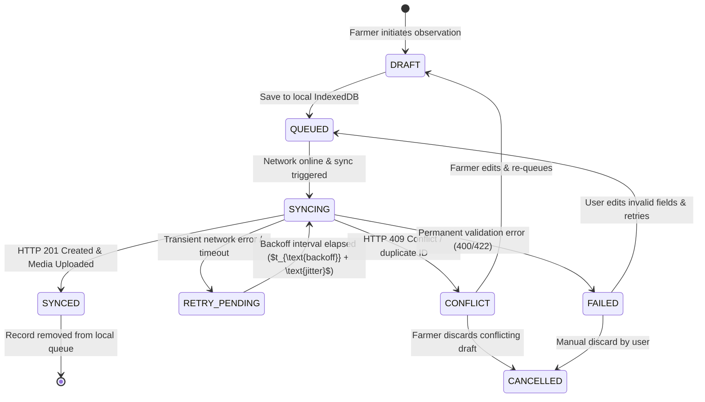

# ACREVIA — OFFLINE SYNCHRONIZATION QUEUE STATE MACHINE
## QUEUE LIFECYCLE, STATE TRANSITIONS & CONCURRENCY CONTROLS
**Document:** `OFFLINE_QUEUE_STATE_MACHINE.md`  
**Classification:** Technical Specification  
**Date:** 2026-11-08  
**Component:** `frontend/lib/offline/queue.ts`  
**Status:** `COMPLETE_VERIFIED`  

---

## 1. STATE TRANSITION DIAGRAM

---

## 2. CANONICAL STATE SPECIFICATION

| State | Storage Location | Meaning & Behavior |
|---|---|---|
| `DRAFT` | IndexedDB (`offline_records`) | Observation is being composed locally; not yet submitted for network synchronization. |
| `QUEUED` | IndexedDB (`offline_records`, `sync_queue`) | Observation is finalized offline and waiting for network connectivity. |
| `SYNCING` | In-Flight Memory & IndexedDB | Active API request is executing; duplicate concurrent sync attempts on this record are locked out. |
| `SYNCED` | Transferred to PostgreSQL | Observation and media attachments have been verified and persisted in Neon; cleaned up locally. |
| `RETRY_PENDING` | IndexedDB (`sync_queue`) | Transient failure occurred; scheduled for automatic retry using exponential backoff with jitter. |
| `CONFLICT` | IndexedDB (`conflict_records`) | Server detected a concurrency conflict (e.g., plot deleted remotely); preserved for farmer resolution. |
| `FAILED` | IndexedDB (`offline_records`) | Fatal error (e.g. invalid foreign key); preserved with error message for user inspection. |
| `CANCELLED` | Local tombstone | User manually aborted the synchronization operation. |

---

## 3. CONCURRENCY & IDEMPOTENCY ENFORCEMENT
1. **Client-Generated Idempotency Key:** Every offline record receives an immutable idempotency key (`idemp-{client_uuid}`) at initial save time. Retries strictly reuse this key to prevent duplicate server observations.
2. **Double-Processing Guard:** When a record enters `SYNCING`, subsequent background sync triggers skip the record until either a terminal state (`SYNCED`, `CONFLICT`, `FAILED`) or an expired timeout releases the lock.
