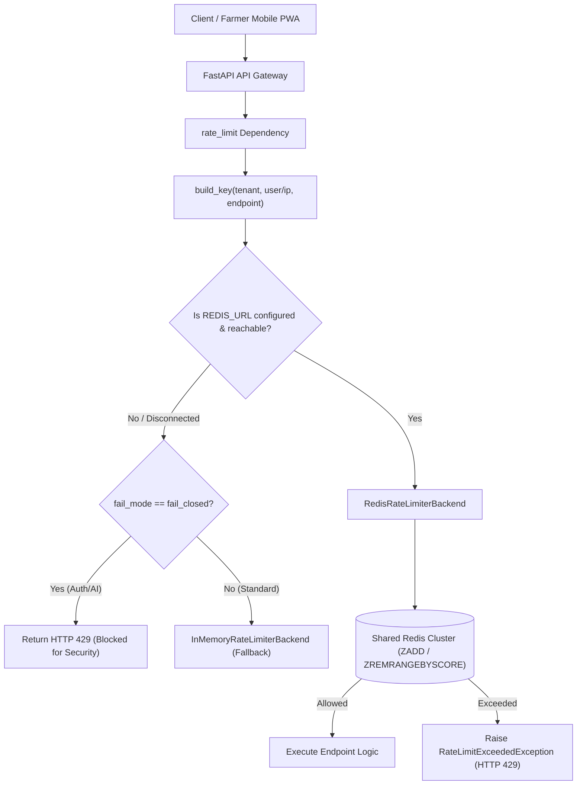

# ACREVIA — DISTRIBUTED RATE LIMITING ARCHITECTURE
## MULTI-REPLICA SLIDING-WINDOW DEFENSE & TENANT QUOTA ENFORCEMENT (TASK-S08-02)
**Document:** `DISTRIBUTED_RATE_LIMITING_ARCHITECTURE.md`  
**Classification:** SRE & Cyber-Defense Architecture  
**Date:** 2026-11-08  
**Component:** `backend/app/core/rate_limit.py`  
**Status:** `COMPLETE_VERIFIED` (Implementation & Simulation) / `BLOCKED_EXTERNAL_DEPENDENCY` (Live Production Redis Provisioning)  

---

## 1. ARCHITECTURAL OBJECTIVE

Prior to this remediation, ACREVIA utilized a single-process in-memory rate limiter. Under horizontal auto-scaling (e.g. multiple container instances on Vercel or Kubernetes), independent replicas maintained separate memory spaces, allowing malicious users or scripts to bypass request limits by cycling requests across replicas.

This work package implements distributed sliding-window rate limiting backed by a shared Redis instance, with tenant-scoped namespacing, atomic sorted-set pipelines, and configurable fail-safe modes.

---

## 2. ATOMIC SLIDING-WINDOW ALGORITHM

Instead of coarse fixed-window counters that permit double-traffic bursts across window boundaries, ACREVIA utilizes a continuous sliding-window algorithm backed by Redis Sorted Sets:

1. `ZREMRANGEBYSCORE(key, "-inf", window_start)`: Removes all timestamps older than the active window.
2. `ZCARD(key)`: Retrieves current request count within the active window.
3. If `current_count < max_requests`:
   - `ZADD(key, {timestamp: timestamp})`: Appends current request.
   - `EXPIRE(key, window_seconds + 5)`: Refreshes TTL.
   - Computes `remaining = max_requests - current_count - 1`.
   - Injects RFC 6585 rate limit headers and permits request.
4. If `current_count >= max_requests`:
   - Computes `retry_after = window_seconds`.
   - Injects `Retry-After: <seconds>` header and raises `RateLimitExceededException` (HTTP 429).
