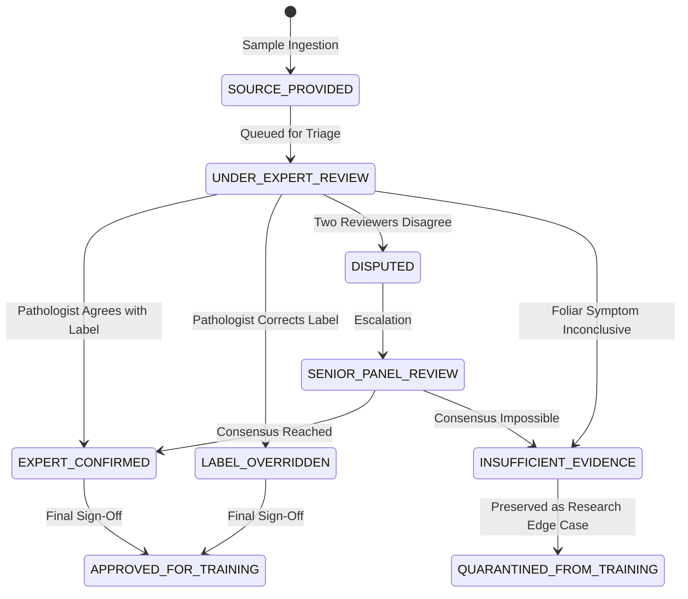

# KISANVISION — ANNOTATION AND EXPERT REVIEW PROTOCOL

**Document Version:** 1.0.0  
**Effective Date:** November 7, 2026  
**Author:** Agricultural AI Research Engineer, Dataset Quality Specialist  
**Standards:** Double-Blind Expert Annotation & Multi-Tier Provenance Traceability  

---

## 1. Five Distinct Semantic Tiers of Label Attribution

To prevent circular bias and maintain strict scientific integrity, KisanVision strictly decouples five different label tiers:

```
[ Tier 1: Farmer-Reported Observation ]
Raw informal perception provided by farmer (e.g. "leaves turning red and dropping").

[ Tier 2: Source Dataset Label ]
Verbatim label from external open-source collection (e.g. "Pepper__bell___Bacterial_spot").

[ Tier 3: AI Model Prediction ]
Statistical probability distribution emitted by neural network (e.g. "CHILLI_CERCOSPORA_SPOT: 0.81").

[ Tier 4: Certified Expert Review Assessment ]
Independent diagnosis authored by accredited university agronomist with physical evidence notes.

[ Tier 5: Final Approved Training Label ]
Canonical ground truth admitted into the training benchmark after validation and consensus gates.
```

*Strict Research Rule:* An AI prediction (Tier 3) or farmer observation (Tier 1) can NEVER be promoted to an approved training label (Tier 5) without passing through the certified Expert Review gate (Tier 4).

---

## 2. Review States & Dispute Resolution Workflow



---

## 3. Expert Review Audit Template Fields
Every review record captures:
- `review_id`: Unique UUID.
- `sample_id`: Foreign key to `UnifiedSampleManifest`.
- `expert_id_hash`: Anonymized cryptographic hash of reviewer identity (e.g., `exp_pjtsau_7f9a`).
- `candidate_class`: Proposed taxonomy class.
- `confirmed_class`: Final verified taxonomy class.
- `diagnostic_certainty`: `CERTAIN`, `PROBABLE`, `INCONCLUSIVE`.
- `evidence_notes`: Botanical description (lesion margins, sporulation, frass presence).
- `microscope_verified`: Boolean (whether lab culture or microscopy was used).
- `timestamp`: ISO-8601 review time.
