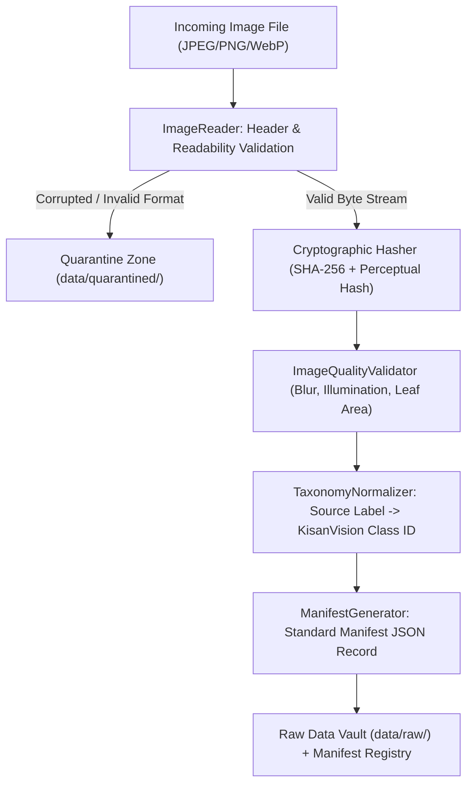

# KISANVISION — DATASET INGESTION PROTOCOL

**Document Version:** 1.0.0  
**Effective Date:** November 7, 2026  
**Auditor / Author:** Data Engineering Architect, ML Research Engineer  

---

## 1. End-to-End Ingestion Workflow

---

## 2. Manifest Schema Specifications

Every ingested sample is tracked by an immutable manifest record adhering to `UnifiedSampleManifest`:

| Manifest Field | Type | Description | Mandatory? | Privacy Rule |
| :--- | :--- | :--- | :---: | :--- |
| `sample_id` | `UUIDv4` | Unique deterministic sample identifier | Yes | Publicly safe |
| `dataset_id` | `str` | Identifier of the originating dataset (e.g., `ds_plantvillage_v1`) | Yes | Publicly safe |
| `source_name` | `str` | Entity or provider of the image | Yes | Publicly safe |
| `source_url` | `str` | Verified URL or internal storage URI | Yes | Publicly safe |
| `license_identifier` | `str` | SPDX license identifier (e.g., `CC-BY-4.0`, `MIT`, `Proprietary`) | Yes | Publicly safe |
| `image_path` | `str` | Relative path to the stored immutable raw file | Yes | System path |
| `original_filename` | `str` | Source filename at time of upload | Yes | System path |
| `image_hash` | `str` | SHA-256 cryptographic digest of the raw image bytes | Yes | Publicly safe |
| `crop` | `str` | Target crop identifier (`cotton`, `rice`, `chilli`) | Yes | Agronomic |
| `variety` | `str` | Commercial or hybrid variety name if recorded | No | Agronomic |
| `original_label` | `str` | Verbatim class name provided by the source dataset | Yes | Preserved for audit |
| `normalized_label` | `str` | Canonical KisanVision taxonomy class ID | Yes | Verified ID |
| `taxonomy_version` | `str` | Version of the taxonomy used for mapping (`1.0.0`) | Yes | Audit trace |
| `annotation_status` | `str` | State: `SOURCE_PROVIDED`, `EXPERT_CONFIRMED`, `DISPUTED`, `UNKNOWN` | Yes | Audit trace |
| `image_quality_status` | `str` | State: `ACCEPTED`, `ACCEPTED_WITH_LIMITATIONS`, `RETAKE_OR_REVIEW`, `QUARANTINED` | Yes | Quality metric |
| `collection_context` | `str` | Environment: `CONTROLLED_LAB`, `SHADE_HOUSE`, `OPEN_FIELD` | Yes | Domain shift key |
| `capture_date` | `str` | ISO 8601 timestamp of photo capture | No | Temporal feature |
| `plant_id` | `str` | Unique plant identifier if photographed multiple times | No | Leakage prevention |
| `farm_group_id` | `str` | Anonymous grouping key (Mandal ID + Farm ID) | Yes | Prevents farm leakage |
| `consent_status` | `str` | State: `RESEARCH_CONSENT_GRANTED`, `DIAGNOSTIC_ONLY`, `PUBLIC_OPEN_ACCESS` | Yes | Legal compliance |
| `dataset_version` | `str` | KisanVision dataset release identifier (`v0.1.0-alpha`) | Yes | Provenance |

---

## 3. Error Handling & Ingestion Rules
1. **Never Silently Discard:** Any unreadable, corrupt, or unsupported file is moved to `data/quarantined/` accompanied by a JSON reason log (`<hash>.error.json`).
2. **Preserve Source Labels:** Even when a source dataset provides an inaccurate or merged label (e.g. `Pepper__bell___Bacterial_spot`), the original string is preserved in `original_label` alongside the mapped `normalized_label`.
3. **Handle Missing Metadata:** When `variety`, `capture_date`, or `plant_id` are absent in public datasets, they are explicitly recorded as `None` rather than causing validation failure.
