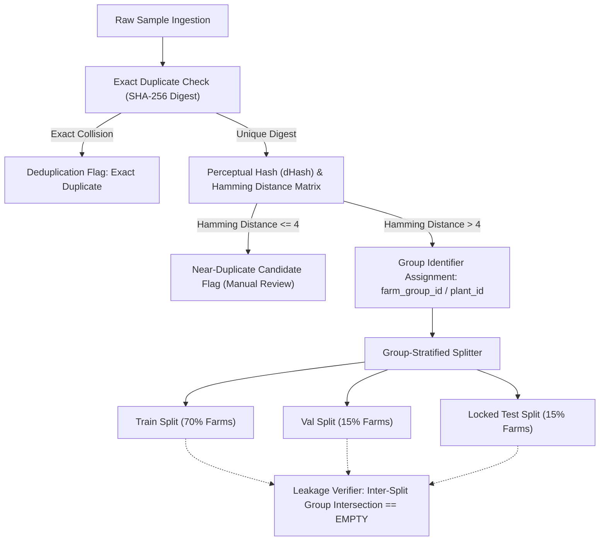

# KISANVISION — DATA LEAKAGE AND DUPLICATE PREVENTION METHODOLOGY

**Document Version:** 1.0.0  
**Effective Date:** November 7, 2026  
**Author:** Principal Machine Learning Engineer, Dataset Quality and Governance Specialist  

---

## 1. The Critical Threat of Group Leakage in Agricultural Computer Vision

In agricultural machine learning literature, numerous published papers boast unrealistic accuracy ($>98\%$) on crop disease identification. Upon scientific audit, the overwhelming majority of these results suffer from **Group Data Leakage**:
1. **Multi-Angle Foliar Leakage:** A field worker photographs the same diseased cotton leaf 5 times from slightly different angles or under shifting shadows.
2. **Random Image Splitting:** When randomized image-level splitting (`train_test_split`) is applied, 3 photos of that identical leaf land in the training set and 2 land in the test set.
3. **Background Memorization:** The neural network memorizes background soil texture, specific tractor paint, weed arrangements, or farmer fingers rather than learning the biological lesion pathology.
4. **Catastrophic Generalization Collapse:** When deployed on a new farm in Telangana, the model's empirical accuracy plunges to $<45\%$.

---

## 2. KisanVision Leakage Prevention Architecture

---

## 3. Deduplication Algorithm Specifications

### 3.1 Exact Cryptographic Deduplication
- Every byte stream is hashed using **SHA-256**.
- If `hash_A == hash_B`, the second sample is marked `EXACT_DUPLICATE` and quarantined from training splits.

### 3.2 Perceptual Hash Screening (dHash)
- Difference Hash (**dHash**, 64-bit hex string) captures structural gradient directions.
- Hamming distance $D_H(\text{hash}_1, \text{hash}_2)$ counts the number of differing bits:
  $$D_H \le 4 \implies \text{High Probability Near-Duplicate (Burst capture / slight pan)}$$
  $$5 \le D_H \le 10 \implies \text{Possible Same Plant / Different Lighting}$$
  $$D_H > 10 \implies \text{Distinct Scene / Unique Sample}$$
- Near-duplicates are flagged for agronomist review; by default, only one representative sample per burst is admitted into the training split.

---

## 4. Group-Stratified Splitting Protocol

1. **Partitioning Key:** The dataset is partitioned strictly by **`farm_group_id`** (or `plant_id` when farm group is unrecorded).
2. **Mathematical Invariant:**
   $$\text{Farms}_{\text{Train}} \cap \text{Farms}_{\text{Val}} = \emptyset$$
   $$\text{Farms}_{\text{Train}} \cap \text{Farms}_{\text{Test}} = \emptyset$$
   $$\text{Farms}_{\text{Val}} \cap \text{Farms}_{\text{Test}} = \emptyset$$
3. **No Retuning on Locked Test Set:** The test set is evaluated only after model training and hyperparameter selection are frozen. Iterative tweaking of test sets is strictly prohibited.
